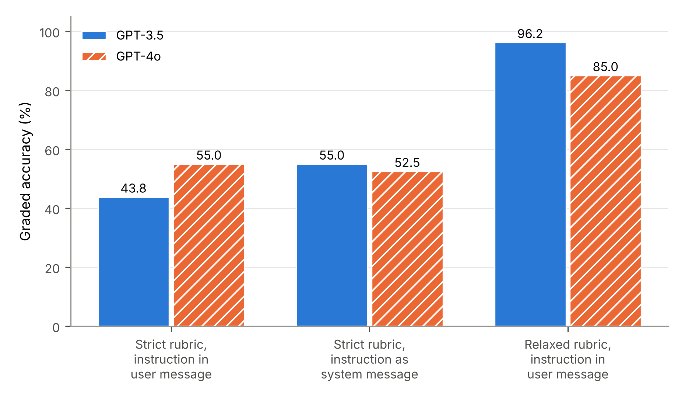

**Abstract.** Teams increasingly score coding assistants by letting one large language model (LLM) grade another's answers. We tried to use such scores for a concrete purpose: to test whether Stack Overflow lost the most questions in the topics where LLMs answer best. Across 50 tags and four models, measured accuracy moved by up to 52 percentage points with the grading rubric and by 11 points with the prompt format alone, enough to reverse the ranking of models. Accuracy levels per tag were moderately stable, but the change in accuracy between two models was not stable at all. Once placebo windows and tag-specific trends were included, no dose-response relation between tag-level accuracy and the loss of questions survived. We distill seven practices for anyone who uses LLM-graded accuracy to make decisions.

**Keywords:** large language models, LLM-as-a-judge, evaluation, Stack Overflow, measurement validity, empirical software engineering

---

## The Question Everyone Is Asking

For more than a decade, Stack Overflow was where developers asked programming questions in public. That era is ending. Across the platform's 30 most popular tags, new questions in 2025 were on average 92.6% below their level of January to November 2022. Careful studies attribute a large part of this drop to ChatGPT: Xue et al. estimate a 14% fall in questions shortly after its release, growing to 28% within six months [1], and del Rio-Chanona et al. find a decline of about 25% relative to Q&A sites where ChatGPT was less available [2].

A natural next step is to ask *where* the decline is strongest, and why. If developers stopped asking because AI answers their questions well, topics in which LLMs perform well should have lost the most questions. Existing studies test this with indirect proxies, such as the popularity of a language on GitHub [2] or a one-time classification of topics into those on which ChatGPT does well or badly [3]. A more direct test would measure how well LLMs answer questions in each tag, follow how that capability changes with each new model release, and check whether the tags that gained the most lost the most questions. Epidemiologists would call this treating capability as an *exposure*, with a dose that varies across topics and over time.

The design looks attractive. It rests on one component, however, that has received little scrutiny: a tag-level accuracy measure reliable enough to serve as the exposure. In practice, LLM answers are graded by another LLM against the accepted answer, using a prompt the researcher writes. This is the same "LLM-as-a-judge" setup [6] that many engineering teams now use to compare coding assistants, to pick a model for an internal tool or to track regressions after a vendor update.

We therefore built the measure and stress-tested it before trusting it. This article reports what we found. The headline is uncomfortable but useful: **the numbers mostly measured our protocol, not the models.** That lesson reaches well beyond Stack Overflow.

## What We Measured

We took the 50 most popular Stack Overflow tags and sampled 40 questions per tag, all created between January 2019 and November 2022 so that they predate ChatGPT. Each question had an accepted answer and a score between 3 and 20. (A first pilot that used only the highest-voted questions gave GPT-3.5 94% accuracy and left no room to see differences.)

We asked GPT-3.5, GPT-4, GPT-4o and Llama 3.1 8B to answer each question at temperature 0. We varied two things that are often treated as incidental:

- **Prompt format.** The instruction "You are an expert programmer answering a Stack Overflow question" was given as a system message (F1), placed at the top of the user message (F2) or omitted (F3).
- **Grading rubric.** A *strict* rubric showed the judge (gpt-4.1-mini) the question, the accepted answer and the key part of the candidate answer, and asked whether it was consistent with the accepted solution. A *relaxed* rubric showed the judge (gpt-4.1) the full candidate answer, stated that the accepted answer was only one valid solution, and asked whether the candidate would solve the asker's problem.

As an independent check, we built execution-based tests for questions tagged python or pandas, keeping only tests that the reference solution passed and an empty answer failed. To relate accuracy to activity, we counted new questions per tag per week from the Stack Exchange data dump and API [13], from 2019 to late 2024. All prompts, outputs, grades, counts and scripts are in a replication package [12].

## Finding 1: The Protocol Can Reverse the Ranking

Figure 1 shows the same 80 questions graded three ways. Under the strict rubric with the instruction in the user message, GPT-4o beat GPT-3.5 by 11 points (55.0% vs. 43.8%). Moving the instruction to the system message raised GPT-3.5 to 55.0% and erased the gap. Under the relaxed rubric, GPT-3.5 reached 96.2% and *beat* GPT-4o (85.0%) and GPT-4 (86.7%).

The relaxed judge accepted almost every GPT-3.5 answer. GPT-3.5 also wrote the longest answers (3,284 characters on average, against 2,339 for GPT-4o), and we suspect the judge was lenient toward long, confident text, although we did not test this directly. The execution-based tests were too few to settle the ranking, but they did not show the newest models leading either: on 31 validated tests, GPT-3.5 and GPT-4o each passed 15, GPT-4 passed 11 and Llama 3.1 8B passed 7. Even with temperature 0 and identical prompts, two complete runs agreed on only 84% (GPT-3.5) and 89% (GPT-4o) of the verdicts, from variation in generation, in judging or both.

The practical point: a single number such as "Model A answers 85% of our questions correctly" is a property of the model, the prompt, the judge and the rubric together. Change any of them and the number can move more than the gap between the models you want to compare.

## Finding 2: Levels Are Usable, Changes Are Not

Is anything stable? We looked at the 30 tags with enough questions answered under all three prompt formats (1,185 questions). The ordering of tags was fairly consistent: Pearson correlations of tag accuracy across formats were 0.67 to 0.73 for GPT-3.5 and 0.73 to 0.77 for Llama 3.1 8B. Those correlations use the same questions, so they include shared question difficulty. A stricter test, split-half reliability, assigns different questions to two halves and asks whether the tag means agree. It was 0.48 to 0.66 for GPT-3.5 but only 0.11 to 0.41 for Llama 3.1 8B. With 40 questions per tag, a moderate share of the stronger model's tag-level accuracy, and a small share of the weaker model's, is a property of the tag rather than of the sampled questions.

For a dose-response design, however, the interesting quantity is not the level but the *change*: how much a new model improved in each tag. Table 1 shows that this quantity did not survive a change of prompt. On 399 questions in 19 tags, GPT-4o was 7.7 points worse than GPT-3.5 under F1 and 1.4 points better under F2, and the per-tag differences under the two formats were uncorrelated (Pearson −0.03). For GPT-4 against GPT-3.5, the between-tag variance of the difference (0.0137) was smaller than the variance expected from sampling noise alone (0.0252).

**Table 1. Per-tag improvement from GPT-3.5 to GPT-4o under two prompt formats (19 tags, 399 questions).**

| Prompt format | Mean difference | Correlation of per-tag differences across formats |
|---|---|---|
| F1: instruction as system message | −7.7 pp | — |
| F2: instruction in user message | +1.4 pp | Pearson −0.03, Spearman −0.14 |

This is a general statistical fact that is easy to forget: the difference of two noisy measurements carries roughly twice the noise of either. If you compare two model versions per category (per language, per team, per service), the per-category deltas can be pure noise even when each model's overall score looks sensible.

## Finding 3: No Robust Dose-Response

We still ran the dose-response analysis, because a null result with a well-documented measure is informative. For each of eight model releases from ChatGPT (November 2022) to o1-preview (September 2024) and for each tag, we compared weekly new questions in the seven weeks before and after the release, subtracted the same calendar change in the three preceding years, and controlled for each tag's recent trend. We then asked whether tags with higher measured accuracy lost more questions.

A key safeguard was a **placebo**: the same regression with every window moved back one year, when no release happened. If the real coefficient is no larger than the placebo, the "effect" is picking up something about the tags, not the release.

Table 2 summarizes the results. Only one of 16 release-exposure combinations, GPT-4 with GPT-3.5 accuracy as exposure, reached |t| > 2 (t = −2.23), with a clean placebo. It did not replicate with Llama 3.1 8B accuracy as exposure, and with 16 tests one such result is expected by chance. Two placebos, by contrast, exceeded |t| = 2 on their own.

**Table 2. Dose-response around eight model releases (30 tags). Coefficient per +1 SD of tag accuracy, t statistic in parentheses; placebo shifts all windows back one year.**

| Release | GPT-3.5 exposure | Placebo t | Llama 3.1 8B exposure | Placebo t |
|---|---|---|---|---|
| ChatGPT (Nov 2022) | −0.018 (−1.04) | −0.11 | −0.006 (−0.50) | −0.62 |
| GPT-4 (Mar 2023) | −0.028 (−2.23) | −0.27 | −0.005 (−0.31) | −3.49 |
| Claude 2 (Jul 2023) | −0.005 (−0.28) | −0.90 | +0.009 (0.80) | −1.45 |
| GPT-4 Turbo (Nov 2023) | −0.021 (−0.83) | −1.01 | −0.014 (−0.63) | −0.45 |
| Claude 3 (Mar 2024) | +0.005 (0.41) | −1.04 | +0.017 (1.50) | +0.26 |
| GPT-4o (May 2024) | −0.036 (−1.75) | −2.47 | −0.028 (−1.26) | −2.14 |
| Claude 3.5 Sonnet (Jun 2024) | +0.012 (0.79) | −0.74 | +0.017 (1.00) | −0.02 |
| o1-preview (Sep 2024) | −0.012 (−0.70) | −1.90 | −0.016 (−0.80) | −1.21 |

The specification mattered as much as the measurement. An earlier version that used a single prompt format and weaker trend controls produced |t| > 2 for three releases (GPT-4, Claude 2 and GPT-4o). It would have made a publishable story. Its placebo regressions, however, also exceeded |t| = 2 for five of eight releases. Without placebo windows we would have reported several spurious effects.

The structure of the decline helps explain why. The relative drop was large and remarkably uniform across tags (mean 92.6%, standard deviation 3.6 points) and unrelated to tag popularity (r = 0.12) or to each tag's pre-ChatGPT trend (r = 0.04). Where everything falls by about the same proportion, a cross-tag exposure has little variation to explain.

We also asked a related question about the feedback loop between public Q&A and model training. If fewer human answers are written, do models trained after the decline know less about recent material [7], [8]? Models with 2024 knowledge cutoffs did score 10 to 13 points lower on 2024 questions than on 2022 questions. But GPT-3.5, whose cutoff predates both periods, showed a similar 9.5-point gap on the same questions. Recent questions are simply harder for every model, and the excess gap for post-decline models (−2.7 to +3.3 points, standard errors of about 5) was indistinguishable from zero. Vendor-stated cutoffs added their own uncertainty [9]: the stated cutoff for GPT-4 postdates its release, so we could not use it.

## What This Means for Practitioners

Our null results do not show that capability is irrelevant to the decline. Windows of seven weeks are short, samples of 40 questions per tag are small, and effects smaller than our designs can detect are plausible. They also do not contradict earlier work [1]–[5], which used exposures that do not change between releases. What turned out to be fragile is the specific thing we added: a *measured* capability that changes from one release to the next.

That fragility matters to anyone who uses LLM-graded scores to decide something: which assistant to license, whether a vendor update regressed, which teams or languages benefit from a tool. The "Seven Practices" sidebar summarizes what we would do differently from the start. Three points deserve emphasis.

**Treat the protocol as part of the measurement.** The judge, the rubric, the prompt format and the output-length limit are not plumbing. In our first pilot, a 500-token output limit produced accuracies of 94% for GPT-3.5, 87% for GPT-4 and 74% for GPT-4o, the reverse of the expected order, probably because the newer models' longer answers were cut off. Fix the protocol before looking at outcomes and report it in full.

**Distrust deltas more than levels.** Per-category improvements between two model versions double the noise. If a dashboard shows that version B improved Python answers by 6 points and Go answers by −2, check whether the pattern survives a second prompt format before acting on it.

**Use falsification checks routinely.** A placebo window, a second measure of the same construct, and an independent reference such as execution-based tests are cheap compared with acting on a spurious effect. Our weaker specification would have passed a casual review and failed every one of these checks.

A cleaner exposure for questions like ours may come from outside the models altogether: data on how much people actually use AI for each topic. We checked two public sources. The Anthropic Economic Index [10] reports usage by task and topic, but only a handful of topics name a specific technology, too few for a per-tag exposure. The Stack Overflow Developer Survey [11] asks which languages respondents use AI for; only 8 of the 30 most popular tags map to a language, and the correlation between language-level AI use and the decline in questions (−0.87 in 2024, −0.39 in 2026) is suggestive at best. Better usage data, broken down by topic, would serve both researchers and platform operators.

> ### Sidebar: Seven Practices for Using LLM-Graded Accuracy as a Variable
>
> 1. **Fix the prompt and the grading protocol before looking at outcomes**, and report the full text of both.
> 2. **Repeat the measurement under at least two prompt formats.** Report the level, the per-category correlation across formats and a split-half reliability; correlations on identical questions overstate reliability.
> 3. **Prefer levels to changes.** Differences between two models double the noise and, in our data, did not replicate across formats.
> 4. **Avoid rubrics that accept any plausible-looking answer**, and compare the model ranking against an independent reference such as execution-based tests.
> 5. **Use placebo windows** and compare the placebo coefficient with the real one.
> 6. **When comparing models on recent and older material, give all models the same questions** and include a model trained before the period of interest as a control.
> 7. **Do not sample only the highest-voted questions, and do not cap output length tightly.** Both compress differences and can reverse rankings.

## Limitations

Accuracy was defined relative to one accepted answer per question and judged by models from a single vendor family; other judges could rank models differently. Our only independent reference covered 31 Python and pandas questions. All questions predate ChatGPT and are probably in every model's training data, so accuracy mixes reasoning with memory. The dose-response estimates are cross-sectional comparisons of tags, and trends that correlate with accuracy can masquerade as effects; our controls reduced but did not remove this problem, and we did not adjust for multiple testing. We studied the 50 most popular tags of one platform, with English prompts and models available through one API gateway; results may differ for other platforms and later model generations.

## Conclusion

Using LLM accuracy as a topic-level exposure for Stack Overflow's decline looks attractive but is fragile in current practice. Measured accuracy moved by up to 52 points with the rubric and 11 points with the prompt format, changes in accuracy between models did not replicate across formats, and no dose-response relation survived placebo checks and a second exposure measure. The same fragility applies whenever an LLM grades another LLM and the result informs a decision. We release all data and code [12] so that others can test better protocols, and we hope the seven practices make the next study, or the next model-selection meeting, more robust than our first attempt.

## Acknowledgment

Language models were the objects of measurement and served as graders in this study. In addition, an AI assistant (Claude, Anthropic) was used to write and run the data collection and analysis code and to draft and revise the text of this article under the author's direction. The author reviewed the code, the results and the text, and takes full responsibility for the content.

## References

[1] J. Xue, L. Wang, J. Zheng, Y. Li, and Y. Tan, "Can ChatGPT kill user-generated Q&A platforms?" *Information Systems Research*, 2026, doi: 10.1287/isre.2023.0561.

[2] R. M. del Rio-Chanona, N. Laurentsyeva, and J. Wachs, "Large language models reduce public knowledge sharing on online Q&A platforms," *PNAS Nexus*, vol. 3, no. 9, p. pgae400, 2024.

[3] G. Burtch, D. Lee, and Z. Chen, "The consequences of generative AI for online knowledge communities," *Scientific Reports*, vol. 14, p. 10413, 2024.

[4] L. Da Silva, J. Samhi, and F. Khomh, "LLMs and Stack Overflow discussions: Reliability, impact, and challenges," arXiv:2402.08801, 2024.

[5] D. Helic and T. Santos, "Stack Overflow is not dead yet: Crowd answers still matter," *Journal of Systems and Software*, vol. 241, p. 112988, 2026.

[6] L. Zheng et al., "Judging LLM-as-a-judge with MT-Bench and Chatbot Arena," in *Advances in Neural Information Processing Systems 36 (Datasets and Benchmarks Track)*, 2023.

[7] I. Shumailov, Z. Shumaylov, Y. Zhao, N. Papernot, R. Anderson, and Y. Gal, "AI models collapse when trained on recursively generated data," *Nature*, vol. 631, pp. 755–759, 2024.

[8] M. Briesch, D. Sobania, and F. Rothlauf, "Large language models suffer from their own output: An analysis of the self-consuming training loop," arXiv:2311.16822, 2023.

[9] J. Cheng, M. Marone, O. Weller, D. Lawrie, D. Khashabi, and B. Van Durme, "Dated data: Tracing knowledge cutoffs in large language models," arXiv:2403.12958, 2024.

[10] Anthropic, "Anthropic Economic Index" (dataset), Hugging Face. Accessed: Oct. 30, 2026. [Online]. Available: https://huggingface.co/datasets/Anthropic/EconomicIndex

[11] Stack Exchange, "Stack Overflow Developer Survey data, 2023 to 2026." Accessed: Oct. 30, 2026. [Online]. Available: https://github.com/StackExchange/Survey

[12] O. Lee, "Replication package: Treating LLM accuracy as an exposure variable," Zenodo, 2026, doi: 10.5281/zenodo.23829331.

[13] Stack Exchange, "Stack Exchange API v2.3" and data dump (Hugging Face copy: mikex86/stackoverflow-posts). Accessed: Oct. 30, 2026.

---

**OOK LEE** is a [TODO: position] in the Department of Information Systems at Hanyang University, Seoul, Republic of Korea. [TODO: research interests, highest degree and institution, IEEE membership if any.] Contact Ook Lee at ooklee@hanyang.ac.kr.
