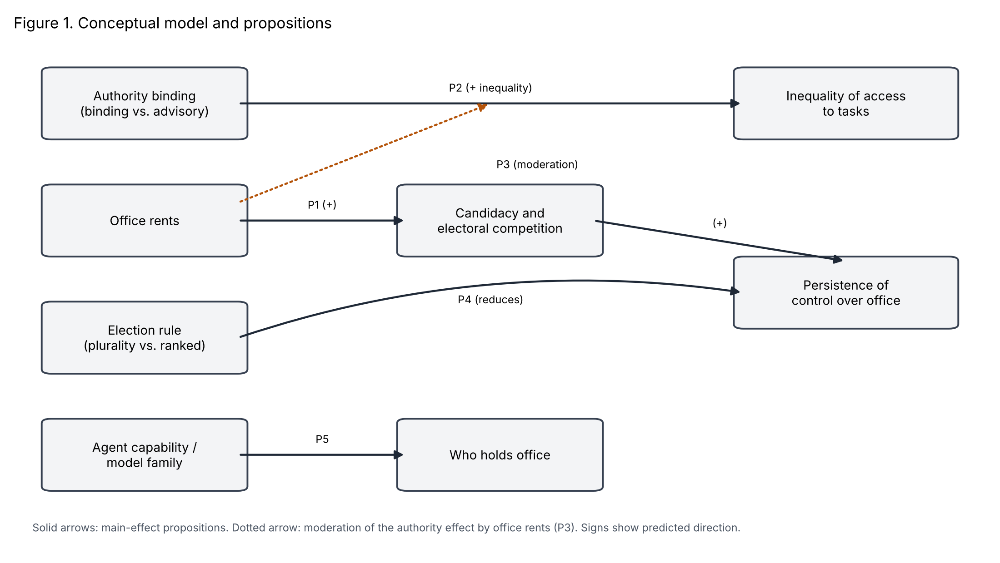

*Working draft. All figures come from 144 main-design worlds (six seeds per cell) and 24 capability-contrast worlds. Bracketed items are still to be filled from the final event logs.*

# Abstract

Organizations are beginning to let networks of large language model (LLM) agents allocate scarce resources among themselves, yet little is known about how the governance rules built into such systems shape who ends up in control. Drawing on IT governance and cumulative-advantage theory, we ask when agents seek and keep allocation authority, and whether holding it concentrates access. We report a controlled simulation of 168 agent worlds in which binding allocation authority, the rewards attached to office, the election rule, and the model composition of the population were varied, and in which every outcome is computed from logged events rather than agent discourse. Office rents sharply increased candidacy and competition, but not inequality of access. Binding authority made allocation more equal than chance. Election rules made no detectable difference. Model family and capability predicted who stood for office. Power concentration was weak; competition for it was not.

**Keywords:** agentic information systems; IT governance; decision rights; large language model agents; multi-agent simulation; office rents

# 1. Introduction

Firms increasingly deploy LLM-based agents that negotiate, schedule, and allocate on behalf of human principals. As these agents begin to deal with each other and not only with people, the information system becomes a setting in which allocation outcomes are produced through agent-to-agent exchange. Research on AI in organizations has concentrated on the human–AI interface, such as trust, adoption, and augmentation. A prior question for the designers of such systems has received less attention. When agents share scarce resources and some of them hold governance rights over those resources, who comes to control them, and does that control entrench itself?

The question matters because agentic systems inherit their governance from their designers. Voting interfaces, allocation privileges, and the rewards attached to holding office are design choices made before any agent acts. The IT governance literature has long treated the assignment of decision rights as a central lever for shaping behavior (Sambamurthy and Zmud 1999; Weill and Ross 2004). That literature assumes human actors whose interests, norms, and hesitations moderate how formal rights are used. Whether the same moderation operates when the rights holders are LLM agents is an open empirical matter.

Recent evidence suggests it cannot be taken for granted. Zhang and Shang (2026) report that LLM agents placed in a minimal executable world, with scarce tasks and basic mechanisms for transfer, election, and allocation, form economic relations without being instructed to, including exchanges of votes for future access. Their setting is small and short, and it was built to show that such relations can emerge, not to ask whether they harden into durable control. Work on LLM-based economic simulation has largely asked a different question, namely whether a governance procedure converges on a socially desirable outcome (Karten et al. 2025). We ask the complementary one: under what design conditions do agents seek office, and does holding office translate into control over who gets access?

Our evidence is a controlled simulation in which four design features were varied across 168 worlds. We report three main findings. First, rewards attached to office determine whether agents compete for it at all; without them most elections drew no candidate. Second, binding allocation authority did not concentrate access. It made allocation more even than a lottery would. Third, which agents took office depended strongly on model family and, within a family, on capability, but mostly through the decision to stand and much less through winning once standing.

These findings qualify a natural expectation, that agents given allocation power and scarce resources will tend to capture them. We contribute in three ways. We specify office rents and authority binding as design-level constructs and derive propositions about their effects. We provide a design that identifies governance effects from behavioral traces, with a placebo comparison for vote-for-access claims. And we document where concentration did and did not appear, which is information designers need before deploying such systems.

# 2. Theoretical Background and Propositions

## 2.1 Decision rights as a governance design variable

IT governance research defines governance as the specification of decision rights and accountability structures that encourage desirable behavior in the use of IT (Weill and Ross 2004). Arrangements for who decides produce systematic differences in how organizations use technology (Sambamurthy and Zmud 1999), and in platform ecosystems, governance mechanisms shape participant behavior and platform evolution (Tiwana et al. 2010). A shared assumption is that a right and its exercise are separable: holding a decision right is one thing, and what the holder does with it depends on incentives and social context. In agentic systems that separation may be thinner, because agents act on the mechanisms as specified and carry few loyalties beyond those the system records.

## 2.2 Delegation among agents

Agency theory frames delegation as a problem of aligning an agent's actions with a principal's interests under information asymmetry (Jensen and Meckling 1976; Eisenhardt 1989). Multi-agent settings add a layer. When one agent controls allocation, the others are in effect subject to its authority, and the question becomes the distribution of control among agents. Research on machine behavior argues that such collective outcomes need to be studied in their own right (Rahwan et al. 2019), and LLMs have begun to be used as simulated economic agents, subject to the usual caveats about validity (Horton 2023).

## 2.3 Cumulative advantage, office rents, and entrenchment

Cumulative-advantage accounts show how early positional gains can feed on themselves (Merton 1968) and how small early differences can lock in outcomes under increasing returns (Arthur 1989). Institutional accounts add that when the holders of political power can steer economic opportunity toward their supporters, and economic advantage helps them retain power, institutions become self-perpetuating (Acemoglu and Robinson 2012). Ostrom (1990) documents rule configurations under which shared resources are governed without capture.

These accounts share a premise: holding office is worth something. We call the value attached to holding a position *office rents*. Whether anyone competes for office, and whether holding it reinforces itself, depends on whether such rents exist. A second design feature is *authority binding*, the degree to which an officeholder's allocation decision is executed without further approval. Where authority is not binding, office carries symbolic status but no control.

## 2.4 Propositions

**P1 (Office rents and candidacy).** Office rents increase candidacy and electoral competition. Without them, agents have little reason to bear the costs of standing.

**P2 (Authority binding and access).** Binding authority increases the officeholder's ability to concentrate access, so inequality of access is greater under binding than under advisory authority. We state this as the expectation from the cumulative-advantage and capture literatures and treat it as a test that could fail.

**P3 (Interaction).** The effect of binding authority on inequality of access is larger when office rents are present, because rents give holders a reason to use authority for their own advantage.

**P4 (Election rules).** Rules that raise the cost of assembling a decisive majority (ranked-choice, relative to plurality) reduce the persistence of control.

**P5 (Capability and selection).** More capable agents are more likely to hold office, whether through greater willingness to stand or through greater success when standing.

Figure 1 summarizes the model. The design features on the left are the manipulated factors: office rents, authority binding, the election rule, and the capability or family of the model that drives each agent. The central construct is candidacy and electoral competition, which we expect office rents to raise (P1) and which we expect in turn to lengthen the persistence of control over the office. Authority binding is expected to raise inequality of access to tasks (P2), and the dotted arrow indicates that office rents are expected to strengthen that relationship (P3), because rents give holders a reason to use authority to their own advantage. The election rule is expected to shorten the persistence of control (P4). Agent capability and model family are expected to affect which agents hold office (P5). The model is deliberately parsimonious: it contains no mediating variables beyond candidacy, and it treats the three outcomes (persistence, inequality, and identity of the holder) as separate.

We also examine *rights convertibility*, the extent to which a vote can be exchanged for access, as a within-world phenomenon and not a manipulated factor. Section 4.5 reports a placebo test of whether voters favor candidates who have given them promises or transfers.

# 3. Method

## 3.1 Environment

We built an executable world in the spirit of Zhang and Shang (2026). Each world contains six agents and runs for 50 simulated days. Each day two scarce tasks become available, and an agent can receive at most one. A task yields three units of energy; every agent pays one unit per day. Agents can send public messages, transfer energy, make promises of future access, stand for election, and vote. An election is held every five days, and the winner holds office until the next election. A holder submits an allocation of the day's tasks. Where authority is binding, that allocation is executed; where it is advisory, tasks are drawn at random from all agents and the holder's proposal is recorded but ignored. The interface is identical in the two conditions. If nobody stands in an election, the office is vacant until the next one and tasks are drawn at random.

All economic relations are identified from logged, state-changing events (transfers, promises, votes, allocations). Agent messages are logged but not used to measure outcomes.

## 3.2 Design

The main design crosses four factors: authority (binding or advisory), election rule (plurality or ranked-choice), population (all Claude Haiku 5.5; all DeepSeek V4 Pro; or three of each), and office rent (zero or two extra energy per day in office). This gives 24 cells, each run with six seeds, for 144 worlds. A second, capability-contrast design places DeepSeek V4 Flash and V4 Pro agents together in the same world, crossing authority with office rent over six seeds (24 worlds). The within-family contrast separates capability from model family. Models were accessed through OpenRouter at a sampling temperature of 1.0, with hidden reasoning disabled so that responses are direct actions.

## 3.3 Measures

*Competition.* The share of elections with no candidate, and the share with at least two. *Persistence.* The longest uninterrupted spell of one holder, the share of office days held by the most frequent holder, and the re-election rate. *Inequality of access.* The Gini coefficient of cumulative tasks received and the longest spell without a task. *Exchange.* The number of voters who backed the winner after receiving a promise or transfer from the winner since the previous election, and the *gifted-vote share*, the proportion of a candidate's votes that came from voters who had received a gift from that candidate. The last is computed separately for winners and non-winners, which provides a placebo benchmark. *Reliability.* The fraction of access promises later honored.

## 3.4 Analysis

We compare levels of each factor with two-sided permutation tests (10,000 permutations) using the world as the unit of analysis. The design is balanced, so these marginal comparisons are valid, although they do not adjust for the other factors and so lose power. We ran about thirty such tests and applied no multiplicity correction. Results with p-values between 0.02 and 0.05 should be read as exploratory. As a benchmark for inequality, we simulated 2,000 worlds in which two of six agents are drawn at random each day; the expected Gini was 0.103 and the expected longest spell without a task was 12.0 days.

## 3.5 Research transparency

The design evolved over three stages. An initial 24-world pilot revealed that a task-request step in the advisory condition produced an artifact: agents adopted informal rotation rules, tasks went unfilled, and inequality in that condition reflected lost tasks and not governance. The request step was removed. A second 24-world pilot, run with the corrected design, showed that most elections had no candidate and that incumbents therefore persisted by default. We changed the rule so that an empty election vacates the office, and added the office-rent factor and the placebo gifted-vote measure. The pilots informed the final design and are not pooled with the main results. The main design was first run with three seeds per cell; three further seeds were added after an initial look at those results, because several differences were borderline, and all 144 worlds are analyzed together. The stopping decision was therefore not fixed in advance, and readers should treat borderline p-values accordingly. The design, models, and all analysis code are retained in a repository, and per-call costs are logged.

# 4. Results

## 4.1 Competition for office

Office rents changed the nature of the elections (Table 1). Without rents, 55 percent of elections drew no candidate; with them, 34 percent did (p < 0.001). The share of contested elections rose from 25 to 40 percent (p < 0.001), and the longest spell of a single holder rose from 8.1 to 12.4 days (p < 0.001). Model family mattered at least as much as any design feature: in Claude-only worlds, 71 percent of elections had no candidate, against 28 percent in DeepSeek-only worlds and 35 percent in mixed worlds.

**Table 1. Main effects (144 worlds; means by level; two-sided permutation p-values)**

| Outcome | Rent 0 | Rent 2 | p | Advisory | Binding | p | Plurality | Ranked | p |
|---|---|---|---|---|---|---|---|---|---|
| Elections with no candidate | 0.55 | 0.34 | <0.001 | 0.45 | 0.44 | 0.79 | 0.44 | 0.45 | 0.69 |
| Contested elections | 0.25 | 0.40 | <0.001 | 0.32 | 0.33 | 0.91 | 0.32 | 0.33 | 0.79 |
| Longest holder spell (days) | 8.1 | 12.4 | <0.001 | 10.1 | 10.4 | 0.80 | 9.9 | 10.6 | 0.53 |
| Re-election rate | 0.33 | 0.36 | 0.54 | 0.30 | 0.40 | 0.09 | 0.32 | 0.38 | 0.31 |
| Gini of tasks | 0.091 | 0.098 | 0.34 | 0.108 | 0.082 | <0.001 | 0.094 | 0.096 | 0.77 |
| Longest spell without a task (days) | 11.0 | 12.3 | 0.07 | 12.0 | 11.2 | 0.28 | 11.6 | 11.7 | 0.87 |
| Winner-backing exchanges | 5.8 | 11.5 | <0.001 | 9.7 | 7.6 | 0.13 | 8.9 | 8.4 | 0.72 |
| Transfers | 100 | 122 | 0.27 | 153 | 68 | <0.001 | 117 | 104 | 0.54 |
| Promises honored | 0.12 | 0.19 | 0.008 | 0.12 | 0.20 | 0.002 | 0.16 | 0.16 | 0.81 |

## 4.2 Authority and access

Binding authority did not concentrate access. Under advisory authority, which is effectively a lottery, the Gini coefficient of tasks (0.108) and the longest spell without a task (12.0 days) matched the random benchmark (0.103 and 12.0). Under binding authority the Gini was lower (0.082, p < 0.001): holders distributed tasks more evenly than chance would. The longest spell without a task was also shorter (11.2 days) but this difference is not distinguishable from noise (p = 0.28). The effect on the Gini is probably understated, because in roughly 45 percent of election cycles the office was vacant and allocation reverted to a lottery even in the binding condition. In the earlier pilot, in which offices persisted by default, the same comparison showed far larger equalization (a Gini of 0.026 against 0.086). Authority binding did not alter the persistence of control: the longest holder spell was 10.1 days under advisory and 10.4 under binding authority, and the re-election rate rose from 0.30 to 0.40 (p = 0.09), a small difference that we do not interpret. Binding authority also halved the number of transfers (68 against 153, p < 0.001), reduced the number of access promises (43 against 64, p = 0.009), and raised the share of promises honored (0.20 against 0.12, p = 0.002).

The proposed interaction between authority and rents (P3) received only weak support. For the Gini of tasks the interaction was negligible (difference in differences of 0.008; permutation p = 0.60). For the longest spell without a task, binding authority shortened exclusion by about two days when office carried no rents (9.9 against 12.0 days) but not at all when it did (12.5 against 12.0 days). The difference in differences is 2.6 days (permutation p = 0.055, bootstrap interval from −0.1 to 5.3). We read this as suggestive and not as established.

## 4.3 Election rules

Plurality and ranked-choice produced indistinguishable outcomes on every measure we examined (all p ≥ 0.22; Table 1). The largest gap was in re-election (0.32 under plurality, 0.38 under ranked-choice), in the direction opposite to P4, and it is not distinguishable from noise at this sample size.

## 4.4 Who takes office

Model composition shaped which agents stood and which won. In the 48 mixed Claude/DeepSeek worlds, agents powered by Claude stood in 105 elections and won 44, while DeepSeek agents stood 462 times and won 269. DeepSeek therefore held 86 percent of the terms filled, against its 82 percent share of candidacies. The gap is mainly one of candidacy: DeepSeek agents stood far more often, and the win rate per candidacy was 58 percent for DeepSeek and 42 percent for Claude.

The capability contrast within one model family points the same way. The stronger DeepSeek V4 Pro stood 246 times and won 121; the weaker V4 Flash stood 161 times and won 56. Given who stood in each election, a random draw among the candidates would have given Pro 112.4 victories, against 121 observed (standard deviation 4.1; z = 2.1). Most of Pro's advantage is therefore accounted for by its greater willingness to stand, and a smaller excess of about nine victories remains once candidacy is taken into account. That excess is borderline, and the z-value treats elections as independent, which they are not, so it should be read as suggestive. P5 is supported as regards selection into candidacy, and only weakly as regards success once standing.

## 4.5 Vote-for-access exchange

Office rents raised the count of voters who backed a winner after receiving a gift from that winner (5.8 against 11.5, p < 0.001), which could be taken as evidence of vote buying. The placebo comparison does not support that reading. In the 110 worlds with votes for both a winner and a non-winner, gifted-vote shares were higher for the winner in 58 worlds and for the non-winner in 50 (two ties), with a mean difference of −0.013. The exchange counts correlate with the volume of transfers in a world (r = 0.67) but not with the number of promises (r = −0.07). Agents who exchange resources freely will often have given something to those who later vote for them, whether or not votes were the object. The count is therefore a poor indicator of an exchange of votes for access, and in our data we cannot distinguish the two.

# 5. Discussion

## 5.1 What the results say

The data do not support the expectation that scarce resources and allocation authority lead LLM agents to capture access. Where authority was binding, the distribution of tasks was more equal than chance. The pattern of competition was driven by the rewards attached to office: when office was worth nothing, most agents did not stand, and when it paid, competition and the volume of exchange rose, but inequality of access did not. For designers, the result locates the lever. The rents attached to a position, and not the authority attached to it, determine whether it becomes contested. Whether contest turns into capture is a separate question that, in this environment, the agents answered mostly in the negative.

The observation that agents often held office for stretches of ten days or more is easily over-read. A considerable part of that persistence in the pilot reflected incumbents continuing by default when nobody stood. After correcting for this, the longest holder spells (8.1 to 12.4 days, against terms of five days) correspond to two or three consecutive terms, which is moderate.

Figure 2 maps the results onto the same structure. Of the five propositions, P1 is supported, P5 is supported with respect to who stands and only weakly with respect to who wins, and P4 is not supported. P2 is contradicted: binding authority reduced inequality of access measured by the Gini coefficient and did not affect the persistence of control. P3 receives only suggestive support, in the form of a loss of the exclusion benefit under rents. We did not test mediation through candidacy, so the path from rents through competition to persistence is inferred from the main effects and not estimated.

## 5.2 Implications for governance design

Three implications follow, with the caution that they derive from a single simulated environment. First, designers who wish to limit contention over control of an agent system should look at the incentives attached to the role before the powers attached to it. Second, binding authority was not harmful here, and may have been protective, in the sense that holders distributed access more evenly than a lottery would. This should not be generalized to settings where holders have private interests that conflict with those of the agents they allocate to. Third, measures of exchange based on co-occurrence, such as a gift followed by a vote, require a benchmark. Without our placebo comparison we would have reported evidence of vote buying where the data show only a high base rate of giving.

## 5.3 Limitations

The environment is small: six agents, 50 days, two tasks per day, and a single prompt framing. The agents had no heterogeneous interests beyond energy and no means of coercion or exclusion beyond the allocation itself. Public reputation records, which the platform supports, were not varied. Outcomes depend on the specific models and on a sampling temperature of 1.0; both are snapshots, and different versions may behave differently. Our permutation tests are marginal and uncorrected for multiple comparisons, and the three seeds per cell limit what can be said about interactions. We did not vary initial endowments, so the part of the capability proposition concerning initial resources is untested. The selection of candidacy over winning in Section 4.4 rests on a null-model comparison that treats elections as independent. Finally, the findings come from simulated agents, and no claim is made that human actors, or agents embedded in organizations, would behave in the same way. A human benchmark in the same environment would be the most informative extension.

## 5.4 Future research

Several extensions follow from these limits: larger populations and tighter scarcity, where competition for access is harder to resolve by rotation; heterogeneous endowments and interests; accountability mechanisms such as public records; and comparison with human participants in the same game. Studying how agents formed the informal rotation norms we observed in early pilots is a further direction, since such norms may be an important and under-studied form of self-governance among agents.

# 6. Conclusion

We asked when LLM agents sharing scarce resources seek and keep control over allocation, and whether control becomes capture. In a controlled simulation of 168 worlds, the rewards attached to office determined whether agents competed for it, binding authority led to a more equal distribution of tasks than chance, election rules made no detectable difference, and stronger models were more active in seeking office. Where concentration appeared, it was concentration of office, not of access. For the designers of agentic systems, the primary design lever is the value attached to a role, and the evidence for capture by authority is, so far, weak.

# References

Acemoglu, D., and Robinson, J. A. 2012. *Why Nations Fail: The Origins of Power, Prosperity, and Poverty*. New York: Crown.

Arthur, W. B. 1989. "Competing Technologies, Increasing Returns, and Lock-In by Historical Events," *The Economic Journal* (99:394), pp. 116-131.

Eisenhardt, K. M. 1989. "Agency Theory: An Assessment and Review," *Academy of Management Review* (14:1), pp. 57-74.

Horton, J. J. 2023. "Large Language Models as Simulated Economic Agents: What Can We Learn from Homo Silicus?" NBER Working Paper.

Jensen, M. C., and Meckling, W. H. 1976. "Theory of the Firm: Managerial Behavior, Agency Costs and Ownership Structure," *Journal of Financial Economics* (3:4), pp. 305-360.

Karten, S., Li, W., Ding, Z., Kleiner, S., Bai, Y., and Jin, C. 2025. "LLM Economist: Large Population Models and Mechanism Design in Multi-Agent Generative Simulacra," arXiv:2507.15815.

Merton, R. K. 1968. "The Matthew Effect in Science," *Science* (159:3810), pp. 56-63.

Ostrom, E. 1990. *Governing the Commons*. Cambridge: Cambridge University Press.

Rahwan, I., et al. 2019. "Machine Behaviour," *Nature* (568), pp. 477-486.

Sambamurthy, V., and Zmud, R. W. 1999. "Arrangements for Information Technology Governance: A Theory of Multiple Contingencies," *MIS Quarterly* (23:2), pp. 261-290.

Tiwana, A., Konsynski, B., and Bush, A. A. 2010. "Platform Evolution: Coevolution of Platform Architecture, Governance, and Environmental Dynamics," *Information Systems Research* (21:4), pp. 675-687.

Weill, P., and Ross, J. W. 2004. *IT Governance: How Top Performers Manage IT Decision Rights for Superior Results*. Boston: Harvard Business School Press.

Zhang, L., and Shang, S. 2026. "AI Agent Economics: Can Autonomous Economic Behavior Emerge among AI Agents under Minimal External Conditions?" arXiv:2608.03076.
