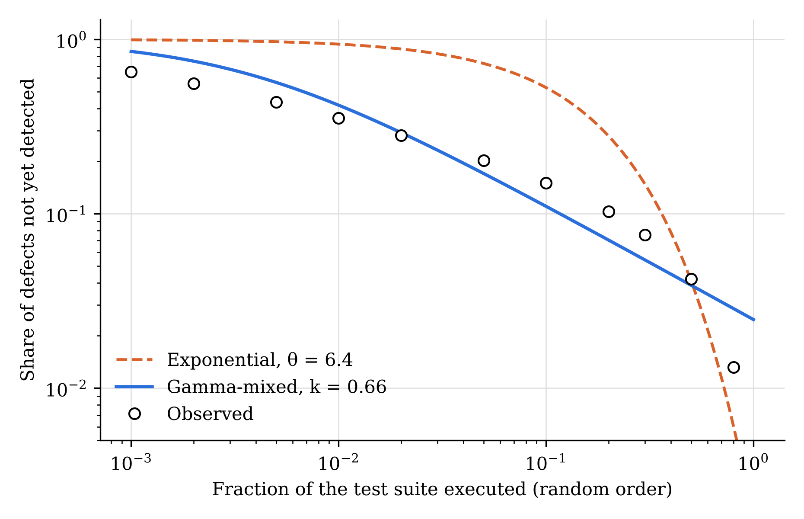
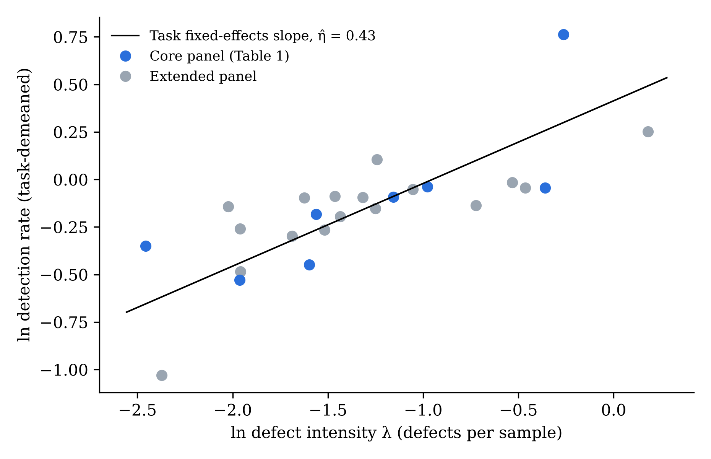
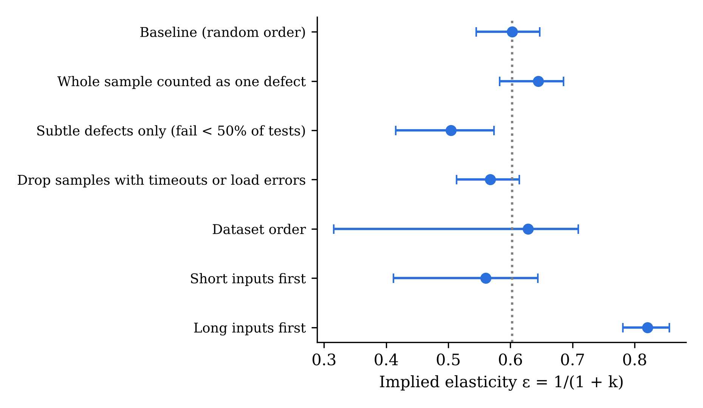
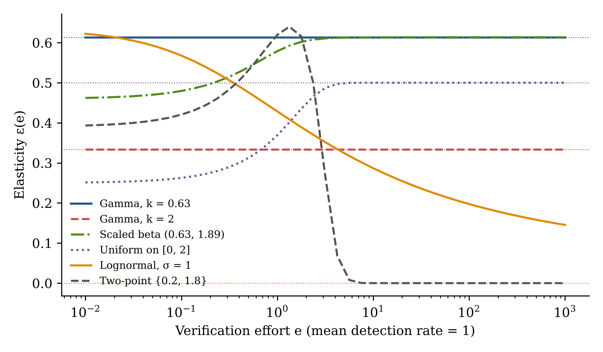
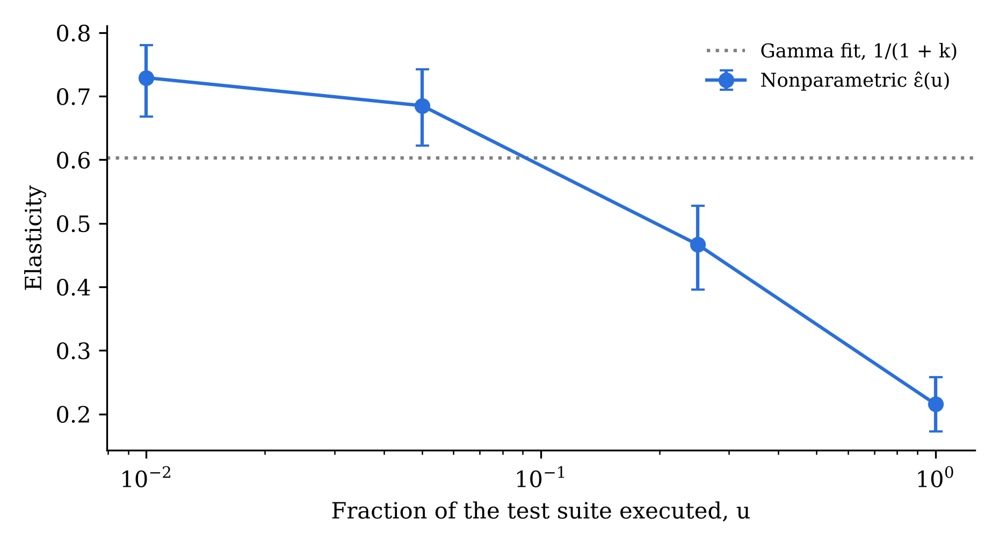

::: {custom-style="Author"}
Authors blinded for review
:::

::: {custom-style="Abstract Title"}
Abstract
:::

::: {custom-style="Abstract"}
AI coding tools lower the rate at which defects enter software, but developers may respond by verifying less. We ask how much of a better tool's quality reaches users as fewer shipped defects. In a model in which defects arrive as a Poisson process and verification detects each defect at its own rate, the answer depends on how unevenly detectable defects are. With linear verification cost, the elasticity of shipped defects with respect to the tool's defect intensity equals CV²/(1 + CV²), where CV is the coefficient of variation of detection rates among defects not yet found. Complete offsetting, the risk-compensation benchmark, requires every defect to be equally easy to find. Because AI tools change which errors they make, a better tool reduces shipped defects only if its errors do not become harder to detect faster than a threshold equal to CV². Under heavy-tailed detection, developer liability and tool quality are complements. In 8,775 defects from 25,120 solutions by eight language models, about 40% of a proportional quality gain would be absorbed by reduced verification. Across 25 models, stronger models make harder-to-detect defects, which absorbs a further 17 percentage points. The results define a verification-adjusted measure of tool quality.
:::

::: {custom-style="Keywords"}
*Keywords:* AI coding assistants; software verification; human–AI collaboration; over-reliance; software liability; defect detectability; economics of information systems
:::

```{=openxml}
<w:p><w:r><w:br w:type="page"/></w:r></w:p>
```

# 1. Introduction

A large and growing share of new code is now written with the help of generative AI, and the first field experiments report sizable gains in developer output (Peng et al. 2023, Cui et al. 2025). Code that a developer did not write line by line still has to be checked, though, and checking is increasingly where the time goes. Catalini et al. (2026) argue that the cost of verifying what AI produces, rather than the cost of producing it, is what limits the gains from automation. For a manager choosing between tools, or a regulator thinking about who should answer for defective generated code, this raises a question that benchmark scores do not settle. When a tool improves and fewer defects enter the code, how much of the improvement reaches users as fewer shipped defects, and how much is spent instead on doing less verification?

Two familiar bodies of work tell us which way the answer points. Since Peltzman (1975), economists have known that people offset part of a safety improvement by taking more risk, and the moral-hazard literature explains why effort falls when its private return falls (Holmström 1979). Research on automation complacency and on human–AI collaboration documents the same tendency in monitoring tasks: people check reliable automation less carefully than unreliable automation (Parasuraman and Manzey 2010, Fügener et al. 2021, Dell'Acqua et al. 2023). What these literatures do not tell us is how large the response will be. A manager who expects a tool that halves defect rates to halve production incidents needs a number, and the existing theory offers only a sign. The information systems literature on software quality has long treated developers' quality effort as an incentive problem (Austin 2001, Harter et al. 2000), but it predates generated code and treats the process by which defects are found as a black box.

Our argument is that the size of the response is set mainly by the technology of detection, not by behavior alone, and that the relevant property of that technology can be measured. We model defects as arriving at a tool-specific Poisson rate and verification as finding each defect at a rate of its own. The developer decides how much to verify, knowing that she bears some share of the loss from the defects she misses. Our central result (Proposition 2) is that, with linear verification cost, the elasticity of shipped defects with respect to the tool's defect intensity equals CV²/(1 + CV²), where CV is the coefficient of variation of detection rates among the defects still undetected at the developer's chosen level of effort. The result requires no assumption about the distribution of detectability. Complete offsetting, in which a better tool leaves shipped defects unchanged, happens only when all defects are equally easy to find. If some defects are obvious and others subtle, the obvious ones are found first and those left behind are mostly hard. Additional checking then pays off slowly, so the developer cuts back only a little when the tool improves, and most of the improvement survives. The same behavioral model can therefore produce complete or partial compensation, depending on the detection technology. At high levels of effort the elasticity approaches 1/(1 + k), where k measures how much of the defect population is nearly impossible to find.

The second result speaks to what is particular about AI-generated code. As language models improve, they do not simply make fewer mistakes. They may also make different ones, producing fluent code that looks right and fails in ways that are harder to catch. We allow tool quality to change the detectability of defects as well as their number. Shipped defects then scale locally as $\lambda^{\varepsilon}\theta^{-(1-\varepsilon)}$, where λ is the tool's defect intensity, θ is the detectability of its defects, and ε is the elasticity above (Proposition 4). A better tool reduces shipped defects only if its errors become harder to detect more slowly than a threshold equal to CV². This gives a natural verification-adjusted measure of tool quality. Benchmark pass rates capture λ alone, whereas what users eventually receive depends on λ and θ together, with weights fixed by the heterogeneity of detection. The same result covers assistants that help with verification as well as with writing code. Cheaper verification and harder-to-detect errors enter shipped defects only through their ratio, so an assistant that writes tests offsets subtler errors one for one (Corollary 2).

The same quantity matters for liability. A developer who bears only part of the loss from shipped defects verifies too little, as in any model of moral hazard. When detection is heavy-tailed, weak liability also reduces how much she is willing to pay for a better tool, because that willingness to pay scales with her share of the loss raised to the power ε (Proposition 6). Developer liability and tool quality are then complements. This channel disappears when detection is homogeneous, which separates our setting from analyses of software liability in which vendor quality and user care act as substitutes (August and Tunca 2011). A vendor with market power under-supplies quality, and the shortfall grows as developer liability weakens, but only to the extent that detectability varies across defects (Corollary 3).

Finally, we measure the detection technology. We ran 25,120 solutions written by eight language models for 157 HumanEval+ tasks against the benchmark's extended test suites. Detectability turns out to be very uneven. A quarter of the defects break at least 85 percent of a task's test inputs and are found almost immediately, while about a tenth break fewer than half of one percent and survive most of the suite. The estimated tail parameter is k = 0.66, with a 95 percent interval of 0.56 to 0.82, which implies that about 40 percent of a proportional quality gain would be absorbed by reduced verification. The estimate is stable across reasonable definitions of a defect and orders of testing, and the heavy tail reappears on a second benchmark, MBPP+. A nonparametric estimate of the survivor CV, which uses no distributional assumption, puts the elasticity higher still, at about 0.7, at the levels of testing a developer is likely to reach. We then extend the panel to 25 models. More capable models make defects that are harder to detect: the elasticity of detectability with respect to defect intensity is η̂ = 0.43 (95 percent interval 0.24 to 0.64). This is well below the threshold at which improvements would stop reaching users, but it is far from zero, and it absorbs a further 17 percentage points of a proportional quality gain. Taken together, less than half of the reduction in defects that a better model achieves on a benchmark survives as fewer shipped defects in our calibration.

The paper contributes to three conversations in information systems research. For work on human–AI collaboration and over-reliance, it replaces a directional prediction with a magnitude tied to a measurable property of AI errors, and it identifies a channel, the composition of errors, through which better AI can worsen outcomes without any behavioral bias. For work on the economics of software quality and liability, it shows that whether liability rules affect investment in tool quality depends on the detection technology. For practice, it suggests that organizations should value AI coding tools by what they deliver after verification rather than by their accuracy on benchmarks.

Section 2 reviews related work. Section 3 sets out the model, and Sections 4 and 5 develop the results on offsetting and on liability. Section 6 measures the detection technology. Section 7 discusses implications, and Section 8 concludes. Proofs, numerical checks, details of the calibration, and the field evidence are in the electronic companion.

# 2. Related Literature

**Human–AI collaboration and over-reliance.** A growing body of IS research studies how people work alongside AI systems that are good but not perfect. Fügener et al. (2021) show that people who receive AI advice become more similar to one another and to the machine, which improves average accuracy but loses the unique knowledge individuals bring. Fügener et al. (2022) find that people delegate poorly to AI because they misjudge their own abilities, and Jussupow et al. (2021) trace how physicians reconcile their own diagnoses with AI advice. Field experiments outside IS reach similar conclusions. Consultants given access to a strong language model performed better on tasks inside the model's capabilities and worse on a task just outside it (Dell'Acqua et al. 2023), and radiologists did not make full use of AI predictions because they underweighted them in some cases and over-relied on them in others (Agarwal et al. 2023). Much of this work rests on the older human-factors literature on automation complacency, which documents that monitoring declines as automation becomes more reliable (Parasuraman and Manzey 2010). These studies establish the direction of the behavioral response. None of them ties its size to properties of the errors that the AI makes, which is what our model does.

**The economics of software quality.** IS research has studied software quality as the outcome of incentives and development practices. Austin (2001) models a developer who faces deadline pressure and can cut corners in ways a principal cannot see, and shows how schedule policies shape hidden quality shortfalls. Empirical work links process maturity, complexity, and development practices to defects and maintenance costs (Banker et al. 1998, Harter et al. 2000, Krishnan et al. 2000). In software reliability engineering, defect discovery is modeled as a non-homogeneous Poisson process, and the cost-based release problem asks when to stop testing (Goel and Okumoto 1979, Okumoto and Goel 1980). Our exponential benchmark reproduces that release logic, and we do not claim it as new. Our question is different. We ask how the stopping point and the number of defects left behind respond to a change in the quality of the code generator, and we show that the answer depends on the dispersion of detection rates, a feature the classical models summarize in a single parameter. A related strand in software testing treats the discovery of failures as sampling from an unknown population of species and estimates the residual risk that testing has not yet found (Böhme 2018, Böhme et al. 2021). We use the tail of the detection curve in a similar spirit, as a technology parameter in an economic model rather than as an estimator of residual risk.

**Software liability and security economics.** A large literature asks who should bear the cost of software failures. Anderson (2001) and Anderson and Moore (2006) argue that security fails when the parties able to prevent harm do not bear its cost. August and Tunca (2006, 2011) compare liability and patching policies when users' security efforts interact through a network, and Arora et al. (2006) study how the option to patch affects the quality of software at release. Gordon and Loeb (2002) model the level of investment in information security, and Varian (2004) and Kunreuther and Heal (2003) analyze free riding when security is interdependent. In law and economics, liability is assigned to the least-cost avoider (Calabresi 1970, Shavell 1980). We add a technology-specific twist to this discussion. In our model the developer's verification and the vendor's quality are linked through the detection curve, and whether weak developer liability depresses investment in tool quality depends on how unevenly detectable defects are.

**Verification as a complement to AI.** Agrawal et al. (2018) describe AI as a fall in the cost of prediction that raises the value of judgment, and Catalini et al. (2026) argue that verification is the binding constraint on the gains from automation, with an externality when those who deploy AI verify too little. Bhati (2026) catalogs the costs of verification in agentic software development. Our model is narrower than these accounts. It considers one developer and one kind of verification, but it gives a closed-form link between tool quality, verification, and shipped defects, and it brings in the vendor.

# 3. Model

**Defects and verification.** A developer produces code of size $s$ with a tool whose quality is summarized by a defect intensity $\lambda > 0$, the expected number of defects introduced per unit of size. A lower $\lambda$ means a better tool, and the number of defects introduced is Poisson with mean $\lambda s$. The developer then spends verification effort $e \ge 0$, which may stand for testing, review, or inspection, at cost $C(e)$ with $C(0)=0$, $C'>0$, and $C''\ge 0$. Each defect survives verification independently with probability $S(e)$, where $S(0)=1$, $S'<0$, and $S(e)\to 0$ as effort grows. We write $h(e)=-S'(e)/S(e)$ for the hazard rate of detection. Because independent thinning of a Poisson variable is again Poisson, the number of residual defects is Poisson with mean $\lambda s S(e)$ (Lemma EC.1).

**Loss and liability.** Each residual defect causes a loss $\ell$. The developer bears a share $\delta \in (0,1]$ of the loss, the vendor bears $\phi_v \ge 0$, and users bear $\phi \ge 0$, with $\delta+\phi_v+\phi=1$. The developer is risk neutral and chooses effort to minimize

$$D(e;\lambda)=C(e)+A\lambda s\,S(e),\qquad A=\delta\ell .$$

We assume that this problem has a unique interior solution $e^*(\lambda)$, characterized by the first-order condition $C'(e)=A\lambda s\,S(e)h(e)$, and that the second-order condition holds. Let $R^*(\lambda)=\lambda s S(e^*)$ denote expected residual defects. The social cost of a given effort is $C(e)+\ell\lambda s S(e)$, and the first best corresponds to $\delta=1$.

**Heterogeneous detectability.** We let each defect $j$ carry its own detection rate $\rho_j>0$, drawn independently from a distribution $G$ on $(0,\infty)$. A defect with rate $\rho_j$ is found after an exponentially distributed amount of effort with that rate, so that

$$S(e)=\int_0^\infty e^{-\rho e}\,dG(\rho).$$

We impose no parametric form on $G$. For $e \ge 0$ we define the survivor distribution $G_e$ by $dG_e(\rho)=e^{-\rho e}dG(\rho)/S(e)$. It describes detection rates among the defects still undetected after effort $e$. We write $\mu_e$, $\sigma_e^2$, and $\mathrm{CV}_e=\sigma_e/\mu_e$ for its mean, variance, and coefficient of variation. All three are finite for every $e>0$, whether or not $G$ itself has finite moments.

Two special cases recur. In the exponential benchmark every defect has the same rate $\theta$, so $S(e)=e^{-\theta e}$ with constant hazard $\theta$, and we pair it with linear cost $C(e)=ce$. In the gamma-mixed case $G$ is a gamma distribution with mean $\theta$ and shape $k$, which gives

$$S(e)=\left(1+\frac{\theta e}{k}\right)^{-k},\qquad h(e)=\frac{\theta}{1+\theta e/k}.$$

The hazard falls with effort because easy defects are found first and the survivors are disproportionately hard to find. The exponential benchmark is the limit $k\to\infty$. A small $k$ describes a population in which some defects are found almost at once and others almost never.

The model is deliberately spare. One developer chooses one dimension of effort, there are no dynamics, and defects are exchangeable apart from their detection rates. The Poisson structure is a modeling device that delivers the thinning property. Section 6 examines how well the data match it.

# 4. How Much of a Quality Gain Is Offset?

## 4.1 The offsetting elasticity

The developer's response to a better tool is governed by how the first-order condition shifts with $\lambda$. Define $a=C''/C'-h'/h$, evaluated at the optimum.

**Proposition 1** (Offsetting elasticity). *Under the standing assumptions, optimal effort satisfies $de^*/d\lambda=1/[\lambda(a+h)]>0$, and the elasticity of expected residual defects with respect to defect intensity is*

$$\varepsilon\equiv\frac{d\ln R^*}{d\ln\lambda}=\frac{a}{a+h}.$$

*The share of a proportional quality gain that is offset by reduced verification is $1-\varepsilon=h/(a+h)$.*

The intuition runs through a single function. Let $\Phi(e)=\ln C'(e)-\ln[-S'(e)]$ be the log of marginal cost over the marginal rate at which effort removes defects. The first-order condition says that $\Phi(e^*)=\ln(A\lambda s)$, so a proportional fall in $\lambda$ must be matched by a fall in $\Phi$. The steeper $\Phi$ is, the less effort has to move, and its slope is $a+h$. Residual defects fall with effort at the proportional rate $h$. The share offset is therefore the ratio of the rate at which effort removes risk to the rate at which the optimality condition resists a change in effort. When the two rates coincide, as they do with linear cost and constant hazard, the developer gives back the whole gain.

**Corollary 1.** *(i) With linear cost and exponential detection, $a=0$ and $\varepsilon=0$. Expected residual defects equal $c/(A\theta)$ whatever the tool, and the offset is complete. (ii) With cost $ce^{\gamma}$, $\gamma>1$, and exponential detection, $\varepsilon=(\gamma-1)/[(\gamma-1)+\theta e^*]$. (iii) If the hazard rises with effort, then $a<0$ and $\varepsilon<0$, so a better tool raises expected residual defects.*

Case (i) restates the optimal release problem of the reliability literature for a change in tool quality. It is a knife-edge case, as the next result shows.

## 4.2 Offsetting depends on how unevenly detectable defects are

**Proposition 2** (Heterogeneity in detectability). *Suppose detection rates are heterogeneous as in Section 3.*

*(a) The hazard of detection is the mean detection rate among survivors, and its slope is minus their variance: $h(e)=\mu_e$ and $h'(e)=-\sigma_e^2$. The hazard is therefore non-increasing, and it is strictly decreasing unless $G$ is degenerate.*

*(b) With $g(e)=C''(e)/C'(e)$, the elasticity in Proposition 1 is*

$$\varepsilon=\frac{g(e^*)+\sigma_{e^*}^2/\mu_{e^*}}{g(e^*)+\sigma_{e^*}^2/\mu_{e^*}+\mu_{e^*}}.$$

*With linear verification cost,*

$$\varepsilon=\frac{\mathrm{CV}_{e^*}^2}{1+\mathrm{CV}_{e^*}^2},\qquad 1-\varepsilon=\frac{1}{1+\mathrm{CV}_{e^*}^2}.$$

*Offsetting is complete if and only if all defects are equally detectable. It is partial for every non-degenerate $G$, and convex cost makes it more partial still, because $\varepsilon$ increases in $g$.*

*(c) Suppose $G(\rho)=\rho^{k}L(\rho)$ as $\rho\downarrow 0$, for some $k>0$ and a function $L$ that is slowly varying at zero. Then $\mathrm{CV}_e^2\to 1/k$ as $e\to\infty$, so that under linear cost $\varepsilon(e)\to 1/(1+k)$. If instead $G$ puts no mass near zero, so that $\underline{\rho}=\operatorname{ess\,inf}\rho>0$, then $\mathrm{CV}_e\to 0$ and $\varepsilon(e)\to 0$.*

*(d) If $G$ is gamma with shape $k$, then $G_e$ is gamma with the same shape at every $e$, so $\mathrm{CV}_e^2=1/k$ and $\varepsilon=1/(1+k)$ at every level of effort.*

Proposition 2 separates what is general from what depends on functional form. That offsetting is partial depends only on heterogeneity in detectability, and part (a) shows why. Each unit of effort removes the easiest of the remaining defects, so the hazard falls at a rate equal to the variance of detection rates among those that remain. The marginal benefit of effort then declines faster than the stock of residual risk, and a given proportional fall in $\lambda$ calls for only a small cut in effort. The size of the offset is pinned down by a single moment of a measurable object, the detection rates of the defects that verification has not yet found.

The constant elasticity $1/(1+k)$ in the gamma case is not an artifact of that distribution. By part (c), it is the high-effort limit for any technology whose density of detection rates behaves like $\rho^{k-1}$ near zero. The parameter $k$ is best read as a measure of how much of the defect population sits close to being undetectable. Where testing eventually exhausts the supply of hard defects, for example because detection rates are bounded away from zero, verification at high effort returns to complete offsetting. The same happens, more slowly, when the density near zero vanishes faster than any power. With lognormal detection rates and $\sigma = 1$, $\varepsilon(e)$ falls from about 0.6 at low effort to 0.15 at an effort a thousand times the mean detection time (Figure EC.1). We return to this point in Section 6, where we estimate the lower tail directly.

## 4.3 Closed forms in the gamma case

With linear cost and gamma-mixed detection, the optimum has a closed form. Let $Z=A\lambda s\theta/c$, which exceeds one when the problem is interior, and let $\varepsilon=1/(k+1)$.

**Proposition 3** (Closed forms). *Under linear cost and gamma-mixed detection with $Z>1$, optimal effort satisfies $1+\theta e^*/k=Z^{\varepsilon}$, expected residual defects are $R^*=\lambda s\,Z^{-k\varepsilon}$, and the developer's minimized cost is*

$$V(\lambda)=\frac{c}{\theta}\bigl[(k+1)Z^{\varepsilon}-k\bigr].$$

*As $k\to\infty$, $V(\lambda)\to(c/\theta)(1+\ln Z)$, which is the exponential benchmark.*

## 4.4 When better tools make subtler errors

So far a better tool has meant one that introduces fewer defects of an unchanged kind. Generated code need not improve that way. As models get better, the errors that remain may be harder to see: code that compiles, passes the obvious cases, and fails on an edge condition. To capture this, we write detection rates as $\rho=\theta\xi$, where $\xi\sim G$ has a fixed distribution and $\theta$ scales how easy the tool's defects are to detect. We then let tool quality move both intensity and detectability, with $\theta\propto\lambda^{\eta}$. A positive $\eta$ means that better tools, those with lower $\lambda$, make defects that are harder to find.

**Proposition 4** (Verification-adjusted quality). *Under linear verification cost, the elasticity of expected residual defects with respect to defect intensity, holding detectability fixed, is the $\varepsilon$ of Proposition 2. The elasticity with respect to detectability, holding intensity fixed, is $-(1-\varepsilon)$. Hence, locally,*

$$R^*\propto\lambda^{\varepsilon}\,\theta^{-(1-\varepsilon)},\qquad \frac{d\ln R^*}{d\ln\lambda}=\varepsilon-\eta(1-\varepsilon).$$

*A better tool reduces residual defects if and only if $\eta<\varepsilon/(1-\varepsilon)=\mathrm{CV}_{e^*}^2$. Under gamma-mixed detection the threshold is $1/k$, about 1.5 at the estimated $k$.*

The index $\lambda^{\varepsilon}\theta^{-(1-\varepsilon)}$ is a verification-adjusted measure of tool quality. Benchmark pass rates and defect counts measure $\lambda$. What reaches users depends on $\lambda$ and $\theta$ together, and the weights are set by the same heterogeneity that makes offsetting partial. When detection is very uneven, the weight on $\lambda$ is high and that on $\theta$ low, so a tool can afford to make its remaining errors somewhat subtler without losing ground. When detection is nearly homogeneous, $\mathrm{CV}^2$ is small and even a modest shift toward subtle errors can cancel the gain from making fewer of them. In that case shipped defects can rise as the tool improves, through a change in the technology and without any bias in how developers behave.

Coding assistants increasingly write tests and review code as well as generating it, which lowers the cost of verification. The proof of Proposition 4 shows that, under linear cost, the developer's problem depends on $\lambda$, $\theta$, and $c$ only through $\lambda\theta/c$, which gives a simple extension.

**Corollary 2** (AI-assisted verification). *Under linear verification cost, $R^*\propto\lambda^{\varepsilon}(\theta/c)^{-(1-\varepsilon)}$ locally. If a better tool also lowers the unit cost of verification, with $c\propto\lambda^{g}$, and changes detectability, with $\theta\propto\lambda^{\eta}$, then*

$$\frac{d\ln R^*}{d\ln\lambda}=\varepsilon+(g-\eta)(1-\varepsilon).$$

Cheaper verification and subtler errors enter shipped defects only through the ratio $\theta/c$, the detection a developer obtains per unit spent on verification. A tool that halves the cost of a test exactly offsets a halving of the detectability of its errors. The result also shows where AI-written tests could go wrong. If the model that writes the code also writes the tests, its tests may share the blind spots of its code, so that $\theta$ falls for precisely the defects it makes. Whether an assistant that checks its own output reduces shipped defects then turns on whether $g$ exceeds $\eta$ for the tool's own defects, which can be measured in the same way as in Section 6.4.

# 5. Liability and the Value of Tool Quality

We now ask how the developer's share of the loss affects verification and welfare, and how it affects what a better tool is worth. Let $W(\lambda;\delta)$ be social cost at the developer's privately chosen effort and $W^{fb}(\lambda)$ its value at the first best, and write $L(\lambda;\delta)=W(\lambda;\delta)-W^{fb}(\lambda)$ for the loss from under-verification. We begin with the exponential benchmark, where the answers are especially simple.

**Proposition 5** (Exponential benchmark). *With linear cost and exponential detection, (a) expected residual defects are $R^*=c/(\delta\ell\theta)$, which does not depend on $\lambda$ or $s$ and is $1/\delta$ times its first-best value; (b) the marginal value of quality is the same privately, socially, and at the first best, $V'(\lambda)=W'(\lambda)=W^{fb\prime}(\lambda)=c/(\theta\lambda)$, whatever the liability share; and (c) the loss from under-verification is*

$$L(\delta)=\frac{c}{\theta}\left(\frac{1}{\delta}-1+\ln\delta\right)\ge 0,$$

*which is zero only if $\delta=1$, falls as $\delta$ rises, and does not depend on $\lambda$.*

Part (b) says that in this benchmark weak developer liability does not distort the incentive to supply better tools. A better tool is valuable only because it saves verification cost, and that saving is the same whoever bears the loss. Part (c) says that better tools do not reduce the damage done by weak liability. Both statements change once detection is heavy-tailed.

**Proposition 6** (Heavy-tailed detection). *Under linear cost and gamma-mixed detection with $Z>1$, let $\lambda_0$ be the intensity of an outside option, such as writing the code without the tool. (a) The developer's willingness to pay to move from $\lambda_0$ to a better tool $\lambda$ is*

$$\mathrm{WTP}(\lambda)=\frac{c}{\theta\varepsilon}\left(\frac{\delta\ell\theta s}{c}\right)^{\varepsilon}\bigl(\lambda_0^{\varepsilon}-\lambda^{\varepsilon}\bigr),$$

*which is proportional to $\delta^{\varepsilon}$. (b) The social benefit of the same improvement, evaluated at the developer's chosen effort, is $\psi\cdot\mathrm{WTP}$ with*

$$\psi=\frac{k+1/\delta}{k+1}=1+\frac{1-\delta}{\delta(k+1)}\ge 1.$$

*(c) The loss from under-verification is*

$$L(\lambda;\delta)=\frac{c}{\theta}\left(\frac{\ell\lambda s\theta}{c}\right)^{\varepsilon}\left[\bigl(k+1/\delta\bigr)\delta^{\varepsilon}-(k+1)\right]\ge 0,$$

*and it increases in $\lambda$ with elasticity $\varepsilon$.*

Three consequences stand out. First, at the estimated $k=0.66$, halving the developer's share of the loss cuts the value of a quality improvement to about 66 percent of its value under full liability, because $0.5^{0.603}\approx 0.66$. Weak liability therefore lowers the return to better tools, not only the amount of verification. Second, the social value of a tool exceeds its private value by the factor $\psi$, which equals 1.6 when $\delta=0.5$ and 3.4 when $\delta=0.2$. Third, better tools reduce the cost of weak liability, since $L$ rises with $\lambda$ at rate $\varepsilon$, but only by a power of the improvement. Developer liability and tool quality are complements, in that each makes the other more valuable. None of this happens in the exponential benchmark, where $\psi=1$ and $\varepsilon=0$. These statements use the constancy of $\varepsilon$ in the gamma case. For a general $G$ they hold locally, with $\varepsilon$ evaluated at the optimum.

The gap between social and private value carries over to the vendor. Suppose $N$ developers differ in a scalar type $\nu$, uniform on $[0,\bar\nu]$, that scales their willingness to pay, so that type $\nu$ values the move from $\lambda_0$ to $\lambda$ at $\nu(\lambda_0^{\varepsilon}-\lambda^{\varepsilon})/\varepsilon$. Such variation arises, for example, when developers differ in the unit cost of verification. A vendor reaches quality $\lambda$ at fixed cost $K_0/\lambda$, has no marginal cost, and sets one quality and one price.

**Corollary 3** (Vendor investment in quality). *(a) The monopolist's defect intensity $\lambda_M$ and the planner's $\lambda_S$ satisfy*

$$\frac{\lambda_M}{\lambda_S}=(2\psi)^{1/(1+\varepsilon)}.$$

*(b) If instead the vendor captures the full private value of every developer, its defect intensity $\lambda_C$ satisfies $\lambda_C/\lambda_S=\psi^{1/(1+\varepsilon)}$.*

The factor of two in part (a) is the familiar distortion that arises because a monopolist ignores the surplus of inframarginal buyers. The new element is $\psi$. Weak developer liability depresses vendor quality only through heterogeneity in detectability. In the homogeneous benchmark ($k\to\infty$) $\psi=1$ whatever the liability share, whereas with $k=0.66$ the ratio rises from 1.54 under full developer liability to 2.07 at $\delta=0.5$ and 3.31 at $\delta=0.2$. For $k$ between 0.5 and 0.8 these ratios change by less than 0.05. Liability rules for generated code thus affect the quality of the tools themselves, and the detection technology determines by how much.

Part (b) separates the two sources of distortion. Full extraction is what a vendor would obtain with perfect price discrimination, and it is an upper bound on what any vendor can earn from quality, whatever the market structure or pricing scheme. Competition, usage-based pricing, or tiered subscriptions may narrow the factor of two, but they cannot remove $\psi$, because no vendor is paid for the part of the loss that falls on users. At $k=0.66$ the remaining ratio is 1.34 at $\delta=0.5$ and 2.15 at $\delta=0.2$, and in any market in which a vendor's marginal return to quality does not exceed developers' marginal private value, these ratios bound the distortion from below. We do not model competition among the vendors of AI coding tools, which today is an oligopoly with a mix of subscription and token-based pricing. Corollary 3 is a benchmark that isolates how liability and detectability enter the incentive to invest in quality, not a description of that market.

# 6. Measuring the Detection Technology

The elasticity $\varepsilon$ depends on how the defects in AI-generated code are distributed in detectability. This section measures that distribution directly, and then asks whether it changes with model quality.

## 6.1 Data

We use the HumanEval+ benchmark (Chen et al. 2021, Liu et al. 2023), which pairs 164 Python programming tasks with test suites of between 12 and 1,100 inputs (median 985) designed to stress edge cases. We excluded six tasks whose tests do not list inputs and expected outputs in a standard layout, and one task whose test relies on a custom checker that our harness does not support. That leaves 157 tasks, on which the reference solutions pass every test input.

Our core panel consists of eight language models that span a wide range of quality: Claude Haiku 5.5, Qwen3 Coder 30B-A3B, Mistral Small 3.2 24B, GPT-4o mini, Gemma 3 12B, Ministral 3B, Llama 3.1 8B Instruct, and Llama 3.2 3B Instruct. Each model wrote 20 solutions per task at temperature 0.8 from a single prompt, for a total of 25,120 solutions. Each solution ran in an isolated process on the test inputs one at a time, with a one-second limit per input. A solution failed on an input if it raised an exception, returned a wrong answer, or exceeded the time limit, and a run was stopped after five timeouts, with the remaining inputs counted as failures. Table 1 shows that the models differ by about an order of magnitude in the number of defects they introduce, which gives the calibration useful variation in $\lambda$. For the analysis of Section 6.4 we added 18 further models under the same protocol, for 81,640 solutions in all (Table EC.3).

Table: Table 1. Quality of the eight core models on HumanEval+ (157 tasks, 20 samples per task). A defect is a distinct failure signature within a solution.

| Model | Pass rate | Mean defects per sample | Samples |
|:--|--:|--:|--:|
| Claude Haiku 5.5 | 0.925 | 0.086 | 3,140 |
| Qwen3 Coder 30B-A3B | 0.891 | 0.140 | 3,140 |
| Mistral Small 3.2 24B | 0.841 | 0.202 | 3,140 |
| GPT-4o mini | 0.833 | 0.210 | 3,140 |
| Gemma 3 12B | 0.747 | 0.314 | 3,140 |
| Ministral 3B | 0.718 | 0.376 | 3,140 |
| Llama 3.1 8B Instruct | 0.522 | 0.698 | 3,140 |
| Llama 3.2 3B Instruct | 0.410 | 0.768 | 3,140 |

## 6.2 Measuring detectability

We need a unit of "defect." Within each solution we group failing inputs by failure signature: the type of exception raised, the shape of a wrong answer (its type compared with the expected type and, where defined, whether it is too low or too high, too short or too long), a timeout, or a failure to load. A solution with $n$ distinct signatures contains $n$ defects. This is an imperfect proxy, and we vary it below.

To trace the effect of verification effort, we suppose that tests are run in a uniformly random order. A defect that causes $f$ of the $M$ tests in its task to fail is still undetected after $e$ tests with probability $\binom{M-f}{e}/\binom{M}{e}$. Averaging this probability over all 8,775 defects in the core panel at each effort level $u=e/M$ gives an empirical survival curve for the population of defects. We fit it on the logarithmic scale with the gamma-mixed and the exponential forms, and we obtain intervals by resampling tasks with replacement.

Proposition 2 suggests two further estimators that do not rely on the gamma form. Under random ordering, defect $j$ survives a fraction $u$ of the suite with probability close to $(1-f_j/M)^{uM}=\exp(-\hat\rho_j u)$, where $\hat\rho_j=-M\ln(1-f_j/M)$. The survivor CV at effort $u$ is then the CV of the $\hat\rho_j$ weighted by $\exp(-\hat\rho_j u)$, and $\hat\varepsilon(u)=\widehat{\mathrm{CV}}_u^2/(1+\widehat{\mathrm{CV}}_u^2)$. Defects that fail every input have $\hat\rho_j=\infty$ and receive zero weight at any positive effort. Second, Proposition 2(c) implies that the survival curve behaves like $u^{-k}$ at high effort when detection rates have a power-like lower tail, so the slope of $\ln S$ against $\ln u$ estimates the lower-tail index directly.

## 6.3 Results

The data reject the exponential form and favor a heavy tail (Figure 1). The sum of squared errors on the log scale is 8.7 for the exponential fit and 1.2 for the gamma-mixed fit. The estimated shape is $k=0.66$ with a 95 percent interval of 0.56 to 0.82, which gives $\varepsilon=0.603$ (0.549 to 0.643) and an offset share of $k/(1+k)=0.397$ (0.357 to 0.451).

{width=5.8in}

The heavy tail reflects a very uneven mix of defects. Across defects, the share of a task's tests that a defect causes to fail has a median of 24 percent and quartiles of 4 and 85 percent. A quarter of the defects break at least 85 percent of a task's inputs and are found by the first test or two. At the other extreme, 11 percent fail on fewer than half of one percent of inputs and are likely to survive most of the suite. The gamma-mixed form captures this pattern broadly but not perfectly. In Figure 1 the observed curve lies below the fitted curve at very low effort and above it in the middle range, because a block of defects is found by the first few tests, which a single gamma mixture does not reproduce.

The nonparametric estimates confirm that offsetting is partial, and they suggest that the gamma fit understates the elasticity at realistic levels of effort (Table 2 and Figure EC.2). When a developer runs 1 to 5 percent of a large suite, roughly 10 to 50 tests for a typical task, the survivor CV² is between 2.2 and 2.7, and $\hat\varepsilon(u)$ is 0.69 to 0.73. The log-log slope of the survival curve over the same range gives a lower-tail index of $k=0.37$ (0.32 to 0.44), and hence an elasticity of 0.73, in close agreement. The gamma fit averages over the whole curve, including the steep initial drop, and gives the more conservative 0.60. At higher effort the nonparametric estimate falls, to 0.47 at a quarter of the suite and 0.22 when the whole suite is run. This decline is largely a property of the benchmark rather than of the code. A defect enters our data only if at least one test catches it, so the observed detection rates are bounded away from zero, and Proposition 2(c) then implies that the estimate must approach zero as the suite is exhausted. Defects that no test in the suite would catch, which are the ones that matter most at high effort, are invisible to this design.

Table: Table 2. Nonparametric estimates of the elasticity. The first four rows report the survivor CV² and $\hat\varepsilon(u)$ at selected levels of effort; the last row reports the lower-tail index from the log-log slope of the survival curve for $u\in[0.01,0.1]$. Intervals are 95% task-bootstrap intervals (300 resamples for $\hat\varepsilon(u)$, 1,000 for the slope).

| Fraction of suite executed, $u$ | $\widehat{\mathrm{CV}}_u^2$ (95% CI) | $\hat\varepsilon(u)$ (95% CI) |
|:------------------------------|--------------------:|--------------------:|
| 0.01 | 2.69 (2.01, 3.56) | 0.73 (0.67, 0.78) |
| 0.05 | 2.18 (1.65, 2.88) | 0.69 (0.62, 0.74) |
| 0.25 | 0.87 (0.65, 1.12) | 0.47 (0.40, 0.53) |
| 1.00 | 0.27 (0.21, 0.35) | 0.22 (0.17, 0.26) |
| Tail slope over $u\in[0.01,0.1]$ | $k=0.37$ (0.32, 0.44) | 0.73 (0.69, 0.76) |

On counts, defects per solution are overdispersed relative to a Poisson distribution when pooled across tasks and models (Pearson ratio 1.37; Cameron and Trivedi 1990 test, $p\approx 4\times10^{-23}$), which reflects differences in difficulty across tasks and in quality across models. Within a model and task the counts are, if anything, underdispersed (Pearson ratio 0.62), because the number of distinct signatures is bounded. The Poisson assumption is therefore a modeling device that delivers the thinning property, and the data do not establish it.

## 6.4 Do better models make subtler errors?

Proposition 4 turns on whether detectability changes with quality. Two pieces of evidence bear on this. The shape of the tail does not vary systematically with quality: the rank correlation between $k$ and defect intensity is −0.12 across the eight core models and 0.29 across the extended panel, and neither is distinguishable from zero (Table EC.3). The scale of detectability, however, does vary. To estimate $\eta$ we regress $\ln\hat\rho_j$, the log detection rate of defect $j$, on the log defect intensity of the model that wrote it, with task fixed effects, so that the comparison is between defects that different models make on the same task. Defects that fail every input are given $f=M-0.5$. We use 25 models: the core panel plus 17 of the 18 additional models. We set aside Qwen 2.5 Coder 32B, whose served endpoint dropped the closing quotes of the docstring in 63 percent of its samples, which produced syntax errors that reflect the deployment rather than the model.

The estimate is $\hat\eta=0.43$ with a 95 percent task-bootstrap interval of 0.24 to 0.64 (Figure 3). A model with half the defect intensity of another makes defects that are, on the same task, about 26 percent less detectable. The estimate is 0.40 (0.21 to 0.59) when load errors are excluded, 0.56 (0.38 to 0.80) when the excluded model is included, and 0.59 (0.31 to 0.91) in the core panel alone.

{width=5.8in}

By Proposition 4, the net elasticity of shipped defects with respect to defect intensity is $\varepsilon-\eta(1-\varepsilon)$. With the gamma estimate of $\varepsilon$ this is $0.603-0.43\times0.397=0.43$ (0.35 to 0.51 over the interval for $\eta$). The estimated $\eta$ lies well below the threshold $\mathrm{CV}^2$, which is about 1.5 under the gamma fit and 2.2 to 2.7 by the nonparametric estimates, so better models still deliver fewer shipped defects. The shift toward harder-to-detect errors is nonetheless large enough to absorb a further 17 percentage points of a proportional improvement, on top of the 40 points absorbed by reduced verification. With the nonparametric elasticity at low effort the net figure is 0.55 to 0.61. The comparison is across models rather than within one model over time, and models differ in more than quality, so we read $\hat\eta$ as a description of how the errors of stronger and weaker models differ on the same tasks, not as a causal effect of improving a given model.

## 6.5 Sensitivity

Table 3 and Figure 2 vary the two arbitrary choices in the procedure, the definition of a defect and the order of tests. Counting a whole solution as a single defect, discarding defects that fail at least half of the tests, and dropping solutions with timeouts or load errors keep $\varepsilon$ between 0.50 and 0.64. Running tests in the order in which the dataset lists them, or shortest inputs first, gives 0.63 and 0.56. Only an adversarial order that runs the longest inputs first moves the estimate materially, to 0.82. In every variant the gamma-mixed form fits far better than the exponential, and $k$ is below one.

Table: Table 3. Sensitivity of the tail index $k$ and the implied elasticity $\varepsilon=1/(1+k)$ to the definition of a defect and to the order of tests. Intervals are 95% task-bootstrap intervals (300 resamples).

| Variant | Defects | $k$ (95% CI) | $\varepsilon$ (95% CI) |
|:--|--:|:-:|:-:|
| Baseline (random order) | 8,775 | 0.66 (0.56, 0.82) | 0.60 (0.55, 0.64) |
| Whole sample counted as one defect | 6,633 | 0.55 (0.46, 0.72) | 0.64 (0.58, 0.69) |
| Subtle defects only (fail < 50% of tests) | 5,469 | 0.98 (0.74, 1.41) | 0.50 (0.42, 0.57) |
| Drop samples with timeouts or load errors | 7,232 | 0.76 (0.63, 0.95) | 0.57 (0.51, 0.61) |
| Dataset order | 8,775 | 0.59 (0.41, 2.17) | 0.63 (0.32, 0.71) |
| Short inputs first | 8,775 | 0.79 (0.55, 1.43) | 0.56 (0.41, 0.64) |
| Long inputs first | 8,775 | 0.22 (0.17, 0.28) | 0.82 (0.78, 0.86) |

{width=5.8in}

## 6.6 A second benchmark

To check that the heavy tail is not a feature of one benchmark, we repeated the calibration for the eight core models on MBPP+ (Austin et al. 2021, Liu et al. 2023), a separate set of short Python tasks with expanded test suites. After excluding six tasks with non-standard tests and seven whose reference solutions fail in our harness, 365 tasks remain, with a median of 108 test inputs. Each model wrote 10 solutions per task, for 29,200 solutions and 12,734 defects. Table 4 compares the two benchmarks.

Table: Table 4. Detection technology on two benchmarks, core panel of eight models. Intervals are 95% task-bootstrap intervals.

| | HumanEval+ | MBPP+ |
|:------------------------------------------|:--------------------:|:--------------------:|
| Tasks; median test inputs per task | 157; 985 | 365; 108 |
| Solutions; defects | 25,120; 8,775 | 29,200; 12,734 |
| Log-scale SSE, exponential / gamma fit | 8.7 / 1.2 | 5.2 / 0.9 |
| Gamma shape $k$ | 0.66 (0.56, 0.82) | 0.87 (0.77, 1.04) |
| $\varepsilon=1/(1+k)$ | 0.60 (0.55, 0.64) | 0.53 (0.49, 0.57) |
| Nonparametric $\hat\varepsilon(0.01)$ | 0.73 (0.67, 0.78) | 0.71 (0.67, 0.74) |
| Nonparametric $\hat\varepsilon(0.05)$ | 0.69 (0.62, 0.74) | 0.65 (0.61, 0.69) |
| Tail-slope $k$, $u\in[0.01,0.1]$ | 0.37 (0.32, 0.44) | 0.38 (0.34, 0.44) |
| $\hat\eta$, eight core models | 0.59 (0.31, 0.91) | 0.49 (0.24, 0.76) |

The main findings carry over. Detection is again heavy-tailed, and the gamma form fits far better than the exponential. The gamma shape is somewhat larger on MBPP+, so the gamma summary implies a smaller elasticity, 0.53, and an offset of 47 percent. The two estimators that use the lower tail directly, which Proposition 2 says is what matters, are almost identical across benchmarks: the nonparametric elasticity at low effort is about 0.7 on both, and the tail-slope estimate of $k$ is 0.37 on one and 0.38 on the other. Stronger models also make harder-to-detect defects on MBPP+, with an estimate of $\eta$ close to the one on HumanEval+. The difference in the gamma fit reflects the smaller MBPP+ suites. With about a hundred inputs per task, no defect can fail on fewer than about one percent of them, and a quarter of the defects fail on every input, so the coarser suites compress the part of the distribution that the gamma fit is most sensitive to. Both benchmarks consist of single functions, and how far the tail extends to code at the scale of a repository remains open (Section 8).

## 6.7 What the calibration does and does not show

The estimates describe how an automated test suite detects defects in code written by language models. They measure the detection technology, which the model takes as given, and they are a reasonable stand-in for the hazard a developer faces when she verifies. They do not measure how developers verify. Real developers do not run tests in random order, and the sensitivity analysis shows that order matters at the margin. The benchmark consists of short functions with sharp specifications, and the tail may be thicker or thinner in production code. And $\varepsilon\approx 0.6$ is the implication of Proposition 2 only under linear verification cost. Convex cost would raise the elasticity, so we regard 0.6 as a benchmark for the technology, not as a prediction of behavior.

Field data are a poor substitute for an experiment here, for reasons we set out in Section EC.6. The model's prediction concerns the author's own verification effort, which public repositories do not record; what they record is review by others, which is a different margin. A test also requires a change in tool quality that is known to have reduced the defects in the code being reviewed, and public data reveal which model wrote a pull request but not how many defects it introduced. An apparent change in the default model of a widely used coding agent illustrates the problem. Neither review nor testing activity moved, but with no measurable first stage and no measure of author effort, the comparison cannot distinguish a small behavioral response from none. A credible test of the behavioral prediction requires a setting in which tool quality is randomized and verification effort is observed directly.

# 7. Discussion

**For organizations adopting AI coding tools.** The model implies that the benefit of a better tool arrives in two forms. Under the estimated tail, about 40 percent of a proportional quality improvement is spent on reduced verification and the rest is kept as fewer residual defects, and the nonparametric estimates suggest the share may be closer to 30 percent at the levels of testing developers typically reach. An organization that evaluates a tool by the reduction in production defects it expects may overstate the benefit if its developers will check less. One that evaluates it by time saved alone ignores the part of the gain that is kept. Verification standards that do not depend on the tool, such as a minimum test coverage for merging, remove the offset altogether, because residual defects then scale one for one with the tool's defect intensity. Such standards also over-verify for the best tools, since the optimal level of verification falls as quality rises.

**For evaluating tools.** Benchmark pass rates measure only one of the two inputs to what users receive. Proposition 4 implies that a tool's value after verification also depends on how detectable its remaining errors are, so a vendor whose newer model makes fewer but subtler errors may deliver less than its pass rate suggests. Section 6.4 shows that this is not a hypothetical concern: across 25 models, stronger models make errors that are harder to detect, and the shift absorbs about 17 percentage points of a proportional improvement. Buyers and independent evaluators would learn more from reporting how failures are distributed across tests (for instance, the share of a suite each failure breaks) alongside pass rates. Section 6 shows that these quantities can be computed from the same test runs that produce pass rates.

**AI-assisted and targeted verification.** Two features of practice that the baseline model leaves out work in opposite directions. Assistants that write tests or review code lower the cost of verification, which by Corollary 2 reduces shipped defects as if detectability had risen, unless the assistant's tests share the blind spots of its code. Developers also do not test at random; they check first what looks suspicious. Proposition 1 applies to any survival curve, and targeting that finds the likely defects first makes the hazard fall more steeply with effort, which raises the elasticity and so reduces offsetting. Our order variants point the same way: the order that finds the most defects early, longest inputs first, gives the highest elasticity (0.82, Table 3).

**For liability.** The loss from under-verification arises because the party who controls verification does not bear the full cost of residual defects. In the exponential benchmark this loss does not depend on the tool, and with heavy-tailed detection it falls only slowly as tools improve (Propositions 5 and 6). Moving loss from the developer to the vendor, for instance through strict vendor liability for defects in generated code or through a warranty, lowers the developer's share and raises expected residual defects by the factor by which the share falls, unless verification requirements come with it. In the heavy-tailed case it also lowers the value of tool quality, so the vendor's incentive to improve weakens at the same time. Shifting loss between the vendor and users, with the developer's share held fixed, changes no behavior in the model and only redistributes. These results support assigning liability to the party that controls verification, as the least-cost-avoider principle recommends, and they show that the case for doing so rests on efficiency as well as fairness.

**For research.** The most direct test of the model is an experiment that randomizes tool quality and observes verification effort and residual defects. The elasticity in Proposition 2 gives a quantity to estimate and a prediction against which to compare it, since the detection technology of the code shown to participants can be measured in advance.

# 8. Limitations and Conclusion

The analysis has limits. The model has one risk-neutral developer who chooses a single dimension of effort, with no dynamics. Fixes do not introduce new defects, and defects are independent. Fix-induced defects would make verification less productive at the margin, and correlated defects would make residual counts more dispersed than the Poisson model implies; we have not worked out how either changes the elasticity. The Poisson structure is a device, and the data depart from it. The vendor results assume that willingness to pay varies by a scalar uniform type, and although Corollary 3(b) bounds the distortion under any market structure in which vendors are paid out of developers' private value, we do not model oligopolistic competition. The propositions hold under regularity conditions, and we check them numerically for several distributions of detectability (Section EC.3), not over the whole parameter space. The calibration uses benchmarks of short functions, one sampling temperature, a proxy for defects, and mostly a random order of tests. Repository-scale benchmarks such as SWE-bench would be a stronger test of external validity, but they supply only a handful of tests per task, which makes the share of tests that a defect fails a coarse measure of its detectability, and running them requires a separate execution environment for every repository. We leave them to future work. Our field evidence does not test the behavioral prediction. We have not examined whether the welfare comparisons survive risk aversion or differences among developers in detection skill.

Within these limits, the paper's message is straightforward. How much of a better tool's promise survives verification depends on how unevenly detectable its defects are. Offsetting is complete only when every defect is equally easy to find, and it is partial under the heavy tail we measure. Because AI tools can change the kind of errors they make, a better tool can even increase shipped defects, and the threshold at which this happens is set by the same heterogeneity. Stronger models in our data do make subtler errors, though not nearly enough to cross that threshold. The effect of liability on the value of tools depends on it as well. When the party who controls verification bears only part of the loss, verification is too low, and when detection is heavy-tailed, tool quality is too low as well. These quantities can be estimated from the test runs that developers and vendors already perform, which gives the discussion of AI liability and verification an empirical footing.

# References

::: {custom-style="Reference"}
Agarwal N, Moehring A, Rajpurkar P, Salz T (2023) Combining human expertise with artificial intelligence: Experimental evidence from radiology. NBER Working Paper 31422, National Bureau of Economic Research, Cambridge, MA.

Agrawal A, Gans J, Goldfarb A (2018) *Prediction Machines: The Simple Economics of Artificial Intelligence* (Harvard Business Review Press, Boston).

Anderson R (2001) Why information security is hard: An economic perspective. *Proc. 17th Annual Comput. Security Appl. Conf.* (IEEE, Piscataway, NJ), 358–365.

Anderson R, Moore T (2006) The economics of information security. *Science* 314(5799):610–613.

Arora A, Caulkins JP, Telang R (2006) Sell first, fix later: Impact of patching on software quality. *Management Sci.* 52(3):465–471.

August T, Tunca TI (2006) Network software security and user incentives. *Management Sci.* 52(11):1703–1720.

August T, Tunca TI (2011) Who should be responsible for software security? A comparative analysis of liability policies in network environments. *Management Sci.* 57(5):934–959.

Austin J, Odena A, Nye M, Bosma M, Michalewski H, Dohan D, Jiang E, Cai C, Terry M, Le Q, Sutton C (2021) Program synthesis with large language models. Preprint, submitted August 16, arXiv:2108.07732.

Austin RD (2001) The effects of time pressure on quality in software development: An agency model. *Inform. Systems Res.* 12(2):195–207.

Banker RD, Davis GB, Slaughter SA (1998) Software development practices, software complexity, and software maintenance performance: A field study. *Management Sci.* 44(4):433–450.

Becker J, Rush N, Barnes E, Rein D (2025) Measuring the impact of early-2025 AI on experienced open-source developer productivity. Preprint, submitted July 10, arXiv:2507.09089.

Bhati H (2026) Beyond code generation: Reliability, verification, and cost economics in the agentic software development lifecycle. Preprint, submitted September 4, arXiv:2609.04681.

Bingham NH, Goldie CM, Teugels JL (1987) *Regular Variation* (Cambridge University Press, Cambridge, UK).

Böhme M (2018) STADS: Software testing as species discovery. *ACM Trans. Software Engrg. Methodology* 27(2):1–52.

Böhme M, Liyanage D, Wüstholz V (2021) Estimating residual risk in greybox fuzzing. *Proc. 29th ACM Joint Meeting Eur. Software Engrg. Conf. and Sympos. Foundations Software Engrg.* (ACM, New York), 230–241.

Calabresi G (1970) *The Costs of Accidents: A Legal and Economic Analysis* (Yale University Press, New Haven, CT).

Cameron AC, Trivedi PK (1990) Regression-based tests for overdispersion in the Poisson model. *J. Econometrics* 46(3):347–364.

Catalini C, Hui X, Wu J (2026) Some simple economics of AGI. Preprint, submitted February 24, arXiv:2602.20946.

Chen M, Tworek J, Jun H, et al. (2021) Evaluating large language models trained on code. Preprint, submitted July 7, arXiv:2107.03374.

Cui Z, Demirer M, Jaffe S, Musolff L, Peng S, Salz T (2025) The effects of generative AI on high-skilled work: Evidence from three field experiments with software developers. *Management Sci.*, ePub ahead of print.

Dell'Acqua F, McFowland E, Mollick ER, Lifshitz-Assaf H, Kellogg K, Rajendran S, Krayer L, Candelon F, Lakhani KR (2023) Navigating the jagged technological frontier: Field experimental evidence of the effects of AI on knowledge worker productivity and quality. Working Paper 24-013, Harvard Business School, Boston.

Feller W (1971) *An Introduction to Probability Theory and Its Applications*, Vol. II, 2nd ed. (Wiley, New York).

Fügener A, Grahl J, Gupta A, Ketter W (2021) Will humans-in-the-loop become borgs? Merits and pitfalls of working with AI. *MIS Quart.* 45(3):1527–1556.

Fügener A, Grahl J, Gupta A, Ketter W (2022) Cognitive challenges in human–artificial intelligence collaboration: Investigating the path toward productive delegation. *Inform. Systems Res.* 33(2):678–696.

Goel AL, Okumoto K (1979) Time-dependent error-detection rate model for software reliability and other performance measures. *IEEE Trans. Reliability* R-28(3):206–211.

Gordon LA, Loeb MP (2002) The economics of information security investment. *ACM Trans. Inform. System Security* 5(4):438–457.

Harter DE, Krishnan MS, Slaughter SA (2000) Effects of process maturity on quality, cycle time, and effort in software product development. *Management Sci.* 46(4):451–466.

Holmström B (1979) Moral hazard and observability. *Bell J. Econom.* 10(1):74–91.

Jussupow E, Spohrer K, Heinzl A, Gawlitza J (2021) Augmenting medical diagnosis decisions? An investigation into physicians' decision-making process with artificial intelligence. *Inform. Systems Res.* 32(3):713–735.

Kingman JFC (1993) *Poisson Processes* (Oxford University Press, Oxford, UK).

Krishnan MS, Kriebel CH, Kekre S, Mukhopadhyay T (2000) An empirical analysis of productivity and quality in software products. *Management Sci.* 46(6):745–759.

Kunreuther H, Heal G (2003) Interdependent security. *J. Risk Uncertainty* 26(2–3):231–249.

Li H, Zhang H, Hassan AE (2026) AIDev: Studying AI coding agents on GitHub. Preprint, submitted February 9, arXiv:2602.09185.

Liu J, Xia CS, Wang Y, Zhang L (2023) Is your code generated by ChatGPT really correct? Rigorous evaluation of large language models for code generation. *Adv. Neural Inform. Processing Systems* 36.

Okumoto K, Goel AL (1980) Optimum release time for software systems based on reliability and cost criteria. *J. Systems Software* 1:315–318.

Parasuraman R, Manzey DH (2010) Complacency and bias in human use of automation: An attentional integration. *Human Factors* 52(3):381–410.

Peltzman S (1975) The effects of automobile safety regulation. *J. Political Econom.* 83(4):677–725.

Peng S, Kalliamvakou E, Cihon P, Demirer M (2023) The impact of AI on developer productivity: Evidence from GitHub Copilot. Preprint, submitted February 13, arXiv:2302.06590.

Shavell S (1980) Strict liability versus negligence. *J. Legal Stud.* 9(1):1–25.

Varian HR (2004) System reliability and free riding. Camp LJ, Lewis S, eds. *Economics of Information Security* (Springer, Boston), 1–15.
:::

```{=openxml}
<w:p><w:r><w:br w:type="page"/></w:r></w:p>
```

::: {custom-style="EC Title"}
Electronic Companion to "When Do Better AI Coding Tools Ship Fewer Defects? Detectability, Verification, and Liability"
:::

This electronic companion contains the proofs of the results in the paper, numerical checks of the analytical results, details of the calibration, the sensitivity analysis, the field evidence from agentic pull requests, and a description of the replication materials.

# EC.1 Notation

| Symbol | Meaning |
|:--|:--|
| $s$, $\lambda$ | Size of the code; defect intensity of the tool (expected defects introduced per unit of size) |
| $e$, $C(e)$ | Verification effort and its cost; $C(e)=ce$ in the linear case |
| $S(e)$, $h(e)$ | Probability that a defect survives effort $e$; hazard rate $h=-S'/S$ |
| $\rho$, $G$, $G_e$ | Detection rate of a defect; its distribution; distribution among defects surviving effort $e$ |
| $\mu_e$, $\sigma_e^2$, $\mathrm{CV}_e$ | Mean, variance, and coefficient of variation of $G_e$ |
| $\ell$, $\delta$, $\phi_v$, $\phi$ | Loss per residual defect; shares borne by the developer, the vendor, and users |
| $A=\delta\ell$ | Developer's marginal exposure to a residual defect |
| $R^*=\lambda sS(e^*)$ | Expected residual defects at the developer's optimum |
| $a=C''/C'-h'/h$ | Curvature term in the offsetting elasticity |
| $\varepsilon$ | Elasticity of residual defects with respect to $\lambda$; $1/(k+1)$ in the gamma case |
| $\theta$, $k$ | Mean detection rate; gamma shape, or lower-tail index of $G$ |
| $\eta$ | Elasticity of detectability $\theta$ with respect to $\lambda$ |
| $Z=A\lambda s\theta/c$ | Interior-solution index; the problem is interior if and only if $Z>1$ |
| $V$, $W$, $W^{fb}$, $L$ | Developer cost, social cost at the private optimum, first-best social cost, loss from under-verification |
| $\psi=(k+1/\delta)/(k+1)$ | Ratio of social to private value of quality |

# EC.2 Proofs

Throughout, $C$ and $S$ are twice continuously differentiable, $C'>0$, $S'<0$, and the developer's problem $\min_e D(e;\lambda)$ has a unique interior solution at which the second-order condition holds strictly.

**Lemma EC.1** (Thinning). *If $N\sim\mathrm{Poisson}(\mu)$ and each of the $N$ points is retained independently with probability $q$, then the retained count $R$ and the removed count $D$ are independent Poisson variables with means $\mu q$ and $\mu(1-q)$.*

*Proof.* Conditional on $N=n$, $(R,D)$ is multinomial. Summing over $n$ gives $P(R=i,D=j)=e^{-\mu}\mu^{i+j}q^i(1-q)^j/(i!\,j!)$, which factors into Poisson probabilities with means $\mu q$ and $\mu(1-q)$ (Kingman 1993). $\square$

Applied with $\mu=\lambda s$ and $q=S(e)$, the number of residual defects is Poisson with mean $\lambda sS(e)$.

*Proof of Proposition 1.* Let $F(e,\lambda)=D_e(e;\lambda)=C'(e)-A\lambda sS(e)h(e)$, using $-S'=hS$. At the optimum $F=0$, so

$$A\lambda sS(e^*)=\frac{C'(e^*)}{h(e^*)}.\qquad(\mathrm{EC}.1)$$

Differentiating $D_e$ again and using $S''=-(Sh)'=S(h^2-h')$,

$$D_{ee}=C''+A\lambda sS(h^2-h')=C''+\frac{C'}{h}(h^2-h')=C'\left(\frac{C''}{C'}-\frac{h'}{h}+h\right)=C'(a+h),$$

where the second equality uses (EC.1). The second-order condition is therefore equivalent to $a+h>0$. Also $F_\lambda=-AsSh=-C'/\lambda$ by (EC.1). By the implicit function theorem, $de^*/d\lambda=-F_\lambda/F_e=1/[\lambda(a+h)]>0$. Since $R^*=\lambda sS(e^*)$ and $d\ln S/de=-h$,

$$\frac{d\ln R^*}{d\ln\lambda}=1-h\lambda\frac{de^*}{d\lambda}=1-\frac{h}{a+h}=\frac{a}{a+h}.\qquad\square$$

*Proof of Corollary 1.* (i) With $C=ce$ and $S=e^{-\theta e}$, $C''=0$ and $h'=0$, so $a=0$ and $\varepsilon=0$. The first-order condition gives $S(e^*)=c/(A\lambda s\theta)$, so $R^*=c/(A\theta)$. (ii) With $C=ce^{\gamma}$, $C''/C'=(\gamma-1)/e$ and $h=\theta$, so $a=(\gamma-1)/e^*$ and $\varepsilon=(\gamma-1)/[(\gamma-1)+\theta e^*]$. (iii) With $C''=0$, $a=-h'/h<0$ when $h'>0$. The second-order condition $a+h>0$ holds by assumption, so $\varepsilon=a/(a+h)<0$. $\square$

*Proof of Proposition 2.* (a) For $e>0$, differentiation under the integral is justified because $\rho^m e^{-\rho e}$ is bounded on $(0,\infty)$ for each $m$. Thus $S'(e)=-\int\rho e^{-\rho e}dG$ and $S''(e)=\int\rho^2e^{-\rho e}dG$, so $h(e)=-S'(e)/S(e)=\int\rho\,dG_e=\mu_e$. Then

$$h'(e)=-\frac{S''}{S}+\left(\frac{S'}{S}\right)^2=-\left(\int\rho^2\,dG_e-\mu_e^2\right)=-\sigma_e^2.$$

Because $G_e$ has a strictly positive density with respect to $G$, it is degenerate if and only if $G$ is.

(b) By (a), $-h'/h=\sigma_e^2/\mu_e$, so $a=g+\sigma_e^2/\mu_e$ and $a+h=g+\sigma_e^2/\mu_e+\mu_e$. Substituting into Proposition 1 gives the first expression. With $g=0$, $\varepsilon=\sigma^2/(\sigma^2+\mu^2)=\mathrm{CV}^2/(1+\mathrm{CV}^2)$. Monotonicity in $g$ follows from $\partial\varepsilon/\partial g=\mu/(g+\sigma^2/\mu+\mu)^2>0$.

(c) Let $Y_e=e\rho$ under $G_e$. For $y>0$,

$$\Pr(Y_e\le y)=\frac{\int_0^{y}e^{-u}\,dG(u/e)}{\int_0^\infty e^{-u}\,dG(u/e)}.$$

Divide the numerator and denominator by $G(1/e)$. Regular variation gives $G(u/e)/G(1/e)\to u^{k}$ for each $u>0$, and Potter's bounds (Bingham et al. 1987, Theorem 1.5.6), combined with the factor $e^{-u}$, supply an integrable dominating function for all large $e$. By dominated convergence, $\int_0^\infty u^m e^{-u}dG(u/e)/G(1/e)\to k\,\Gamma(k+m)$ for $m=0,1,2$, which is the Abelian half of Karamata's Tauberian theorem (Feller 1971, Section XIII.5). Hence $E[Y_e^m]\to\Gamma(k+m)/\Gamma(k)$, so $Y_e$ has the first two moments of a Gamma$(k,1)$ variable in the limit. Since the coefficient of variation does not depend on scale, $\mathrm{CV}_e^2=\mathrm{Var}(Y_e)/E[Y_e]^2\to[k(k+1)-k^2]/k^2=1/k$.

If $\underline\rho>0$, fix $\delta>0$. On $(\underline\rho+\delta,\infty)$ the factor $e^{-\rho e}$ is at most $e^{-(\underline\rho+\delta)e}$, and on $[\underline\rho,\underline\rho+\delta/2]$ it is at least $e^{-(\underline\rho+\delta/2)e}$, so

$$\frac{G_e\bigl((\underline\rho+\delta,\infty)\bigr)}{G_e\bigl([\underline\rho,\underline\rho+\delta/2]\bigr)}\le\frac{e^{-\delta e/2}}{G\bigl([\underline\rho,\underline\rho+\delta/2]\bigr)}\to 0,$$

where the denominator is positive by the definition of the essential infimum. Hence $G_e$ concentrates on $\underline\rho$, so $\sigma_e\to 0$ while $\mu_e\to\underline\rho>0$, and $\mathrm{CV}_e\to 0$.

(d) If $dG\propto\rho^{k-1}e^{-\beta\rho}$, then $dG_e\propto\rho^{k-1}e^{-(\beta+e)\rho}$, a gamma density with shape $k$ and rate $\beta+e$, so $\mathrm{CV}_e^2=1/k$ for all $e$. $\square$

*Proof of Proposition 3.* Write $x=\theta e/k$. Under linear cost and gamma-mixed detection, $Sh=\theta(1+x)^{-(k+1)}$, so the first-order condition $c=A\lambda sSh$ reads $(1+x)^{k+1}=Z$. A solution with $e^*>0$ exists if and only if $Z>1$, and it is unique. The second-order condition holds because $a+h=h(1+1/k)>0$. Hence $1+\theta e^*/k=Z^{\varepsilon}$, $e^*=(k/\theta)(Z^{\varepsilon}-1)$, and $S(e^*)=Z^{-k\varepsilon}$, which gives $R^*=\lambda sZ^{-k\varepsilon}$. Using $A\lambda s=cZ/\theta$ and $1-k\varepsilon=\varepsilon$,

$$V=ce^*+A\lambda sS(e^*)=\frac{ck}{\theta}(Z^{\varepsilon}-1)+\frac{c}{\theta}Z^{\varepsilon}=\frac{c}{\theta}\bigl[(k+1)Z^{\varepsilon}-k\bigr].$$

As $k\to\infty$, $\varepsilon\to 0$ and $(k+1)Z^{1/(k+1)}-k=1+\ln Z+O(1/k)$. $\square$

*Proof of Proposition 4.* Let $x=\theta e$ be effort measured in units of the tool's detectability, and let $S_\xi(x)=\int e^{-\xi x}dG(\xi)$, so that $S(e)=S_\xi(\theta e)$. With $C(e)=ce$ the developer chooses $x$ to minimize $(c/\theta)x+A\lambda s\,S_\xi(x)$. The first-order condition $c=A\lambda s\,\theta\,[-S_\xi'(x)]$ depends on $(\lambda,\theta)$ only through $Z=\lambda\theta$, so $x^*=x^*(Z)$ and $\ln R^*=\ln\lambda+\ln s+\ln S_\xi(x^*(Z))$. Let $\kappa=d\ln S_\xi(x^*)/d\ln Z$. Holding $\theta$ fixed, $\partial\ln R^*/\partial\ln\lambda=1+\kappa$, which equals $\varepsilon$ by Proposition 1. Holding $\lambda$ fixed, $\partial\ln R^*/\partial\ln\theta=\kappa=\varepsilon-1$. With $\theta\propto\lambda^{\eta}$, $d\ln R^*/d\ln\lambda=\varepsilon+\eta(\varepsilon-1)$, which is positive if and only if $\eta<\varepsilon/(1-\varepsilon)$. By Proposition 2(b) the right side equals $\mathrm{CV}_{e^*}^2$, computed for the survivor distribution in units of $\xi$; the coefficient of variation does not depend on scale. $\square$

*Proof of Corollary 2.* Dividing the developer's objective in the proof of Proposition 4 by $c$, she minimizes $x/\theta+(A\lambda s/c)S_\xi(x)$, whose first-order condition $1=(A\lambda s\theta/c)[-S_\xi'(x)]$ depends on $(\lambda,\theta,c)$ only through $Z'=\lambda\theta/c$. Hence $x^*=x^*(Z')$ and $\ln R^*=\ln\lambda+\ln s+\ln S_\xi(x^*(Z'))$. With $\kappa=d\ln S_\xi(x^*)/d\ln Z'=\varepsilon-1$ as before, $\partial\ln R^*/\partial\ln c=-\kappa=1-\varepsilon$, which together with Proposition 4 gives $R^*\propto\lambda^{\varepsilon}(\theta/c)^{-(1-\varepsilon)}$ locally. With $c\propto\lambda^{g}$ and $\theta\propto\lambda^{\eta}$, $d\ln R^*/d\ln\lambda=\varepsilon-\eta(1-\varepsilon)+g(1-\varepsilon)$. $\square$

*Proof of Proposition 5.* With linear cost and exponential detection, the first-order condition gives $S^*=c/(A\lambda s\theta)$ and $e^*=(1/\theta)\ln Z$. (a) $R^*=\lambda sS^*=c/(A\theta)=c/(\delta\ell\theta)$, which does not depend on $\lambda$ or $s$ and equals $1/\delta$ times the first-best value $c/(\ell\theta)$. (b) The developer's cost is $V=ce^*+A\lambda sS^*=(c/\theta)(\ln Z+1)$, so $V'(\lambda)=c/(\theta\lambda)$. Social cost at the private optimum is $W=ce^*+\ell\lambda sS^*=(c/\theta)(\ln Z+1/\delta)$, because $\ell\lambda sS^*=c/(\delta\theta)$, so $W'(\lambda)=c/(\theta\lambda)$. The first best is the case $\delta=1$, so $W^{fb}(\lambda)=(c/\theta)[\ln(\ell\lambda s\theta/c)+1]$ and $W^{fb\prime}=c/(\theta\lambda)$. (c) $L=W-W^{fb}=(c/\theta)(\ln\delta+1/\delta-1)$. With $x=1/\delta\ge 1$, $x-1-\ln x\ge 0$ with equality only at $x=1$, and $dL/d\delta=(c/\theta)(\delta-1)/\delta^2<0$ for $\delta<1$. $\square$

*Proof of Proposition 6.* (a) From Proposition 3, $V(\lambda_0)-V(\lambda)=(c/\theta)(k+1)(Z_0^{\varepsilon}-Z^{\varepsilon})$ with $Z=(\delta\ell\theta s/c)\lambda$, which gives the stated expression because $k+1=1/\varepsilon$. It is proportional to $(\delta\ell)^{\varepsilon}$. (b) Social cost at the private optimum is $W=ce^*+\ell\lambda sS^*$. From $A\lambda s=cZ/\theta$ we have $\ell\lambda s=cZ/(\delta\theta)$, so $\ell\lambda sS^*=(c/\delta\theta)Z^{\varepsilon}$, and with $ce^*=(ck/\theta)(Z^{\varepsilon}-1)$,

$$W=\frac{c}{\theta}\left[\left(k+\frac{1}{\delta}\right)Z^{\varepsilon}-k\right].$$

Hence $W(\lambda_0)-W(\lambda)=(c/\theta)(k+1/\delta)(\delta\ell\theta s/c)^{\varepsilon}(\lambda_0^{\varepsilon}-\lambda^{\varepsilon})$, and its ratio to the willingness to pay is $(k+1/\delta)/(k+1)=\psi$. Since $\psi=1+(1/\delta-1)/(k+1)$, $\psi\ge 1$ with equality only at $\delta=1$. (c) The first best has $\delta=1$ and $Z_\ell=\ell\lambda s\theta/c=Z/\delta$, so $W^{fb}=(c/\theta)[(k+1)Z_\ell^{\varepsilon}-k]$. Subtracting and using $Z^{\varepsilon}=\delta^{\varepsilon}Z_\ell^{\varepsilon}$ gives $L=(c/\theta)Z_\ell^{\varepsilon}[(k+1/\delta)\delta^{\varepsilon}-(k+1)]$. It is non-negative because the first best minimizes social cost, and it is proportional to $\lambda^{\varepsilon}$ through $Z_\ell^{\varepsilon}$. As $k\to\infty$ the expressions converge to those in Proposition 5. $\square$

*Proof of Corollary 3.* Type $\nu$ buys at price $p$ if and only if $\nu G(\lambda)\ge p$, where $G(\lambda)=(\lambda_0^{\varepsilon}-\lambda^{\varepsilon})/\varepsilon$. With $\nu\sim U[0,\bar\nu]$ the number of buyers is $N[1-p/(\bar\nu G)]$, and revenue $Np[1-p/(\bar\nu G)]$ is maximized at $p=\bar\nu G/2$, giving revenue $N\bar\nu G/4$. The vendor's profit is $\Pi(\lambda)=N\bar\nu G(\lambda)/4-K_0/\lambda$, with $G'(\lambda)=-\lambda^{\varepsilon-1}$. The derivative $\Pi'=-N\bar\nu\lambda^{\varepsilon-1}/4+K_0/\lambda^2$ is positive when $\lambda^{1+\varepsilon}<4K_0/(N\bar\nu)$ and negative otherwise, so the unique maximum is at $\lambda_M^{1+\varepsilon}=4K_0/(N\bar\nu)$, assumed to lie below $\lambda_0$. The planner serves every buyer, whose mean type is $\bar\nu/2$, and counts the social benefit $\psi\nu G$. It therefore maximizes $\psi N\bar\nu G/2-K_0/\lambda$, which gives $\lambda_S^{1+\varepsilon}=2K_0/(N\bar\nu\psi)$. The ratio is $(2\psi)^{1/(1+\varepsilon)}$. (b) A vendor that captures the full private value of every developer earns $N\bar\nu G(\lambda)/2$ and maximizes $N\bar\nu G/2-K_0/\lambda$, which gives $\lambda_C^{1+\varepsilon}=2K_0/(N\bar\nu)$ and the ratio $\lambda_C/\lambda_S=\psi^{1/(1+\varepsilon)}$. Any vendor whose marginal revenue from quality is at most $N\bar\nu|G'(\lambda)|/2$ chooses $\lambda\ge\lambda_C$, since its profit's derivative is at least that of the full-extraction vendor at every $\lambda$. $\square$

# EC.3 Numerical Verification

We checked every analytical result against numerical solutions of the developer's problem for six distributions of detection rates, each normalized to mean one: gamma with shape 0.63 and 2; a scaled beta distribution on $[0,4]$ with shape parameters 0.63 and 1.89, which has the same lower-tail index as the gamma with shape 0.63 but bounded support; the uniform distribution on $[0,2]$, with lower-tail index one; the lognormal with $\sigma=1$, whose density vanishes faster than any power at zero; and a two-point distribution on $\{0.2,1.8\}$. The script `sim_cv_elasticity.py` in the replication package reproduces all results.

*Hazard identities.* Finite differences of $\ln S$ and of $h$ agree with the survivor mean and minus the survivor variance to within $3\times 10^{-7}$ at all distributions and effort levels tested.

*Elasticity.* For each distribution, three cost curvatures ($\gamma=1, 1.5, 2.5$) and three exposure levels, we computed $\varepsilon$ by numerical comparative statics and compared it with Proposition 2(b). The largest absolute difference across the 54 cases is $6\times 10^{-10}$. Table EC.1 reports the linear-cost cases.

Table: Table EC.1. Elasticity of residual defects under linear cost: numerical comparative statics and Proposition 2(b). $B$ is the developer's exposure $A s$ with $c=1$.

| Distribution | $B$ | $e^*$ | $\mathrm{CV}_{e^*}^2$ | $\varepsilon$ (numerical) | $\varepsilon$ (formula) |
|:--|--:|--:|--:|--:|--:|
| Gamma, $k=0.63$ | 5 | 1.061 | 1.587 | 0.61350 | 0.61350 |
| Gamma, $k=0.63$ | 500 | 27.890 | 1.587 | 0.61350 | 0.61350 |
| Gamma, $k=2$ | 50 | 5.368 | 0.500 | 0.33333 | 0.33333 |
| Scaled beta (0.63, 1.89) | 5 | 1.149 | 1.414 | 0.58578 | 0.58578 |
| Scaled beta (0.63, 1.89) | 500 | 24.376 | 1.587 | 0.61346 | 0.61346 |
| Uniform on $[0,2]$ | 5 | 1.380 | 0.681 | 0.40505 | 0.40505 |
| Uniform on $[0,2]$ | 500 | 15.811 | 1.000 | 0.50000 | 0.50000 |
| Lognormal, $\sigma=1$ | 5 | 1.313 | 0.694 | 0.40970 | 0.40970 |
| Lognormal, $\sigma=1$ | 500 | 18.244 | 0.349 | 0.25852 | 0.25852 |
| Two-point $\{0.2,1.8\}$ | 5 | 1.119 | 1.706 | 0.63049 | 0.63049 |
| Two-point $\{0.2,1.8\}$ | 50 | 8.047 | 0.000 | 0.00016 | 0.00016 |

*Limits.* Figure EC.1 plots $\varepsilon(e)$ under linear cost. The scaled beta and the uniform converge to $1/(1+k)$ for their lower-tail indices (0.613 and 0.5), even though neither is gamma. The two-point distribution converges to zero once the easy defects are exhausted, and the lognormal drifts slowly toward zero (0.145 at $e=1000$).

{width=5.8in}

*Detectability that moves with quality.* For the gamma, lognormal, and two-point cases we let $\theta\propto\lambda^{\eta}$ for six values of $\eta$, including the threshold $\mathrm{CV}_{e^*}^2$, and compared $d\ln R^*/d\ln\lambda$ with $\varepsilon-\eta(1-\varepsilon)$. The two agree to five decimal places in every case, and the sign changes exactly at the threshold (for the gamma case, $+0.227$ at $\eta=1$, zero at $\eta=1.587$, and $-0.160$ at $\eta=2$).

*AI-assisted verification and competition.* For the gamma, lognormal, two-point, and scaled beta cases we computed $d\ln R^*/d\ln c$ and the total elasticity under five combinations of $(g,\eta)$, and compared them with Corollary 2; the largest absolute difference is $6\times10^{-11}$. Solving the full-extraction vendor's problem numerically at $k=0.66$ reproduces Corollary 3(b) to four decimal places (ratios 1.000, 1.342, and 2.150 at $\delta=1, 0.5, 0.2$). The script is `sim_ai_verification.py`.

*Agent-level simulation.* Drawing Poisson defect counts and individual detection rates and simulating detection directly (40,000 replications per case) reproduces the analytical expected residual defects within Monte Carlo error. For the gamma case the arc elasticity between $\lambda=1$ and $\lambda=0.8$ is 0.616 in the simulation and 0.613 analytically. The residual counts have variance-to-mean ratios between 0.99 and 1.00, as the thinning lemma implies.

# EC.4 Calibration Details

**Models and sampling.** Solutions were sampled through a commercial model-aggregation API (OpenRouter) in November 2026. Every call used temperature 0.8, a limit of 1,024 output tokens, and a single prompt, and no calls failed. The user message was: "Complete the following Python function. Reply with the complete implementation, including any imports it needs, in a single python code block and nothing else," followed by the task's function signature and docstring in a code block. The solution is the first code block that defines the required function; failing that, the first code block; failing that, the raw reply. Replies cut off at the token limit have no closing code fence, so the raw reply is used and the solution fails to load; such solutions count as defective, and the sensitivity variant that drops load errors removes them. Qwen 2.5 7B Instruct, part of an earlier version of the core panel, was no longer offered when we sampled, and Gemma 3 12B takes its place.

Table: Table EC.2. Models. Core models form the panel of Table 1; all models except Qwen 2.5 Coder 32B enter the estimate of $\eta$ in Section 6.4.

| Model | Identifier | Panel |
|:-------------------------|:-----------------------------------------|:--------------------------|
| Claude Haiku 5.5 | anthropic/claude-haiku-5.5 | Core |
| DeepSeek V3.2 | deepseek/deepseek-v3.2 | Extended |
| Qwen3 30B-A3B Instruct | qwen/qwen3-30b-a3b-instruct-2507 | Extended |
| Qwen3 Coder 30B-A3B | qwen/qwen3-coder-30b-a3b-instruct | Core |
| Codestral | mistralai/codestral-2508 | Extended |
| Gemini 2.5 Flash Lite | google/gemini-2.5-flash-lite | Extended |
| GPT-4.1 nano | openai/gpt-4.1-nano | Extended |
| Mistral Small 3.2 24B | mistralai/mistral-small-3.2-24b-instruct | Core |
| GPT-4o mini | openai/gpt-4o-mini | Core |
| Qwen 2.5 72B Instruct | qwen/qwen-2.5-72b-instruct | Extended |
| Phi-4 | microsoft/phi-4 | Extended |
| Ministral 8B | mistralai/ministral-8b-2512 | Extended |
| Gemma 3 27B | google/gemma-3-27b-it | Extended |
| Llama 3.3 70B Instruct | meta-llama/llama-3.3-70b-instruct | Extended |
| Nova Lite | amazon/nova-lite-v1 | Extended |
| Llama 4 Scout | meta-llama/llama-4-scout | Extended |
| Gemma 3 12B | google/gemma-3-12b-it | Core |
| Nova Micro | amazon/nova-micro-v1 | Extended |
| Ministral 3B | mistralai/ministral-3b-2512 | Core |
| Gemma 3 4B | google/gemma-3-4b-it | Extended |
| Mistral Nemo 12B | mistralai/mistral-nemo | Extended |
| Command R7B | cohere/command-r7b-12-2024 | Extended |
| Llama 3.1 8B Instruct | meta-llama/llama-3.1-8b-instruct | Core |
| Llama 3.2 3B Instruct | meta-llama/llama-3.2-3b-instruct | Core |
| Qwen 2.5 Coder 32B | qwen/qwen-2.5-coder-32b-instruct | Extended (excluded from main $\eta$) |
| Llama 3.2 1B Instruct | meta-llama/llama-3.2-1b-instruct | Extended |

**Tasks and test harness.** HumanEval+ contains 164 tasks. Six (HumanEval/14, /15, /83, /100, /130, /139) use a test layout that does not list inputs and expected outputs in a standard way and were excluded. HumanEval/32 was excluded because its test uses a custom checker (the residual of a polynomial at the returned root) that our harness does not support. Each solution was executed in a separate Python process. The task's stub runs first, then the candidate code, and test inputs are run one at a time on deep copies of the inputs. A result is correct if it equals the expected value. Floating-point values are compared with tolerance $10^{-6}$, as in EvalPlus, and tuples and lists are treated as equal by converting tuples to lists recursively before comparison. Each input has a one-second limit, and a run stops after five timeouts, with the remaining inputs counted as timeouts. Each process is limited to 4 GB of memory and 80 seconds of CPU time, with a 120-second wall-clock limit per solution.

Before sampling, we ran the reference solutions through the harness. The first run exposed failures in nine tasks. Eight were caused by reference solutions returning tuples where the stored expected values are lists, which the normalization above fixes. After the fix, the reference solutions pass every test input in 157 of the 158 tasks; HumanEval/32 is the exception.

**Failure signatures.** A solution's defects are its distinct failure signatures. A signature is one of the following: the exception class name (for example, EXC:IndexError); TIMEOUT; LOAD plus the exception class, when the code fails to define the required function, in which case every input counts as failing; or a wrong-answer signature of the form WA followed by the type of the returned value, the type of the expected value, and a relation (for numbers, lo or hi; for sequences, short, long, or samelen; for booleans, flip; otherwise neq).

Table: Table EC.3. Quality and detection tail by model (157 tasks, 20 samples per task). $k$ is fitted to each model's own defects; intervals are 95% task-bootstrap intervals (400 resamples).

| Model | Pass rate | Defects per sample | Defects | $k$ (95% CI) | $1/(1+k)$ | Median $f/M$ |
|:-----------------------------|-------:|---------:|---------:|:------------------:|------:|----------:|
| Claude Haiku 5.5† | 0.925 | 0.086 | 269 | 1.45 (0.24, >20) | 0.41 | 0.014 |
| DeepSeek V3.2 | 0.918 | 0.093 | 293 | 0.71 (0.40, 2.22) | 0.59 | 0.049 |
| Qwen3 30B-A3B Instruct | 0.898 | 0.132 | 415 | 0.61 (0.36, 2.15) | 0.62 | 0.131 |
| Qwen3 Coder 30B-A3B† | 0.891 | 0.140 | 441 | 0.51 (0.36, 1.07) | 0.66 | 0.148 |
| Codestral | 0.883 | 0.141 | 442 | 0.60 (0.41, 1.86) | 0.62 | 0.225 |
| Gemini 2.5 Flash Lite | 0.878 | 0.141 | 443 | 0.60 (0.42, 1.33) | 0.62 | 0.103 |
| GPT-4.1 nano | 0.848 | 0.185 | 580 | 0.60 (0.41, 1.41) | 0.63 | 0.181 |
| Mistral Small 3.2 24B† | 0.841 | 0.202 | 635 | 0.62 (0.47, 0.98) | 0.62 | 0.148 |
| GPT-4o mini† | 0.833 | 0.210 | 659 | 0.90 (0.56, 3.33) | 0.53 | 0.131 |
| Qwen 2.5 72B Instruct | 0.832 | 0.197 | 619 | 0.70 (0.50, 1.28) | 0.59 | 0.181 |
| Phi-4 | 0.821 | 0.219 | 688 | 0.59 (0.43, 0.97) | 0.63 | 0.174 |
| Ministral 8B | 0.810 | 0.238 | 747 | 0.69 (0.53, 0.95) | 0.59 | 0.221 |
| Gemma 3 27B | 0.803 | 0.231 | 726 | 0.59 (0.43, 1.23) | 0.63 | 0.306 |
| Llama 3.3 70B Instruct | 0.790 | 0.268 | 841 | 0.65 (0.50, 1.11) | 0.61 | 0.150 |
| Nova Lite | 0.784 | 0.286 | 899 | 0.60 (0.48, 0.80) | 0.62 | 0.204 |
| Llama 4 Scout | 0.761 | 0.289 | 906 | 0.59 (0.44, 0.84) | 0.63 | 0.221 |
| Gemma 3 12B† | 0.747 | 0.314 | 987 | 0.75 (0.51, 1.82) | 0.57 | 0.203 |
| Nova Micro | 0.731 | 0.348 | 1,094 | 0.76 (0.57, 1.14) | 0.57 | 0.176 |
| Ministral 3B† | 0.718 | 0.376 | 1,180 | 0.84 (0.65, 1.26) | 0.54 | 0.204 |
| Gemma 3 4B | 0.650 | 0.485 | 1,523 | 0.70 (0.54, 1.03) | 0.59 | 0.287 |
| Mistral Nemo 12B | 0.591 | 0.587 | 1,844 | 0.76 (0.62, 1.04) | 0.57 | 0.234 |
| Command R7B | 0.540 | 0.629 | 1,974 | 0.79 (0.65, 1.00) | 0.56 | 0.290 |
| Llama 3.1 8B Instruct† | 0.522 | 0.698 | 2,193 | 0.66 (0.57, 0.78) | 0.60 | 0.232 |
| Llama 3.2 3B Instruct† | 0.410 | 0.768 | 2,411 | 0.64 (0.55, 0.79) | 0.61 | 0.625 |
| Qwen 2.5 Coder 32B‡ | 0.297 | 0.716 | 2,249 | 0.92 (0.72, 5.95) | 0.52 | 1.000 |
| Llama 3.2 1B Instruct | 0.219 | 1.196 | 3,756 | 0.69 (0.61, 0.78) | 0.59 | 0.433 |

† Core panel. ‡ Excluded from the main estimate of $\eta$ (see Section 6.4).

Per-model estimates are precise for the weaker models, which account for most of the defects, and imprecise for the strongest models, which make few errors. The estimate for Claude Haiku 5.5 rests on 269 defects and its interval is unbounded above. Qwen 2.5 Coder 32B has a median failure share of one because most of its defects are load failures.

{width=5.8in}

**MBPP+.** We used the EvalPlus release of MBPP+ (Austin et al. 2021, Liu et al. 2023), 378 tasks. Six tasks call a helper function or use a non-literal value in their tests and were excluded, and seven (Mbpp/2, /579, /599, /737, /769, /787, /794) were excluded because their reference solutions fail in our harness: two return tuples built from sets, whose element order differs from the stored answers; three return a regular-expression match object where the stored answer is a Boolean; one times out; and one produces a single output that differs from the stored answer. Inputs are stored with their Python types, so tuples, sets, and complex numbers are passed to candidate functions as they appear in the benchmark. The prompt follows EvalPlus: the task description and the first example assertion inside a docstring, preceded by the same instruction as for HumanEval+. Each core model wrote 10 solutions per task. The harness, defect definition, and analysis are otherwise identical. The rank correlation between $k$ and defect intensity across the eight models is -0.55.

Table: Table EC.4. MBPP+: quality and detection tail by model (365 tasks, 10 samples per task). Intervals are 95% task-bootstrap intervals (400 resamples).

| Model | Pass rate | Defects per sample | Defects | $k$ (95% CI) | $1/(1+k)$ |
|:-----------------------------|-------:|---------:|---------:|:------------------:|------:|
| Claude Haiku 5.5 | 0.845 | 0.205 | 747 | 1.02 (0.76, 1.47) | 0.50 |
| Qwen3 Coder 30B-A3B | 0.761 | 0.315 | 1,148 | 0.95 (0.73, 1.28) | 0.51 |
| GPT-4o mini | 0.735 | 0.342 | 1,250 | 0.77 (0.63, 1.05) | 0.56 |
| Gemma 3 12B | 0.730 | 0.392 | 1,432 | 1.11 (0.92, 1.46) | 0.47 |
| Mistral Small 3.2 24B | 0.712 | 0.403 | 1,472 | 0.97 (0.82, 1.20) | 0.51 |
| Ministral 3B | 0.619 | 0.539 | 1,966 | 0.88 (0.73, 1.11) | 0.53 |
| Llama 3.1 8B Instruct | 0.571 | 0.607 | 2,215 | 0.91 (0.78, 1.07) | 0.52 |
| Llama 3.2 3B Instruct | 0.454 | 0.686 | 2,504 | 0.74 (0.66, 0.87) | 0.57 |

# EC.5 Sensitivity Analysis

Each variant in Table 3 changes one choice relative to the baseline. In "whole sample counted as one defect," all failing inputs of a solution form a single defect. In "subtle defects only," defects that fail at least half of a task's inputs, and load errors, are dropped. In "drop samples with timeouts or load errors," any solution that timed out or failed to load is dropped. In the three order variants, tests are no longer run in random order. A defect is found at the first failing input in the dataset's own order ("dataset order"), in order of increasing length of the input's printed representation ("short inputs first"), or in order of decreasing length ("long inputs first").

# EC.6 Field Data from Agentic Pull Requests: An Identification Problem

Public data on pull requests written by AI coding agents seem a natural place to look for the behavioral response, but four obstacles stand in the way, and they explain why we treat these data as illustrative. First, the model's effort $e$ is the author's own verification before code is submitted, which repositories do not record. What they record is review by others, which responds to the author's effort as well as to tool quality and may move in either direction. Second, a test requires a first stage, a change in tool quality known to have reduced the defects in the code under review. Repositories reveal which model wrote a pull request, but not how many defects it introduced, and the outcomes that might proxy for defects, such as change requests and merges, are themselves partly verification outcomes. Third, who uses which model is not random: users choose larger models for harder tasks, which confounds comparisons across models. Fourth, agents differ in workflow by design, so comparisons across agents mostly reflect workflow. An instrument for tool quality would need to shift the defect rate of generated code without affecting review practices directly, and we know of none in public data. Changes in an agent's default model come closest, and we study one below, but they leave the first problem untouched and address the second only if the new model's defect rate can be measured on the same tasks.

**Data.** We use AIDev version 5 (Li et al. 2026), released under a CC BY 4.0 license, restricted to repositories with more than 100 stars. The subset contains 361,296 pull requests in 25,402 repositories from six agents. Test code is identified by path: a directory named test, tests, \_\_tests\_\_, spec, specs, e2e, cypress, or \_\_mocks\_\_, or a file whose name follows a common test-file pattern (test\_\*, \*\_test.\*, \*.test.\*, \*.spec.\*, and similar). Added lines are summed over commits, and we use the logarithm of this gross amount as a size measure.

**Design.** Claude Code, the agent with the most pull requests (172,597), records the model it used in commit trailers, which identifies the model for 114,085 pull requests whose commits all name a single model. The share of identified pull requests naming one particular model rose from 0.9 percent in the 21 days before February 5, 2026 to 79.5 percent in the 21 days after, and most of the rise took place within two days (1.5 percent on February 3, 18.0 percent on February 5, and 83.2 percent on February 7). We read this as a change in the default model, although the data cannot confirm it. We compare outcomes within the same repositories before and after the change, with repository fixed effects and standard errors clustered by repository, and we also estimate the jump at the change date with separate linear trends on each side. The sample has 35,636 pull requests in 1,431 repositories.

Table: Table EC.5. Pull-request outcomes before and after the change in the default model (21-day windows, repository fixed effects, standard errors clustered by repository).

| Outcome | Pre-period mean | Post − pre (SE) | Jump with trends (SE) | $p$ (jump) |
|:--|--:|--:|--:|--:|
| Any human review | 0.264 | 0.010 (0.007) | 0.005 (0.010) | 0.62 |
| Human reviews per PR | 0.764 | 0.077 (0.056) | 0.020 (0.073) | 0.79 |
| Changes requested | 0.030 | −0.001 (0.002) | −0.002 (0.004) | 0.67 |
| Merged | 0.749 | 0.002 (0.008) | 0.010 (0.011) | 0.37 |
| Log lines added | 5.136 | −0.117 (0.048) | 0.083 (0.088) | 0.34 |
| Any test file changed | 0.440 | 0.013 (0.009) | 0.005 (0.013) | 0.70 |
| Test share of added lines | 0.202 | 0.017 (0.007) | 0.006 (0.009) | 0.48 |

Neither specification shows a detectable change in human review, change requests, merging, pull request size, or test code. Simple before-and-after differences for the share of test code (+1.7 percentage points) and for log size (−0.12) are statistically significant, but placebo dates in the weeks before and after produce differences of similar size (Table EC.6), and the estimates disappear once trends are removed. The 95 percent interval for the jump in the probability of any human review is about ±1.9 points on a base of 26 points, so declines of more than a few points are ruled out and smaller ones are not.

Table: Table EC.6. True and placebo dates.

| Date | Any review: post − pre (SE) | Any review: jump (SE) | Test share: post − pre (SE) | Test share: jump (SE) |
|:--|--:|--:|--:|--:|
| February 5 (true) | 0.010 (0.007) | 0.005 (0.010) | 0.017 (0.007) | 0.006 (0.009) |
| 42 days earlier | 0.003 (0.009) | 0.012 (0.014) | −0.011 (0.008) | −0.013 (0.013) |
| 21 days earlier | −0.005 (0.008) | 0.001 (0.013) | 0.022 (0.010) | 0.008 (0.013) |
| 21 days later | 0.011 (0.007) | 0.008 (0.012) | 0.007 (0.005) | −0.000 (0.008) |

These estimates illustrate the obstacles rather than overcome them. We do not observe that the newer model produced fewer defects in these tasks, since merge rates and change requests did not move, and without a quality gain the model predicts no change in verification. The review we measure is done by reviewers, whereas the model's $e$ is the author's own checking. And the sample offers limited power against small effects. Across agents, review intensity differs greatly, but these differences mostly reflect workflow (some agents' pull requests are opened and merged by the same user within minutes, while others are assigned to a human reviewer by design), so we do not read them as responses to quality. Comparisons across model versions within Claude Code are confounded by users' choice of larger models for harder tasks.

# EC.7 Replication Materials

The replication package contains all scripts and the data produced in the calibration: the 81,640 sampled solutions with the raw model replies, the execution results (failing inputs per signature for every solution), the task file derived from the public HumanEval+ benchmark, and the result tables used in the paper. The pipeline has four steps: `prep_tasks.py` extracts inputs and expected outputs from the benchmark by parsing, without executing, its test code; `sample.py` draws solutions; `harness.py` runs them; and `analyze.py` with `analyze_extra.py` produce every estimate in Section 6 and Sections EC.4–EC.5. The harness and analysis run on the included data in about an hour on a four-core machine without external access. The field analyses download the public AIDev tables. The numerical checks of the analytical results (Section EC.3) run in a few minutes.
