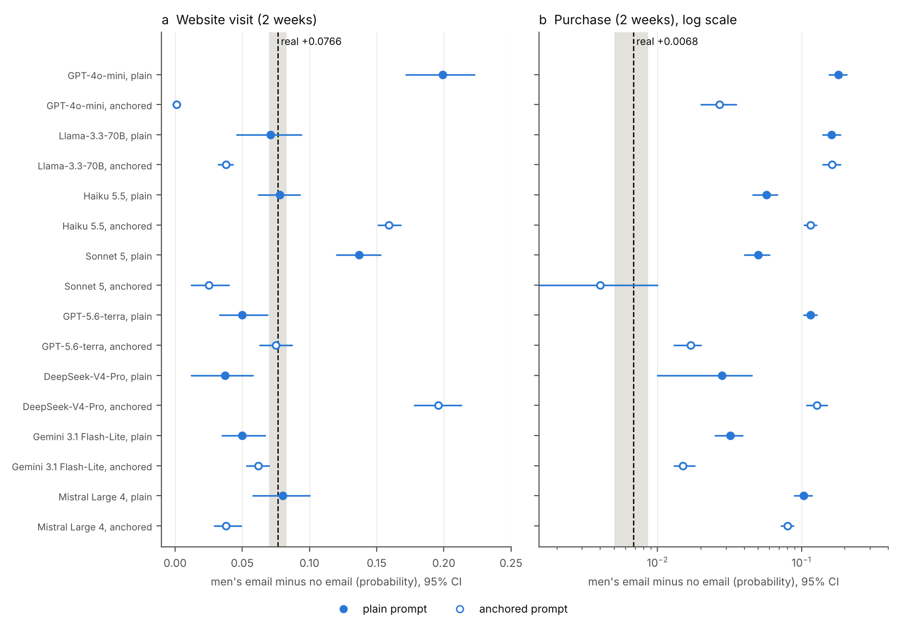

::: {custom-style="Title"}
Synthetic Customers as Decision-Support Artifacts: Design Constraints, Calibration, and Accountability in Generative-AI Marketing Analytics
:::

::: {custom-style="Author"}
Manuscript prepared for submission to *Information Systems Research* (author information omitted for review)
:::

**Abstract**

Organizations are placing generative-AI "digital twins" of customers inside their marketing analytics systems, yet little is known about how such systems should be designed, validated, and governed. We treat the synthetic-customer simulator as an IT artifact for decision support and develop design knowledge for it. Two propositions state system design constraints. A persona-conditioned model that returns deterministic answers can carry only the customer heterogeneity that its persona describes (Proposition 1), and heterogeneity supplied from outside the model must be calibrated against it to avoid double counting (Proposition 2). These constraints explain why a familiar statistical result becomes a managerial problem: when behavior is generated instead of estimated, the spread of simulated behavior is no longer disciplined by the firm's data, it cannot be detected from inside the system, and it can be checked only against the real data that the system was meant to economize. We evaluate four elicitation designs in eight language models against public transaction data (mean counts of about 0.5, 4.8, and 7.8) and a randomized email experiment, using purchase counts and promotion lifts as supporting evidence. Direct and day-by-day designs collapse toward near-constant answers and lose the concentration of purchases among heavy buyers; a design that takes only the level from the model and calibrates the spread externally restores concentration; but calibrating the level adds little beyond what the historical mean alone provides, so the model supplies little that the firm's data do not. Purchase lifts have the right sign but are overstated in 15 of 16 configurations (median about ninefold), enough to reverse a go/no-go decision. We derive five design principles, an acceptance-test protocol, and accountability arrangements for validating and governing synthetic data in analytics systems.

**Keywords:** IT artifact, decision support systems, design science, generative AI, synthetic customers, organizational accountability

# 1. Introduction

Organizations are beginning to place generative-AI "digital twins" of customers inside their marketing analytics systems. The idea is simple: prompt a language model with a customer description, ask what that customer would do, and repeat for thousands of customers, so that promotions, prices, and messages can be tested before money is committed. Early studies found that such synthetic respondents produce plausible willingness-to-pay estimates and conjoint results (Brand et al. 2023), reproduce classic behavioral experiments (Horton 2023), and mimic purchase-intent ratings (Maier et al. 2025), and vendors now market twins of consumer panels on this basis. These studies evaluate the model's answers. What an organization adopts, however, is a system: personas drawn from its customer data, an elicitation procedure, a step that turns answers into numbers, and a decision process that uses them. Whether that system can be trusted for a decision depends on how it is designed, how it is validated, and who is accountable for it. These are questions for information systems research.

We treat the synthetic-customer simulator as an IT artifact, that is, a system that organizations design, deploy, and use to support decisions (Orlikowski and Iacono 2001, Hevner et al. 2004). Design science asks that such an artifact be evaluated against the decisions it serves and that the evaluation yield prescriptive knowledge about how to build it (Gregor and Hevner 2013). Its value does not lie in the language model alone but in the fit between what the system delivers and what the task demands (Goodhue and Thompson 1995). For promotion planning the task demands a plausible share of customers who do not buy, a plausible weight of heavy buyers, and a plausible absolute size of an effect. The elicitation design, meaning how the model is asked, how its answers become numbers, and where the variation among customers comes from, is therefore the artifact's central design variable. We ask which designs preserve what the decision needs, why, and what organizations must do to know.

The question sits at the interface of information systems and marketing. Marketing analytics has become a systems problem: data are collected, transformed, and fed into models and dashboards that shape budgets and campaigns (Wedel and Kannan 2016), and the design, validation, and governance of those systems fall to information systems functions as much as to marketing. Generative AI adds a new component to this pipeline, the synthetic customer. A twin is only as useful as the properties it preserves, and fluent output invites reliance beyond what a system warrants (Lee and See 2004).

To make the question tractable we examine one property on which analytics systems depend, the heterogeneity of customers, as it appears in purchase counts. Marketing science has long modeled counts as a Poisson process whose rate differs across customers, so that the overdispersion of counts measures how much customers differ (Ehrenberg 1959, Schmittlein et al. 1987, Fader et al. 2005). Heterogeneity is a demanding test for a generative system for three reasons. It is invisible in the averages that users inspect. It drives the decisions that matter, those that depend on heavy buyers, on non-buyers, and on uncertainty. And it is the property that studies of silicon samples find compressed, with answers clustering on the modal response (Li et al. 2025, Tigre and Souto 2026) and instruction-tuned models unable to sample from distributions they can describe (Jang et al. 2026). Purchase counts, concentration, and promotion lifts are thus the supporting evidence in this paper, not its subject. They let us observe, against real data, whether the artifact preserves the property that the decision needs.

The statistics are familiar; the setting is not. In classical customer-base models heterogeneity is estimated from the firm's own data, so its magnitude is disciplined by that data. In a synthetic-customer system it is generated by a pretrained model, and nothing in the generation process ties it to the firm's customers. This changes who can know whether the artifact is right, and what the firm must do about it.

We ask four questions. What design constraints govern how much customer heterogeneity a persona-conditioned generative system can carry, and what calibration mechanism restores the rest (RQ1)? Do the elicitation designs open to an organization differ in whether they preserve decision-relevant properties of customer behavior, across models and settings (RQ2)? How can a firm validate such a system, and does calibrating it with its own data suffice (RQ3)? And what do the errors mean for a decision, as judged against a randomized promotion experiment (RQ4)? We compare four elicitation designs in eight language models and two prompt variants against public transaction data sets whose mean counts differ by a factor of ten or more, and against a randomized email experiment.

The study makes five contributions. First, we give design knowledge for the artifact: a design constraint, a calibration mechanism, and a result that links the constraint to customer concentration (Propositions 1 to 3). Second, we explain why this is a managerial problem and not merely a statistical one: when behavior is generated rather than estimated, quality is bounded by the firm's data assets, cannot be seen from inside the system, and depends on components that the firm does not control. Third, we show across designs, models, and settings that direct and day-by-day designs collapse, that taking only the level from the model and calibrating the spread externally restores concentration, and that calibrating the level adds little beyond the historical mean. Fourth, we derive five design principles and an acceptance-test protocol for synthetic-customer systems. Fifth, we identify the organizational arrangements that follow, and we show with a randomized email experiment that overstated promotion lifts would reverse a go/no-go decision.

The remainder of the paper is organized as follows. Section 2 reviews the literature and states the gap. Section 3 develops the design knowledge and hypotheses. Section 4 describes the data, designs, and measures. Section 5 reports results, Section 6 discusses implications and limitations, and Section 7 concludes.

# 2. Related Literature

## 2.1 LLMs as synthetic respondents and customers

LLMs are increasingly proposed as inexpensive stand-ins for consumer panels. Early work suggested that GPT-based respondents can produce plausible willingness-to-pay estimates and conjoint results (Brand et al. 2023), that simulated agents reproduce the qualitative pattern of classic behavioral experiments (Horton 2023), and that LLM-driven agents can be placed in simulated markets to test discount strategies (Chu et al. 2025). Evidence on preferences is more mixed: Goli and Singh (2023) report that GPT models are less patient than humans in intertemporal choices. Related studies find that LLM-generated data can track the direction of experimental treatment effects, although the magnitudes tend to be overstated (Hewitt et al. 2024). Direct elicitation of numerical ratings yields response distributions that are unrealistically narrow, and recent methods address this by mapping free-text answers to rating scales through embedding similarity (Maier et al. 2025).

## 2.2 Variance collapse and sampling

The narrowness of simulated responses is now well documented. Silicon samples drift toward the modal answer within demographic subgroups (Li et al. 2025), consumer panels built from LLMs show variance compression and sign flips in estimated coefficients (Tigre and Souto 2026), and instruction-tuned models appear unable to draw independent samples from the distribution they can otherwise describe (Jang et al. 2026; see also Gu et al. 2024). Prompting a model to list several candidate answers together with their probabilities partly restores diversity (Zhang et al. 2025a). In operations management, LLMs often reproduce the outcome of a hypothesis test while diverging from human data in the full response distribution, with mismatched dispersion playing a central role (Zhang et al. 2025b).

## 2.3 Counts in customer analytics

Nearly all of this evidence concerns bounded, ordinal, or continuous responses such as ratings, choices, and prices. Purchase and visit counts differ in an important way. They are nonnegative integers whose variance is tied to their mean, and in marketing practice they are modeled as a Poisson process whose rate varies across customers, giving a negative binomial distribution in aggregate (Ehrenberg 1959, Schmittlein et al. 1987, Fader et al. 2005). For this reason, overdispersion relative to the Poisson is the empirical signature of customer heterogeneity (Cameron and Trivedi 1990), and a simulator that compresses heterogeneity should show up first as underdispersion. These distributions also feed customer lifetime value, repeat-purchase forecasts, and budget allocation, so errors in their shape propagate directly into downstream decisions.

## 2.4 Synthetic customers as decision-support artifacts

Information systems research has long treated decision-support tools as artifacts whose worth must be shown by evaluation against the decisions they serve, not by internal consistency alone (Hevner et al. 2004, Gregor and Hevner 2013). Design science separates the design of an artifact, here the elicitation procedure, the persona schema, and the calibration step of a simulator, from its evaluation, here the comparison with observed behavior. Task–technology fit supplies the criterion: a technology improves performance when its capabilities match the demands of the task (Goodhue and Thompson 1995). Promotion pre-testing demands four capabilities of a simulated customer base: a plausible average, a plausible spread across customers, a plausible share of non-buyers, and a plausible absolute effect size. Existing evaluations of synthetic respondents mostly check the first and, through ratings, a crude version of the second. We therefore frame our four designs as alternative instantiations of one artifact class and our measures as the fit criteria that this task imposes. The artifact view also locates the topic at the interface of information systems and marketing analytics, where the design of the data and model pipeline determines which marketing decisions are well supported (Wedel and Kannan 2016). Hybrid arrangements in which a model supplies part of a judgment and a statistical procedure supplies another (Dellermann et al. 2019) are one response, and the design we call hybrid is an instance. The artifact view also clarifies what is not at stake. The question is not whether language models "understand" customers, but whether a particular system built on them supports a particular decision (Orlikowski and Iacono 2001).

## 2.5 Research gap

The studies closest to ours stop short of this question. Huang and Wang (2026) model aggregate demand as a mixture of persona-level purchase probabilities, but within a single period and without repeat counts. Sashihara et al. (2025) use the distribution of purchases per buyer as a validation metric for a simulated marketplace, without testing it against Poisson or negative binomial benchmarks. Chen (2026) compares LLM user simulators with verified payment outcomes and finds that they overstate purchase propensity among customers who ultimately do not buy, but the outcome there is a binary conversion rather than a count. Calibration frameworks such as SYN-DIGITS (Fan et al. 2026) align simulated responses with human ground truth at the individual and distributional level, yet, to our reading, they do not exploit the Poisson–gamma structure that governs count data. To our knowledge, and within the scope of our search, no prior study evaluates whether LLM-generated per-customer purchase counts reproduce the dispersion, zero proportion, and tail behavior of observed count data, or examines how the way heterogeneity is injected affects that fidelity.

# 3. Design Knowledge and Hypotheses

This section develops design knowledge for the artifact. We use the Poisson–gamma model as the formal language in which to state what a persona-conditioned generative system can and cannot carry, and we use the propositions that follow as design constraints and as a calibration mechanism for such a system, not as claims about count data. Section 3.7 sets out why we regard them as an information systems contribution.

## 3.1 Purchase counts as a Poisson–gamma mixture

Let customer $i$ have a latent purchase rate $\Lambda_i$ for the period, with mean $\mu = E[\Lambda]$, and let the observed count satisfy $N_i \mid \Lambda_i \sim \text{Poisson}(\Lambda_i)$. Then $E[N] = \mu$ and $\text{Var}(N) = \mu + \text{Var}(\Lambda)$. We define the overdispersion parameter
$$\alpha = \frac{\text{Var}(N) - E[N]}{E[N]^2} = \frac{\text{Var}(\Lambda)}{\mu^2},$$
the squared coefficient of variation of the rate, so that the variance-to-mean ratio equals $1 + \alpha\mu$. When $\Lambda$ follows a gamma distribution, $N$ is negative binomial with dispersion $\alpha$. The quantity $\alpha$ is thus a direct measure of unobserved customer heterogeneity, and it does not depend on the mean, whereas the variance-to-mean ratio does. We report both: the variance-to-mean ratio is easier to read, and $\alpha$ permits comparison across settings with different means.

## 3.2 What a persona-conditioned simulator can carry

A synthetic customer is generated from a persona description $X$. Suppose that, given $X$, the simulator returns a count with conditional mean $m(X)$ and conditional variance $v(X)$, and let $\mu^* = E[m(X)]$.

**Proposition 1.** The simulated counts $N^*$ satisfy $\text{Var}(N^*) = E[v(X)] + \text{Var}(m(X))$. If the simulator is deterministic given the persona, so that $v(X) = 0$, then
$$\alpha^* = c^2 - \frac{1}{\mu^*}, \qquad c^2 = \frac{\text{Var}(m(X))}{\mu^{*2}},$$
and the simulated counts are underdispersed ($\alpha^* < 0$) whenever $\text{Var}(m(X)) < \mu^*$. If in addition $m(X) = E[\Lambda \mid X]$, then $\alpha^* = \alpha - R - 1/\mu$, where $R = E[\text{Var}(\Lambda \mid X)]/\mu^2$ is the share of heterogeneity that the persona does not explain.

*Proof.* The first statement is the law of total variance. With $v(X) = 0$, $\text{Var}(N^*) = \text{Var}(m(X))$, and substituting into the definition of $\alpha$ gives $\alpha^* = c^2 - 1/\mu^*$. If $m(X) = E[\Lambda \mid X]$, then $\mu^* = \mu$ and $\text{Var}(m(X)) = \text{Var}(\Lambda) - E[\text{Var}(\Lambda \mid X)]$, which yields the last expression. $\square$

Proposition 1 identifies two losses. A deterministic simulator drops the Poisson noise (the term $-1/\mu$), and it cannot carry any heterogeneity that the persona does not describe (the term $R$). Both losses are present in direct integer answers. Because real customers differ in ways that a short persona cannot capture, $R$ is rarely small, and collapse toward a single answer is the expected outcome rather than an anomaly.

## 3.3 Injecting heterogeneity without double counting

An obvious repair is to let the model supply only a persona-level mean $\lambda(X)$ and to add the missing heterogeneity from an external random multiplier. Let $\Lambda = \lambda(X)\,G$, where $G$ is independent of $X$, $E[G] = 1$, and $\text{Var}(G) = \alpha_w$.

**Proposition 2.** With $c^2 = \text{Var}(\lambda(X))/E[\lambda(X)]^2$,
$$1 + \alpha = (1 + c^2)(1 + \alpha_w).$$
Consequently, setting $\alpha_w$ equal to the total target $\alpha$ implies an overdispersion of $(1 + c^2)(1 + \alpha) - 1 > \alpha$, an overstatement of $c^2(1 + \alpha)$.

*Proof.* By independence, $E[\Lambda^2] = E[\lambda(X)^2]\,E[G^2] = \mu^2(1 + c^2)(1 + \alpha_w)$, and $\alpha = E[\Lambda^2]/\mu^2 - 1$. $\square$

Proposition 2 gives the calibration rule used in our hybrid design: the external multiplier must carry only the within-persona heterogeneity $\alpha_w = (1 + \alpha)/(1 + c^2) - 1$. It also shows that the hybrid reproduces dispersion by construction, so that its fidelity depends on the one thing the model still supplies, the accuracy of $\lambda(X)$.

## 3.4 Describing a distribution, and a ceiling

A third design asks the model to state probabilities for count bins and then samples a count externally. Because the top bin must be closed to be sampled, this design cannot produce the extreme tail of the real distribution. The variance-to-mean ratio attainable by a perfect description is that of the reference distribution after each bin's mass is spread uniformly within the bin. For the bins we use, this ceiling is 2.10 (with $\alpha$ of 2.33) in the low-mean setting and 6.61 (with $\alpha$ of 1.18) in the high-mean setting, against real values of 2.49 and 7.85. Comparisons for this design are therefore made against the ceiling as well as against the real value.

## 3.5 Relative and absolute effects

Let $p_0$ be the probability of an outcome without a promotion and $d$ the absolute lift caused by it. The risk ratio is $RR = 1 + d/p_0$. A simulator that has the lift right but the base rate wrong therefore produces the wrong risk ratio, and a simulator that has the base rate right but overstates the lift produces an inflated one. Because revenue depends on the absolute lift $d$, evaluating a simulator on risk ratios alone can lead to opposite conclusions from evaluating it on lifts.

## 3.6 Hypotheses

Proposition 1 motivates the first hypothesis, Proposition 2 and Section 3.4 the second and third, and Section 3.5 the fourth.

- **H1 (collapse).** Direct answers (design A) and day-by-day simulation (design B) yield variance-to-mean ratios below the real value and fewer zero counts than the real data.
- **H2 (description).** Describing a distribution (design C) raises dispersion toward, but not beyond, the ceiling of its bins, and yields too few zeros.
- **H3 (hybrid).** The hybrid (design D) reproduces dispersion, and its fidelity depends on the accuracy of the model's mean.
- **H4 (effects).** In an experiment, simulated promotion effects (a) have the correct sign, (b) overstate the absolute lift when the simulated base rate is overstated, and (c) fail to distinguish similar treatments.

We also ask, as an exploratory question, whether collapse is specific to settings with low mean counts, as one might expect if the model rounds small expected counts to 0, 1, or 2.

## 3.7 Propositions as design constraints and a calibration mechanism

The propositions can be read as statements about how to build the artifact, not only about count distributions. Proposition 1 is a design constraint: a component that returns a deterministic answer for each persona can transmit only the heterogeneity that the persona describes, so the remainder must come from another component. Proposition 2 is a calibration mechanism. It allocates a variance budget between the model's persona-conditioned rates and an external noise generator so that their combination matches the dispersion in the organization's own data, $1 + \alpha = (1 + c^2)(1 + \alpha_w)$. The mechanism is explicit, because the allocation is computed rather than tuned; auditable, because the target comes from a named historical data set; and modular, because the model can be replaced without changing the calibration step, although the step must then be recomputed. Together the propositions separate the responsibilities of the language model, which supplies the level of a customer's expected behavior, and a statistical layer, which supplies and calibrates the spread.

*Why this is more than a statistical result.* The algebra is elementary, and we do not claim otherwise. The contribution lies in what it establishes about the design space that an organization faces. First, Proposition 1 is an impossibility result for the levers that organizations control: the prompt, the persona, the choice of model, and the decoding settings. Each acts on the deterministic map from persona to answer, and none can lift the bound $\alpha^* = c^2 - 1/\mu$ beyond what the persona information allows, so a team that tunes prompts to "add diversity" is working on the wrong lever, and this can be known before any experiment. Second, Proposition 2 turns the remedy into a rule that can be computed, audited, and handed to a governance process, which is the form in which design knowledge becomes usable in organizations (Gregor and Hevner 2013). Third, both propositions are independent of which model is used, so they continue to hold when models and providers change, which is the condition for building a system around a component that the organization does not control. Fourth, they generate predictions that we test in Section 5: that direct answers collapse, that constant answers produce $\alpha^* = -1/\mu$, that external noise restores concentration, and that richer personas cannot supply heterogeneity that the persona data do not contain. They are therefore testable design knowledge in the sense of design science (Gregor and Hevner 2013), in the form of constraints and a mechanism that apply to a class of artifacts, not post hoc description.

## 3.8 Why a familiar statistic becomes a managerial problem

The model behind the propositions is not new. What is new is the setting in which their implication becomes a problem for organizations. It changes in four ways when behavior is generated by a language model instead of estimated from data.

*From estimated to generated heterogeneity.* In the customer-base models of marketing science, heterogeneity is a latent quantity inferred from the firm's own data, so its magnitude is disciplined by that data. In a synthetic-customer system it is generated by a pretrained model, and nothing in the generation process ties it to the firm's customers. Proposition 1 shows that the tie cannot be restored through the prompt. The spread is a property of the system's architecture and not of its inputs, and it must be supplied by a component that is connected to data.

*A bound set by the organization's data assets.* The share of heterogeneity that a simulator can carry is the share explained by the persona, and the persona can contain only what the organization knows about its customers (about 1% in our demographic experiment). This is a statement of complementarity between a generative model and the firm's data assets, familiar from research on IT business value (Melville et al. 2004), with a sharp form: more capable models cannot compensate for uninformative customer data. The common assumption that they can is the opposite of what the proposition implies.

*The validation paradox.* Synthetic customers are adopted where real data are scarce or costly, yet the part of the heterogeneity that Proposition 1 shows to be lost is invisible inside the system and can be detected only against real data on the same properties. The evidence that would reveal the error is the evidence that the system was meant to economize. The paradox is resolved only by partial validation, in which a small amount of real data is used to calibrate and audit a large amount of synthetic data, and Proposition 2 supplies the calibration step.

*Silent failure and shifting components.* Fluent output with the right sign gives the user no signal of failure, and a decision that is wrong because of a compressed spread becomes visible only after several campaign cycles, if at all. The generating component is also outside the firm's control. In our runs eight models produced very different levels and spreads for the same prompt, and a model that the firm rents has to be re-validated whenever it changes, which makes validation a continuing governance task.

The consequence of a lost spread is not limited to a statistical summary. It affects decisions that depend on concentration, as the following result shows.

**Proposition 3 (concentration).** Let $\Lambda \ge 0$ be a customer rate with mean $\mu$ and squared coefficient of variation $\alpha > 0$. For $0 < q < 1$ let $S_q$ be the share of all expected purchases that comes from the fraction $q$ of customers with the highest rates, $S_q = \max_{P(A) = q} E[\Lambda \mathbf{1}_A]/\mu$, where the maximum is over events $A$ of probability $q$.

(a) For every rate distribution, $q \le S_q \le q + \sqrt{\alpha\, q(1-q)}$.

(b) If $\Lambda$ is gamma distributed with shape $k = 1/\alpha$, then $S_q(\alpha) = 1 - F_{k+1}\!\left(F_k^{-1}(1-q)\right)$, where $F_k$ is the distribution function of a gamma variable with shape $k$ and unit scale.

(c) Among gamma distributions, $S_q(\alpha)$ is strictly increasing in $\alpha$, and $S_q(\alpha) \to q$ as $\alpha \to 0$.

(d) The simulated count $N^*$ of a deterministic persona-conditioned simulator (Proposition 1) has squared coefficient of variation $c^2$. The share of simulated purchases made by the fraction $q$ of customers with the highest counts is therefore at most $q + \sqrt{c^2 q(1-q)}$.

*Proof sketch.* Part (a) follows from the Cauchy–Schwarz inequality applied to $\text{Cov}(\Lambda, \mathbf{1}_A)$, with an independent event of probability $q$ for the lower bound. Part (b) follows from the identity $\lambda f_{k,\theta}(\lambda) = k\theta\, f_{k+1,\theta}(\lambda)$, which makes the size-biased gamma a gamma with shape $k+1$. Part (c) uses the beta–gamma algebra to write a gamma variable with smaller shape as an independent mean-one multiple of one with larger shape. Part (d) applies (a) to the simulated counts. The full proof is in Online Appendix D. $\square$

For the three reference settings with $q = 0.1$, part (b) gives shares of expected purchases of 52% for the top tenth of customers when $\alpha = 3.05$ (low-mean setting), 38% when $\alpha = 1.42$ (high-mean setting), and 29% when $\alpha = 0.71$ (demographic households), against 10% for a population without heterogeneity. The shares of observed counts are somewhat higher in the low-mean setting (65%, 39%, and 30%) because counts are discrete and zeros are common. A simulator that carries only the persona-described heterogeneity of the demographic experiment ($c^2 = 0.006$) can represent a share of at most 12% by part (d), and 11% if its rates were gamma distributed. Decisions that depend on concentration, such as how deeply to target a promotion, how to set loyalty tiers, or how to size a budget ceiling for heavy buyers, are therefore biased in a known direction when the spread is lost. The direction of the bias, and an upper bound on what a given simulator can represent, are known in advance, which is what makes the problem manageable by design.

# 4. Research Design

## 4.1 Settings and reference data

Table 1 summarizes the three reference settings. In the first, the reference is a negative binomial distribution calibrated to the 4-week purchase counts of customers in the public Online Retail II transaction file (Chen 2019) whose first purchase fell in the first three months: mean 0.49, variance-to-mean ratio 2.49, zero share 0.74, and $\alpha = 3.05$. Our re-aggregation of the public file gave a similar profile (mean 0.43 to 0.51, zero share 0.66 to 0.72, and $\alpha$ between 2.2 and 4.2 across seven consecutive windows, for a cohort of 1,731 customers), and the Cameron and Trivedi (1990) test rejected the Poisson model in every window. In the second, the reference is the empirical distribution of 4-week basket counts, pooled over 13 windows, for the 2,469 loyalty-card households of the dunnhumby Complete Journey data in 2017 (32,097 household-windows). Negative binomial was the best-fitting model by AIC in every window, and the Poisson model was rejected in all of them. In the third, the benchmark is the randomized email test of Hillstrom (2008), in which 64,000 customers received no email, a men's merchandise email, or a women's merchandise email, and visits and purchases were recorded for the following two weeks.

| Data | Unit | Mean | Zero | Var/mean | Alpha | Treatment |
|---|---|---|---|---|---|---|
| Online Retail II (reference) | customer, 4 weeks | 0.49 | 0.74 | 2.49 | 3.05 | none |
| Complete Journey (empirical) | household, 4 weeks | 4.84 | 0.19 | 7.85 | 1.42 | targeted campaigns, not randomized |
| Complete Journey, households with demographics (empirical) | household, 4 weeks | 7.83 | 0.03 | 6.52 | 0.71 | none |
| Hillstrom email test | customer, 2 weeks | visit 0.106; purchase 0.0057 (no email) | | | | randomized: none, men's, women's |

*Table 1. Reference settings.*

## 4.2 Elicitation designs

Each simulated customer is described by a short persona text (a segment label, age, and country or household size; in the email experiment, the real covariates of a sampled customer). We compare four designs.

*Design A (direct).* The persona is asked how many purchases (or shopping trips) it will make in the next 4 weeks and answers with an integer.

*Design B (daily).* For each of the four weeks, the persona decides for each of 7 days whether it makes a purchase (one model call per week); the daily indicators are summed.

*Design C (describe, then sample).* The persona states probabilities for count bins (0, 1, 2, 3, 4, and 5 or more in the low-mean setting; 0, 1–2, 3–4, 5–7, 8–12, 13–20, and 21 or more in the high-mean setting), and a count is drawn with an external random number generator.

*Design D (hybrid).* The persona states only its expected mean count $\lambda$. The count is Poisson with rate $\lambda G$, where $G$ is an external gamma multiplier whose variance is set according to Proposition 2 from the dispersion of the model's own $\lambda$ values and the reference $\alpha$.

Each design is run in two prompt variants. In the *plain* variant the persona receives no information about the population's purchase behavior. In the *anchored* variant it is told the base rate (about 0.5 purchases per 4 weeks and that most customers make none; or about 5 shopping trips per 4 weeks and that some make none).

## 4.3 Models, runs, and measures

We used eight LLMs through the OpenRouter interface: GPT-4o-mini, Llama-3.3-70B-Instruct, and Claude Haiku 5.5 in the first runs, and Claude Sonnet 5, GPT-5.6-terra, DeepSeek-V4-Pro, Gemini 3.1 Flash-Lite, and Mistral Large 4, which were added to test whether larger and more recent models behave differently. All eight models were run on three random seeds, that is, on three independent samples of customers (or household-windows) with new model calls, in the three transaction settings. In the low-mean setting GPT-4o-mini and Llama were run at temperatures 0.3, 0.7, and 1.0 in the first seed and at 0.7 in the two further seeds, giving 1,000 customers per cell; the other six models contribute 600 (three seeds of 200). In the two high-mean settings the temperature was fixed at 0.7, with 600 customers or household-windows per cell. In the email experiment each seed uses 300 customers (900 per model over the three seeds). Three models (Haiku 5.5, Sonnet 5, and GPT-5.6-terra) do not accept a temperature setting and contribute one run per prompt variant and seed. For every model that allows it, hidden reasoning was switched off so that short answers are not truncated. For each cell we report the mean, the variance-to-mean ratio, the zero share, and $\alpha$, with 95% bootstrap intervals over customers. An asterisk marks an interval that excludes the reference value. Parsing failed for 5% or less of the responses in all cells but two: DeepSeek-V4-Pro returned unusable answers for about 10% of the daily-simulation prompts in the high-mean setting, and those cells are computed from the parsed responses only.

## 4.4 Email experiment

For each of 300 customers sampled from the real data (a new sample for each seed) we asked, in separate independent calls, for the probability (0 to 100 percent) that the customer would visit the website, and that it would make a purchase, in the next two weeks, under each of three conditions: no email, a men's email, and a women's email. We report the risk ratio and the absolute lift (the probability with the email minus the probability without it), the latter with paired bootstrap intervals over customers. Yes/no answers and Bernoulli draws from the elicited probabilities were also collected and are discussed where relevant. Because each call sees only one condition, the design mimics random assignment but does not equal it.

# 5. Results

## 5.1 Overview

Table 2 summarizes the low-mean and the high-mean setting by design, and the Online Appendix gives all cells. The main pattern is that variance collapse is severe in designs A and B in every setting, that design C moves toward the real dispersion but loses zeros where they are common, and that design D matches dispersion in most cells while its mean depends on the model. The loss of dispersion has a direct consequence for the concentration of purchases among heavy buyers (Section 5.7).

| Setting | Design | Mean | Var/mean | Zero | Alpha |
|---|---|---|---|---|---|
| Low mean | Reference | 0.49 | 2.49 | 0.74 | 3.05 |
| Low mean | A Direct | 0.00 to 2.10 | 0.00 to 14.72 | 0.00 to 1.00 | -1.00 to 6.54 |
| Low mean | B Daily | 0.00 to 13.56 | 0.24 to 2.95 | 0.00 to 1.00 | -0.86 to 0.62 |
| Low mean | C Describe | 0.37 to 1.30 | 0.97 to 1.61 | 0.32 to 0.71 | -0.06 to 0.80 |
| Low mean | D Hybrid | 0.26 to 0.93 | 1.47 to 3.38 | 0.63 to 0.81 | 1.81 to 3.77 |
| High mean | Reference | 4.84 | 7.85 | 0.19 | 1.42 |
| High mean | A Direct | 3.73 to 11.74 | 0.00 to 2.45 | 0.00 to 0.02 | -0.20 to 0.17 |
| High mean | B Daily | 4.35 to 16.65 | 0.04 to 0.38 | 0.00 to 0.00 | -0.20 to -0.06 |
| High mean | C Describe | 4.23 to 7.95 | 3.65 to 6.44 | 0.01 to 0.15 | 0.41 to 1.00 |
| High mean | D Hybrid | 3.63 to 8.69 | 5.84 to 12.15 | 0.13 to 0.27 | 1.03 to 1.52 |

*Table 2. Range of results across the model-and-prompt cells of each design (sixteen cells in each setting). Reference rows are the real values. For design A in the low-mean setting the variance-to-mean ratio of 1.00 comes from a cell in which practically every simulated customer answered "0" and is uninformative.*

{width=6.4in}

## 5.2 Low-mean setting

Direct and daily designs rarely reproduce the real dispersion. In 45 of the 47 cells of designs A, B, and C with a defined ratio, the upper bound of the variance-to-mean interval is below the reference of 2.49 (Online Appendix Table B1, Figure 1a). Two cells go the other way. DeepSeek-V4-Pro without the anchor gives direct answers with a ratio of 14.7 (interval 5.6 to 22.3), because a few customers receive very large counts alongside many zeros (mean 2.10, zero share 0.52), and its seeds range from 9.0 to 18.4; and Sonnet 5 without the anchor gives daily simulations with a ratio of 2.95 (2.73 to 3.17). Elsewhere direct answers are the most compressed, with ratios of at most 0.87 in 11 of 16 cells; in three further cells nearly every answer was "0" (Llama, Sonnet 5, and Mistral Large 4 with the anchor), which gives a ratio near one and no information, and one cell (DeepSeek-V4-Pro with the anchor) has a ratio close to the Poisson value of one (0.95, interval 0.76 to 1.15). With the anchor, five cells in all (those three, and Sonnet 5 and GPT-5.6-terra for daily simulation) return "0" for 98% to 100% of customers, which follows the anchor text ("most make none") but carries no persona information. Without the anchor, daily simulation overstates the mean in every model (1.6 to 13.6 purchases in 28 days against 0.49) and stays close to Poisson or below it in most. Describing a distribution reaches ratios of 0.97 to 1.61, below its own ceiling of 2.10 in all 16 cells, and its zero share is too low (0.32 to 0.71, against 0.74) in every cell.

The hybrid matches the reference ratio in 10 of 16 cells, the mean in 6, the zero share in 10, and $\alpha$ in 13; all four in 5 cells (Sonnet 5, DeepSeek-V4-Pro, and GPT-5.6-terra without the anchor, and Mistral Large 4 and GPT-5.6-terra with it). Its variance-to-mean ratio misses mainly when the model's mean is low, because the ratio equals $1 + \alpha\mu$ and so inherits the error of the mean even when $\alpha$ is right. Agreement on dispersion is partly by construction, because the gamma multiplier injects it; what the model contributes is the mean, which is almost twice the reference for Llama with the anchor (0.93 against 0.49).

## 5.3 High-mean setting

A higher mean does not relieve the collapse of direct answers (Online Appendix Table B2, Figure 1b). In 13 of 16 cells the variance-to-mean ratio of design A lies between 0.00 and 0.36, against a reference of 7.85. Three cells have more spread: DeepSeek-V4-Pro (1.10 without the anchor and 1.57 with it, both with wide intervals) and Mistral Large 4 without the anchor (2.45, interval 1.98 to 2.98, $\alpha = +0.17$), which carries about a third of the real dispersion. Without the anchor GPT-4o-mini and Llama answered "8" for practically every customer; with the anchor all eight models returned numbers close to the stated base rate of 5 (means of 3.73 to 5.22), so that the answer carries little persona information. Daily simulation again misses the mean (4.35 to 16.65 trips against 4.84) and has almost no dispersion (ratios of 0.04 to 0.38, zero share of at most 0.01). In all 48 cells of designs A, B, and C the variance-to-mean interval lies entirely below the reference.

Describing a distribution reaches ratios of 3.65 to 6.44. Its intervals contain the ceiling of 6.61 in only 3 of 16 cells (3 of the 8 anchored cells), so the impression from the first three models that the anchor lets design C reach the ceiling does not generalize. Its weak point is the zero share: 0.01 to 0.15 against the real 0.19, below the reference in every cell. The hybrid matches the reference ratio in 12 of 16 cells, the mean in 4, the zero share in 8, and all four of mean, ratio, zero share, and $\alpha$ in 2: Haiku 5.5 without the anchor and GPT-4o-mini with it. The remaining cells fail because the model's mean is wrong, for example 3.63 for Mistral Large 4 with the anchor and 7.65 for DeepSeek-V4-Pro without it.

## 5.4 Is collapse specific to low means?

If direct answers were underdispersed only because small expected counts are rounded to 0, 1, or 2, the problem should shrink at higher means. It does not. At a mean of 0.5, 11 of 16 direct-answer cells have variance-to-mean ratios of at most 0.87, three more are cells in which nearly every answer was "0", one is close to Poisson (0.95), and one (DeepSeek-V4-Pro without the anchor) is overdispersed; at a mean of 4.8 the ratio is at most 0.36 in 13 of 16 cells and at most 2.45 in all of them, and at a mean of 7.8 it is at most 0.53 in 14 of 16 cells and at most 1.73 in all. In every setting several models return one value for practically every customer. Collapse of direct answers is therefore not a rounding artifact of low means. Nor do larger or more recent models escape it: the ratios of Sonnet 5 and GPT-5.6-terra in the two high-mean settings lie between 0.02 and 0.36 for direct and daily designs.

## 5.5 Richer personas from real household demographics

The personas used so far were deliberately simple. To test whether richer personas change the picture, we drew 200 household-windows at random in each of three seeds from the 801 Complete Journey households with demographic records and described each household by its real age group, household type and size, number of children, marital status, income, and home ownership. This design also lets us compare each simulated count with that household's real count in the same window. The reference is now the real distribution of these households, who shop more often than the full panel: mean 7.83, variance-to-mean ratio 6.52, zero share 0.03, and $\alpha = 0.71$. The ceiling of design C for this reference is 5.01.

How much can demographics explain? Out of sample (households held out), a Poisson regression of the household's count on all demographic fields reaches a Spearman correlation of only 0.04 with the real count, and the squared coefficient of variation of its predicted means is $c^2 = 0.006$, about 1% of $\alpha$. In terms of Proposition 1, the unexplained share $R$ is almost equal to $\alpha$: the persona describes almost none of the heterogeneity. A deterministic simulator that predicted these means perfectly would have $\alpha^* = c^2 - 1/\mu = -0.12$, against a real $\alpha$ of 0.71.

The simulations behave as Proposition 1 predicts (Table 3, Online Appendix Table B3). Direct answers are collapsed again (variance-to-mean ratio 0.00 to 1.73, $\alpha$ between -0.16 and +0.08). GPT-4o-mini answered "8" for every household when told the base rate and for practically every household without it, which gives $\alpha = -1/\mu = -0.125$, exactly the value of Proposition 1 with $c^2 = 0$. Daily simulation again misses the mean (5.9 to 17.2 against 7.83). Describing a distribution reaches ratios of 3.44 to 6.11, with intervals that contain the ceiling of 5.01 in 10 of 16 cells and a zero share that matches the real 0.03 in 8 of 16. The hybrid matches the reference ratio in 10 of 16 cells but the mean in only 3, because the model's $\lambda$ is usually too low (4.28 to 7.17 in the cells that miss, against 7.83). It matches the zero share in none (0.07 to 0.15), because Poisson counts with a gamma multiplier produce more zeros than these households, and so it matches all four statistics in none.

| Design | Mean | Var/mean | Zero | Alpha | Rank correlation with real count |
|---|---|---|---|---|---|
| Reference | 7.83 | 6.52 | 0.03 | 0.71 | |
| A Direct | 5.60 to 10.25 | 0.00 to 1.73 | 0.00 to 0.00 | -0.16 to 0.08 | -0.11 to +0.04 |
| B Daily | 5.92 to 17.21 | 0.06 to 0.30 | 0.00 to 0.00 | -0.12 to -0.05 | -0.08 to +0.04 |
| C Describe | 5.78 to 9.46 | 3.44 to 6.11 | 0.03 to 0.15 | 0.37 to 0.79 | -0.01 to +0.08 |
| D Hybrid | 4.28 to 7.53 | 4.48 to 6.70 | 0.07 to 0.15 | 0.71 to 0.84 | -0.06 to +0.05 |

*Table 3. Persona experiment with real household demographics: range of results across the 16 model-and-prompt cells of each design (600 household-windows per cell). The last column is the range of the Spearman correlation between the simulated count and the household's real count in the same window.*

Individual-level validity is essentially nil. Across the 63 cells in which the answers vary, the Spearman correlation between the simulated count and the household's real count lies between -0.11 and +0.08, and the interval excludes zero in only two cells (one negative, for DeepSeek-V4-Pro without the anchor, and one positive, for GPT-5.6-terra with it). The model's own $\lambda$ in design D correlates between -0.06 and +0.05 with the real count, and none of its 16 intervals excludes zero. With 79 intervals, about four exclusions are expected by chance at the 5% level. Design C has positive correlations somewhat more often than the others (11 of 16 cells), but the median is +0.01, and the models were run on the same samples of household-windows, so the cells are not independent evidence. On the first sample the demographic regression itself has a rank correlation of -0.03 (interval -0.17 to +0.10); on the two further samples of 200 household-windows it reaches +0.19 and -0.02, which shows how much a single sample can move these correlations. Because the demographics predict the real count with a rank correlation of only 0.04 across all households, this result does not show that the models ignore information; it shows that these personas contain almost no information for any simulator to use. It is the empirical counterpart of Proposition 1: richer observable personas cannot supply the heterogeneity that counts contain.

## 5.6 Randomized email experiment

Table 4 reports the elicited-probability design (the most stable of the three formats we tried), and Figure 2 shows the absolute lift for the men's email. Models run on three seeds are pooled over the three samples of 300 customers. The real effect is a risk ratio of 1.72 for visits and 2.19 for purchases for the men's email, with absolute lifts of 7.7 and 0.7 percentage points.

| Model | Prompt | Outcome | No email | Lift, men's email [95% CI] | Lift, women's email [95% CI] | Gap men minus women [95% CI] | RR men | RR women |
|---|---|---|---|---|---|---|---|---|
| Real (randomized) | | visit | 0.106 | +0.077 [+0.070, +0.083] | +0.045 [+0.039, +0.052] | +0.031 [+0.024, +0.038] | 1.72 | 1.43 |
| Real (randomized) | | purchase | 0.0057 | +0.0068 [+0.0050, +0.0086] | +0.0031 [+0.0015, +0.0047] | +0.0037 [+0.0017, +0.0056] | 2.19 | 1.54 |
| GPT-4o-mini | plain | visit | 0.260 | +0.190 [+0.175, +0.206]\* | +0.215 [+0.199, +0.229]\* | -0.025 [-0.051, +0.003]\* | 1.73 | 1.83\* |
| GPT-4o-mini | anchored | visit | 0.100 | +0.003 [+0.002, +0.004]\* | +0.004 [+0.002, +0.006]\* | -0.001 [-0.003, +0.001]\* | 1.03\* | 1.04\* |
| Llama-3.3-70B | plain | visit | 0.296 | +0.071 [+0.057, +0.084] | +0.064 [+0.050, +0.079]\* | +0.007 [-0.018, +0.030]\* | 1.24\* | 1.22\* |
| Llama-3.3-70B | anchored | visit | 0.100 | +0.035 [+0.032, +0.039]\* | +0.036 [+0.033, +0.039]\* | -0.000 [-0.006, +0.005]\* | 1.36\* | 1.36 |
| Haiku 5.5 | plain | visit | 0.154 | +0.073 [+0.065, +0.081] | +0.091 [+0.082, +0.099]\* | -0.018 [-0.032, -0.004]\* | 1.47\* | 1.59 |
| Haiku 5.5 | anchored | visit | 0.093 | +0.159 [+0.154, +0.164]\* | +0.163 [+0.158, +0.167]\* | -0.004 [-0.011, +0.003]\* | 2.71\* | 2.75\* |
| Sonnet 5 | plain | visit | 0.212 | +0.139 [+0.129, +0.150]\* | +0.152 [+0.143, +0.162]\* | -0.013 [-0.028, +0.003]\* | 1.65 | 1.72\* |
| Sonnet 5 | anchored | visit | 0.195 | +0.027 [+0.019, +0.036]\* | +0.036 [+0.027, +0.045]\* | -0.009 [-0.022, +0.004]\* | 1.14\* | 1.19\* |
| GPT-5.6-terra | plain | visit | 0.277 | +0.049 [+0.038, +0.060]\* | +0.055 [+0.044, +0.066] | -0.006 [-0.021, +0.010]\* | 1.18\* | 1.20\* |
| GPT-5.6-terra | anchored | visit | 0.103 | +0.075 [+0.068, +0.083] | +0.088 [+0.080, +0.096]\* | -0.013 [-0.025, -0.001]\* | 1.73 | 1.86\* |
| DeepSeek-V4-Pro | plain | visit | 0.191 | +0.051 [+0.037, +0.065]\* | +0.044 [+0.030, +0.057] | +0.007 [-0.008, +0.021]\* | 1.27\* | 1.23\* |
| DeepSeek-V4-Pro | anchored | visit | 0.068 | +0.198 [+0.187, +0.208]\* | +0.183 [+0.173, +0.192]\* | +0.015 [+0.002, +0.029]\* | 3.90\* | 3.68\* |
| Gemini 3.1 Flash-Lite | plain | visit | 0.123 | +0.045 [+0.037, +0.052]\* | +0.049 [+0.041, +0.057] | -0.005 [-0.019, +0.008]\* | 1.36\* | 1.40 |
| Gemini 3.1 Flash-Lite | anchored | visit | 0.100 | +0.059 [+0.055, +0.064]\* | +0.058 [+0.053, +0.063]\* | +0.001 [-0.007, +0.009]\* | 1.59\* | 1.58\* |
| Mistral Large 4 | plain | visit | 0.230 | +0.078 [+0.066, +0.089] | +0.089 [+0.078, +0.101]\* | -0.012 [-0.033, +0.008]\* | 1.34\* | 1.39 |
| Mistral Large 4 | anchored | visit | 0.100 | +0.041 [+0.035, +0.047]\* | +0.037 [+0.032, +0.043]\* | +0.004 [-0.007, +0.014]\* | 1.40\* | 1.37 |
| GPT-4o-mini | plain | purchase | 0.155 | +0.169 [+0.155, +0.184]\* | +0.201 [+0.187, +0.214]\* | -0.032 [-0.056, -0.005]\* | 2.09 | 2.30\* |
| GPT-4o-mini | anchored | purchase | 0.064 | +0.026 [+0.021, +0.030]\* | +0.048 [+0.044, +0.053]\* | -0.023 [-0.029, -0.018]\* | 1.40\* | 1.75\* |
| Llama-3.3-70B | plain | purchase | 0.087 | +0.154 [+0.141, +0.168]\* | +0.167 [+0.153, +0.182]\* | -0.013 [-0.039, +0.011] | 2.78\* | 2.93\* |
| Llama-3.3-70B | anchored | purchase | 0.004 | +0.149 [+0.137, +0.162]\* | +0.161 [+0.148, +0.175]\* | -0.012 [-0.034, +0.011] | 43.83\* | 47.87\* |
| Haiku 5.5 | plain | purchase | 0.096 | +0.047 [+0.041, +0.053]\* | +0.054 [+0.049, +0.060]\* | -0.008 [-0.017, +0.002]\* | 1.49\* | 1.57 |
| Haiku 5.5 | anchored | purchase | 0.008 | +0.110 [+0.104, +0.116]\* | +0.120 [+0.113, +0.126]\* | -0.010 [-0.019, -0.000]\* | 15.80\* | 17.02\* |
| Sonnet 5 | plain | purchase | 0.093 | +0.044 [+0.039, +0.050]\* | +0.058 [+0.053, +0.063]\* | -0.013 [-0.022, -0.004]\* | 1.48\* | 1.62 |
| Sonnet 5 | anchored | purchase | 0.045 | +0.002 [-0.001, +0.006]\* | +0.009 [+0.006, +0.012]\* | -0.007 [-0.012, -0.002]\* | 1.05\* | 1.21\* |
| GPT-5.6-terra | plain | purchase | 0.069 | +0.111 [+0.104, +0.118]\* | +0.110 [+0.103, +0.117]\* | +0.001 [-0.010, +0.011] | 2.61\* | 2.60\* |
| GPT-5.6-terra | anchored | purchase | 0.008 | +0.016 [+0.014, +0.018]\* | +0.018 [+0.016, +0.020]\* | -0.002 [-0.005, +0.001]\* | 3.00\* | 3.26\* |
| DeepSeek-V4-Pro | plain | purchase | 0.100 | +0.025 [+0.016, +0.035]\* | +0.025 [+0.016, +0.035]\* | -0.000 [-0.010, +0.010] | 1.25\* | 1.26\* |
| DeepSeek-V4-Pro | anchored | purchase | 0.073 | +0.110 [+0.099, +0.121]\* | +0.107 [+0.096, +0.118]\* | +0.003 [-0.010, +0.015] | 2.52 | 2.47\* |
| Gemini 3.1 Flash-Lite | plain | purchase | 0.072 | +0.029 [+0.025, +0.033]\* | +0.031 [+0.027, +0.035]\* | -0.002 [-0.009, +0.005] | 1.40\* | 1.43 |
| Gemini 3.1 Flash-Lite | anchored | purchase | 0.010 | +0.014 [+0.012, +0.015]\* | +0.014 [+0.012, +0.015]\* | +0.000 [-0.002, +0.003]\* | 2.41 | 2.39\* |
| Mistral Large 4 | plain | purchase | 0.119 | +0.098 [+0.091, +0.105]\* | +0.097 [+0.088, +0.106]\* | +0.001 [-0.012, +0.015] | 1.82\* | 1.81\* |
| Mistral Large 4 | anchored | purchase | 0.009 | +0.078 [+0.074, +0.082]\* | +0.077 [+0.072, +0.081]\* | +0.001 [-0.007, +0.009] | 10.12\* | 10.01\* |

*Table 4. Probability-elicitation design (mean elicited probability over 300 simulated customers per seed, three independent calls per customer, pooled over three seeds, 900 customers per model). Lift = probability with the email minus probability without it; gap = lift of the men's email minus lift of the women's email; intervals are 95% paired bootstrap intervals over customers (real values: normal approximation). RR = risk ratio, the mean of the three per-seed ratios; its asterisk is set only if the interval excludes the real ratio in all three seeds. \* the simulated and the real intervals do not overlap.*

{width=6.4in}

Four patterns emerge. First, the direction is mostly reproduced: the risk ratio, averaged over seeds, exceeds one in all 32 probability-elicitation cells (smallest 1.03), although in individual seeds its interval touches one in a few cells (for example, Sonnet 5 with the anchor for purchases, 1.02 [0.91, 1.15] in the second seed). Llama with the anchor gave a risk ratio below one in the yes/no format for visits (0.60 to 0.69 in all three seeds). Second, the size of the visit effect depends on the model and the prompt. In 4 of 16 configurations the lift for the men's email is statistically consistent with the real +0.077 (Llama-3.3-70B, Haiku 5.5, and Mistral Large 4 without the anchor, and GPT-5.6-terra with it); eight are significantly smaller (three of them less than half as large, for example Sonnet 5 with the anchor, +0.027), and four are more than 1.5 times as large (for example GPT-4o-mini without the anchor, +0.190). Which prompt works differs by model: the anchor brings GPT-5.6-terra to the real value but moves DeepSeek-V4-Pro from 0.5 to 2.6 times the real lift.

Third, the absolute lift in purchase probability exceeds the real +0.0068 in 15 of the 16 configurations, by a median factor of about 9 and by up to 25 (for example +0.169 for GPT-4o-mini without the anchor). The one exception is Sonnet 5 with the anchor, whose purchase lift (+0.002) is only 0.4 times the real one, because it attributes almost no effect to the email (its visit lift is also 0.4 times the real one, and its no-email purchase probability is eight times the real one). Providing the base rate sets the no-email probability close to the stated number (about 0.10 for visits in six models, and 0.004 to 0.010 for purchases in five) without lowering the email-arm probability accordingly, so the risk ratio explodes in some cases (10 to 44 for Llama, Haiku, and Mistral) while the absolute lift stays large. The relation $RR = 1 + d/p_0$ explains both patterns: Llama without the anchor has a visit lift of +0.071, close to the real value, but a no-email probability of 0.30 instead of 0.106, and therefore a risk ratio of only 1.24 against the real 1.72.

Fourth, the models do not tell the two emails apart. In reality the men's email has the larger lift (+0.077 against +0.045 for visits, a gap of +0.031 with interval +0.024 to +0.038). Among the 32 probability-elicitation cells, the point estimate of the gap is positive in only 9, and the largest simulated visit gap is +0.015. Seven gap intervals exclude zero. In six of them the women's email is rated significantly higher (Haiku 5.5 without the anchor and GPT-5.6-terra with it for visits, and GPT-4o-mini and Sonnet 5 in both prompt variants for purchases), and in one (DeepSeek-V4-Pro with the anchor for visits) the men's email is rated higher, by +0.015, which is half the real gap.

Direct yes/no answers are not usable for rare events. In 15 of 32 yes/no cells of the first seed (and in 27 of 64 cells of the two further seeds) the model answered "No" for every customer in the no-email condition, so the risk ratio is undefined (for example, GPT-4o-mini answered "No" for every customer without an email and "Yes" for about half with one). The yes/no visit lifts range from -0.31 to +0.55, and the purchase lifts from +0.008 to +0.55, up to 80 times the real lift.

## 5.7 Customer concentration

Proposition 3 predicts that a simulator without heterogeneity cannot represent the concentration of purchases among heavy buyers, and that the hybrid design, which supplies the spread externally, can. We measured the share of all simulated purchases made by the top tenth of customers (ranked by count) in every cell and compared it with the same share in the reference. In the reference the top tenth account for 65% of purchases in the low-mean setting, 39% in the high-mean setting, and 30% for the demographic households. For a population without heterogeneity the share is 10% or, in the low-mean setting, slightly above because most counts are zero and the counts of the rest are discrete.

The prediction is borne out. Direct answers and daily simulation cannot represent concentration. In the 91 cells of these two designs in which a meaningful share can be computed, the top-decile share is below the reference in every one and the interval excludes the reference. It lies between 0.10 and 0.49 in the low-mean setting (the highest value is the overdispersed DeepSeek-V4-Pro cell for direct answers), between 0.10 and 0.18 in the high-mean setting, and between 0.10 and 0.16 for the demographic households, that is, practically at the 10% that a population without heterogeneity would give. We excluded five low-mean cells in which almost every simulated customer made no purchase, where the share is 1.00 or undefined only because there is almost nothing to distribute. Describing a distribution recovers part of the concentration (0.30 to 0.52 in the low-mean setting against 0.65, and 0.27 to 0.36 in the high-mean setting against 0.39), and its interval excludes the reference in 16 of 16 and 15 of 16 cells. For the demographic households, whose reference concentration is low, it lies within the interval of the reference in 11 of 16 cells. The hybrid design reproduces concentration in 39 of 48 cells (11 of 16, 13 of 16, and 15 of 16 in the three settings), including cells in which the model's mean is wrong, because the share depends on the dispersion and not on the level. This is the clearest case in which the hybrid design repairs a decision-relevant property that direct elicitation loses entirely.

## 5.8 Does calibrating the level repair the hybrid design?

The hybrid design inherits the model's mean, which was often wrong. An obvious repair is to rescale the model's expected counts so that their average equals the historical mean of the organization's own customer file, and to keep the external gamma multiplier of Proposition 2. We tested this offline on the stored expected counts of design D, in every model-and-prompt cell, with a fresh simulation of the counts (so the figures differ slightly from those in Sections 5.2 to 5.5). We added a baseline that uses no information from the model: every customer receives the reference mean, and the same gamma multiplier supplies the entire dispersion. This baseline is the reference distribution itself, up to sampling, and it shows what the model adds.

Calibration does what it is meant to do for the mean. The mean matches the reference in 44 of 48 cells after calibration, against 19 of 48 before (13 of 16 against 9 in the low-mean setting, 15 against 6 in the high-mean setting, and 16 against 4 for the demographic households). It does not, however, make the design match the reference on all four statistics at once. The number of cells that match on mean, variance-to-mean ratio, zero share, and $\alpha$ together is 14 of 48 after calibration and 10 of 48 before, and 19 of 48 for the baseline with no model information (low-mean setting: 12, 7, and 15 of 16; high-mean setting: 2, 3, and 4 of 16; demographic households: 0 in all three). The remaining mismatches are mostly in the zero share, and they do not come from the model. A Poisson–gamma distribution with the reference mean and dispersion implies a zero share of 0.23 in the high-mean setting (real 0.19) and of 0.07 for the demographic households (real 0.03), so the parametric family itself misses the zeros of these empirical distributions, and the baseline shows the same misses.

The squared coefficient of variation of the model's expected counts, which is the heterogeneity that the model contributes, ranged from 0.00 to 0.75 in the low-mean setting (against $\alpha = 3.05$), from 0.00 to 1.00 in the high-mean setting (against 1.42; the largest value is Llama with the anchor), and from 0.00 to 0.07 for the demographic households (against 0.71). With rank correlations to real counts near zero (Section 5.5), this heterogeneity is not informative about which customers buy more. The evidence therefore supports a narrow reading of the model's role. In this task it supplies a level, and a model-free level taken from the organization's data does as well or better. Whether a model contributes more when the personas carry informative history, such as past purchases, is untested.

## 5.9 Summary of hypotheses

| Hypothesis | Evidence |
|---|---|
| H1. Designs A and B collapse. | Supported. The variance-to-mean ratio of designs A, B, and C lies below the reference in 45 of 47 cells (low mean; the exceptions are a DeepSeek-V4-Pro cell for direct answers and a Sonnet 5 cell for daily simulation, both without the anchor), 48 of 48 (high mean), and 45 of 48 (demographic personas, where design C sometimes reaches the reference). The zero share of designs A and B is at most 0.02 in the two high-mean settings and below the real value in 26 of 32 low-mean cells (in the others, anchored prompts led the model to answer "0" for most customers). |
| H2. Design C approaches but does not exceed its ceiling and under-produces zeros. | Partly supported. Design C stays below its ceiling in all 16 low-mean cells, reaches it in 3 of 16 high-mean cells, and reaches it in 10 of 16 cells with demographic personas. Zero shares are too low where the real share is large (0.74 and 0.19) but close to the real value where it is small (0.03; 8 of 16 cells). |
| H3. Design D reproduces dispersion; fidelity depends on the model's mean. | Partly supported. It matches the reference ratio in 32 of 48 cells (10 of 16, 12 of 16, 10 of 16), but matches mean, ratio, zero share, and $\alpha$ jointly in only 7 of 48 (5, 2, 0) because the model's mean is often wrong and, in the demographic setting, the zero share is too high in every cell. No model matches in more than two of the three settings. |
| H4a. Direction is reproduced. | Mostly supported: the risk ratio exceeds one in all 32 probability cells, with two intervals touching one (see Section 5.6). |
| H4b. Absolute lift is overstated when the simulated base rate is overstated. | Supported for purchases: the lift exceeds the real value in 15 of 16 configurations (median about ninefold). Not for visits: 4 of 16 are consistent with the real value, 8 are too small, and 4 are too large. |
| H4c. Similar treatments are not distinguished. | Supported. The simulated gap between the two emails excludes zero in 7 of 32 cells; in six the sign is the opposite of the real one, and in one it is right but half the size. |
| Exploratory: collapse is specific to low means. | Not supported. Direct answers collapse at means of 0.5, 4.8, and 7.8. |
| Exploratory: calibrating the model's level repairs the hybrid design. | Partly. The mean matches in 44 of 48 cells after calibration (19 before), but the number of cells matching on all four statistics rises only from 10 to 14 of 48, and a baseline that uses no model information matches in 19 of 48. |
| Exploratory: concentration of purchases among heavy buyers (Proposition 3). | Supported. The top-decile share of purchases is practically at the 10% of a homogeneous population for direct and daily designs (below the reference in all 91 interpretable cells), is partly recovered by describing a distribution, and is matched by the hybrid design in 39 of 48 cells. |
| Exploratory: richer personas repair collapse. | Not supported. With real demographics the simulated counts have a rank correlation with real counts of -0.17 to +0.16 (3 of 63 intervals exclude zero); the demographics themselves explain about 1% of the heterogeneity. |
| Exploratory: larger and more recent models escape collapse. | Not for direct answers (ratios of at most 1.00 in 42 of 48 cells; the six exceptions are all DeepSeek-V4-Pro or Mistral Large 4). Not for the hybrid design either: its accuracy follows the model's mean, which matched the reference in 13 of 48 cells with no model better than the others across settings. |

*Table 5. Hypotheses and evidence.*

# 6. Discussion

We lead with the contributions to information systems research (Section 6.1) and the design principles that follow from them (Section 6.2), then turn to the validation protocol and the decision consequences (Section 6.3), the cost of uncritical trust (Section 6.4), and the organizational arrangements that follow (Section 6.5). The marketing results of Section 5 serve as evidence for these contributions. Limitations are in Section 6.6.

## 6.1 Contributions to information systems research

*Design knowledge for a class of artifacts that organizations are adopting without one.* Propositions 1 and 2 define a design constraint and a calibration mechanism for persona-conditioned generative systems, and the evidence is consistent with both. Variance-to-mean ratios of direct answers are at most 1.00 in 42 of 48 cells, whatever the mean or the model. When a model returns the same number for every household, the dispersion parameter takes the value $-1/\mu$ that Proposition 1 predicts (about -0.12 in the demographic experiment). Persona enrichment cannot repair this, because the demographics explain about 1% of the heterogeneity. And the design that follows Proposition 2, in which the model supplies a level and an external layer supplies the spread, restores the concentration of purchases among heavy buyers in 39 of 48 cells where direct and daily designs lose it entirely (Section 5.7). Larger and more recent models (Sonnet 5, GPT-5.6-terra, DeepSeek-V4-Pro, Gemini 3.1 Flash-Lite, Mistral Large 4) do not escape the constraint. This reframes the usual advice to "add noise" to synthetic respondents: the amount of noise is not a free parameter, and it is determined by how much heterogeneity the persona already carries.

*Why the problem is managerial.* The constraint has organizational consequences that a purely statistical reading would miss (Section 3.8). The system's quality is bounded by the firm's data assets and not by the capability of the model: the model contributed little heterogeneity of its own (squared coefficients of variation of its rates of 0.00 to 0.75 against dispersion parameters of 0.71 to 3.05) and nothing that identified which customers buy more (rank correlations with real counts between -0.11 and +0.08). Calibrating the model's level to the historical mean repaired the mean in 44 of 48 cells, but a baseline that gave every customer the historical mean did as well or better on the joint fit (Section 5.8). The value of the generative component therefore has to be demonstrated against the firm's own data, which is the data the system was meant to economize (the validation paradox), and the failure is silent and exposed to changes in components that the firm does not control.

*The limits of AI-based decision support and of the "digital twin" idea.* A twin is usually understood as a replica that can stand in for the original in a decision. Our evidence supports a narrower reading. At the level of the individual customer, the demographic personas carried almost no information about real counts, so a customer-level replica is not supported by these data. At the level of the population, the distribution of counts and the size of effects are reproduced only by designs in which the dispersion is supplied from outside the model and the level is checked against data. The claim that a simulated population is a twin of a real one is therefore a claim about specific properties, and it has to be tested property by property: the share of zeros, the spread, the concentration among heavy buyers, and the absolute size of an effect. Evaluation should be stated in terms of the decision-relevant properties of the artifact's output, because fluency and aggregate plausibility, which are what users see, do not indicate them.

*Supporting evidence for marketing analytics.* Two further results extend what is known about LLM-based simulation. Describing a distribution (Jang et al. 2026, Zhang et al. 2025a) helps more at a high mean than at a low mean, and in the settings where zeros are common it under-produces them, which matters because the zero share decides how many customers a campaign does not reach. And evaluating a promotion simulator on relative effects alone is hazardous: the relation $RR = 1 + d/p_0$ shows that errors in the simulated base rate and errors in the simulated lift are confounded in the risk ratio, and our data contain cases in which the two readings of the same output disagree.

## 6.2 Design principles for synthetic-customer systems

Design science asks that an evaluation lead to prescriptive knowledge about how the artifact should be built (Gregor and Hevner 2013). The evidence supports five design principles. They are derived from our experiments and analytical results and have not been tested as an intervention, so they should be read as hypotheses for design rather than as established prescriptions.

*Principle 1: Separate the level from the spread.* Take the expected rate of a customer from the model and take the dispersion across customers from an external, calibrated source (Proposition 2). In system terms this places a statistical calibration layer behind the language model, with the variance budget of Section 3.7 as its rule. Designs that let the model produce the spread itself collapsed, while the hybrid design matched the reference dispersion in 32 of 48 cells.

*Principle 2: Do not let the model produce the final integer or the daily draw.* Direct integer answers and day-by-day simulation returned nearly constant values in almost every cell, and their errors were not random but systematic (Section 5).

*Principle 3: Calibrate the level before use, and invest in customer data before model capability.* Because the persona bounds what the model can carry (Section 3.8), the data assets that feed the persona matter more than the choice of model. The mean from the model was the bottleneck of the hybrid design (matching the reference in only 13 of 48 cells). Rescaling the model's rates to the historical mean repaired the mean in 44 of 48 cells (Section 5.8), but a baseline that gives every customer the historical mean did as well or better on the joint fit, so calibration should be paired with a test against such a baseline to show what the model adds.

*Principle 4: Treat context and wording as design parameters that must be validated.* A stated base rate changed some outputs by an order of magnitude, and in several cells it made the model repeat the stated number for every customer. Wording of the prompt is a design parameter in the same sense.

*Principle 5: Evaluate on absolute effects against a randomized benchmark.* Risk ratios hid errors in the simulated base rate (Section 5.6).

A further observation concerns use. The simulators' output looked plausible: the sign of the promotion effect was right in nearly all cells, and the answers were fluent and well formed. Errors of the kind we document, such as a compressed spread or a tenfold lift, cannot be seen by inspecting the output, which is why an explicit evaluation protocol is needed before such a system is adopted for decisions.

## 6.3 Validation protocol and decision consequences

The artifact view implies an acceptance test that a synthetic-customer system should pass before it enters a planning process. We state it in terms of the decision-relevant properties established above.

1. *Compare shapes, not only means.* Before using synthetic counts, compute the variance-to-mean ratio, $\alpha$, the zero share, and the share of purchases made by the top decile of customers against a historical customer file, and check them with an interval, as we do here. A ratio near or below one signals collapse.
2. *Do not use direct integer answers.* In our data they returned a single value for practically every customer in several cells.
3. *If the model is used, use it for the level only, calibrate the level, and test the model against a baseline without it.* Inject the remaining heterogeneity externally, calibrated according to Proposition 2 on a historical or pilot sample, and rescale the model's rates to the historical mean. In our data the uncalibrated mean matched the reference in only 13 of 48 hybrid cells, calibration raised this to 44, and a baseline that used the historical mean alone fitted as well or better, so the value of the model has to be shown, not assumed.
4. *Treat a stated base rate as a prompt choice that must be tested.* It corrected the mean in some designs, collapsed all answers to one value in others, and changed the size of the simulated promotion effect by an order of magnitude.
5. *Validate on absolute effects and base rates.* Report the simulated base rate and the absolute lift next to the risk ratio, and compare both with a past randomized test before any revenue calculation.

The consequence for a decision can be shown in a stylized example. A firm launches a promotion if the expected gain per targeted customer exceeds its cost, that is, if the lift in purchase probability exceeds the ratio of cost to margin. Suppose a promotion costs 1 monetary unit per targeted customer and each purchase earns a margin of 50, so the ratio is 0.02. The real lift in purchase probability from the men's email was 0.0068, below 0.02, so the randomized test says not to launch. The simulated lift exceeded 0.02 in 13 of the 16 configurations (the median was 0.063, and the real value was exceeded in 15), so a firm that relied on those simulators would have launched. The stylized numbers are ours and are not taken from the retailer, and the email test does not involve a discount, but the example shows how an overstated absolute lift turns directly into a wrong go decision.

## 6.4 The cost of uncritical trust

The central managerial risk is not that synthetic customers are useless but that they are trusted without being tested. Our evidence points to four ways in which that trust becomes costly.

*Confident, wrong sizing.* The simulated purchase lift for the men's email was overstated in 15 of 16 configurations, with a median of about nine times the randomized value. In the stylized example of Section 6.3, a campaign to 100,000 customers has a real expected result of $0.0068 \times 50 - 1 = -0.66$ per customer, a loss of about 66,000, while the median simulated lift of 0.063 predicts about $+2.1$ per customer, a profit of about 213,000. The gap of about 280,000 for a single campaign has a sign that favors launching, and the error is systematic, so it does not average out over campaigns.

*False precision.* The simulated lifts often came with narrow intervals that excluded the real value in most configurations. Statistical precision, which a synthetic population gives cheaply because the sample size is limited only by the budget for calls, must not be mistaken for validity.

*Erosion of the evidence base.* If synthetic results replace randomized tests because they are faster and cheaper, the organization loses the data that would reveal the error and that its calibration step needs (Section 3.8), and the failure becomes self-concealing. We did not observe this process; it follows from the validation paradox.

*Propagation.* Synthetic customers used as inputs to forecasts, budget models, or other learned systems carry their compressed spread with them. Concentration is lost (Proposition 3) and the share of non-buyers is distorted, and the result enters downstream decisions as if it were observed data. The cost is then a bias built into the planning system, whose source is hard to trace afterward.

These risks do not argue against the technology. They argue against using it as a replacement for evidence rather than as a complement to it, and against purchasing decisions based on demonstrations of fluency and plausible averages, which our experiments show to be the properties least informative about decision quality.

## 6.5 Organizational accountability: validating and governing synthetic data in analytics systems

The following arrangements follow from our evidence and from the artifact view; we did not test them in an organization.

*Treat validation as an acceptance gate with named owners.* Before synthetic customers enter a planning process, the system should pass the acceptance test of Section 6.3 against the organization's own history. The reference values come from the customer file and the experiment archive that the marketing analytics team already holds, so the test puts a concrete interface between two functions: the marketing team owns the reference data and the decision requirements, and the information systems team owns the pipeline, the model versions, and the calibration step. A decision that rests on a vendor's model, a prompt written by an analyst, and a calibration step maintained by another team has no owner for its errors unless accountability is assigned before the system is used. A digital twin that no one is accountable for validating is a liability presented as an asset.

*Re-validate when a component changes.* The eight models we tested differed widely in the same design, and the same model reacted differently to different prompt context. A vendor update, a switch of model or provider, or a change in the prompt template should therefore trigger the acceptance test again, in the same way that a schema change triggers regression tests in other systems.

*Use synthetic data where its errors do the least harm.* The designs reproduced the sign of a promotion effect in nearly all cases, but not its size. Synthetic customers are therefore better suited to screening and ranking options, or to generating hypotheses, than to sizing a campaign or computing revenue, for which a randomized holdout test remains the standard.

*Keep synthetic data separate from real data.* Synthetic records that share a schema with customer records can end up in dashboards, forecasts, or training sets for other models, where their compressed spread is no longer visible. Provenance labels, separate storage, and a rule against pooling synthetic and real records in estimation are inexpensive safeguards.

*Weigh the savings against the cost of a wrong decision, and build the correcting loop.* The runs themselves are cheap: about 25,600 calls cost under one US dollar with the least expensive models and about eleven US dollars with the most expensive of the four we priced, at list prices at the time of our runs. The relevant cost is the decision made on the output, so governance effort should be proportional to its value. Each randomized test that the organization runs is also a calibration data point for its simulator; a system that stores the simulated and the realized lift of each past campaign can track its own bias and adjust the calibration step, which turns an occasional validation into a continuing feedback process.

## 6.6 Limitations and future research

The evidence is preliminary. Every design has one prompt wording, so our intervals capture the sampling of customers but not variation across prompts, The transaction settings and the email experiment were run on three seeds for all eight models, and the per-seed variance-to-mean ratios were stable for the direct and daily designs (median range 0.04 and 0.03 across seeds, at most 0.30), except in a few DeepSeek-V4-Pro cells where direct answers are overdispersed (ranges of up to 9.4). They varied more for the describe design (median range 0.9, at most 2.1) and the hybrid design (median 1.2, at most 4.2), so the counts of cells in which these designs match the reference should be read as approximate. We tested eight models in all four settings, five of them larger or more recent than the first three. Whether still larger or reasoning-enabled models collapse less, and whether the overstated purchase lifts persist there, remains open. The low-mean reference is a calibrated parametric distribution rather than the raw data, and the Complete Journey households are loyalty-card shoppers with relatively high purchase frequency. Richer personas built from real household demographics did not change the picture, but the demographics in these data explain almost none of the heterogeneity ($c^2/\alpha = 0.01$), so that test marks the limit of observable personas rather than a limit of particular models; settings in which observable attributes, such as purchase histories, are more predictive of purchase frequency would be a stronger test of Proposition 1. In the Complete Journey data campaigns were targeted rather than randomized, so only the email experiment supports a causal comparison. Design C truncates its top bin, which lowers the dispersion it can reach; we quantified this ceiling but did not remove it. Public data may also be part of the models' training data. Future work should evaluate the hybrid design with a calibrated mean, test prompts that elicit several candidate answers with probabilities, and use a randomized promotion data set with purchase counts, for example from a partner firm, so that the count-distribution and treatment-effect questions can be studied on the same customers.

# 7. Conclusion

A synthetic-customer system is an artifact whose quality cannot be read from its output. We showed that a persona-conditioned generative component can transmit only the customer heterogeneity that its persona describes, that the remainder has to be supplied and calibrated by a layer connected to the firm's own data, and that this turns a familiar statistical fact into a managerial problem: the spread of simulated behavior is no longer disciplined by the firm's data, it cannot be seen from inside the system, and it can be checked only against the real data that the system was meant to economize. The evidence from eight language models, three transaction settings, and a randomized email experiment is consistent with this account. Direct and day-by-day designs collapse toward a single value and lose the concentration of purchases among heavy buyers; a design that takes the level from the model and the spread from an external calibrated source restores concentration; calibrating the level repairs the mean, but a baseline that uses the historical mean alone does about as well, so the model supplied little that the firm's data did not; and purchase lifts are overstated in 15 of 16 configurations, enough to turn a no-go decision into a go. For organizations the implication is a short list of duties: validate against the firm's own data before use, with an acceptance test on shape, concentration, and absolute effects; revalidate when the model, provider, or prompt changes; keep synthetic data apart from real data; keep running randomized tests as the evidence base that calibration needs; and assign accountability for the artifact before it is used, not after the first costly outcome. Future research should study these arrangements in organizations and test whether personas that carry informative purchase histories give the generative component more to contribute.

# References {-}

Brand J, Israeli A, Ngwe D (2023) Using GPT for market research. Working Paper 23-062, Harvard Business School, Boston.

Cameron AC, Trivedi PK (1990) Regression-based tests for overdispersion in the Poisson model. *J. Econometrics* 46(3):347–364.

Chen D (2019) Online Retail II. Data set, UCI Machine Learning Repository, University of California, Irvine.

Chen L (2026) Simulated customers never walk away: Decision fidelity of LLM user simulators measured against real purchase outcomes. Preprint, submitted June 16, arXiv:2606.20708.

Chu ML, Terhorst L, Reed K, et al. (2025) LLM-based multi-agent system for simulating and analyzing marketing and consumer behavior. Preprint, submitted October 20, arXiv:2510.18155.

dunnhumby (n.d.) The Complete Journey. Data set, accessed through the completejourney_py package.

Ehrenberg ASC (1959) The pattern of consumer purchases. *J. Royal Statist. Soc. Ser. C* 8(1):26–41.

Fader PS, Hardie BGS, Lee KL (2005) "Counting your customers" the easy way: An alternative to the Pareto/NBD model. *Marketing Sci.* 24(2):275–284.

Fan GJ, Huang C, Peng T (2026) SYN-DIGITS: A synthetic control framework for calibrated digital twin simulation. Preprint, submitted April 8, arXiv:2604.07513.

Goodhue DL, Thompson RL (1995) Task-technology fit and individual performance. *MIS Quart.* 19(2):213–236.

Goli A, Singh A (2023) Can LLMs capture human preferences? Preprint, submitted May 4, arXiv:2305.02531.

Gu J, Pang L, Shen H, Cheng X (2024) Do LLMs play dice? Exploring probability distribution sampling in large language models for behavioral simulation. Preprint, submitted April 13, arXiv:2404.09043.

Gregor S, Hevner AR (2013) Positioning and presenting design science research for maximum impact. *MIS Quart.* 37(2):337–355.

Dellermann D, Ebel P, Söllner M, Leimeister JM (2019) Hybrid intelligence. *Bus. Inform. Systems Engrg.* 61(5):637–643.

Hevner AR, March ST, Park J, Ram S (2004) Design science in information systems research. *MIS Quart.* 28(1):75–105.

Hewitt L, Ashokkumar A, Ghezae I, Willer R (2024) Predicting results of social science experiments using large language models. Working paper, Stanford University, Stanford, CA.

Hillstrom K (2008) The MineThatData e-mail analytics and data mining challenge. Blog post, March 20, http://blog.minethatdata.com.

Horton JJ (2023) Large language models as simulated economic agents: What can we learn from Homo silicus? Preprint, submitted January 18, arXiv:2301.07543.

Huang C, Wang K (2026) LLM-powered virtual population for demand simulation and pricing. Preprint, submitted June 15, arXiv:2606.16183.

Jang C, Lee D, Kim J (2026) Instruction-tuned language models cannot sample from distributions they can describe. Preprint, submitted July 28, arXiv:2607.25292.

Li D, Li L, Qiu HS (2025) ChatGPT is not a man but Das Man: Representativeness and structural consistency of silicon samples generated by large language models. Preprint, submitted June 25, arXiv:2507.02919.

Maier BF, Aslak U, Fiaschi L, et al. (2025) LLMs reproduce human purchase intent via semantic similarity elicitation of Likert ratings. Preprint, submitted October 9, arXiv:2510.08338.

Melville N, Kraemer K, Gurbaxani V (2004) Review: Information technology and organizational performance: An integrative model of IT business value. *MIS Quart.* 28(2):283–322.

Orlikowski WJ, Iacono CS (2001) Research commentary: Desperately seeking the "IT" in IT research—A call to theorizing the IT artifact. *Inform. Systems Res.* 12(2):121–134.

Sashihara J, Fujita Y, Nakamura K, et al. (2025) LLM-based multi-agent system for simulating strategic and goal-oriented data marketplaces. Preprint, submitted November 17, arXiv:2511.13233.

Schmittlein DC, Morrison DG, Colombo R (1987) Counting your customers: Who are they and what will they do next? *Management Sci.* 33(1):1–24.

Lee JD, See KA (2004) Trust in automation: Designing for appropriate reliance. *Human Factors* 46(1):50–80.

Tigre R, Souto HG (2026) When can you trust your synthetic users? Diagnostics and corrections for LLM consumer panels. Preprint, submitted June 3, arXiv:2609.13148.

Wedel M, Kannan PK (2016) Marketing analytics for data-rich environments. *J. Marketing* 80(6):97–121.

Zhang J, Yu S, Chong D, et al. (2025a) Verbalized sampling: How to mitigate mode collapse and unlock LLM diversity. Preprint, submitted October 1, arXiv:2510.01171.

Zhang R, Zhang X, Zhao M (2025b) Predicting effects, missing distributions: Evaluating LLMs as human behavior simulators in operations management. Preprint, submitted September 30, arXiv:2510.03310.

*An Online Appendix (Appendix A, prompt templates; Appendix B, full results by model and prompt; Appendix C, reproducibility; Appendix D, proof of Proposition 3) is provided as a separate file.*
