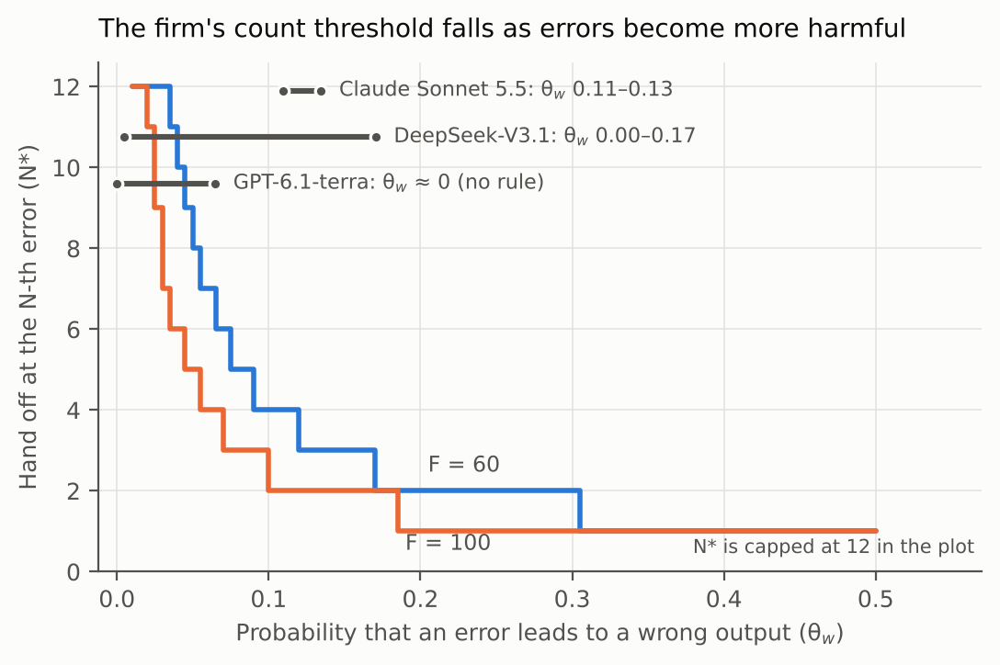
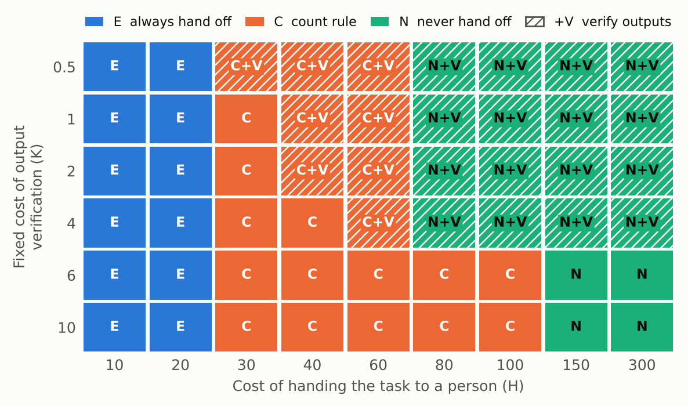
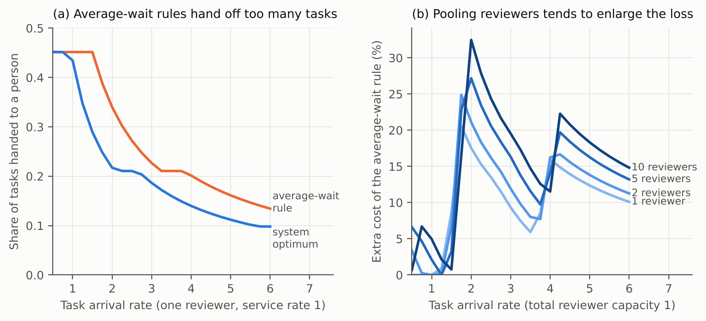
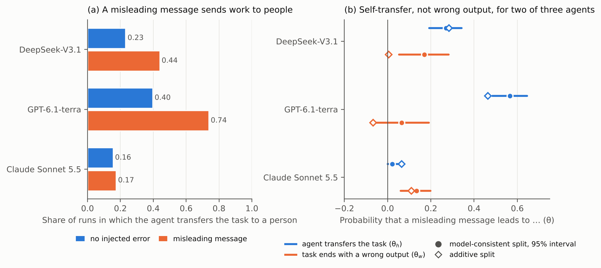

## Abstract

Firms deploy AI agents on streams of multistep tasks and rely on a limited pool of human reviewers to take over when an agent goes wrong. Work reaches those reviewers from two sources: the firm, through a rule such as "hand off after N errors," and the agent, which may transfer a task to a person on its own. We study how the two combine with verification of outputs and with reviewer capacity. In our model an error can lead to a wrong output, which is costly to repair, or to a transfer by the agent, which loads the reviewers. We show that the firm's best rule counts each error type by the probability that it leads to a wrong output; that verification and escalation are substitutes, with verification worth most when reviewers are hardest to reach; and that a rule set from the observed average wait hands off too often. We use 80,036 public agent trajectories and randomized fault-injection experiments with five agents (11,352 runs). Transient failures did not change the success of the two commercial models. A misleading tool message raised GPT-6.1-terra's rate of transferring to a person from 0.40 to 0.74 without increasing wrong outcomes, and led Claude Sonnet 5.5 to wrong outputs (about 0.12 per message). What an error leads to matters more than how many errors occur, and the accuracy of an agent's tools affects how many reviewers a firm needs.

**Keywords:** AI agents; human oversight; escalation; reviewer capacity; optimal stopping; randomized experiment

## 1. Introduction

A customer asks an airline's AI agent to change a flight. The agent looks up the reservation, and the booking system answers: *reservation not found*. The agent has three options. It can accept the message and tell the customer there is no booking. It can look again by another route. Or it can hand the case to a person. In our experiments one commercial model, GPT-6.1-terra, chose the third option far more often when the "not found" message was false: it transferred the case in 74% of runs, against 40% when nothing was wrong. Every such transfer joins a queue of cases waiting for a reviewer.

This paper is about the decision behind that queue. When should a task be taken back from an AI agent, who should make that call, and how many people does the answer require?

A common reply is that firms should retrain or redesign their agents so that they make fewer errors. They should, but that does not remove the problem. Agents are often bought and not built. The tools an agent calls are run by systems the firm does not control, and even a very reliable agent will meet an occasional wrong answer from a database or an interface. What the firm does control is the rest of the system: when it steps in, whether it checks results, and how many reviewers it employs. These choices interact. A firm that tunes one and ignores the others will misjudge the cost.

We model a firm that sends tasks to an AI agent. At each step the agent may make errors, the task may finish, and the firm may hand the task to a human reviewer. We give an error two possible consequences, because the data separate them. An error can *derail* the task, so that it ends with a wrong output that is costly to detect and repair. Or it can lead the agent to *transfer* the task to a person itself, which costs a reviewer's time. Reviewers are scarce, and tasks that reach them wait. The firm chooses its hand-off rule and whether to pay for a check on finished outputs; in an extension it also chooses how many reviewers to employ.

**What we find in the model.** First, the firm should count errors by what they cause. The best rule hands off when a weighted count of errors reaches a threshold, where each error type is weighted by the probability that it leads to a wrong output. A type that never does should not be counted, however often it occurs. An agent's own transfers hardly change the threshold, but they change the load on reviewers a great deal. Second, verification and escalation are substitutes. Better verification raises the threshold at which the firm should step in, and verification is worth the most when people are hardest to reach, whereas monitoring is worth the most for tasks at the margin of delegation, where handing off costs about what letting the agent finish costs. Third, a firm that decides to escalate against the average wait it observes hands off too often, because each new case also delays the cases behind it. This is the classical congestion externality applied to hand-off rules, and we treat it as a supporting result.

**What we find in the data.** A public corpus of 80,036 trajectories of an open-source software-engineering agent shows strong clustering of errors, but most of it disappears once tasks are allowed to differ in difficulty. We then ran two randomized fault-injection experiments, in customer service and in code repair, with five agents and 11,352 runs. At a random point of each run we inserted either a transient failure or a misleading "not found" message. Transient failures did not change the success of the two commercial models. A misleading message did. It raised GPT-6.1-terra's transfer rate from 0.40 to 0.74 and lowered its success from 0.77 to 0.46, but the additional failures were almost all transfers and not wrong outputs. Claude Sonnet 5.5 behaved differently: it rarely transferred more and sometimes finished with a wrong output (we estimate that a misleading message leads to one with probability about 0.12). For DeepSeek-V3.1 the split between the two depends on how the channels are separated. In code repair, where the agent can run tests, effects were smaller.

**Contributions.**

- *For capacity models of oversight.* Existing models take the demand for review as given, as a function of an exogenous risk score (Wang and Rachev 2026) or of exogenous reviewer error rates (Lin and Zhang 2026). We show with randomized fault injection that, for a multistep agent, the volume of escalations depends on the accuracy of its tools: a misleading message raised one agent's transfer rate from 0.40 to 0.74. This is one agent in one domain, and we do not claim it holds in general.
- *For research on human–AI delegation.* We move from whether to delegate to when and by whom a delegation should be reversed once the agent acts over many steps. Operations research already studies capacity-dependent deferral from classifiers and screening judges (Lykouris and Weng 2024; Wang and Rachev 2026; Lin and Zhang 2026). We add the error structure of multistep agents and evidence on what agents do after an error.
- *For practice.* The quality of tool outputs drives escalation volume, so data governance and staffing are one decision. A small injection experiment of the kind we run calibrates the rule. And a common shortcut, setting escalation thresholds from the observed queue, escalates too much.

Our first reading of the experiments treated the whole fall in success after a misleading message as wrong outputs. The transcripts show that for two of three agents most of it is the agent's own transfer. We report both channels and show where the conclusions depend on how they are separated (Section 5).

Section 2 reviews related work. Section 3 presents the model and Section 4 the results on thresholds, verification, and reviewer capacity. Section 5 reports the observational and experimental evidence and separates the two channels. Section 6 discusses implications and limits, and Section 7 concludes. Proofs and details of the experiments are in the appendices.

## 2. Related Literature

**Delegation to AI agents.** Research on information systems has long asked how work is divided between people and technology. Baird and Maruping (2021) treat delegation to agentic artifacts as an ongoing allocation of rights and responsibilities, Berente et al. (2021) frame the management of AI as a balance of autonomy, learning, and inscrutability, and Fügener et al. (2022) show that people delegate poorly to AI. These papers ask whether to delegate. We ask when and by whom a delegation should be reversed once an agent acts over many steps.

**Deferral and escalation under congestion.** The closest work studies when to send cases to scarce human reviewers.

- Lykouris and Weng (2024) study an AI that classifies items and sends uncertain ones to a congested human queue, with delayed and selectively sampled feedback, and give a near-optimal online-learning algorithm. Their object is a classifier acting on independent items.
- Wang and Rachev (2026) model a controller that decides, for each arriving task with a risk score, whether to automate it or escalate it to a finite-capacity human queue, while the reliability of the automation drifts as a Markov chain. They prove that the optimal rule is a threshold on the risk score that rises with the backlog ("congestion shedding"), falls under drift ("safety buffering"), and is driven by a shadow price of capacity, and they identify a capacity phase transition. Their analysis states the congestion externality and the planner's shadow price. **It overlaps with our capacity analysis, and we do not present that part as new.** Their decisions are made one task at a time on an exogenous risk score. They do not model errors that accumulate within a run, errors with different consequences, transfers initiated by the agent, or verification, and their numerical study is synthetic.
- Lin and Zhang (2026) study agents that draft pull requests, a mandatory human approval, and an optional AI reviewer that filters first but whose false rejections send good work back for another agent run. In a queueing network with rework, the optimal share of work sent to review passes through four phases as maintainer capacity grows. Reviewer error rates are exogenous inputs, calibrated on a coding benchmark. Their reviewer screens finished outputs, and nothing happens inside the run. Their result that the value of oversight is non-monotone in staffing is close to ours, and we present ours as supporting.
- Turan (2026) models agent action gates with a reviewer whose accuracy falls as load rises, and finds that safety peaks at an intermediate escalation rate. Alves et al. add workload constraints to cost-sensitive learning to defer.

**Queues and individual versus social optimization.** Naor (1969) shows that joining decisions made against the observed queue exceed the social optimum. Our result on hand-off rules applies this externality; it is an application and not a new principle. For the convexity of the mean queue size in the M/M/c queue we rely on Grassmann (1983); Lee and Cohen (1983) treat related performance measures.

**Optimal stopping, monitoring, and control.** The decision to take a task back is a stopping problem (Wald 1947; Shiryaev 1963). We use the monotone case of Chow, Robbins, and Siegmund (1971) to obtain a closed-form threshold. Which signal to monitor is the question of informativeness (Blackwell 1953; Holmström 1979), and our distinction between monitoring a process and verifying its output follows the control-portfolio view of Kirsch (1997).

**The reliability of LLM agents.** Benchmarks such as SWE-agent (Yang et al. 2024) and τ-bench (Yao et al. 2024; Barres et al. 2025) report whether agents finish tasks. They do not model the dynamics of errors within a run or derive decision rules for a firm that deploys an agent. Persistence in observed outcomes can come from past outcomes changing future behavior or from differences between units (Heckman 1981); we address this with a model of task heterogeneity and, more decisively, with randomized injection of errors.

## 3. Model

**Setting.** A firm sends a stream of tasks to an AI agent. A task is carried out in steps; a step is one action of the agent, such as a tool call. A step costs $k$, and each error made in it costs a further $c$. After each step the task is completed with probability $q$, independently of everything else. At the start of each step the firm may instead hand the task to a human reviewer, which ends the agent's involvement and costs $H$. The cost $H$ includes the reviewer's time to take over and finish the task.

**Errors and what they cause.** An error is a tool call that the environment rejects. Errors are of types $j = 1, \dots, J$, and the number of type-$j$ errors in a step is Poisson with mean $\mu_j$. An error of type $j$ has two possible consequences, which we keep apart because the data separate them (Section 5).

- *Derailment.* With probability $\theta_{wj}$ the error derails the task. A derailed task still runs on and may be completed, but its output is wrong, and the firm then pays $F$ to detect and repair it. The firm does not observe derailment directly.
- *Self-transfer.* With probability $\theta_{hj}$ the error leads the agent to transfer the task to a person on its own. The task ends and costs $H$, exactly as if the firm had handed it off, but the firm did not choose the timing.

Errors are independent across steps and types. We write $\tilde\theta_j = \theta_{wj} + \theta_{hj} - \theta_{wj}\theta_{hj}$ for the probability that an error has at least one consequence.

**What the firm sees and controls.** The firm sees every error and its type, but not derailment. It chooses when to hand off, as a function of the history of errors. In Section 4.2 it also chooses the quality $d \in [0,1]$ of a check on finished outputs. A derailed output is caught with probability $d$, in which case repair costs $F_d$; otherwise the wrong output reaches the customer and costs $F_u > F_d$. The expected cost of a derailed completion is therefore $F(d) = F_u - d\,(F_u - F_d)$, and the check costs $v(d)$, with $v$ convex and increasing. In Section 4.3 hand-offs queue for a limited number of reviewers.

**Timing and cost.** At the start of step $t$ the firm hands off or lets the agent act. If the agent acts, the step cost is incurred, errors arrive, the agent may transfer the task, and otherwise the task is completed with probability $q$. If it completes, the firm pays $F(d)$ times the probability that the task has been derailed. The firm minimizes expected total cost.

**Assumptions.** (A1) Errors and their types are observed. (A2) Parameters are known and constant. (A3) Completion occurs with probability $q$ whatever the error history; errors affect the correctness of the output only through derailment.

*Terms.* A *hand-off* is a transfer chosen by the firm; a *self-transfer* is a transfer chosen by the agent; *escalation* covers both.

## 4. Analysis

### 4.1 Count errors by what they cause

Write $N_j$ for the number of type-$j$ errors so far, $w_j = -\ln(1-\theta_{wj})$ for the weight of a type-$j$ error, and $\rho = \exp(-\sum_j \mu_j\theta_{hj})$ for the probability that the agent does not transfer the task in a step.

**Proposition 1 (count rule).** The optimal policy hands the task to a person at the first step at which the weighted count $\sum_j w_j N_j$ reaches $-\ln R$, where
$$R = e^{\sum_j \mu_j \tilde\theta_j}\left[\frac{k + c\sum_j \mu_j}{qF} - \rho\,\frac{H-F}{F}\right].$$
If $R \ge 1$ the firm should hand off at once. If $R \le 0$, or if all $\theta_{wj} = 0$ and $R < 1$, it should never hand off on account of errors.

*In words.* Count each error by how likely it is to lead to a wrong output, and hand off when the total gets large enough. An error type that never produces a wrong output should not be counted at all, however often it occurs. Without self-transfer ($\theta_{hj} = 0$) the rule reduces to the single-type threshold of Equation (A1) in Appendix A.

*Remark (what self-transfer changes).* The agent's own transfers affect the threshold only through the factors $e^{\sum_j\mu_j\tilde\theta_j}$ and $\rho$, which differ from one by terms of order $\mu$. In numerical examples ($\theta_w$ between 0.1 and 0.3, $F = 60$ or $100$) the optimal count did not change when $\theta_h$ was varied from 0 to 0.8, except in one case ($\theta_w = 0.3$, $F = 60$), where it fell from two to one. The threshold is set by $\theta_w$. Self-transfer matters for how much work reaches the reviewers (Section 4.3), not for when the firm should step in.

Figure 1 shows the threshold as a function of $\theta_w$. In our data, for example, the estimate of $\theta_w$ for Claude Sonnet 5.5 after a misleading message is about 0.12, which gives a threshold of two to four errors, whereas for GPT-6.1-terra $\theta_w$ is indistinguishable from zero and no count rule is warranted, even though its misleading errors have large consequences in another way: they send work to reviewers (Section 5).

{width=100%}

**Figure 1.** *The firm's count threshold falls as errors become more harmful. Optimal number of errors after which the firm hands the task to a person (Proposition 1) as a function of the probability $\theta_w$ that an error leads to a wrong output, for two costs of a wrong output ($F = 60$ and $100$). Hand-off cost $H = 40$; other costs are illustrative. Horizontal bars mark the estimated $\theta_w$ of each agent after a misleading message in customer service; the ends of each bar are the additive and the model-consistent estimates (Section 5.3). For GPT-6.1-terra $\theta_w$ is indistinguishable from zero and no count rule is warranted. The number of errors is capped at 12 in the plot.*

### 4.2 Escalation and verification are substitutes

Let $G(H, F)$ be the expected cost of the best count rule for a given hand-off cost $H$ and wrong-output cost $F$. Call the saving relative to the better of the two static choices (always hand off, never hand off) the *value of monitoring*, and call $V(H; d) = G(H, F_u) - G(H, F(d))$ the *value of verification at quality $d$*.

**Proposition 2 (monitoring pays at the margin).** Let $\bar C$ be the expected cost of never handing off. The value of monitoring is nondecreasing in $H$ up to $H = \bar C$ and nonincreasing beyond it.

*In words.* Monitoring is worth building for tasks where taking the work back costs about as much as letting the agent finish. Tasks that are cheap to reassign can simply be reassigned, and tasks that are very costly to reassign stay with the agent whatever the monitor reports.

**Proposition 3 (verification substitutes for escalation).**

(a) The optimal count threshold is nondecreasing in the quality $d$ of the output check, and the optimal check quality is nondecreasing in the threshold: tighter escalation lowers the value of checking.

(b) The optimal threshold is nondecreasing in the hand-off cost $H$.

(c) The value of verification $V(H; d)$ is nondecreasing in $H$. It is zero when hand-offs are so cheap that the firm always hands off, and it equals $d\,(F_u - F_d)\,z_\infty$ when the firm never hands off, where $z_\infty$ is the probability that a task finishes derailed when the firm never intervenes. With $v(d) = \kappa d^2$ the check that is worth buying in that case has quality $d = (F_u - F_d)\,z_\infty/(2\kappa)$ and a net gain of $[(F_u - F_d)\,z_\infty]^2/(4\kappa)$.

*In words.* Checking outputs and stepping in during the run do the same job, so more of one means less of the other. Escalation is worth most at the margin of delegation; verification is worth most when people are hardest to reach.

Figure 2 shows which combination of controls is best as the cost of reaching a person and the fixed cost of verification vary. We did not manipulate verification in our experiments. The coding agent can run the tests, which checks its own work, and its effects were smaller than those of the customer-service agent, which is consistent with the ordering of Figure 2 but does not test it.

{width=100%}

**Figure 2.** *The best combination of controls as the cost of reaching a person varies. Best portfolio as the cost $H$ of handing a task to a person and the fixed cost $K$ of verifying outputs vary (Proposition 3). Colors give the escalation policy (E: always hand off; C: count rule; N: never hand off); hatching marks that output verification is adopted. Verification detects a derailed output with probability 0.8 and turns the cost of an undetected wrong output (100) into a repair cost (30). Probability that an error derails the task: $\theta_w = 0.12$ (the estimate for Claude Sonnet 5.5). Costs are illustrative; verification was not manipulated in the experiments.*

### 4.3 Reviewer capacity

So far the hand-off cost $H$ is a constant. With a limited number of reviewers, each hand-off also delays the others, and the cost of a hand-off depends on how many tasks are handed off. Suppose tasks arrive at rate $\Lambda$ and a hand-off waits in a queue with mean delay $W(\lambda)$ at hand-off rate $\lambda = \Lambda P$, where $P$ is the probability that a task is handed off under the firm's rule. Delay costs $\omega$ per unit of time. The hand-off cost becomes $H_{\text{eff}} = h + \omega W(\lambda)$, where $h$ is the reviewer's working cost.

**Proposition 4 (do not set the rule from the observed wait).** Suppose $\lambda W(\lambda)$ is convex and $W$ is increasing, as in the M/M/1 and M/G/1 queues and, by Grassmann (1983), in the M/M/c queue. A firm that sets its rule against the average wait it observes hands off at least as often as the system optimum, which accounts for the delay each hand-off imposes on others. The wedge between the marginal and the average delay cost per hand-off is $\omega\Lambda P\,W'(\Lambda P)$, which is positive whenever waits rise with load and is what the average-wait rule ignores. The two rules coincide only where the policy frontier has a kink or at a corner.

*In words.* A rule that looks at how busy the reviewers seem now ignores the delay that a new case causes for everyone behind it, so it escalates too much.

In numerical examples the extra cost of the average-wait rule ranges from zero to about 30%. It tends to be larger when the same total capacity is pooled across more reviewers, and smaller under bursty arrivals in most but not all cases (Figure 3). The costs in these examples are illustrative, and we use an approximation (Allen–Cunneen) for queues with variable arrivals. We present Proposition 4 as an application of Naor's (1969) externality, and capacity-dependent thresholds also appear in Wang and Rachev (2026), so we treat this part as supporting.

{width=100%}

**Figure 3.** *A rule based on the observed wait hands off too many tasks. (a) Share of tasks handed to a person under the system optimum and under a rule that treats the average observed wait as the price of a hand-off, as the arrival rate of tasks grows; one reviewer with service rate 1 and delay cost 10 per unit of time (Proposition 4). (b) Cost of the average-wait rule relative to the system optimum when the same total capacity is split across 1, 2, 5, or 10 reviewers (Allen–Cunneen approximation with arrival variability equal to 1, queueing delay only). The curves are not smooth because the number of errors at which the rule hands off is an integer. Pooling raises the loss in most but not all cases: averaged over arrival rates of 2 or more, the loss is 11.9%, 13.7%, 16.7%, and 19.2% for 1, 2, 5, and 10 reviewers, and it exceeds the one-reviewer loss at 94% of the arrival rates tried. $\theta_w = 0.29$, $F = 100$, reviewer working cost $h = 20$; illustrative.*

*Link to Section 5.* In this extension the arrival rate of work at the reviewers is not a primitive. It is $\Lambda P$, where $P$ depends on the agent's self-transfer probability $\theta_h$ as well as on the firm's rule. In our data a misleading tool message changed GPT-6.1-terra's transfer rate from 0.40 to 0.74, which nearly doubles the load on the reviewers while changing the firm's threshold hardly at all (the Remark in Section 4.1). The accuracy of the tools the agent relies on therefore enters the staffing decision directly.

## 5. Evidence

The model needs three quantities: how strongly errors beget errors, how likely an error is to lead to a wrong output ($\theta_w$), and how likely it is to lead the agent to transfer the task itself ($\theta_h$). We estimate the first from a large observational corpus and the other two from randomized fault injection.

### 5.1 Observational evidence from software-engineering trajectories

We use a public corpus of 80,036 trajectories of the open-source agent SWE-agent, driven by three sizes of an open-weight model (Llama-3.1 8B, 70B, and 405B; Yang et al. 2024; Nebius 2024). We code an error whenever the environment rejects an action: an edit that fails a syntax check, a command that does not exist, a missing file, a malformed call, or a timeout. About 22% of steps contain an error.

Errors cluster strongly. The probability of an error is 0.66 after an error and 0.10 after a successful step. Part of that gap is task difficulty. Permuting errors within each trajectory, which keeps a trajectory's error rate but destroys dependence, leaves a gap of 0.434 against the observed 0.555. A self-exciting model of the Hawkes (1971) type, without task heterogeneity, puts all three models in the unstable range (a branching ratio between 1.48 and 2.08, Table 1). Once task difficulty varies, through a gamma-distributed baseline, the ratio falls to between 0.38 and 0.56, and likelihood-ratio tests still reject the absence of excitation. Two features argue against reading what remains as causal. Persistence within a run, such as an agent stuck in a malformed workspace, looks like contagion. And the number of errors in the first eight steps predicts the final failure with an area under the curve of only 0.55.

| Model | Trajectories | Branching ratio, no heterogeneity | Branching ratio, with heterogeneity | 95% bootstrap interval | α | δ | CV of μ | LR statistic |
|---|---|---|---|---|---|---|---|---|
| Llama-3.1-8B | 3,000 | 1.85 | 0.50 | [0.44, 0.56] | 0.20 | 0.60 | 1.79 | 2077 |
| Llama-3.1-70B | 3,000 | 1.48 | 0.38 | [0.31, 0.42] | 0.21 | 0.45 | 1.41 | 1130 |
| Llama-3.1-405B | 1,140 | 2.08 | 0.56 | [0.49, 0.62] | 0.15 | 0.73 | 3.05 | 659 |

*Table 1. Self-exciting models of agent errors in SWE-agent trajectories, with and without a gamma-distributed baseline. The branching ratio is the expected number of further errors that one error triggers directly or through its descendants; α is the increase in intensity caused by one error and δ the rate at which it persists. The likelihood-ratio statistic tests excitation given heterogeneity (two degrees of freedom). Bootstrap intervals use 15 resamples, warm-started at the estimate, and may understate uncertainty.*

Most of the clustering that practitioners call a cascade is therefore differences between tasks. The observational data cannot separate contagion from persistence inside a run, which is why we randomize.

### 5.2 Randomized fault injection

*Design.* We inserted errors at a random point of each run, so that a comparison of injected and control runs identifies the causal effect of an error. In the *transient* arm the agent's $j$-th tool call, with $j$ drawn uniformly from $\{1, 2, 3\}$, is not executed and returns a message that the service is temporarily unavailable. In the *misleading* arm the call returns a message of the form "<argument> '<value>' not found," which mimics the environment's own error messages and asserts, falsely, that the requested object does not exist. Control runs carry a virtual injection point drawn in the same way. Injected calls never change the state of the environment. A third arm with repeated transient errors is reported in the replication package.

*Settings.* Customer service uses $\tau^2$-bench (Barres et al. 2025): 50 airline and 114 retail tasks served through tool calls on a database. Success is the final database matching the one produced by the correct actions, and the simulated customer is played by GPT-4.1-mini (7,872 runs). Code repair uses 87 real bugs from seven open-source Python projects (BugsInPy; Widyasari et al. 2020), with at most 30 turns. Success requires every failing developer test to pass and no previously passing test to fail (3,480 runs). We ran five agents: Llama-3.1-8B and 70B, DeepSeek-V3.1, and two recent commercial models, GPT-6.1-terra and Claude Sonnet 5.5, the latter two at low reasoning effort, all at temperature 0.5. The injection point was reached in 90–99% of runs, so intention-to-treat estimates are close to effects among runs in which the error occurred. The 11,352 runs cost about US\$330. Appendix B gives details, and code and run-level logs are in the replication package.

### 5.3 What injected errors do

*Transient failures are mostly harmless.* Table 2 shows that, after an unavailability message, the success of GPT-6.1-terra and Claude Sonnet 5.5 does not change in customer service, and the agents typically retry once and succeed. DeepSeek-V3.1 is the exception: its success falls by about 0.20 after either kind of error.

| Domain | Agent | Control success | Transient − control | Misleading − control |
|---|---|---|---|---|
| Customer service | Llama-3.1-8B | 0.18 | +0.016 [-0.012, +0.041] | -0.022 [-0.047, +0.002] |
| Customer service | Llama-3.1-70B | 0.33 | -0.039 [-0.085, +0.006] | -0.043 [-0.087, +0.006] |
| Customer service | DeepSeek-V3.1 | 0.68 | -0.198 [-0.259, -0.143] | -0.195 [-0.262, -0.131] |
| Customer service | GPT-6.1-terra | 0.77 | -0.006 [-0.061, +0.049] | -0.305 [-0.372, -0.235] |
| Customer service | Claude Sonnet 5.5 | 0.84 | -0.021 [-0.070, +0.021] | -0.146 [-0.210, -0.088] |
| Code repair | Llama-3.1-8B | 0.00 | +0.011 [+0.000, +0.034] | +0.011 [+0.000, +0.029] |
| Code repair | Llama-3.1-70B | 0.09 | +0.034 [-0.011, +0.086] | -0.006 [-0.063, +0.046] |
| Code repair | DeepSeek-V3.1 | 0.83 | -0.080 [-0.144, -0.017] | -0.057 [-0.115, -0.006] |
| Code repair | GPT-6.1-terra | 0.99 | +0.006 [+0.000, +0.017] | +0.006 [+0.000, +0.017] |
| Code repair | Claude Sonnet 5.5 | 0.97 | -0.052 [-0.098, -0.011] | -0.057 [-0.109, -0.011] |

*Table 2. Task success in the control arm and change in success after an injected error, by domain and agent. Differences are paired by task and repetition; 95% intervals come from a task-clustered bootstrap with 1,000 resamples.*

*A misleading message changes what the agent does.* In customer service it lowers success by 0.31 for GPT-6.1-terra, 0.20 for DeepSeek-V3.1, and 0.15 for Claude Sonnet 5.5. Table 3 shows that the fall for GPT-6.1-terra goes together with a near-doubling of the share of runs in which the agent transfers the case to a person.

| Agent | Control success | Misleading message: success | Transfer rate, control | Transfer rate, misleading | Change in transfer rate |
|---|---|---|---|---|---|
| Llama-3.1-70B | 0.33 | 0.29 | 0.47 | 0.51 | +0.05 [-0.01, +0.11] |
| DeepSeek-V3.1 | 0.68 | 0.48 | 0.23 | 0.44 | +0.21 [+0.14, +0.27] |
| GPT-6.1-terra | 0.77 | 0.46 | 0.40 | 0.74 | +0.34 [+0.28, +0.41] |
| Claude Sonnet 5.5 | 0.84 | 0.69 | 0.16 | 0.17 | +0.02 [-0.03, +0.06] |

*Table 3. Customer service, misleading message versus control. Success and transfer rates over all runs; a transfer means that the agent called `transfer_to_human_agents`; intervals from a task-clustered bootstrap with 2,000 resamples.*

{width=100%}

**Figure 4.** *What a misleading tool message does. Customer service, misleading message versus no injected error. (a) Share of runs in which the agent transfers the task to a person. (b) Probability that a misleading message leads to a self-transfer ($\theta_h$) or to a wrong output ($\theta_w$). Dots and lines: model-consistent split with 95% task-clustered bootstrap intervals; open diamonds: additive split (Section 5.3). For GPT-6.1-terra almost all of the fall in success is self-transfer; for Claude Sonnet 5.5 it is wrong output; for DeepSeek-V3.1 the split of the wrong-output channel depends on the estimator. The Llama agents are omitted because their control success is too low to separate the channels.*

*Two channels.* The model distinguishes a wrong output from a self-transfer, so we split the fall in success accordingly. Let $\theta$ be one minus the ratio of success in injected and control runs. We split it in two ways. In the *additive* split, $\theta_h$ is the extra failures that include a transfer call and $\theta_w$ the extra failures that do not, each divided by control success, so that $\theta = \theta_h + \theta_w$ exactly. A transfer can replace a run that would otherwise have ended wrong, so the additive $\theta_w$ can understate derailment, and for GPT-6.1-terra it is significantly negative. The *model-consistent* split assumes that error-induced transfer thins the runs that would not have transferred, and that success without a transfer is then thinned by $(1-\theta_h)(1-\theta_w)$, which is the structure of the model in Section 3. The two splits bracket the answer.

| Agent | Total θ | θ_h, additive | θ_w, additive | θ_h, model-consistent | θ_w, model-consistent |
|---|---|---|---|---|---|
| Llama-3.1-70B | +0.13 [+0.00, +0.25] | +0.15 [-0.01, +0.31] | -0.02 [-0.20, +0.14] | +0.09 [+0.00, +0.19] | +0.11 [-0.09, +0.27] |
| DeepSeek-V3.1 | +0.29 [+0.20, +0.37] | +0.28 [+0.20, +0.37] | +0.00 [-0.09, +0.09] | +0.27 [+0.19, +0.34] | +0.17 [+0.05, +0.28] |
| GPT-6.1-terra | +0.40 [+0.31, +0.48] | +0.46 [+0.38, +0.55] | -0.07 [-0.13, -0.02] | +0.57 [+0.48, +0.65] | +0.06 [-0.06, +0.19] |
| Claude Sonnet 5.5 | +0.18 [+0.11, +0.24] | +0.07 [+0.03, +0.11] | +0.11 [+0.05, +0.17] | +0.02 [+0.00, +0.07] | +0.13 [+0.06, +0.20] |

*Table 4. Customer service, misleading message. $\theta$ is one minus the success ratio; $\theta_h$ is the probability that an error leads to a self-transfer and $\theta_w$ that it leads to a wrong output. Task-clustered bootstrap intervals.*

Three conclusions hold under both splits (Table 4 and Figure 4). First, GPT-6.1-terra's drop is almost entirely self-transfer, with $\theta_h$ between 0.46 and 0.57, and its $\theta_w$ is not distinguishable from zero. Second, Claude Sonnet 5.5 shows genuine wrong-output derailment, with $\theta_w$ about 0.11 to 0.13, and little self-transfer. Third, for DeepSeek-V3.1 the split matters: the additive split gives a $\theta_w$ of 0.00 and the model-consistent split 0.17, with a large $\theta_h$ of about 0.27 either way. We therefore report a range for DeepSeek-V3.1. Llama-3.1-70B has low control success (0.33) and intervals that include zero, and Llama-3.1-8B (0.18) is too low to split; we do not interpret them. For transient failures (Appendix Table A1) the commercial models show neither channel, and DeepSeek-V3.1 shows both.

*What the agent does after the message.* For a misleading message we classify the next two calls as a cross-check (a different read-only tool), a retry (the same tool again), or neither. In 94 of the 97 misleading-message runs of GPT-6.1-terra in which it did neither, a transfer to a person appeared within the next two calls. For this agent a misleading message also lowers cross-checking by 0.27 (95% interval from $-0.34$ to $-0.20$) relative to the paired control run. Success is highest when the agent checks elsewhere and lowest when it neither checks nor retries (Table 5). Cross-checking is the agent's choice, so this is descriptive: an agent that accepts the false report is the one that stops looking, and the table cannot be read as the effect of checking.

| Agent | Cross-checks (n) | θ if cross-checked | Retries (n) | θ if retried | Neither (n) | θ if neither |
|---|---|---|---|---|---|---|
| Llama-3.1-70B | 300 | -0.02 [-0.22, 0.15] | 50 | 0.43 [0.00, 0.73] | 73 | 0.55 [0.35, 0.74] |
| DeepSeek-V3.1 | 194 | 0.26 [0.15, 0.36] | 96 | 0.22 [0.02, 0.40] | 35 | 0.64 [0.42, 0.83] |
| GPT-6.1-terra | 127 | 0.14 [0.01, 0.26] | 99 | 0.36 [0.22, 0.49] | 95 | 0.82 [0.71, 0.92] |
| Claude Sonnet 5.5 | 197 | 0.11 [0.03, 0.18] | 108 | 0.31 [0.19, 0.44] | 13 | 0.40 [0.11, 0.75] |

*Table 5. Misleading arm: $\theta$ by what the agent did in the two calls after the message (95% intervals).*

*Code repair.* Effects are smaller (Table 2). A misleading message lowers the success of DeepSeek-V3.1 and Claude Sonnet 5.5 by about 0.06, with intervals that exclude zero, and leaves GPT-6.1-terra, which repairs 99% of the bugs, unchanged. The Llama agents succeed too rarely to learn from. The coding environment has no transfer tool, so $\theta_h$ is zero and the whole effect is wrong output. One reason the effects may be smaller is that the coding agent can run the tests and discover that something is wrong; we did not manipulate this.

### 5.4 Calibrating the count rule

Proposition 1 needs $\theta_w$ and not $\theta$. Table 6 compares the thresholds that follow from the undivided $\theta$ with those under each split, for a cost of a wrong output of $F = 60$ and $F = 100$, a hand-off cost $H = 40$, a step cost of 1, an error cost of 5, a completion probability of 0.06, and an error rate of 0.054 per step. These costs are illustrative.

| Agent, error type | Total θ, undivided | θ_w additive | θ_w model-consistent |
|---|---|---|---|
| DeepSeek-V3.1, transient | 2/1 | 3/2 | 2/1 |
| DeepSeek-V3.1, misleading | 2/1 | no rule needed/no rule needed | 2/2 |
| GPT-6.1-terra, transient | no rule/no rule | no rule/no rule | no rule/no rule |
| GPT-6.1-terra, misleading | 1/1 | no rule needed/no rule needed | no rule needed/no rule needed |
| Claude Sonnet 5.5, transient | no rule/no rule | no rule/no rule | no rule/no rule |
| Claude Sonnet 5.5, misleading | 2/2 | 4/2 | 3/2 |

*Table 6. Count at which the firm should hand off ($F = 60$ / $F = 100$). "No rule" means errors of this kind do not lower this agent's success; "no rule needed" means the wrong-output risk is indistinguishable from zero.*

The firm's rule changes materially for GPT-6.1-terra. A single misleading message does not call for a count-based hand-off on account of wrong output, because the agent hands off by itself. What that behavior calls for instead is staffing (Section 4.3): a misleading message nearly doubles the share of tasks that reach the reviewers. For Claude Sonnet 5.5 the threshold is two to four errors, a little higher than the undivided estimate suggests. For DeepSeek-V3.1 and a misleading message it ranges from no rule to two.

### 5.5 Robustness and limits

- *How the split is made matters for one agent.* The DeepSeek-V3.1 conclusion changes between the two splits. We report both and do not choose.
- *A transfer is not always an error.* GPT-6.1-terra transfers in about 40% of control runs, and some tasks may call for a transfer. We classify a run by whether it contains any transfer call and have not separated the tasks for which transfer is the correct action. Success among runs with a transfer is low (about 0.35 for GPT-6.1-terra after a misleading message), so transfers are mostly scored as failures. But the success measure, the final database state, does not say what a transfer is worth.
- *One agent and one domain for the volume result.* The near-doubling is for GPT-6.1-terra in customer service. DeepSeek-V3.1 shows a smaller increase (0.21) and Claude Sonnet 5.5 almost none. We do not claim that tool-output errors raise escalation volume in general.
- *The reason for a transfer is unknown.* The run-level logs record tool calls and not the agent's messages, so we cannot say what the agent told the customer or why it transferred.
- *Exogenous errors.* Injected errors do not arise from the agent's own confusion and may differ from natural errors. The misleading message reads like the agent's own mistake and asserts something false at the same time, and the design does not separate the two.
- *Exploratory analysis.* The split into two channels was made after we saw that most of the drop in success was transfer. An earlier version of this analysis treated the whole drop as wrong output. We report the revised analysis, the scripts, and the logs so that readers can redo it.
- *Noise.* Agents sample at temperature 0.5, model versions change, and requests to commercial models may be served by more than one provider. Intervals reflect task-level resampling only.

The threshold for stepping in depends on the probability that an error leads to a wrong output. The load on reviewers depends in addition on what the agent does on its own. A monitoring system that counts errors without asking what they lead to will both set the wrong threshold and misjudge the staffing it requires.

## 6. Discussion

### 6.1 Implications for research

**Reversing a delegation is a design problem with its own structure.** Work on human–AI delegation has mostly asked whether a task should be given to an AI (Baird and Maruping 2021; Fügener et al. 2022). Once an agent acts over many steps, the question that follows is when the task should be taken back, by whom, and with what evidence. The decision can be taken by the firm, by the agent, or by both, and the two sources of escalation do different things: the firm's rule should follow the probability that errors lead to wrong outputs, while the agent's own transfers determine how much work reaches the reviewers.

**The same observed pattern can come from different mechanisms.** Bursts of errors, which practitioners often call cascades, are consistent with contagion, with differences in task difficulty, and with persistence inside a run. In our observational corpus most of the clustering is difficulty. In the experiments a misleading message has effects that last only a few calls. What differs most across agents and error types is not whether errors spread but what the agent does next. Counting errors without asking what they lead to will misjudge both risk and workload.

**Success rates hide a distinction that matters economically.** After a misleading message, task success falls for two of the three agents we split, and in our first analysis we read this as wrong outputs. The transcripts show that for those two agents it is mostly the agent handing the task to a person. Both reduce success on a benchmark that scores the final state, but one costs a repair and the other a reviewer's time, and they call for different responses. Evaluations of agents that report a single success rate should record at least whether the agent escalated. This is a methodological point from the agents we tested, and we do not claim that it holds for others.

**Randomized fault injection is cheap enough to be routine.** The 11,352 runs reported here cost about US\$330. Agent behavior can be manipulated at low cost and under full control, which makes it possible to test behavioral claims about agents with the standards used for claims about people. We used it to separate errors that arrive by chance from errors that cause others, and to separate two consequences of an error.

**Oversight capacity and tool accuracy belong in the same model.** Capacity models of human review take the demand for review as given, as a function of a risk score or of reviewer error rates (Lykouris and Weng 2024; Wang and Rachev 2026; Lin and Zhang 2026). Our evidence suggests that, for multistep agents, demand also depends on the accuracy of the agent's tools: a misleading message nearly doubled one agent's transfer rate. This is one agent in one domain.

### 6.2 Implications for practice

1. **Classify the errors your agent meets, and measure what each kind leads to.** Count errors by their probability of leading to a wrong output (Proposition 1). An error type that never does should carry no weight, however often it occurs. A small injection experiment, in which known errors of each type are inserted at random points of real tasks, estimates these probabilities and the rate of agent-initiated transfers. Our design used 328 runs per arm for each commercial agent (164 tasks, two repetitions). With a paired design and a task-level standard deviation of the difference of about 0.45, that detects effects of about 0.10 or larger with 80% power (the standard error is $0.45/\sqrt{164} \approx 0.035$, and the minimum detectable effect is 2.8 times that). Smaller effects, such as a drop of a few points, would need more runs.

2. **Treat tool accuracy as an input to staffing.** For one agent, a single misleading tool message changed the share of tasks reaching a person from 40% to 74%. A firm that connects an agent to enterprise data should plan reviewer capacity for the error rate of those data sources and not only for the agent's own reliability, and should expect data governance and capacity planning to move together. This should be confirmed with more agents and domains before it is generalized.

3. **Do not set escalation thresholds from the observed queue.** A rule that reacts to how busy the reviewers look ignores the delay a new case causes for others and hands off too much (Proposition 4). Use the marginal cost of a reviewer's time, which exceeds the average wait whenever waits rise with load.

4. **Decide where to monitor and where to verify.** Monitoring pays most for tasks at the margin of delegation, where handing off costs about what letting the agent finish costs (Proposition 2). Verification of finished outputs is worth more the harder it is to reach a person, and it substitutes for escalation (Proposition 3): when a check is cheap and good, escalation can wait for more errors. In our experiments the coding agent can run the tests and its effects were smaller. We did not manipulate this.

5. **Agents differ in what they do after an error, so calibrate per agent and recalibrate on change.** After a misleading message GPT-6.1-terra mostly transferred, Claude Sonnet 5.5 mostly continued and sometimes finished wrong, and DeepSeek-V3.1 did both. The same rule would be wrong for at least two of them, and a new model version can change the behavior. The injection experiment can be repeated on each version.

### 6.3 Limitations and future research

*Evidence.*

- There are two task domains, one with a simulated customer and one with bugs from seven Python projects. Injected errors are exogenous and may differ from the agent's own errors, which arise when it is already confused. Our misleading message reads like the agent's own mistake and states something false at the same time, and the design does not separate the two.
- The commercial models were run at low reasoning effort and at temperature 0.5, requests may have been served by more than one provider, and model versions change quickly.
- The two channels are separated by whether a run contains a transfer to a person, and for one agent the result is sensitive to how the split is made. We have not separated tasks for which a transfer is the correct action, and the logs do not record the agent's messages, so we do not know why it transferred.
- The analyses of the two channels were chosen after we saw the data and were not pre-registered.
- We did not manipulate verification. The substitution between verification and escalation is a result of the model, and its only support in the data is that the pattern across domains agrees with it.

*Model.*

- The firm is a single decision maker with known, constant parameters, and the costs of a hand-off, of a wrong output, and of delay are illustrative. The agent's own transfers are exogenous probabilities and not the result of a strategic choice.
- Errors are independent across steps, and the probability that an error derails a task does not depend on history. The observational data suggest a persistent component that we do not model.
- The capacity extension uses an approximation for queues with variable arrivals (Allen–Cunneen) and neglects reviewer fatigue and the quality of review (Turan 2026; Wang and Rachev 2026).

*Directions.* (i) Manipulate verification directly and test whether the threshold rises as the model predicts. (ii) Log the agent's messages to learn why it escalates and to separate tasks that call for a transfer. (iii) Study natural errors alongside injected ones. (iv) Let the vendor of the agent choose its reliability, or the reviewer choose effort, which turns the hand-off rule into part of a contract. (v) Learn the parameters online as the firm deploys.

## 7. Conclusion

Firms that deploy AI agents must decide when to take a task back, who should decide, and how many people the answer requires. We have shown that the firm's rule should count errors by their probability of leading to a wrong output; that an agent's own transfers set the workload of reviewers and hardly change the firm's threshold; that verification of outputs substitutes for escalation and is worth most when people are hardest to reach; and that a rule set against the observed queue hands off too much. In randomized experiments with five agents, transient failures did not change the success of the commercial models. A misleading tool message sent one agent's work to people far more often without producing more wrong outputs, and produced wrong outputs in another. What an error leads to matters more than how many errors occur, and the accuracy of an agent's tools is a staffing decision as much as a technical one.

## References

Alves et al. (2024) Cost-sensitive learning to defer to multiple experts with workload constraints. Preprint, arXiv:2403.06906. [verify authors and venue]

Baird A, Maruping LM (2021) The next generation of research on IS use: A theoretical framework of delegation to and from agentic IS artifacts. *MIS Quarterly* 45(1):315–341.

Barres V, Dong H, Ray S, Si X, Narasimhan K (2025) $\tau^2$-Bench: Evaluating conversational agents in a dual-control environment. Preprint, submitted June 9, https://arxiv.org/abs/2506.07982.

Berente N, Gu B, Recker J, Santhanam R (2021) Managing artificial intelligence. *MIS Quarterly* 45(3):1433–1450.

Blackwell D (1953) Equivalent comparisons of experiments. *Annals of Mathematical Statistics* 24(2):265–272.

Chow YS, Robbins H, Siegmund D (1971) *Great Expectations: The Theory of Optimal Stopping* (Houghton Mifflin, Boston).

Fügener A, Grahl J, Gupta A, Ketter W (2022) Cognitive challenges in human–artificial intelligence collaboration: Investigating the path toward productive delegation. *Information Systems Research* 33(2):678–696.

Grassmann W (1983) The convexity of the mean queue size of the M/M/c queue with respect to the traffic intensity. *Journal of Applied Probability* 20(4):916–919.

Hawkes AG (1971) Spectra of some self-exciting and mutually exciting point processes. *Biometrika* 58(1):83–90.

Heckman JJ (1981) Heterogeneity and state dependence. Rosen S, ed. *Studies in Labor Markets* (University of Chicago Press, Chicago), 91–140.

Holmström B (1979) Moral hazard and observability. *Bell Journal of Economics* 10(1):74–91.

Kirsch LJ (1997) Portfolios of control modes and IS project management. *Information Systems Research* 8(3):215–239.

Lee HL, Cohen MA (1983) A note on the convexity of performance measures of M/M/c queueing systems. *Journal of Applied Probability* 20(4):920–923.

Lin R, Zhang J (2026) When should AI review precede human approval of agent-generated code? Preprint, arXiv:2603.13870 (v2). [first version titled "When to Screen, When to Bypass"]

Lykouris T, Weng W (2024) Learning to defer in congested systems: The AI–human interplay. Preprint, arXiv:2402.12237 (v4, 2025).

Milgrom P, Shannon C (1994) Monotone comparative statics. *Econometrica* 62(1):157–180.

Naor P (1969) The regulation of queue size by levying tolls. *Econometrica* 37(1):15–24.

Nebius (2024) SWE-agent trajectories. Dataset, Hugging Face, https://huggingface.co/datasets/nebius/SWE-agent-trajectories.

Puterman ML (1994) *Markov Decision Processes: Discrete Stochastic Dynamic Programming* (Wiley, New York).

Shiryaev AN (1963) On optimum methods in quickest detection problems. *Theory of Probability and Its Applications* 8(1):22–46.

Topkis DM (1978) Minimizing a submodular function on a lattice. *Operations Research* 26(2):305–321.

Turan E (2026) Oversight has a capacity: Calibrating agent guards to a subjective, fatiguing human. Preprint, arXiv:2606.08919.

Wald A (1947) *Sequential Analysis* (Wiley, New York).

Wang Z, Rachev ST (2026) Operating imperfect AI: Reliability drift and human congestion. Preprint, arXiv:2601.22295.

Widyasari R, Sim SQ, Lok C, Qi H, Phan J, Tay Q, Tan C, et al. (2020) BugsInPy: A database of existing bugs in Python programs to enable controlled testing and debugging studies. *Proc. 28th ACM Joint Meeting European Software Engineering Conference and Symposium on the Foundations of Software Engineering* (ACM, New York), 1556–1560.

Yang J, Jimenez CE, Wettig A, Lieret K, Yao S, Narasimhan K, Press O (2024) SWE-agent: Agent-computer interfaces enable automated software engineering. *Advances in Neural Information Processing Systems* 37.

Yao S, Shinn N, Razavi P, Narasimhan K (2024) $\tau$-bench: A benchmark for tool-agent-user interaction in real-world domains. Preprint, submitted June 17, https://arxiv.org/abs/2406.12045.

*Not yet cited in the text and to be added or dropped:* Allen–Cunneen approximation for G/G/c queues (original source to be identified); Jovanovic (1979) and Wang and Strong (1996) appear in the earlier version and are not used here.

## Appendix A. Proofs

**Notation.** A path is the sequence of errors by type and the completion indicators of the steps. Let $T$ be the first completing step, $S_t = \sum_j w_j N_{j,t}$ the weighted count of errors before step $t$, and $\pi(S) = 1 - e^{-S}$ the probability that the task is derailed at weighted count $S$. For a threshold $c$ on the weighted count, a step $t$ is taken under the firm's rule only if $S_t < c$, and we write $\tau_c = \inf\{t : S_t \ge c\}$. Let $\tau_h$ be the first step in which the agent transfers the task itself (infinite if never). A task is handed to a person by someone if $\min(\tau_c, \tau_h) \le T$ and is completed otherwise.

**Single-type threshold, Equation (A1).** With one error type and no self-transfer the rule of Proposition 1 reads: hand off at the first count $N$ with
$$(1-\theta_w)^N \le \left[1 - \frac{qH - k - c\mu}{qF}\right] e^{\mu\theta_w}. \tag{A1}$$

### Lemma A1 (monotonicity of the policy family)

For a threshold $c$ let $a_c$ be the expected cost of the steps taken (step and error costs), $z_c = E[\pi(S_{T+1})\,\mathbf 1\{T < \min(\tau_c, \tau_h)\}]$ the probability that the task is completed in a derailed state, and $P_c = P(\min(\tau_c, \tau_h) \le T)$ the probability that the task is handed to a person by either party. The expected cost of the policy is
$$a_c + F\,z_c + H\,P_c .$$
Then $a_c$ and $z_c$ are nondecreasing and $P_c$ is nonincreasing in $c$, with $a_0 = z_0 = 0$ and $P_0 = 1$.

*Proof.* On a given path $S_t$ is nondecreasing in $t$, so $\tau_c$ is nondecreasing in $c$ and so is $\min(\tau_c, \tau_h)$. The event $\{T < \min(\tau_c, \tau_h)\}$ therefore grows with $c$ and the payoff $\pi(S_{T+1}) \ge 0$ on it does not depend on $c$, so $z_c$ is nondecreasing. The complementary event shrinks, so $P_c$ is nonincreasing. More steps are taken as $c$ grows, so $a_c$ is nondecreasing. At $c = 0$ the firm hands off before the first step. $\square$

Without self-transfer, $z_{c'} - z_c = E[\pi(S_{T+1})\,\mathbf 1\{\tau_c \le T < \tau_{c'}\}]$ is strictly positive for consecutive integer counts in the single-type case, and likewise $P_c - P_{c'}$, because the event has positive probability when $q \in (0,1)$ and $\mu > 0$. Self-transfer is independent of the completion indicators and does not change these arguments; we checked the strict version without self-transfer numerically and use only the weak version with it.

### Proof of Proposition 1

Consider the state after some steps, with counts $N = (N_1, \dots, N_J)$ and no transfer so far. Stopping now costs $H$. Taking one more step and then stopping costs
$$k + c\sum_j\mu_j + E\Big[s\,H + (1-s)\big(qF\,\pi(N+e) + (1-q)H\big)\Big],$$
where $e = (e_1, \dots, e_J)$ are the errors in the step and $s = 1 - \prod_j (1-\theta_{hj})^{e_j}$ is the probability that the agent transfers the task. Independence of the Poisson counts gives $E[1-s] = \rho$ and
$$E\big[(1-s)\,(1 - \pi(N+e))\big] = \prod_j (1-\theta_{wj})^{N_j}\,\exp\Big(-\sum_j \mu_j\tilde\theta_j\Big),$$
so that $E[(1-s)\pi(N+e)] = \rho - \prod_j (1-\theta_{wj})^{N_j}\exp(-\sum_j\mu_j\tilde\theta_j)$. Substituting, one more step followed by a hand-off is at least as good as handing off now if and only if
$$k + c\sum_j\mu_j + qF\rho - qF\prod_j(1-\theta_{wj})^{N_j}e^{-\sum_j\mu_j\tilde\theta_j} \le qH\rho,$$
which rearranges to $\prod_j (1-\theta_{wj})^{N_j} \ge R$, or $\sum_j w_j N_j \le -\ln R$. The left-hand side of this inequality is nonincreasing as errors accumulate, and a self-transfer ends the task, so once handing off is at least as good as one more step it remains so at all later states. The problem is therefore monotone in the sense of Chow, Robbins, and Siegmund (1971, Theorem 3.5), and the one-step look-ahead rule is optimal. The boundary cases follow from the inequality. With $\theta_{hj} = 0$ and one type, the rule is Equation (A1). $\square$

We also verified the closed form against value iteration on the count vector: it agreed with the optimal stopping decision in 150 random single-type parameter sets and in all 3,025 states of 25 random two-type models.

### Proof of Proposition 2

Every policy $\pi$ has expected cost $A_\pi + H P_\pi$, where $A_\pi$ is the expected cost of the agent's steps and of wrong outputs and $P_\pi$ is the probability that a person takes over; neither depends on $H$. The optimal cost $G(H) = \inf_\pi (A_\pi + H P_\pi)$ is therefore concave and nondecreasing in $H$, with $G(0) = 0$. Let $\bar C$ be the cost of never handing off, so that the best static choice costs $\min\{H, \bar C\}$, and let $V(H) = \min\{H, \bar C\} - G(H)$. For $H \le \bar C$, $V(H) = H - G(H)$ is convex with $V(0) = 0$ and $V \ge 0$, and a convex function that is zero at the origin and nonnegative is nondecreasing. For $H \ge \bar C$, $V(H) = \bar C - G(H)$ is nonincreasing because $G$ is nondecreasing. $\square$

### Proof of Proposition 3

*(a), (b).* By Lemma A1 the cost of threshold $c$ at check quality $d$ and hand-off cost $H$ is $J(c, d, H) = a_c + F(d)\,z_c + H P_c + v(d)$ with $F(d) = F_u - d(F_u - F_d)$. For $d' > d$, $J(c, d', H) - J(c, d, H) = -(d'-d)(F_u - F_d) z_c + v(d') - v(d)$, which is nonincreasing in $c$ because $z_c$ is nondecreasing. For $H' > H$, $J(c, d, H') - J(c, d, H) = (H'-H) P_c$, which is nonincreasing in $c$ because $P_c$ is. Both differences are monotone in $c$ (decreasing differences), so by the monotone comparative statics theorem (Topkis 1978; Milgrom and Shannon 1994) the set of minimizing thresholds is nondecreasing in $d$ and in $H$ in the strong set order. The same argument with the roles reversed, using that $J(c', d, H) - J(c, d, H) = a_{c'} - a_c + F(d)(z_{c'} - z_c) + H(P_{c'} - P_c)$ is nonincreasing in $d$ for $c' > c$ because $F(d)$ falls with $d$, gives that the optimal check quality is nondecreasing in $c$.

*(c).* Let $G(H, F) = \min_c \{a_c + F z_c + H P_c\}$. It is concave and piecewise linear in $F$ with $\partial G/\partial F = z_{c^*(H,F)}$ almost everywhere (envelope theorem), so $V(H; d) = G(H, F_u) - G(H, F(d)) = \int_{F(d)}^{F_u} z_{c^*(H,f)}\,df$. By (b), $c^*(H, f)$ is nondecreasing in $H$ for every $f$ and $z_c$ is nondecreasing in $c$, so the integrand and hence $V$ are nondecreasing in $H$. For $H$ large enough the firm never hands off, $c^* = \infty$ for every $f$ in the range, and $V = (F_u - F(d))\,z_\infty = d\,(F_u - F_d)\,z_\infty$. When hand-offs are so cheap that $c^* = 0$, $z_0 = 0$ and $V = 0$. With $v(d) = \kappa d^2$ the net gain $d(F_u-F_d)z_\infty - \kappa d^2$ is maximized at $d = (F_u - F_d)z_\infty/(2\kappa)$, with value $[(F_u-F_d)z_\infty]^2/(4\kappa)$. $\square$

We checked these statements numerically in 40 random parameter sets for each claim, without self-transfer: no violations of the monotonicity in (a) and (b), of the monotonicity and plateau in (c), or of the envelope identity.

### Proof of Proposition 4

Let $A(P)$ be the lower convex hull of the points (probability that a task is handed to a person, cost excluding the hand-off cost) of the threshold policies; randomizing over thresholds makes every point of the hull achievable. $A$ is convex and decreasing. The system cost per task is $f(P) = A(P) + hP + \omega P\,W(\Lambda P)$, which is convex because $\lambda W(\lambda)$ is convex (Lemma A2). The decentralized outcome is the point at which each task, taking $\tilde H = h + \omega W(\Lambda P)$ as the price of a hand-off, minimizes $A(P') + P'\tilde H$ over the hull; because the best response is nonincreasing in $\tilde H$ and $\tilde H$ is increasing in $P$, the resulting $P_{\text{dec}}$ is unique.

Suppose $P_{\text{dec}} < P_{\text{sys}}$. Write $A'_\pm$ for the one-sided derivatives. The equilibrium condition at $P_{\text{dec}}$ (which is not the upper corner) gives $-A'_+(P_{\text{dec}}) \le h + \omega W(\Lambda P_{\text{dec}})$. Optimality of $P_{\text{sys}}$ (above the lower corner, since $P_{\text{sys}} > P_{\text{dec}}$) gives $h + \omega M(P_{\text{sys}}) \le -A'_-(P_{\text{sys}})$, where $M(P) = \frac{d}{dP}[P\,W(\Lambda P)] = W + \Lambda P\,W' \ge W$. Convexity of $A$ gives $A'_+(P_{\text{dec}}) \le A'_-(P_{\text{sys}})$. Chaining,
$$h + \omega M(P_{\text{sys}}) \le -A'_-(P_{\text{sys}}) \le -A'_+(P_{\text{dec}}) \le h + \omega W(\Lambda P_{\text{dec}}) < h + \omega W(\Lambda P_{\text{sys}}) \le h + \omega M(P_{\text{sys}}),$$
a contradiction. Hence $P_{\text{dec}} \ge P_{\text{sys}}$. The wedge between the marginal and the average delay cost is $\omega\Lambda P W'$. The two outcomes can coincide at a vertex of the hull, where the subdifferential is an interval, or at a corner. $\square$

### Lemma A2 (convexity of the queueing delay)

In the M/M/1 queue the mean number waiting is $L_q = \rho^2/(1-\rho)$ with $\rho = \lambda/m$, whose second derivative is positive, and the mean wait $W_q = \lambda/(m(m-\lambda))$ increases with $\lambda$. In the M/G/1 queue with Poisson arrivals, $L_q = \lambda^2 E[S^2]/(2(1-\rho))$ is convex and increasing. For the M/M/c queue, convexity of the mean queue size in the traffic intensity is due to Grassmann (1983). Since $L_q(0) = 0$, $W_q = L_q/\lambda$ is nondecreasing. Adding the service time, which is constant, adds a term linear in $\lambda$ to $\lambda W(\lambda)$. In the Allen–Cunneen approximation the delay is the M/M/c delay multiplied by a constant $(C_a^2 + C_s^2)/2$, so $\lambda W(\lambda)$ is a positive multiple of $L_q$ and remains convex. We checked convexity and the monotonicity of $W_q$ numerically for $c \in \{1, 2, 3, 5, 10, 20, 50\}$ on a grid of 4,001 loads. The Allen–Cunneen formula is an approximation, and convexity for the exact G/G/c queue is not guaranteed. $\square$

## Appendix B. Details of the experiments

*Models and access.* All agents were accessed through OpenRouter at temperature 0.5. The commercial models were run with low reasoning effort, and prompt caching was enabled for Claude Sonnet 5.5. Requests to a given model may be served by several providers. We excluded two providers for the Llama models that rejected histories containing parallel tool calls, and providers of DeepSeek-V3.1 whose tool templates failed. Llama-3.1-8B often returned tool arguments that were not valid JSON, for example two objects concatenated; in both studies we kept the first object and recorded the event instead of ending the run. Failures caused by the provider were retried, and failures caused by the agent's output were kept as outcomes.

*Study 1.* We used $\tau^2$-bench version 2.0 in text mode with its airline and retail task sets, the default language-model agent, and the default user simulator, played by GPT-4.1-mini. Success is the benchmark's environment check, which compares the final database with the database produced by the correct sequence of actions; we did not use language-model judges. The injection intercepts the environment's response to the agent's tool calls. Injected calls are not executed, and the benchmark's evaluation replays them with the same injected response, so that injections cannot change the database. Llama agents were run with three repetitions, and DeepSeek-V3.1 and the commercial models with two because of provider rate limits and cost.

*Study 2.* The 87 bugs come from youtube-dl (38), thefuck (32), tqdm (7), httpie (5), fastapi (3), cookiecutter (1), and tornado (1). For each bug we built the buggy version with its dependencies in a separate environment, added the developer's test files from the fixed version, and recorded the fail-to-pass and pass-to-pass tests by running them before and after applying the developer's patch. Each run starts from a clean copy of the buggy version and is reverted afterwards, and runs on the same bug are serialized across agents. The agent's prompt contains the identifiers of the failing tests and the last lines of their output. Tool outputs are truncated to 4,000 characters, file views to 150 lines, and test runs to 300 seconds.

*Analysis.* Agent errors are tool calls that the real environment rejected. Success estimates use all runs, pair injected and control runs by task and repetition, and use a task-clustered bootstrap with 1,000 resamples (2,000 for the splits of Section 5.3). The split into $\theta_h$ and $\theta_w$ counts a run as a transfer if it contains a call to `transfer_to_human_agents`; the additive and the model-consistent estimators are defined in Section 5.3. The classification of the two calls after the injection point into cross-check, retry, and neither uses the tool names logged for each call; arguments were not logged. The total cost of the 11,352 runs, including pilots, was about US\$330.

*Replication.* The replication package contains the run-level logs and the code of the experiments. The scripts for the splits, the tables, the figures, the numerical checks of the propositions, and the build of this document are in the repository.

| Agent | Total θ | θ_h, additive | θ_w, additive | θ_h, model-consistent | θ_w, model-consistent |
|---|---|---|---|---|---|
| Llama-3.1-70B | +0.12 [-0.03, +0.25] | +0.21 [+0.05, +0.35] | -0.09 [-0.26, +0.06] | +0.17 [+0.08, +0.26] | +0.13 [-0.07, +0.31] |
| DeepSeek-V3.1 | +0.29 [+0.21, +0.37] | +0.16 [+0.08, +0.23] | +0.14 [+0.05, +0.21] | +0.13 [+0.05, +0.20] | +0.26 [+0.17, +0.36] |
| GPT-6.1-terra | +0.01 [-0.06, +0.08] | +0.02 [-0.03, +0.07] | -0.01 [-0.07, +0.04] | +0.03 [+0.00, +0.11] | -0.01 [-0.13, +0.07] |
| Claude Sonnet 5.5 | +0.03 [-0.03, +0.08] | +0.00 [-0.02, +0.03] | +0.02 [-0.03, +0.07] | +0.00 [+0.00, +0.02] | +0.00 [-0.07, +0.07] |

*Table A1. Customer service, transient failure. Same definitions as Table 4.*
