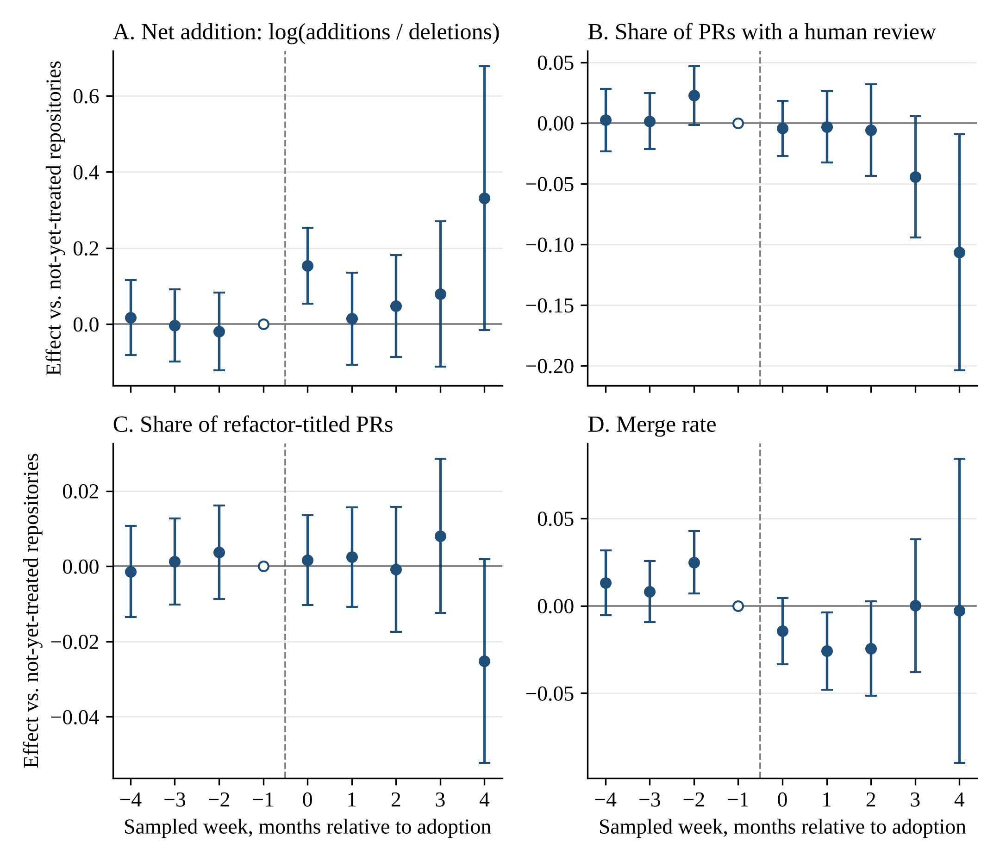

*Manuscript prepared for blind review*

# Abstract

Large language model (LLM) coding assistants have lowered the cost of producing working code, yet early evidence suggests that software maintainability is deteriorating. The standard view of technical debt as a rational trade-off predicts the opposite, although a rational developer can still accumulate more debt if faster development raises the value of speed. We argue that LLM assistance changes the structure of the developer's decision: an ex ante choice between an expedient and a quality implementation becomes an ex post decision about whether to accept an artifact that already exists, works, and looks finished. We formalize this shift through present-bias, perception, default, and loss-aversion wedges. Aggregate debt cannot separate this account from rational acceleration, but the self-admitted share of debt, the effect of possessing an artifact on refactoring, and the lapse of planned refactoring can. More reliable models can increase debt, and present bias can create debt traps. In a game among vendors, organizations, and developers, control over tool configuration, not market structure, governs interface friction, within limits set by shadow-IT bypass. Public repository data are consistent with the predicted net-addition bias and with fewer self-admitted markers relative to other debt signals, but do not test the mechanisms.

**Keywords:** technical debt; large language models; generative AI; behavioral economics; automation bias; choice architecture; IT governance; formal model

# 1. Introduction

Software organizations are adopting LLM-based coding assistants at a pace with few precedents in the history of development tooling. In the largest annual developer survey, 51 percent of professional developers reported using AI tools daily in 2025, even though more respondents distrusted the accuracy of those tools than trusted it (Stack Overflow 2025). The earliest evidence on what happens to the code afterward is unsettling. In a difference-in-differences study of open-source projects, adopting an agentic coding assistant produced a large but transient increase in development velocity and a persistent increase in static-analysis warnings and code complexity (He et al. 2026). Controlled comparisons of human- and LLM-authored implementations find that models systematically favor high-coupling solutions, and that neither functional correctness nor more detailed prompting removes this tendency (Zhu et al. 2026). Industry-wide trends point the same way, although they do not identify which code was generated: across hundreds of millions of changed lines, 2024 was the first year in which copied-and-pasted code exceeded moved code, the main trace of refactoring (GitClear 2025, 2026). In short, the tools that make code cheaper to write appear to be making systems more expensive to maintain.

This pattern is a puzzle for the dominant theory of technical debt. Since Cunningham's (1992) original metaphor, and in its subsequent formalization (Avgeriou et al. 2016; Kruchten et al. 2012), technical debt has been modeled as a rational intertemporal trade-off: an actor knowingly accepts a shortcut today in exchange for delivery speed, incurring interest that must be repaid through future rework. On this account, debt should accumulate when the price of doing things properly is high relative to the value of speed. LLM assistance lowers the price of doing things properly, since a well-structured, documented, and tested module costs little more to generate than a sloppy one, so the rational-trade-off theory predicts that debt should fall, or at least not rise, as adoption spreads.

The puzzle is not decisive on its own. A rational account can accommodate rising debt if cheaper code changes more than the price of quality. When features can be built faster, the value of shipping them sooner rises, and a rational developer may accept more expedient implementations. When new code is cheaper to generate than existing code is to find and reuse, total volume and duplication grow even if each unit is written with care (Jevons 1865; Sorrell 2009). We call this the rational-acceleration account and treat it as the principal rival to our theory. Both accounts predict more debt, so the question is not whether debt rises but what form it takes. Under rational acceleration, debt is taken on knowingly, recorded, scrutinized in review, and repaid when repayment pays. Under the behavioral account we develop, debt is less often recognized, recorded, or reviewed, and repayment that was planned does not happen.

Our argument is that the distinctive change LLM assistance brings is a change in the decision itself. Without an assistant, a developer chooses between an expedient and a quality implementation before either exists. With one, a working implementation arrives first, and the developer decides whether to accept it. We call this conversion of an ex ante choice into an ex post acceptance the *frame shift*. The artifact exists before the quality decision is made, looks finished, and is already possessed and preselected, and these three features activate, respectively, present bias and the planning fallacy, fluency and automation bias, and default effects, loss aversion, and weak ownership. The contribution is not that these biases exist, since each has an established literature, but that one structural feature of generation-first assistance brings them to bear on the same decision at once, and that this has testable implications that rational acceleration does not share, chief among them that the effects depend on the order of events and not on the quality of the tool.

We ask: through which mechanisms does LLM-assisted development accelerate the accumulation of technical debt, what distinguishes those mechanisms from a rational response to cheaper code, and what do they imply for how debt evolves and how it should be governed? The paper makes three contributions. First, it offers a theory of technical debt accumulation organized around a single structural construct, the shift from choosing to accepting. Second, it formalizes that shift and derives results that the verbal argument cannot establish: aggregate debt is observationally equivalent across the behavioral and rational accounts, although three other statistics separate them; more reliable models can increase debt; present bias can create debt traps with hysteresis; and, in a game among vendors, organizations, and developers, the governance of tool configuration, together with the ease of bypassing it, determines how much of this debt an organization can prevent. Third, it reports early field evidence from public repositories that is consistent with parts of the theory and states what would count against it. The paper is written for information systems researchers who study the value, risks, and governance of AI tools in organizations, and for managers who decide how those tools are configured and overseen.

Section 2 reviews the background, Section 3 develops the theory and its rational rival, Section 4 formalizes it, Section 5 reports the empirical evidence and the design of a decisive experiment, Section 6 discusses contributions and limits, and Section 7 concludes.

# 2. Theoretical Background

## 2.1 Technical Debt as a Rational Trade-off

Cunningham (1992) introduced technical debt to explain to nontechnical stakeholders why shipping imperfect code can be sensible: like financial debt, it buys time now at the cost of interest later. Subsequent work formalized the construct. Avgeriou et al. (2016) define technical debt as design or implementation constructs that are expedient in the short term but create a technical context that makes future change more costly. Kruchten et al. (2012) distinguish debt that is visible, in the form of known shortcuts, from debt that is invisible, and deliberate from inadvertent debt. Tom et al. (2013) catalog its dimensions (code, design, architecture, test, and documentation) and its causes, which they locate in schedule pressure, insufficient knowledge, and inattention.

The economic framing has been made explicit in models that treat technical debt as an investment decision with a principal, an interest rate, and a repayment schedule (Seaman and Guo 2011; Buschmann 2011). In these models the actor is a rational planner who incurs debt when the net present value of speed exceeds the discounted cost of rework, and repays when the reverse holds. Research on self-admitted technical debt is consistent with this view; developers leave comments such as TODO and HACK precisely because they know a shortcut has been taken and intend to return to it (Potdar and Shihab 2014; Bavota and Russo 2016).

The rational model has two features that matter here. First, it locates the cause of debt in the price of quality relative to speed. Second, it assumes the actor perceives the shortcut as a shortcut. Both features are strained by LLM assistance. The price of quality falls, yet debt rises, and much LLM-introduced debt is not perceived at the moment of introduction, because the code that carries it looks finished.

## 2.2 LLM-Assisted Development and Its Observed Consequences

A growing empirical literature documents the quality profile of LLM-generated code. Early security studies found that a substantial share of assistant-generated snippets contained exploitable weaknesses (Pearce et al. 2022; Fu et al. 2025). Comparative evaluations of Copilot, CodeWhisperer, and ChatGPT found acceptable validity and correctness but recurring maintainability issues (Yetiştiren et al. 2023). More recent work has moved from snippets to systems. A pilot study of microservices generated under hexagonal-architecture constraints found that one open-weights model violated the prescribed dependency boundaries in most runs, although the proprietary models it tested conformed (Slater 2025). An audit of code and architectures generated by LLMs and coding agents finds that code volume is a near-perfect predictor of structural degradation, and that more capable models produce more bloated and coupled code (Zhu et al. 2026). The quasi-experimental estimates of He et al. (2026) are the strongest causal evidence to date, and public corpora of agent-authored pull requests now make the review of such code directly observable (Li et al. 2025, 2026). A multivocal review concludes that LLM assistance amplifies code, design, and documentation debt and introduces new forms, notably fast-integration debt, in which rapidly generated code is integrated ahead of quality (Ehsani et al. 2026). In industry workshops, practitioners prioritized the maintainability and readability of generated code and warned that it may accelerate the accumulation of technical debt (Sun et al. 2026).

Two recent studies bear directly on the empirical territory of this paper. Liu et al. (2026) track about 303,000 AI-authored commits across 6,299 repositories with static analysis before and after each commit and find that more than 15 percent of commits from every assistant introduce at least one issue, and that 22.7 percent of the tracked issues are still present in the latest version of the repository. Mujahid and Imran (2026) find that among 6,540 code comments referring to LLMs, 81 (about 1.2 percent) also admit technical debt, mostly postponed testing and incomplete integration. These studies establish that AI-authored code carries persistent issues and that admissions of debt are rare. They do not explain why, and they cannot say whether the pattern is a rational response to cheaper code. That is the gap this paper addresses.

On the productivity side, the evidence is mixed in a way that matters for our argument. A randomized experiment found that developers with an AI pair programmer finished a server-implementation task 55.8 percent faster (Peng et al. 2023), whereas a randomized trial with experienced open-source developers working on their own repositories found that allowing AI increased completion time by 19 percent although the developers had expected a 20 percent reduction (METR 2025). A field experiment with knowledge workers found that AI improved performance on some tasks and worsened it on tasks outside the technology's frontier (Dell'Acqua et al. 2026). Taken together, these findings show that the effect of assistance on speed is real but heterogeneous, and that users' perceptions of its effects can be mistaken, which is the kind of misperception our theory builds on.

## 2.3 Behavioral Economics and Information Systems: Relevant Constructs

Behavioral economics studies systematic departures from the rational-actor model, and four groups of its constructs bear on how developers treat generated code. Present bias, the tendency to overweight immediate payoffs relative to delayed ones beyond what any constant discount rate implies, produces preference reversals in which planned investments are repeatedly deferred (Laibson 1997; O'Donoghue and Rabin 1999), and the planning fallacy compounds it (Buehler et al. 1994). The fluency heuristic and automation bias describe how easily processed output is judged to be of higher quality and how automated aids are underverified when they are usually right (Alter and Oppenheimer 2009; Parasuraman and Manzey 2010; Goddard et al. 2012). Reference dependence covers loss aversion, status quo bias, and default effects, under which what is already possessed or preselected is retained far more often than preference alone would predict (Kahneman and Tversky 1979; Samuelson and Zeckhauser 1988; Johnson and Goldstein 2003; Thaler and Sunstein 2008). Effort-based valuation, the IKEA effect, implies that artifacts acquired without effort command less care and weaker psychological ownership (Pierce et al. 2001; Norton et al. 2012).

A fifth group of constructs is not behavioral at all. Moral hazard (Arrow 1963), common-pool dynamics (Hardin 1968; Ostrom 1990), and the rebound effect (Jevons 1865; Sorrell 2009) follow from rational responses to incentives. We build the theory from the first four groups and treat the fifth as incentive conditions that amplify it; on their own, those conditions form the core of the rational account we develop as a rival.

The theory also connects to two streams of information systems research. The first concerns how people rely on algorithmic output. Work on algorithm aversion and appreciation shows that reliance depends on how the output is presented and on the user's experience of its errors (Dietvorst et al. 2015; Logg et al. 2019), and research on automation bias documents underverification of aids that are usually reliable (Goddard et al. 2012; Parasuraman and Manzey 2010). The second concerns the governance of technology use inside organizations, including the shadow IT that arises when individuals adopt tools outside sanctioned channels (Haag and Eckhardt 2017). Our strategic extension (Section 4.6) draws on the second stream to ask who controls the configuration of an AI assistant and how far an organization's control can reach.

# 3. Theory Development

## 3.1 The Core Argument: From Choosing to Accepting

We model the introduction of technical debt as the outcome of a repeated microdecision: a developer facing a unit of work chooses between an expedient implementation (E) and a quality implementation (Q). Under the rational model, she chooses E when the value of the time saved exceeds the discounted cost of future rework. LLM assistance reduces the time cost of Q relative to E, which shrinks the value of the time saved and, on the rational model, predicts more Q.

Our theory holds that LLM assistance does something else that dominates this effect: it changes the order of events in the decision. Before assistance, E and Q are compared before either exists, and both lie in the future. With assistance, an implementation, often an instance of E, exists as soon as the prompt returns, and the developer's decision becomes whether to accept it or to do more work. We call this the *frame shift* and define it by a single structural condition: the frame has shifted when the implementation is generated before the quality decision is made. The shifted frame has three features, each of which engages a distinct set of mechanisms.

*Timing.* The artifact precedes the quality decision, so Q becomes a deferred investment set against a present reward, which activates present bias and the planning fallacy. *Appearance.* The artifact is syntactically polished and confidently explained, so E looks like Q to its author and to its reviewers, which activates the fluency heuristic and automation bias. *Possession.* The artifact is already in the working tree and preselected by the interface, so accepting it is the default, removing it is experienced as a loss, and, because it was acquired without effort, it commands little ownership. Taken together, developers choose E more often even though Q has become cheaper, and E is more often not recognized as E, which converts deliberate debt into inadvertent debt.

**Why this is a structural claim and not a relabeling of known biases.** Each bias in our account is familiar, and we do not claim otherwise. The claim concerns *when they bind*. Present bias, loss aversion, imperfect perception, and default effects are properties of people and interfaces that exist in any setting, but whether one of them affects a particular decision depends on the decision's structure, and the frame shift is what gives each of them something to act on. Present bias requires a cost that arrives before the benefit it buys. In the choice regime the extra effort of building quality and the rework it avoids both lie in the future, so present bias scales both sides of the comparison equally and drops out. Loss aversion requires a reference point, and before generation there is no artifact whose removal could be felt as a loss. Imperfect perception requires something to perceive: a developer who writes a shortcut knows that she has, whereas one who receives a polished artifact must decide whether to inspect it, an information problem that does not exist before generation. A default requires an option that is already selected for her. Lemma 1 in Section 4.3 makes this precise. In the choice regime, the probability of debt, the self-admitted share, and the lapse rate are the same for every value of the four wedges; in the acceptance regime, debt depends on each of them. The biases are latent before generation and active after it. What the technology changes is not how biased the developer is but which decision those biases apply to.

This structure gives the theory empirical content that a list of biases does not. *First, the wedges should depend on the order of events and on little else.* Hold fixed the developer, the tool, the quality of the artifact, the stated costs, and the value of speed, and move the quality decision before generation, for example by requiring the developer to commit to an expedient-or-quality approach before the assistant produces code. The possession effect, the lapse of planned refactoring, and the self-admitted share should then return to their rational values (P12). Rational acceleration predicts no such dependence, because it operates through the value of speed and the price of quality, neither of which the order of events changes. A trait account, in which some developers are simply more biased, predicts differences between developers and none within one developer across orderings. And an account that attributes the debt to the lower quality of generated code predicts that decisions about an artifact of a given quality do not depend on when the decision is taken. A rational developer can also behave differently before and after generation if the artifact reveals information about the work ahead; Section 4.7 shows that this channel is bounded by the dispersion of the signal, has a case-dependent sign, and is absent when costs are stated. *Second, because the decision is the unit of analysis, the wedge in aggregate debt should scale with the share of work that is generation-first.* If a share $\theta$ of tasks is done that way, aggregate debt is $(1-\theta)D_C+\theta D_A$ and its behavioral wedge is $\theta[D_A-D_A^*]$ (Section 4.4), so the intensity of use, and not adoption alone, is the relevant variable. *Third, the frame is not fixed.* Whether an artifact precedes the decision, and how costly it is to reject, are features of the interface, and Section 4.6 asks who sets them.

**Relation to neighboring ideas.** Choice architecture (Thaler and Sunstein 2008) treats the frame in which a decision is presented as given and asks how it can be redesigned. Here the technology itself creates the frame, and the question is how a change in technology reorganizes a decision that was previously made in a different order. The theory also differs from rational inattention (Sims 2003), which predicts that people inspect less when inspection is costly. That prediction is already part of our rational benchmark, in which the developer inspects optimally given the cost of inspecting and the value of what she might find; as Result 2(b) shows, the benchmark then yields a self-admitted share of $\sigma$, no possession effect, and no lapses. What the wedges add is behavior that a cost-of-inspection account does not produce in this model.

Incentive conditions, namely moral hazard, common-pool dynamics, the rebound effect, and metric targeting, do not depend on the frame shift, but they determine how far its consequences spread beyond the individual decision. They are not biases but rational responses to incentives; we include them because they govern how the frame effects propagate through a team and because, on their own, they generate the rival account developed in Section 3.3.

## 3.2 Mechanisms and Propositions

*Timing.* Before LLM assistance, E and Q were compared before any code existed. With assistance, E exists as soon as the prompt returns, and Q requires further effort after a working artifact is already in hand. That is the configuration in which present bias is strongest (Laibson 1997; O'Donoghue and Rabin 1999), and the planning fallacy leads developers to underestimate the rework they defer (Buehler et al. 1994). Developers therefore plan to refactor and then defer (P1, P2).

*Appearance.* LLM output is syntactically regular, idiomatically named, and accompanied by fluent explanation, which are the surface features that trigger fluency-based judgments of quality (Alter and Oppenheimer 2009). A human shortcut typically looks like a shortcut and is often self-admitted; a generated one looks finished, which converts deliberate debt into inadvertent debt (P3, P4). Code review, the institutional check on individual judgment, is weakened by automation bias when reviewers calibrate scrutiny to the perceived reliability of the tool rather than to the artifact (Parasuraman and Manzey 2010), and more so as generated changes grow larger (P7).

*Possession.* A generated artifact is already in the working tree and preselected by the interface. Accepting it is the default (Johnson and Goldstein 2003), so acceptance is insensitive to suggestion quality (P8). Deleting it is experienced as a loss (Kahneman and Tversky 1979), so LLM-assisted changes add more relative to what they delete (P5). And because it cost little effort, it commands little ownership (Norton et al. 2012), so its defects are fixed more slowly (P6).

*Incentive amplifiers.* Three further mechanisms require no departure from rationality. LLM assistance makes it cheap to change modules one does not own while their maintenance falls on others, which is moral hazard (Arrow 1963; P9). It makes generating new code cheaper than finding and reusing existing code, so a shared codebase is overextracted, more so with more contributors (Ostrom 1990; Sorrell 2009; P10). And where individual throughput is rewarded and maintainability is not measured, cheap throughput becomes a target (P11).

Table 1 lists the mechanisms and the twelve propositions they imply. The propositions are the empirical hypotheses of the verbal theory; Section 4 formalizes the timing, appearance, and possession mechanisms at the level of a single decision, and the ownership and incentive mechanisms (P6 and P9 to P11) are stated as hypotheses and are not formalized in this paper.

**Table 1. Mechanisms and propositions**

| P | Statement | Mechanism | Component |
|---|---|---|---|
| P1 | (a) Refactoring per active contributor declines as the share of LLM-authored code rises. (b) Holding the cost of refactoring fixed, possessing a working generated artifact increases deferral and the lapse of planned refactoring. | Present bias; planning fallacy | Timing |
| P2 | Comments deferring quality work on LLM-authored code are resolved less often and later than comparable comments on human-authored code. | Present bias | Timing |
| P3 | At equal measured structural quality, reviewers rate LLM-authored code higher. | Fluency heuristic | Appearance |
| P4 | For a given amount of statically detected debt introduced by a change, LLM-assisted changes carry fewer self-admitted debt markers. | Fluency heuristic | Appearance |
| P5 | LLM-assisted commits add more relative to what they delete, and the surplus is concentrated in duplicated and unreachable code. | Loss aversion | Possession |
| P6 | At equal severity and complexity, defects in code a developer generated are fixed more slowly than defects in code she wrote. | Effort-based valuation | Possession |
| P7 | LLM-authored pull requests receive less review time per changed line and fewer substantive comments, with a gap that widens with size. | Automation bias | Appearance |
| P8 | Acceptance of inline suggestions varies less with suggestion quality than with the interface cost of rejection. | Default effect | Possession |
| P9 | Debt introduced by LLM-assisted changes concentrates in modules the author does not maintain. | Moral hazard | Incentive amplifier |
| P10 | Duplication rises with LLM adoption, more so in repositories with more contributors and weaker ownership. | Common pool; rebound | Incentive amplifier |
| P11 | The association between LLM adoption and debt growth is stronger where individual throughput is rewarded and maintainability is not measured. | Metric targeting | Incentive amplifier |
| P12 | Holding the developer, the tool, the artifact's quality, the stated costs, and the value of speed fixed, requiring the quality decision to be made before generation returns the possession effect, the lapse of planned refactoring, and the self-admitted share to their rational values. | Frame shift (order of events) | All |

## 3.3 A Rival Account: Rational Acceleration

The rational trade-off view is not exhausted by the prediction that cheaper quality means less debt. Suppose LLM assistance lowers the time cost of both E and Q but also raises the value of time saved, because a team that can build faster has more features it can profitably ship. A rational developer then chooses E more often, not less, whenever the rise in the value of speed outweighs the fall in the price of quality. Add the rebound effect, under which cheaper code means more code and more duplication, and moral hazard, under which cross-boundary edits become cheaper to make while their maintenance cost falls on others, and the rational account predicts rising debt without any bias.

The behavioral and rational accounts agree on the direction of aggregate debt. They disagree about its form, because the rational account keeps the two features of the rational model identified in Section 2.1: debt is taken on knowingly, and it is repaid when repayment pays. Four implications follow. First, a knowingly incurred shortcut is recorded at the same rate whoever wrote it, so self-admission per unit of detected debt should not differ between LLM-assisted and hand-written changes (contrast P4). Second, reviewers who calibrate scrutiny to risk rather than to authorship should give LLM-assisted changes of a given size at least as much substantive review as others (contrast P7). Third, retention should follow usefulness rather than provenance, so a net-addition bias in LLM-assisted commits should appear only where rebound operates, in larger teams, and not in single-contributor code (contrast P5). Fourth, refactoring should follow its net present value, so, holding its cost fixed, possession of a working artifact should not change the decision to refactor, and refactoring that was planned should be carried out (contrast P1b and P2). Table 2 summarizes the contrast.

**Table 2. Competing predictions of rational acceleration and the behavioral theory**

| Prediction | Rational acceleration | Behavioral theory |
|---|---|---|
| Aggregate debt after LLM adoption | Rises | Rises |
| Self-admitted debt per unit of detected debt introduced (P4) | No difference by authorship | Lower for LLM-assisted changes |
| Substantive review per changed line (P7) | No lower for LLM-assisted changes | Lower for LLM-assisted changes |
| Net-addition bias in single-contributor code (P5) | Absent | Present |
| Deferral with artifact in hand at equal cost; completion of planned refactoring (P1b, P2) | No possession effect; plans carried out | Possession raises deferral; plans lapse |
| Debt under developer-controlled versus organization-controlled configuration of the assistant (Result 6) | No difference | Lower under organization control |
| Duplication rising with team size; debt in nonowned modules; stronger effects under throughput metrics (P9 to P11) | Yes | Yes |
| Order of events: quality decision made before versus after generation (P12) | No change in the three statistics | Statistics return to rational values when the decision precedes generation |

The comparison also marks the limits of the discrimination. Rebound, moral hazard, and metric targeting operate under both accounts, so Propositions 9 to 11 cannot distinguish them; their role is to measure how far debt spreads, not to adjudicate between accounts.

## 3.4 Boundary Conditions

The theory is not a claim that LLM output is intrinsically worse than human output. Several conditions attenuate the mechanisms. Strong module ownership limits moral hazard (P9). Mandatory, quality-blind review protocols limit automation bias (P7). Interfaces that require active selection rather than passive acceptance limit default effects (P8). Deletion-friendly workflows and explicit net-lines reporting counteract loss aversion (P5). And maintainability metrics, when measured and rewarded, reverse the Goodhart dynamic (P11). These conditions are also the theory's prescriptions, and they differ from those of the rational model, which would recommend better cost accounting and debt registers, interventions that assume the actor already perceives the debt.

# 4. A Formal Model of Choosing and Accepting

This section formalizes the frame shift. It states the developer's decision problem as a utility-maximization problem under each regime (Sections 4.1 to 4.3), extends it to debt dynamics and learning (4.5), embeds the developer in a game with a tool vendor and her organization (4.6), and asks how far rational information can explain order dependence (4.7). Proofs of Results 1 to 3, 5 to 7, and 9 are in Appendix A; proofs of Results 4 and 8 are in Online Appendix OA1 and OA2. Every closed form was also checked against a brute-force evaluation of the problem it solves.

## 4.1 Environment

A task can be implemented expediently (E) or with quality (Q). A task that ends as E imposes a rework cost $R>0$ at date 2. The rework cost is task-specific, drawn from a continuous distribution $F$ with positive density on the positive reals, and known to the developer when she decides. Developer time is valued at $v$ per unit, so an increase in $v$ represents the rational-acceleration channel of Section 3.3: time saved is worth more when more features can be shipped. Quality requires $a$ units of time more than E.

In the *choice regime*, which describes development without an assistant, the developer decides at date 0 how the task will be built at date 1. In the *acceptance regime*, which describes development with an assistant, an artifact arrives at date 1 and all of the developer's decisions are taken then; rework, if any, falls at date 2. The artifact is an instance of E with probability $q$, the model's maintainability-defect rate. Inspecting it takes time $k$, drawn from a continuous distribution $G$ independent of $R$, and refactoring a detected instance of E into Q takes time $r$. An instance of E is noticed without inspection with probability $\eta\varphi$, with $\eta\le 1/2$, and a share $\alpha$ of artifacts that have not been noticed to be defective is accepted by default, without deliberation.

The behavioral wedges are as follows. Present bias $\beta\in(0,1]$ is the weight on all future payoffs relative to the present. Perception $\varphi\in(0,1]$ scales both the perceived defect rate, which is $\varphi q$, and the noticing probability. Default share $\alpha\in[0,1)$ is the share accepted without deliberation. Loss aversion $\lambda\ge 1$ scales the time cost of changing an artifact that is already in hand. The rational benchmark sets $\beta=\varphi=\lambda=1$ and $\alpha=0$. A developer who knows a shortcut is in the code self-admits it with probability $\sigma$; one who is unaware of it self-admits with probability $\sigma\varphi$, in proportion to the risk she perceives.

## 4.2 The Developer's Utility and Beliefs

At date $t$ the developer maximizes the decision utility

$$U_t=u_t+\beta\sum_{\tau>t}\delta^{\tau-t}u_\tau,\qquad u_\tau=-v\cdot(\text{time spent at }\tau)-(\text{rework cost incurred at }\tau),$$

where $\delta\le 1$ is the long-run discount factor, and the weight $\lambda\ge1$ multiplies time spent changing an artifact already in hand. This is the standard gain–loss specification, with retaining the artifact as the reference point. Welfare is evaluated with $\beta=\lambda=1$.

The developer believes the artifact is E with probability $\varphi q$ and knows the noticing technology. When deciding whether to inspect an artifact she has not noticed to be defective, she values the event "E and not noticed" at $\tilde q\equiv\varphi q(1-\eta\varphi)$. This neglects the information in the absence of a defect signal, since a Bayesian posterior would divide by $1-\eta\varphi\cdot\varphi q$. We call this *noticing neglect* and retain it as a behavioral assumption because it keeps the closed forms tractable; replacing $\tilde q$ by the Bayesian posterior preserves every sign result. Finally, the developer is naive about her own present bias: at date 0 she believes that her date-1 self will not be present biased, although she expects to feel loss aversion tomorrow as she does today. Naivety matters only for planning, and so only for the lapse rate defined below.

## 4.3 The Developer's Decision Problems

*Choice regime.* At date 0 the developer compares Q with E. Choosing Q instead of E costs $a$ units of time at date 1 and avoids the rework $R$ at date 2, so $U_0(Q)-U_0(E)=-\beta\delta va+\beta\delta^2R$, and she chooses E if and only if

$$va>\delta R.\qquad(1)$$

Present bias cancels from (1) because it scales both sides equally.

*Acceptance regime.* The date-1 decision tree is solved by backward induction. A detected instance of E is refactored if and only if the time cost of doing so, incurred now, is less than the discounted saving:

$$\lambda vr<\beta\delta R.\qquad(2)$$

An unnoticed artifact that is not accepted by default is inspected if and only if the cost of inspecting is below the expected gain:

$$vk<\tilde q\cdot\max\{0,\ \beta\delta R-\lambda vr\}.\qquad(3)$$

Debt remains when the artifact is E and is not both detected and refactored. With $\rho(R)=\mathbf 1[\lambda vr<\beta\delta R]$, the probabilities that a task ends with debt in the choice and acceptance regimes are

$$D_C(v)=F(va/\delta),$$

$$D_A(v)=q\,\mathbb E_R\Big[\eta\varphi(1-\rho)+(1-\eta\varphi)\big(1-(1-\alpha)\rho\,G\big(\tilde q(\beta\delta R-\lambda vr)/v\big)\big)\Big].$$

We write $D_A^*(v)$ for $D_A(v)$ in the rational benchmark.

**Lemma 1 (activation).** (a) In the choice regime, $D_C(v)=F(va/\delta)$, the self-admitted share equals $\sigma$, and the lapse rate is zero, for every value of $(\beta,\varphi,\alpha,\lambda)$. (b) In the acceptance regime, $D_A(v)$ is weakly decreasing in $\beta$ and in $\varphi$ and weakly increasing in $\alpha$ and in $\lambda$, and strictly so when the wedge changes a decision on a set of tasks of positive probability.

Part (a) says that the four wedges have no domain in the choice regime; part (b) says that each acquires one in the acceptance regime. This is the sense in which the frame shift activates the biases.

*Plans and lapses.* At date 0 the naive developer plans to refactor a detected instance if and only if $\lambda vr<\delta R$, because she expects her date-1 self to have $\beta=1$. Her date-1 self refactors if and only if (2) holds. A lapse is a plan that is not carried out:

$$\beta\delta R\le\lambda vr<\delta R.\qquad(4)$$

*Three statistics.* The *self-admitted share* is $S=\Pr(\text{self-admitted}\mid\text{debt})$. The *possession effect* is the probability of deferring refactoring with an artifact in hand, at $r=a$, minus the probability of choosing E ex ante at the same cost; it equals $F(\lambda va/(\beta\delta))-F(va/\delta)$. The *lapse rate* is the probability of event (4) per detected instance of E.

## 4.4 What Aggregate Debt Can and Cannot Reveal

**Result 1 (decomposition).** $D_A(v_1)-D_C(v_0)=[D_A^*(v_0)-D_C(v_0)]+[D_A^*(v_1)-D_A^*(v_0)]+[D_A(v_1)-D_A^*(v_1)]$. The first term, the price effect, is nonpositive when refactoring is no more costly than building quality ($r\le a$) and inspection is free ($k=0$). The second, the acceleration effect, is nonnegative when $v_1\ge v_0$. The third, the behavioral wedge, is nonnegative, and strictly positive when any wedge binds on a set of tasks with positive probability.

The rational trade-off view of Section 2.1 is the first term alone; it predicts that debt falls when quality becomes cheaper. Debt can nonetheless rise through either of the other two terms, which is why the anomaly described in Section 1 does not by itself favor either account. In an illustration with $q=0.8$, $\beta=0.5$, $\varphi=0.6$, $\alpha=0.3$, $\eta=0.5$, $r=0.4a$, inspection time uniform on $[0,0.6a]$, and lognormal rework costs whose median equals $va$ with log-dispersion 0.79, the price effect lowers the probability of debt by 0.24 and the wedge raises it by 0.32 at a constant value of time, so that debt rises from 0.50 to 0.58 per task even though quality has become cheaper.

**Remark (workflow mix).** If a share $\theta$ of tasks is done generation-first and the rest in the choice regime, aggregate debt is $D(\theta,v)=(1-\theta)D_C(v)+\theta D_A(v)$. Because $D_C$ does not depend on the wedges (Lemma 1), the behavioral wedge in aggregate debt is $D(\theta,v)-D^*(\theta,v)=\theta\,[D_A(v)-D_A^*(v)]$, which scales with $\theta$.

**Result 2 (observational equivalence and separation).** (a) For any configuration of wedges with $D_A(v_0)<q$, there is a value of time $v_1\ge v_0$ at which the rational benchmark produces the same aggregate debt, $D_A^*(v_1)=D_A(v_0)$. (b) In the rational benchmark, for every $v$, $q$, and $G$, the self-admitted share equals $\sigma$, the possession effect is zero, and the lapse rate is zero. (c) Under the wedges, the self-admitted share falls below $\sigma$ if and only if $\varphi<1$ and some debt is undetected; the possession effect is positive if and only if $\beta<1$ or $\lambda>1$; and the lapse rate is positive if and only if $\beta<1$.

Part (a) formalizes why aggregate debt, including the difference-in-differences estimates that dominate the current evidence, cannot adjudicate between the accounts: whatever the wedges do to the level of debt, a faster pace of work can do as well. Parts (b) and (c) identify what can. The self-admitted share isolates the appearance wedge. The possession effect and the lapse rate isolate the timing and possession wedges, and the lapse rate separates present bias from loss aversion: a developer who feels refactoring a generated artifact as a loss feels it today and tomorrow alike, so she does not plan what she will not do, whereas a present-biased developer plans to refactor tomorrow and, tomorrow, defers again. In the illustration above, rational acceleration matches the behavioral level of debt at $v_1=2.9v_0$ while its self-admitted share stays at $\sigma=0.5$ and its possession effect and lapse rate stay at zero. The behavioral configuration yields a self-admitted share of 0.33, a possession effect of 0.31, and a lapse rate of 0.21, where the lapse rate is reported as the joint probability that the artifact is E and a plan lapses. With loss aversion alone ($\lambda=1.8$) the possession effect is 0.27 and the lapse rate is zero. Table 2 is the empirical counterpart of this result.

## 4.5 The Reliability Paradox, Debt Traps, and Learning

**Result 3 (reliability paradox).** Suppose inspection time is uniform on $[0,K]$ and consider tasks on which refactoring a detected instance of E is worthwhile, $B\equiv\beta\delta R-\lambda vr>0$. Then debt per task is
$$D(q)=q(1-\eta\varphi)\big[1-(1-\alpha)\min\{1,q/\hat q\}\big],\qquad \hat q=\frac{vK}{\varphi(1-\eta\varphi)B}.$$
If $\alpha<1/2$, $D$ is nonmonotone in $q$: it is decreasing in $q$ on $(q^*,\hat q)$, where $q^*=\hat q/[2(1-\alpha)]$, so a more reliable model produces more debt on that interval. If $\alpha\ge1/2$, $D$ is increasing in $q$ everywhere.

The mechanism is reliance. When models are unreliable, developers inspect everything and debt is low. As reliability improves, perceived risk falls and inspection stops before the defect rate has fallen far enough to compensate, so the share of defects reaching the codebase rises faster than the defect rate falls. The paradox is not in itself behavioral: a rational developer also relaxes inspection as models improve, and her debt also rises, efficiently, over an interval. What the wedges do is move and widen that interval and turn an efficient response into an inefficient one. The implication is that improvements in model quality should not be expected to reduce debt monotonically, and that the debt consequences of a model upgrade depend on how much inspection it displaces.

*Debt traps.* Let $H$ be the stock of unresolved debt, and suppose refactoring becomes harder as the stock grows, $r(H)=r_0(1+\gamma H)$, which is the interest in the debt metaphor. In each period $n$ artifacts arrive, and a share $p$ of those not accepted by default is inspected; in this section $p$ is exogenous, so $\varphi$, $\eta$, and $K$ do not enter. A detected instance of E is refactored if and only if (2) holds at $r(H)$, and a fraction $\mu$ of the stock is repaid each period, so
$$H_{t+1}=(1-\mu)H_t+I(H_t;\beta),\qquad I(H;\beta)=A+C\cdot F\!\left(\frac{\lambda vr_0(1+\gamma H)}{\beta\delta}\right),$$
with $A=nq[1-(1-\alpha)p]$ and $C=nq(1-\alpha)p$. Steady states solve $I(H;\beta)=\mu H$.

**Result 4 (debt traps and hysteresis).** Let rework costs be lognormal with median $R_m$ and log-dispersion $s$, let $\epsilon\in(0,1/2)$, and let $z=\Phi^{-1}(1-\epsilon)$. A low-debt state and a debt trap, both stable and separated by an unstable steady state, coexist whenever $\beta\in(\beta_1(\epsilon),\beta_2(\epsilon))$, where
$$\beta_1(\epsilon)=\frac{\lambda vr_0[1+\gamma(A+C\epsilon)/\mu]}{\delta R_m e^{-sz}},\qquad \beta_2(\epsilon)=\frac{\lambda vr_0[1+\gamma(A+C(1-\epsilon))/\mu]}{\delta R_m e^{sz}}.$$
The interval is nonempty when $e^{2sz}<[1+\gamma(A+C(1-\epsilon))/\mu]\,/\,[1+\gamma(A+C\epsilon)/\mu]$. A codebase that enters the trap as $\beta$ falls does not leave it when $\beta$ returns to the level at which it tipped, but only when $\beta$ rises past the upper edge of the bistable region or a one-time repayment lowers $H$ below the unstable steady state.

Because present bias cancels in the choice regime, a team without an assistant behaves as if $\beta=1$ in its refactoring decisions, and adoption replaces 1 with the team's $\beta$. Adoption can therefore tip a codebase from the low-debt state into the trap even though the assistant also lowers $r_0$. In an illustration ($n=1$, $q=0.5$, $p=0.9$, $\alpha=0$, $r_0=0.3$, $\gamma=3$, $\mu=0.5$, lognormal rework costs with median 1 and log-dispersion 0.25) the bistable region is $\beta\in(0.646,0.843)$: codebases tip into the trap when $\beta$ falls below 0.646 and escape only when it rises above 0.843. Three implications follow. The distribution of debt across codebases should become bimodal after adoption; codebases that enter adoption with more debt should be more likely to tip; and interventions that would have prevented the trap, such as nudges that raise effective $\beta$ slightly, cannot reverse it. Escape requires a large change in the decision environment or a one-time refactoring program.

*Learning.* The perception wedge need not be permanent, because developers can learn the defect rate. Let the perceived defect rate $\hat q=\varphi q$ evolve while the noticing probability stays fixed, and suppose developers learn from inspected artifacts, which are an unbiased sample, and from rework they attribute to generated code, which happens with probability $\theta$ per instance of undetected debt. With learning speed $\kappa$ and inspection probability $s(\hat q)$, $\hat q'=\hat q+\kappa[s(\hat q)+\theta(1-s(\hat q))](q-\hat q)$. Suppose inspection takes at least $k_{\min}>0$ units of time, so that $s(\hat q)=0$ whenever the perceived value of inspection is below $vk_{\min}$, which defines a threshold belief $\hat q_c<q$.

**Result 8 (self-confirming complacency).** (a) If $\theta>0$ or $\hat q_0>\hat q_c$, the perceived defect rate converges to $q$ and the perception wedge vanishes. (b) If $\theta=0$ and $\hat q_0\le\hat q_c$, the belief is self-confirming: developers do not inspect, observe no evidence, and never revise. (c) In case (b), a mandate that requires inspection for $T$ periods removes the wedge permanently if and only if $(1-\kappa)^T(q-\hat q_0)<q-\hat q_c$.

Learning dissolves the perception wedge only if evidence reaches the developer, and evidence arrives mainly through the inspection that the wedge suppresses. A temporary intervention can therefore have permanent effects. The result also yields a test: under a perception wedge, the effects of a temporary inspection mandate should persist after it is lifted, whereas under rational acceleration they should end with it.

## 4.6 Strategic Extension: Tool Design, Adoption Governance, and Shadow AI

The single-decision model treats the interface as given. In practice the interface is designed by a vendor, and whether its settings are chosen by developers or by their organization is a governance decision. We therefore embed the developer in a game.

*Players and offers.* The players are vendors $j=1,\dots,J$ ($J=1$ is a monopoly and $J\ge2$ is Bertrand competition), a representative developer, and an organization. Each vendor simultaneously offers a contract $(f_j,p_j)\in[0,1]\times\mathbb R_+$, where $f_j$ is the interface *friction*, the effort required to accept a suggestion without deliberation, as when large suggestions are presented as diffs to be reviewed rather than text to be accepted, and $p_j$ is a per-period license price. The marginal cost of supplying a tool is $m\ge0$ and friction is free to supply. Friction lowers the default share to $\alpha(f)=\alpha_0(1-f)$ and costs the developer $vcf^2/2$ of time per artifact, incurred now.

*Governance and bypass.* Governance $g\in\{D,O\}$ is a parameter of the game, known to all, and determines whose payoff selects the tool: under developer-led adoption ($g=D$) the developer chooses the offer that maximizes her perceived payoff, and under organization-led adoption ($g=O$) the organization chooses the offer that maximizes its long-run payoff. When $g=O$ the developer may bypass the sanctioned tool and use an unsanctioned one offered by a fringe supplier at friction $f_D$ and price $m$, at a personal cost $\varepsilon\ge0$ per period; this captures the shadow IT that information systems research has documented for earlier technologies (Haag and Eckhardt 2017).

*Task level.* Given the tool, the developer solves the problem of Section 4.3. For tractability, rework cost is a constant $\bar R$ with $B=\beta\delta\bar R-\lambda vr>0$, and inspection time is uniform on $[0,K]$. Two quantities summarize the inspection problem: the *perceived* value of inspecting an artifact, $\Delta_p=\varphi q(1-\eta\varphi)(\beta\delta\bar R-\lambda vr)$, and its *long-run* value, $\Delta=q(1-\eta\varphi)(\delta\bar R-vr)$. We assume $0<\Delta_p\le vK$, so that inspection is interior; then $\Delta_p\le\Delta$, with equality if and only if $\beta=\varphi=\lambda=1$.

*Payoffs.* The developer's inspection probability is $s_p=\Delta_p/(vK)$. Her perceived cost of an interface, per artifact, is $J(f)=vcf^2/2-\alpha_0fW_p$, where $W_p=\Delta_p^2/(2vK)$ is the perceived value of the option to deliberate: the perceived gain $\Delta_p s_p$ minus the expected inspection time cost. The organization values deliberation at $W_O=\Delta s_p-\Delta_p^2/(2vK)=\Delta_p(2\Delta-\Delta_p)/(2vK)$, so its cost of an interface is $C_O(f)=vcf^2/2-\alpha_0fW_O$. The timing is: (1) vendors offer $(f_j,p_j)$; (2) the adopter, developer or organization according to $g$, selects a vendor; (3) if $g=O$, the developer decides whether to bypass; (4) task-level decisions follow Section 4.3. Parameters are common knowledge, ties are broken in favor of the sanctioned tool and, among vendors, by equal splitting, and the solution concept is subgame-perfect Nash equilibrium.

**Result 5 (friction wedge).** The friction that minimizes the developer's perceived cost is $f_D=\alpha_0\Delta_p^2/(2v^2cK)$, and the friction that minimizes the organization's long-run cost is $f_O=\alpha_0\Delta_p(2\Delta-\Delta_p)/(2v^2cK)$, each capped at 1. At interior values $f_O-f_D=\alpha_0\Delta_p(\Delta-\Delta_p)/(v^2cK)\ge0$, with equality if and only if $\Delta_p=\Delta$, which holds in the rational benchmark for every value of time.

**Result 6 (governance, not competition).** (a) Under developer-led adoption, in every subgame-perfect equilibrium the adopted tool has friction $f_D$, whether the vendor is a monopolist or faces Bertrand competition; market structure affects the price, not the design. (b) Under organization-led adoption with no bypass, the equilibrium friction is $f_O$. (c) Debt under organization-led adoption is lower than under developer-led adoption if and only if some wedge binds.

**Result 7 (shadow-AI constraint).** If developers can bypass a sanctioned tool at cost $\varepsilon$, the organization implements $f=f_D+\min\{f_O-f_D,\sqrt{2\varepsilon/(vc)}\}$. The constraint binds, and the organization closes only part of the gap, when $f_O-f_D$ exceeds $\sqrt{2\varepsilon/(vc)}$.

The vendor's side of the game follows a familiar logic. When a cost is borne later and perceived dimly, sellers compete on what buyers perceive, as in the shrouded-attribute and self-control results of behavioral industrial organization (DellaVigna and Malmendier 2004; Gabaix and Laibson 2006), so developers will not pay for friction and a vendor that offered more of it would lose them. The extension adds three things on the buyer's side. First, the remedy is a matter of IT governance rather than market structure: what matters is not who pays for the tool but who controls its configuration, and the prediction that debt is lower where configuration is centrally controlled holds only under the behavioral theory, which adds a row to Table 2. Second, the remedy is bounded by shadow IT: an organization can move friction toward $f_O$ only as far as developers are willing to comply, so enforcement against unsanctioned tools and choice architecture are complements. Third, the organization's optimal friction is not monotone in the wedges. Friction pays by moving artifacts from default acceptance into deliberation, but deliberation yields inspection only in proportion to perceived risk; when the wedges are strong, developers who deliberate still inspect little, and friction buys little. Friction is therefore a complement to debiasing rather than a substitute for it, and the conflict between developers and their organization is sharpest at intermediate wedges. With $\beta=0.5$, $\varphi=0.6$, and $\lambda=1.2$ (and $q=0.5$, $\bar R=2$, $r=0.4$, $K=0.6$, $\alpha_0=0.8$, $c=0.15$, $\eta=0.5$, $v=\delta=1$), developers prefer friction of 0.05 and the organization 0.49; with a bypass cost of $\varepsilon=0.005$, the organization can implement 0.31. Under rational acceleration the two preferences coincide at every value of time: doubling $v$ lowers the friction both parties prefer from 0.71 to 0.10 but opens no gap.

Result 6(a) for $J\ge2$ relies on vendors offering friction and price simultaneously, or on contestable entry. If vendors chose friction first and prices second, vertical differentiation could let a vendor soften price competition by offering a lower-surplus design (Shaked and Sutton 1982), and market structure could then affect design. We maintain the simultaneous-offer assumption.

## 4.7 Robustness: Can Rational Information Explain Order Dependence?

A rational developer can also behave differently before and after generation if generating the artifact reveals information about the work ahead: that the code runs, that the task is easier than expected, or that the surrounding code is harder to change. This is a legitimate objection to the order-dependence implication (P12) and to the statistics that rest on it, and we address it inside the model. Let the rework cost $R$ be unknown when the developer decides ex ante, with prior mean $\bar R=\mathbb E[R]$, and let her observe a signal $S$ about it only once the artifact exists, with posterior mean $m(S)=\mathbb E[R\mid S]$, so that $\mathbb E[m(S)]=\bar R$. A rational developer ($\beta=\varphi=\lambda=1$, $\alpha=0$) improves the code if and only if $t<m$, where $t\equiv vc/\delta$ and $m$ is her current posterior mean. For a given case, the *possession effect* is the probability of deferring after the artifact exists minus the probability of deferring ex ante.

**Result 9 (information and order).** (a) If the developer has the same information about $R$ whenever she decides, in particular when $R$ is stated, the rational thresholds coincide across orderings: the possession effect and the lapse rate are zero. (b) Otherwise, in a case with $\bar R>t$, so that improvement is warranted ex ante, the rational possession effect equals $\Pr(m(S)\le t)$. It is bounded by $V/[V+(\bar R-t)^2]$ with $V=\mathrm{Var}(m(S))\le\mathrm{Var}(R)$, and it vanishes as the signal becomes uninformative. In a case with $\bar R\le t$ it is nonpositive. (c) For a developer with the same information and wedges $\beta<1$ and $\lambda>1$, the possession effect in a case with $\bar R>t$ is $\Pr(m(S)\le\lambda t/\beta)$, which exceeds the rational effect by $\Pr(t<m(S)\le\lambda t/\beta)\ge0$.

Information therefore produces order effects of a different kind from the wedges. The informational effect depends on the case: it is nonnegative where improvement is warranted ex ante and nonpositive where it is not, because information moves decisions toward indifference. It is bounded by the dispersion of the signal, and it disappears when the signal is uninformative. The wedge effect is a one-directional shift of the deferral threshold by the factor $\lambda/\beta$ and does not depend on any signal. Two consequences follow. In an experiment that states $R$ and the artifact's quality, information is identical across orderings and part (a) applies, so any order effect cannot be informational. In field data, part (b) gives a way to bound the informational channel from the observed dispersion of rework costs across similar tasks: a possession effect in warranted cases that exceeds $\mathrm{Var}(R)/[\mathrm{Var}(R)+(\bar R-t)^2]$ cannot be explained by information alone.

# 5. Empirical Evidence

The contribution of this paper is theoretical, and the theory is built to be tested. This section reports what public data can and cannot say about it. We make two points up front. The mechanisms (present bias, loss aversion, perception) are not directly observable in archival data, and aggregate outcomes cannot separate the behavioral account from rational acceleration (Result 2a). Archival data can therefore only be consistent or inconsistent with the theory's predictions, not test its mechanisms. Section 5.4 describes the experiment that can. The construction of the data and additional results are in Online Appendix OA5 to OA8.

## 5.1 Data and Measures

We use three public sources. *GH Archive* provides event logs of GitHub activity; we extract pull requests closed in several observation windows, together with the reviews and inline review comments on them. We identify agent-authored pull requests by account name or branch prefix (Copilot, Jules, Devin, Cursor, Codex) or by the Claude Code signature in the description, which follows the cues used by the AIDev dataset (Li et al. 2025, 2026). All other nonbot authors are treated as human; unlabelled AI-assisted human pull requests would therefore bias estimated differences toward zero. *AIDev* (Li et al. 2025, 2026) provides agent-authored pull requests in repositories with more than 100 stars, with the code patches of their commits. *CommitPackFT* (Muennighoff et al. 2023) provides human commits from GitHub, mostly before 2023, with the content of changed files; we use it as a human baseline for code patches.

For each pull request we measure size (additions plus deletions), net addition $\ln[(\text{additions}+1)/(\text{deletions}+1)]$, and whether a nonauthor, nonbot user reviewed or commented on it. Estimates compare agent and human pull requests *within the same repository*, with controls for log size, repository fixed effects, and standard errors clustered by repository. Our observation windows are 1 to 14 August, 1 to 14 September, and 15 to 28 September 2025 (GH Archive payloads after about October 2025 no longer carry pull-request size or author fields), and the samples comprise 431,043 agent and 2,525,598 human pull requests, of which 211,624 and 160,944, respectively, are in repositories with both types.

## 5.2 Net Addition and Review Intensity (P5, P7)

**Table 3. Agent-authored versus human-authored pull requests within repositories, pooled over three windows**

| Outcome | Sample | Agent coefficient (SE) |
|---|---|---|
| Net addition (log additions/deletions) | All repositories | +0.597 (0.022) |
| | Solo repositories | +0.625 (0.026) |
| | Team repositories | +0.538 (0.045) |
| Any human review | All repositories | +0.026 (0.002) |
| | Excluding Copilot | −0.005 (0.001) |
| | Team repositories, excluding Copilot | −0.059 (0.008) |
| Human review within 24 hours | Team repositories, excluding Copilot | −0.045 (0.007) |
| Number of inline comments (log 1 + count) | Excluding Copilot | +0.001 (0.001) |

*Notes.* Within-repository comparisons with repository fixed effects and a log-size control; standard errors are clustered by repository. Team repositories are those with at least three distinct authors in the window and solo repositories those with one or fewer, a rough proxy.

*Net addition.* Agent-authored pull requests add more relative to what they delete. Within a repository the ratio of additions to deletions is about 1.8 times that of human pull requests, the sign is the same in each window (coefficients from +0.47 to +0.76), and it holds for each coding agent but one (the smallest, Devin, is positive but imprecise). It survives controls for task type inferred from titles and the exclusion of refactoring-titled pull requests. Median additions and deletions are 50 and 8 for agent pull requests and 37 and 9 for human ones. The bias is present, and larger, in solo repositories, which is the single-contributor condition under which the rational account in Table 2 predicts it should be absent. One qualification applies: the pooled share of deleted lines goes the opposite way because a few very large deletion pull requests dominate the sums, so we rely on the per-pull-request ratio.

*Review.* Raw gaps are large: human pull requests are reviewed by a human far more often (11.7 percent against 3.1 percent in the September window). But this is a gap across repositories; agent pull requests are concentrated in solo and self-merge settings where nobody reviews. Within the same repository agent pull requests are *more* likely to be reviewed, and this reflects Copilot, whose workflow has a human steer the agent through review comments, so that those comments measure iteration and not scrutiny. Excluding Copilot the difference vanishes. In team repositories excluding Copilot, where review is feasible, 37.8 percent of human pull requests receive a human review against 20.3 percent of agent pull requests, and within the same repository agent pull requests are 5.9 percentage points less likely to be reviewed (and 4.5 points less likely to be reviewed within 24 hours), with the same sign in each window (−5.9 to −8.0 points). The number of inline comments does not differ. P7 is therefore supported for the presence of review in settings where review is feasible, and not for the intensity of commenting; the team-repository agent sample is small (5,981 agent against 84,231 human pull requests).

## 5.3 Self-Admitted Debt Markers (P4, Partial)

P4 concerns self-admission per unit of debt introduced. No dataset we could use measures the debt introduced, so this is not a test of P4 as stated. We count self-admitted debt markers (TODO, FIXME, HACK, and XXX) in added lines of code files and, as a proxy for debt signals that developers do not admit, a smell score that sums four pattern counts on added lines: lines over 120 characters, repeated long lines within a patch, broad exception handlers, and warning-suppression comments. The score is our own construction and not an established static-analysis measure.

**Table 4. Marker density, agent patches against a human baseline (per 1,000 added lines)**

| Measure | Agent | Human | Ratio (95% CI) |
|---|---|---|---|
| Self-admitted markers | 0.62 | 1.38 | 0.45 (0.33–0.61) |
| Smell score | 35.9 | 11.2 | 3.22 (2.85–3.71) |
| Smell score without repeated lines | 13.1 | 4.3 | 3.04 (2.54–3.79) |
| Markers per smell instance | 0.017 | 0.124 | 0.14 (0.10–0.19) |

*Notes.* Agent: 241,916 file changes in 2,203 repositories (after excluding one user who supplied 34 percent of the Codex rows). Human: 283,557 file changes in 121,120 repositories. Human rates are reweighted to the agent's mix of language and patch size (60 cells covering 61 percent of the agent's added lines; the human data contain no patches over 150 added lines). Intervals resample repositories.

Agent-authored code carries fewer self-admitted markers than the human baseline and, at the same time, more of the signals that usually accompany unadmitted debt, so markers per smell instance are about one seventh of the human level. The pattern holds within cells of language and patch size, in new and in modified files, and in each component of the score. A second comparison uses pull requests in which both the agent's account and a human committed code: in 2,429 such pull requests, human commits carry 0.59 markers per 1,000 added lines and agent commits 0.34 (difference 0.25, 95 percent CI 0.13 to 0.36), though the difference is not significant under a wider definition of markers. These results match the direction P4 predicts. They are exploratory for three reasons. The human baseline is older, and comment conventions and tooling have changed. It is also selected for clear commit messages, and its repositories are not selected on stars. And fewer markers could reflect less debt rather than less admission, which these data cannot separate.

## 5.4 Event Study Around Agent Adoption

To go beyond cross-sectional contrasts, we study repository-level outcomes before and after a repository's first agent pull request. We build a panel from GH Archive for the 6,673 repositories in AIDev, using the first seven days of each month from February to September 2025. Adoption dates, taken from AIDev, are spread over May to October 2025, with 750 to 950 repositories first adopting in each of June through September. We use the Callaway and Sant'Anna (2021) estimator with not-yet-treated repositories as controls and the period before adoption as base; standard errors come from resampling repositories. The panel holds 7,041 agent and 172,875 human pull requests.

**Table 5. Event study: average effect after adoption, and placebo before adoption**

| Outcome (repository mean) | After adoption (SE) | Before adoption, placebo (SE) |
|---|---|---|
| Net addition, all pull requests | +0.089 (0.042) | +0.025 (0.039) |
| Net addition, human pull requests only | +0.037 (0.042) | +0.026 (0.040) |
| Share with a human review, all | −0.010 (0.011) | +0.005 (0.011) |
| Share of refactoring-titled pull requests | +0.001 (0.005) | 0.000 (0.005) |
| Merge rate, all | −0.017 (0.008) | +0.010 (0.007) |
| log(1 + pull-request count), all | +0.061 (0.019) | n.a. |

{width=6.5in}

Net addition rises modestly after adoption (about 9 percent, t = 2.1), mostly in the adoption period itself and not at all among human pull requests, so it reflects the agent pull requests and does not spill over to human work. We find no repository-level change in the share reviewed or in the share of refactoring-titled pull requests. The merge rate falls slightly, but its estimate has a significant positive lead two periods before adoption, so part of that decline may be a reversal. Pooled placebo estimates are close to zero, although individual leads are not uniformly clean. These results are weak evidence. Only one of the outcomes in Table 5 is significant at 5 percent, which would not survive a correction for multiple outcomes. The refactoring measure is a keyword match on pull-request titles. All repositories eventually adopt, so late adopters serve as controls and common shocks to adopters are not removed. Only one week per month is observed, and estimates several periods after adoption rest on few repositories. And, as Result 2(a) says, repository-level means are aggregates that cannot distinguish the accounts; the event study is consistent with the pull-request-level finding on net addition and adds no discriminating test.

## 5.5 The Decisive Test: Experimental Design

The statistics that separate the two accounts are the possession effect, the lapse of planned refactoring, and the self-admitted share, and the first two can be measured directly in an experiment. A within-subject design presents professional developers with the same decision, whether to improve a piece of code at a stated cost $c$ when the stated future rework is $R$, in three conditions: *choice* (before any code exists), *plan* (committing now to improve an artifact to be received next week), and *acceptance* (the artifact is in hand). Under the model, the conditions imply thresholds on $\ln R$ that differ by $\ln\lambda$ (plan versus choice), $-\ln\beta$ (acceptance versus plan), and $\ln(\lambda/\beta)$ (acceptance versus choice, the possession effect), so the design recovers both parameters separately, while rational acceleration predicts all three differences are zero. The comparison of the choice and acceptance conditions is also the within-person test of the order-dependence implication (P12). Because the rework cost and the code are stated, the developer has the same information in every condition, so rational information cannot explain differences across conditions (Result 9a). To make costs real, one decision per participant is drawn at random and its stated minutes are deducted from a bonus. Simulations of the design, using the model's own decision rule with realistic response noise and 15 percent random responders, show that a single session comparing choice and acceptance detects the possession effect with power above 0.85 at about 100 participants for moderate or mild effects, whereas separating $\beta$ from $\lambda$ for mild effects requires about 240 completers across two sessions. A threat to identification, that participants ignore loss aversion when planning, is addressed by an additional condition in which the artifact is already in hand when the plan is made. A companion module crosses an authorship label with actual authorship and seeded defects to separate label-driven automation bias from the appearance wedge. The design is described here as a proposal; the experiment has not been run. The full protocol and its simulated power are in Online Appendix OA9.

# 6. Discussion

## 6.1 Theoretical Contributions

The paper's first contribution is to explain an anomaly without assuming it away. A rational account can recover rising debt through the value of speed and the rebound effect, and we take it seriously as a rival; what it cannot produce is the form the debt takes under our theory: unrecorded, underreviewed, retained, and unrepaid despite plans. The formal model makes the distinction precise by showing that aggregate debt is observationally equivalent across the two accounts and by identifying the statistics that are not. The theory also reclassifies much LLM-era debt from deliberate to inadvertent. Prior taxonomies attribute inadvertent debt to ignorance (Kruchten et al. 2012; Tom et al. 2013), whereas the fluency mechanism locates it in judgment that the artifact's surface suppressed, which calls for different remedies.

Second, the paper connects the software-engineering literature on technical debt to information systems research on human–automation interaction, including automation bias (Goddard et al. 2012; Parasuraman and Manzey 2010) and algorithm aversion and appreciation (Dietvorst et al. 2015; Logg et al. 2019). Technical debt is a durable, measurable trace of thousands of human–AI microdecisions and can be studied with an archival precision that survey measures of overreliance cannot match. The strategic extension adds a link to research on IT governance and shadow IT (Haag and Eckhardt 2017): the debt consequences of generative AI depend on who controls the configuration of the tools, and the reach of any organizational remedy is bounded by how easily developers can bypass it.

Third, the model yields results that the verbal argument cannot establish: that more reliable models can increase debt, that present bias can create debt traps with hysteresis, and that temporary inspection mandates can have permanent effects when complacency suppresses the evidence that would correct it. Each is a consequence of the frame shift and none arises under rational acceleration alone.

## 6.2 Implications for Practice

The rational model's prescriptions, such as debt registers, interest estimates, and repayment sprints, assume that debt is visible and will be repaid when the numbers justify it. Our mechanisms suggest they will underperform, because the debt is not recorded (P4) and repayment is deferred (P1, P2). Choice-architecture interventions target the mechanisms directly. Review defaults that set a floor on review time per changed line and require reviewers to name reusable code counter automation bias and duplication (P7, P10). Reporting net rather than added lines and surfacing unreferenced functions make retention the active choice (P5). Owner sign-off on cross-boundary changes and routing defects to change authors restore ownership and internalize moral hazard (P6, P9). Interfaces that present large suggestions as diffs to be reviewed counter default acceptance (P8), and pairing throughput metrics with maintainability metrics at the team level addresses metric targeting (P11). The model adds two prescriptions: organizations should control assistant configuration centrally and enforce it against unsanctioned tools (Results 6 and 7), and where developers perceive little risk in generated code, a temporary inspection mandate can have lasting effects (Result 8).

## 6.3 Limitations

The theory and model are developed here and only partly tested. The formal model is deliberately minimal: tasks are independent, inspection detects defects perfectly, and the debt-trap result relies on a particular form of interest on debt, so its results are statements about mechanisms rather than calibrated magnitudes. The closed forms of the strategic extension assume a constant rework cost and uniform inspection time, although the sign results hold more generally (Online Appendix OA3). In field data the informational channel cannot be removed, and Result 9 bounds it but does not eliminate it. The extensions abstract from competition among the organizations that use the tools, and they model learning only about the defect rate, not about the heuristic component of fluency, which may resist statistical evidence.

The empirical evidence is exploratory. It is observational and cannot identify the mechanisms. Agent labels are noisy and likely understate usage, which biases estimates toward zero. Static-analysis measures of debt are proxies that may not track the debt developers experience, and our smell score is not an established measure. The event study has limited power and no never-treated group. The experiment that could test the mechanisms directly has been designed but not run, and its cover story may not fully reproduce field conditions in which reviewers know the tools their colleagues use. Finally, the theory is silent on model capability: a sufficiently capable model might produce code whose surface fluency is matched by its structure, in which case the fluency mechanism becomes harmless. The evidence to date, which finds structural degradation increasing with model capability (Zhu et al. 2026), suggests this point has not been reached, but the theory should be understood as conditional on the current gap between apparent and actual quality.

## 6.4 Future Research

Three extensions are natural. First, the theory could be applied to other generative-AI artifacts, such as documentation, infrastructure configuration, and analytics notebooks, where the same mechanisms plausibly operate but the debt has not been named. Second, the propositions could be tested at the level of the individual developer over time, asking whether biases attenuate with experience or, as some automation-bias research suggests, intensify as trust accumulates. Third, the choice-architecture interventions in Section 6.2 could be studied as field experiments, which would provide both a test of the mechanisms and direct evidence on remedies; the sign of such an intervention's effect on maintenance cost is itself a test of the wedges.

# 7. Conclusion

LLM coding assistants have made code cheap to produce, and the first evidence suggests they have made systems more expensive to maintain. We have argued that the explanation lies in how LLM assistance restructures the decision: it places a working artifact in the developer's hand before the quality decision is made, dresses shortcuts as finished work, makes acceptance the default and deletion a loss, and weakens the ownership that effort would confer. A rational response to cheaper code can also produce more debt; what distinguishes our account is that the debt it predicts is unrecorded, underreviewed, and unrepaid, and the statistics derived here can tell the two apart. Public repository data are consistent with part of this picture, in particular a bias toward adding rather than deleting and fewer self-admitted markers relative to other signals of debt, but they cannot yet test the mechanisms. The model adds two warnings: better models do not guarantee less debt, and a codebase that has tipped into a high-debt state will not be rescued by the nudges that would have prevented it. If the theory is correct, the remedy is not better accounting but better choice architecture.

# References

Alter AL, Oppenheimer DM (2009) Uniting the tribes of fluency to form a metacognitive nation. *Personality Soc. Psych. Rev.* 13(3):219–235.

Arrow KJ (1963) Uncertainty and the welfare economics of medical care. *Amer. Econom. Rev.* 53(5):941–973.

Avgeriou P, Kruchten P, Ozkaya I, Seaman C (2016) Managing technical debt in software engineering (Dagstuhl Seminar 16162). *Dagstuhl Rep.* 6(4):110–138.

Bavota G, Russo B (2016) A large-scale empirical study on self-admitted technical debt. *Proc. 13th Internat. Conf. Mining Software Repositories* (ACM, New York), 315–326.

Buehler R, Griffin D, Ross M (1994) Exploring the "planning fallacy": Why people underestimate their task completion times. *J. Personality Soc. Psych.* 67(3):366–381.

Buschmann F (2011) To pay or not to pay technical debt. *IEEE Software* 28(6):29–31.

Callaway B, Sant'Anna PHC (2021) Difference-in-differences with multiple time periods. *J. Econometrics* 225(2):200–230.

Cunningham W (1992) The WyCash portfolio management system. *Addendum to the Proc. Object-Oriented Programming Systems, Languages, and Applications* (ACM, New York), 29–30.

Dell'Acqua F, McFowland E, Mollick ER, Lifshitz-Assaf H, Kellogg K, Rajendran S, Krayer L, Candelon F, Lakhani KR (2026) Navigating the jagged technological frontier: Field experimental evidence of the effects of artificial intelligence on knowledge worker productivity and quality. *Organ. Sci.* 37(2). [volume, issue, and pages to be verified]

DellaVigna S, Malmendier U (2004) Contract design and self-control: Theory and evidence. *Quart. J. Econom.* 119(2):353–402.

Dietvorst BJ, Simmons JP, Massey C (2015) Algorithm aversion: People erroneously avoid algorithms after seeing them err. *J. Experiment. Psych. General* 144(1):114–126.

Ehsani R, Rawal S, Cai Y, Chatterjee P (2026) Faster code, deeper debt? A multivocal literature review on technical debt and its early signs in LLM-assisted software development. *ACM Trans. Software Engrg. Methodology*, ePub ahead of print, https://doi.org/10.1145/3820165.

Fu Y, Liang P, Tahir A, Li Z, Shahin M, Yu J, Chen J (2025) Security weaknesses of Copilot-generated code in GitHub projects: An empirical study. *ACM Trans. Software Engrg. Methodology* 34(8):1–34.

Gabaix X, Laibson D (2006) Shrouded attributes, consumer myopia, and information suppression in competitive markets. *Quart. J. Econom.* 121(2):505–540.

GitClear (2025) AI Copilot code quality: 2025 data suggests 4x growth in code clones. Report, GitClear, https://www.gitclear.com/ai_assistant_code_quality_2025_research.

GitClear (2026) The maintainability gap: 2026 AI code quality research. Report, GitClear, https://www.gitclear.com/the_ai_code_quality_maintainability_gap.

Goddard K, Roudsari A, Wyatt JC (2012) Automation bias: A systematic review of frequency, effect mediators, and mitigators. *J. Amer. Medical Informatics Assoc.* 19(1):121–127.

Haag S, Eckhardt A (2017) Shadow IT. *Bus. Inform. Systems Engrg.* 59(6):469–473.

Hardin G (1968) The tragedy of the commons. *Science* 162(3859):1243–1248.

He H, Miller C, Agarwal S, Kästner C, Vasilescu B (2026) Speed at the cost of quality: How Cursor AI increases short-term velocity and long-term complexity in open-source projects. *Proc. 23rd Internat. Conf. Mining Software Repositories* (ACM, New York). Preprint, arXiv:2511.04427.

Jevons WS (1865) *The Coal Question* (Macmillan, London).

Johnson EJ, Goldstein D (2003) Do defaults save lives? *Science* 302(5649):1338–1339.

Kahneman D, Tversky A (1979) Prospect theory: An analysis of decision under risk. *Econometrica* 47(2):263–291.

Kruchten P, Nord RL, Ozkaya I (2012) Technical debt: From metaphor to theory and practice. *IEEE Software* 29(6):18–21.

Laibson D (1997) Golden eggs and hyperbolic discounting. *Quart. J. Econom.* 112(2):443–478.

Li H, Zhang H, Hassan AE (2025) The rise of AI teammates in software engineering (SE) 3.0: How autonomous coding agents are reshaping software engineering. Working paper, arXiv:2507.15003.

Li H, Zhang H, Hassan AE (2026) AIDev: Studying AI coding agents on GitHub. *Proc. 23rd Internat. Conf. Mining Software Repositories* (ACM, New York), https://doi.org/10.1145/3793302.3797249.

Liu Y, Widyasari R, Zhao Y, Irsan IC, Chen J, Lo D (2026) Debt behind the AI boom: A large-scale empirical study of AI-generated code in the wild. Working paper, arXiv:2603.28592.

Logg JM, Minson JA, Moore DA (2019) Algorithm appreciation: People prefer algorithmic to human judgment. *Organ. Behav. Human Decision Processes* 151:90–103.

METR (2025) Measuring the impact of early-2025 AI on experienced open-source developer productivity. Report, METR, https://metr.org/blog/2025-07-10-early-2025-ai-experienced-os-dev-study/.

Muennighoff N, et al. (2023) OctoPack: Instruction tuning code large language models. Working paper, arXiv:2308.07124. [full author list to be completed]

Mujahid AA, Imran MM (2026) "TODO: Fix the mess Gemini created": Towards understanding GenAI-induced self-admitted technical debt. *Proc. 9th Internat. Conf. Technical Debt*, arXiv:2601.07786.

Norton MI, Mochon D, Ariely D (2012) The IKEA effect: When labor leads to love. *J. Consumer Psych.* 22(3):453–460.

O'Donoghue T, Rabin M (1999) Doing it now or later. *Amer. Econom. Rev.* 89(1):103–124.

Ostrom E (1990) *Governing the Commons: The Evolution of Institutions for Collective Action* (Cambridge University Press, Cambridge, UK).

Parasuraman R, Manzey DH (2010) Complacency and bias in human use of automation: An attentional integration. *Human Factors* 52(3):381–410.

Pearce H, Ahmad B, Tan B, Dolan-Gavitt B, Karri R (2022) Asleep at the keyboard? Assessing the security of GitHub Copilot's code contributions. *Proc. 2022 IEEE Sympos. Security Privacy* (IEEE, Piscataway, NJ), 754–768.

Peng S, Kalliamvakou E, Cihon P, Demirer M (2023) The impact of AI on developer productivity: Evidence from GitHub Copilot. Working paper, arXiv:2302.06590.

Pierce JL, Kostova T, Dirks KT (2001) Toward a theory of psychological ownership in organizations. *Acad. Management Rev.* 26(2):298–310.

Potdar A, Shihab E (2014) An exploratory study on self-admitted technical debt. *Proc. 2014 IEEE Internat. Conf. Software Maintenance Evolution* (IEEE, Piscataway, NJ), 91–100.

Samuelson W, Zeckhauser R (1988) Status quo bias in decision making. *J. Risk Uncertainty* 1(1):7–59.

Seaman C, Guo Y (2011) Measuring and monitoring technical debt. *Adv. Comput.* 82:25–46.

Shaked A, Sutton J (1982) Relaxing price competition through product differentiation. *Rev. Econom. Stud.* 49(1):3–13.

Sims CA (2003) Implications of rational inattention. *J. Monetary Econom.* 50(3):665–690.

Slater T (2025) Quantitative analysis of technical debt and pattern violation in large language model architectures. Working paper, arXiv:2512.04273.

Sorrell S (2009) Jevons' paradox revisited: The evidence for backfire from improved energy efficiency. *Energy Policy* 37(4):1456–1469.

Stack Overflow (2025) 2025 Developer Survey. Accessed September 27, 2026, https://survey.stackoverflow.co/2025/.

Sun X, Ståhl D, Sandahl K, Kessler C (2026) Quality assurance of LLM-generated code: Addressing non-functional quality characteristics. *J. Systems Software* 238:112885.

Thaler RH, Sunstein CR (2008) *Nudge: Improving Decisions About Health, Wealth, and Happiness* (Yale University Press, New Haven, CT).

Tom E, Aurum A, Vidgen R (2013) An exploration of technical debt. *J. Systems Software* 86(6):1498–1516.

Yetiştiren B, Özsoy I, Ayerdem M, Tüzün E (2023) Evaluating the code quality of AI-assisted code generation tools: An empirical study on GitHub Copilot, Amazon CodeWhisperer, and ChatGPT. Working paper, arXiv:2304.10778.

Zhu Y, Tsantalis N, Rigby PC (2026) AI-generated smells: An analysis of code and architecture in LLM and agent-driven development. Working paper, arXiv:2605.02741.

# Appendix A. Proofs

**Lemma 1.** (a) Condition (1) contains none of $\beta$, $\varphi$, $\alpha$, $\lambda$, so the decision in the choice regime and its debt probability $F(va/\delta)$ do not depend on them. A shortcut chosen in this way is recognized, and so is admitted with probability $\sigma$. The decision taken at date 0 determines what is built at date 1, so there is no plan that can later lapse. (b) This is the wedge argument in the proof of Result 1: $\beta<1$ and $\lambda>1$ lower $\beta\delta R-\lambda vr$; $\varphi<1$ lowers $\tilde q$, which is increasing in $\varphi$ because $\eta\le1/2$, and lowers the noticing probability; and $\alpha>0$ removes inspections. Each makes debt pointwise weakly higher.

**Result 1.** The decomposition is an identity: add and subtract $D_A^*(v_0)$ and $D_A^*(v_1)$. For the price effect, with $k=0$ and $\beta=\varphi=\lambda=1$ every artifact is inspected, so $D_A^*=q\,F(vr/\delta)\le F(va/\delta)=D_C$ when $r\le a$ and $q\le1$. For the acceleration effect, for fixed $(R,k)$ raising $v$ weakly lowers the left side of (3) relative to its right side and weakly tightens (2), so debt is pointwise weakly increasing in $v$. For the wedge, each wedge weakens (2) or (3) pointwise: $\beta<1$ and $\lambda>1$ lower $\beta\delta R-\lambda vr$; $\varphi<1$ lowers $\tilde q$, which is increasing in $\varphi$ because $\eta\le1/2$, and lowers the noticing probability; and $\alpha>0$ removes inspections. Debt is therefore pointwise weakly higher, and strictly higher on any set of positive probability on which a wedge changes a decision.

**Result 2.** (a) $D_A^*$ is continuous and weakly increasing in $v$ (Result 1, with $G$ continuous), $D_A^*(v_0)\le D_A(v_0)$ by the wedge, and $D_A^*\to q>D_A(v_0)$ as $v\to\infty$, since nothing is refactored. The intermediate value theorem gives $v_1$. (b) In the rational benchmark detected unrefactored debt is admitted with probability $\sigma$, and with $\varphi=1$ undetected debt is too, so $S=\sigma$. At $r=a$ the date-1 refactoring condition coincides with the ex ante condition (1), so the possession effect is zero, and with $\beta=1$ plans and execution coincide, so there are no lapses. (c) $S=\sigma\,[\Pr(\text{det},\neg\text{ref})+\varphi\Pr(\text{undet})]/[\Pr(\text{det},\neg\text{ref})+\Pr(\text{undet})]$, which is below $\sigma$ if and only if $\varphi<1$ and $\Pr(\text{undet})>0$. The possession effect is positive if and only if $\lambda/\beta>1$, because $F$ has positive density. Event (4) has positive probability if and only if $\beta<1$, because $\lambda$ cancels from the two sides.

**Result 3.** The inspection probability is $\min\{1,q/\hat q\}$. For $q\ge\hat q$, $D=\alpha q(1-\eta\varphi)$, which is increasing. For $q<\hat q$, $D'(q)=(1-\eta\varphi)[1-2(1-\alpha)q/\hat q]$, which is negative if and only if $q>q^*$, and $q^*<\hat q$ if and only if $\alpha<1/2$.

**Result 5.** $J$ and $C_O$ are strictly convex in $f$, with first-order conditions $vcf=\alpha_0W_p$ and $vcf=\alpha_0W_O$. Substituting $W_p$ and $W_O$ gives the formulas, and $\Delta_p\le\Delta$ gives the sign. The value $W_p$ is the perceived gain from inspecting, $\Delta_p s_p=\Delta_p^2/(vK)$, minus the expected inspection time cost, $\Delta_p^2/(2vK)$, and $W_O$ is $\Delta s_p$ minus the same cost.

**Result 6.** (a) With $J=1$ the monopolist maximizes $p-m$ subject to the developer's participation constraint $S_0-p-J(f)\ge0$, so $p=S_0-J(f)$ and its profit is $S_0-J(f)-m$, which is maximized uniquely at $f_D$ because $J$ is strictly convex. With $J\ge2$ and simultaneous offers: suppose a selected vendor earns $p_j>m$; any rival can offer $(f_D,p')$ with $p'$ just below $p_j+J(f_j)-J(f_D)\ge p_j$, win all demand, and earn $p'-m>0$, a contradiction, so $p_j=m$. If a selected vendor has $f_j\ne f_D$ at $p_j=m$, it can deviate to $(f_D,m+\eta')$ for small $\eta'>0$, which still gives the developer strictly more surplus, and earn $\eta'>0$; so $f_j=f_D$. The profile in which every vendor offers $(f_D,m)$ is an equilibrium, since any offer with $p\ge m$ gives the developer less surplus. (b) The same arguments apply with the organization's payoff $S_0^O-p-C_O(f)$, so $f_O$ replaces $f_D$. (c) Debt is decreasing in $f$, because friction moves artifacts from default acceptance into deliberation, and $f_O>f_D$ if and only if $\Delta_p<\Delta$ (Result 5).

**Result 7.** The developer bypasses if and only if $J(f)-J(f_D)>\varepsilon$. Since $J$ is quadratic with minimum at $f_D$, $J(f)-J(f_D)=(vc/2)(f-f_D)^2$, so she complies if and only if $|f-f_D|\le\sqrt{2\varepsilon/(vc)}$. The organization's payoff is strictly concave in $f$ with maximum at $f_O\ge f_D$. If it chooses a bypassed tool its payoff is that at $f_D$, which is strictly lower than at the nearest compliant friction, so its best compliant choice is $\min\{f_O,f_D+\sqrt{2\varepsilon/(vc)}\}$.

**Result 9.** (a) The rational rule depends on the information available only through the posterior mean, so identical information gives identical decisions in every ordering. With a plan at date 0 and execution at date 1 on the same information, the plan and its execution coincide, so no plan lapses. (b) With $\bar R>t$ the ex ante decision is to improve, so ex ante deferral is zero and the possession effect is $\Pr(m(S)\le t)$. Cantelli's inequality for a variable with mean $\bar R$ and variance $V$ gives $\Pr(m\le\bar R-a)\le V/(V+a^2)$ with $a=\bar R-t>0$, and $V\le\mathrm{Var}(R)$ by the law of total variance. If $\bar R\le t$, ex ante deferral is one and the post-generation probability cannot exceed one. If the signal is uninformative, $m(S)=\bar R>t$ almost surely and the effect is zero. (c) The ex ante rule (1) does not involve $\beta$ or $\lambda$, so ex ante deferral is again zero; after generation she defers when $m(S)\le\lambda t/\beta$ by the analogue of (2), and the difference from the rational effect is the probability of the interval $(t,\lambda t/\beta]$.

