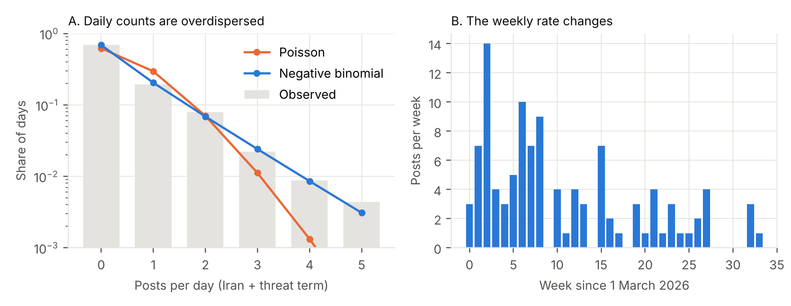
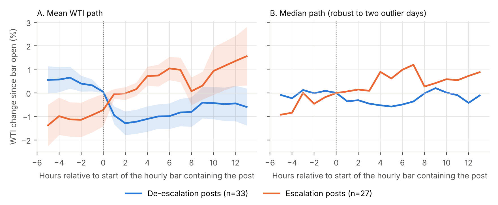
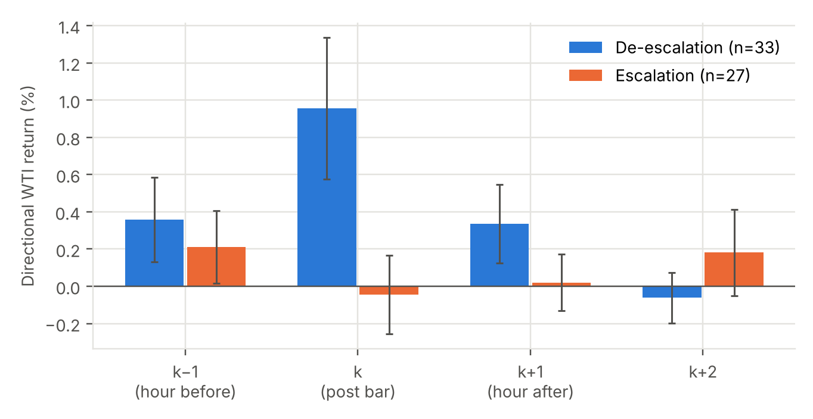

# Surprise, Uncertainty, and Redundancy: An Information-Theoretic Account of How Platform-Mediated Executive Speech Reaches Markets

Ook Lee  
Department of Information System, Hanyang University, Seoul, Korea  
ooklee@hanyang.ac.kr (corresponding author)

*Manuscript prepared for submission to MIS Quarterly (version 2). Bracketed items are placeholders to be completed or verified before submission. Every analysis cited here has a dated pre-registration file in the project repository (Appendix A); results that were not pre-registered as confirmatory are labelled exploratory.*

---

## Abstract

Heads of state now announce policy on social platforms, and markets read those feeds in real time. Existing accounts explain market reactions to such speech with attention, salience, or sentiment, but they say little about why identical channels produce messages that sometimes move prices and sometimes do not. We propose an information-theoretic account. A post updates a market's belief over states of the world; the size of the update depends on the message's surprisal under the market's prior, on the prior's entropy, and on the channel's reliability, while redundant messages carry no bits. We examine the account using 4,838 posts from the U.S. president's platform (March–October 2026), hourly futures data, and the 2026 closure of the Strait of Hormuz, a period of unusually high prior uncertainty about a single physical state. Posting is overdispersed and bursty yet conditionally Poisson, and it follows volatile hours. During the closure, oil fell 1.29% (median 0.31%) over two hours after posts that a model coded as de-escalation. All 191 war-period keyword posts were then labelled by two humans (κ = 0.61 to 0.69; disagreements adjudicated), and the model's labels agree with them only moderately (κ = 0.50). On posts that humans label de-escalation, tick data show a directional move of 0.67% within five minutes and 1.05% within 30 minutes (n = 29, p = 0.0002), exceeding the preceding 30 minutes by 0.48% (p = 0.030). Posts that humans label escalation (n = 16) are followed by 0.48% (p = 0.007), a response that the model's labels hide because only 36% of its escalation labels are escalation in human judgment; the difference between the two directions is not distinguishable from zero. Posts on monetary policy or non-tariff China matters show no hourly response. Pre-registered measures of novelty and prior uncertainty have the predicted sign in every topic and in a 2022–2024 replication, but none clears its threshold (p = 0.08, 0.07), while mutual information between post class and return direction is above its null during the closure (p = 0.041) and not before. In an independent sample of 191 oil- and Iran-related tweets from 2017–2021, when the strait was open, the three propositions are again not supported (Holm-adjusted p ≥ 0.45), and the direction of the response reverses: oil rises by 0.51% within 30 minutes after tweets that the models label escalation (p = 0.001) and does not respond to de-escalation tweets, so the sign of the response seems to depend on the state. In 410 tariff and trade tweets, prior uncertainty is supported (Holm-adjusted p < 0.001) although it is confounded with volatility clustering, novelty and the interaction are not, responses in the expected direction are small (0.05–0.09% of the index), and a pre-registered state-dependent sign proposition fails, in the opposite direction. We read the account as an organizing framework that fits the evidence without being confirmed by it, and we document the design that makes that statement credible.

**Keywords:** information theory, social media, executive communication, event study, pre-registration, large language models as coders, financial markets

---

## 1. Introduction

On the evening of 7 April 2026 a post on the president's platform announced a conditional two-week ceasefire with Iran, contingent on the reopening of the Strait of Hormuz. Oil, which had risen from about $67 to $114.6 per barrel since the first U.S. trading day of the war, fell by double digits within hours. Two weeks earlier, on 23 March, a post announcing a five-day postponement of strikes had produced a drop of similar size. Between those dates, and many times since, other posts threatened strikes, restated demands, or linked to commentary, and the market often barely moved. The puzzle is not that platform speech occasionally matters; it is that the same author, on the same channel, produces messages whose consequences differ by an order of magnitude.

Research on social media and markets has mostly asked whether platform content predicts prices (Bollen et al. 2011; Chen et al. 2014; for the news-media precursor, Tetlock 2007), and, from the firm's side, how dissemination through Twitter affects market liquidity (Blankespoor et al. 2014). The closest work on presidential communication studies tweets and firm values or intraday reactions (Born et al. 2017; Ge et al. 2019). Explanations typically invoke attention (Barber and Odean 2008), rational inattention (Sims 2003), or the distinction between words and actions in central-bank communication (Gürkaynak et al. 2005). Those accounts name factors but offer no common currency in which they can be compared.

Information theory supplies one. In Shannon's (1948) formulation, the information carried by a message is its surprisal, the entropy of the receiver's uncertainty is what the message can reduce, and a noisy channel limits how much of the message is received as intended; a message already implied by prior messages is redundant and carries nothing new (Cover and Thomas 2006). A market's belief update after a message is a Kullback–Leibler divergence between posterior and prior (Kullback and Leibler 1951). Read this way, a post moves prices to the extent that it is surprising given what the market already believes, that the market was uncertain about the state it concerns, and that the message is credible; a repeated threat, a re-post, or a link to commentary should move nothing, and a decision that resolves a physical uncertainty should move the price of the thing that was uncertain.

The 2026 Hormuz closure is a favorable setting for such an account because the prior uncertainty about one physical state (strait open or closed) was unusually high and changed over time. We examine five implications and the arrival side of the channel. We find that posting is overdispersed and bursty yet conditionally Poisson, which is what a source with a time-varying entropy rate looks like; that, during the closure, oil co-moves with de-escalation posts and, less so, with escalation posts as labelled by humans; that this co-movement is not separable from a pre-post drift at hourly resolution and that posts are more likely in volatile hours, so that causal wording is unwarranted; that the novelty and prior-uncertainty variables have the predicted signs in every topic and in a replication sample but fall short of conventional significance; and that the information transferred from post class to return direction exceeds chance during the closure and not before.

We therefore claim a framework and a pattern of evidence, not a confirmed mechanism. Four further contributions are secondary. First, we document the arrival process of presidential posts and show that event-study designs that treat posting times as random are fragile. Second, we show how pre-registered plans, independent model-instance coders working blind to outcomes, and explicit power reporting can make negative and ambiguous results interpretable; three earlier mechanisms (binding constraint, salience, habituation) were pre-registered and none was confirmed, and we report all of them. Third, we test the account in independent 2017–2021 samples of the same author's tweets (oil and Iran; tariffs and trade) under plans registered before returns were examined: the propositions about novelty and the interaction are not supported in either, prior uncertainty is supported in the tariff tweets with a volatility-clustering caveat, the sign of the oil response differs between the closed-strait and open-strait periods, and a pre-registered state-dependent sign proposition fails. Fourth, we describe what we could not do, namely establish causality, validate model coding against human coders (the validation shows moderate agreement only), and test the account with a continuous measure of the physical constraint.

The paper proceeds as follows. Section 2 develops the account and its implications. Section 3 describes the setting, data, and design. Section 4 reports results. Section 5 discusses contributions, implications, and limitations. Section 6 concludes.

## 2. An Information-Theoretic Account of Platform-Mediated Executive Speech

### 2.1 The channel

When the author of a message is also the decision-maker, the message may be the decision's first public form. In speech-act terms, an announcement that strikes are postponed is closer to a declarative act than to an assertion about the world (Austin 1962; Searle 1969); a threat is a directive or commissive whose force depends on the speaker's ability and intent to act. A platform adds two features: it lowers the cost of producing messages and it removes intermediaries that would filter, summarize, or confirm them. Both bear on how receivers should treat the message. Cheap, frequent messages from an actor who may be strategic are sent through a channel whose reliability the receiver must infer; this is the problem studied in the economics of strategic information transmission (Crawford and Sobel 1982) and of persuasion by information design (Kamenica and Gentzkow 2011), and it maps onto channel noise in information theory.

### 2.2 The account

Let S be a state variable that the market cares about (here, whether Hormuz transit is open) with prior distribution π over a finite set of values and prior entropy H(π). A message m is received with some reliability ρ (the probability that the message corresponds to what the sender will do). Receiving m changes the belief to π′, and the information gained is the divergence KL(π′ ‖ π). Three implications follow in expectation.

(i) *Surprisal.* A message whose content has low probability under π produces a larger update than a message the market already expected. Messages that repeat earlier messages (including re-posts and links to commentary) are redundant and produce no update.

(ii) *Prior uncertainty.* For a given message, the update is larger when H(π) is larger, because there is more uncertainty to resolve. State dependence in the response to the same type of message therefore follows from variation in H(π), not from a separate mechanism.

(iii) *Channel reliability.* Reliability scales the update: a message from a channel that the market expects to be reversed, denied, or contradicted moves beliefs less, and a denial by a counterparty reduces the net update.

Two corollaries connect the account to the earlier mechanisms we pre-registered. Salience (reaction rising with posting intensity) is an attention-allocation story; in an information-theoretic frame, higher posting intensity changes surprisal only if it signals a regime change, and otherwise adds redundancy. Habituation (reaction falling with the number of recent similar posts) is the redundancy implication (i) applied to a sequence. The binding-constraint hypothesis is implication (ii) when H(π) is dominated by one physical state.

A further implication concerns the *sign* of impact, and it is the one we state with most care. The 2026 closure and the 2017–2021 sample (Section 4.7) show opposite directional asymmetries in oil, which we read, after the fact, as the prior at work: when closure is the prior, relief is the improbable message; when peace is the prior, a threat is. We turn that post hoc reading into a proposition (P6) and test it with a variable, the recent balance of escalatory and de-escalatory messages, that is measured from labels alone and registered before the tariff-sample returns were examined (Section 4.8). The account predicts magnitude, |reaction|, rather than the sign assigned by a classifier; the sign depends on which direction the message moves π. During the closure, the prior probability of de-escalation was low and that of continued closure high, so a de-escalation announcement is high-surprisal and an escalation threat low-surprisal. The apparent asymmetry between de-escalation and escalation posts is thus an implication of the prior, not an additional assumption.

### 2.3 Source side

On the source side, the arrival of messages has its own entropy rate. A homogeneous Poisson source has maximal entropy for a given rate and no burst structure; a source whose rate varies, such as a Poisson–Gamma mixture, is partly predictable from its own recent history and from the environment (Cameron and Trivedi 2013). If the rate of posting reflects the state of the environment, posting times are informative about the state and are not exogenous for the purposes of event-study identification.

### 2.4 Propositions

We state seven propositions, each with a pre-registered operationalization (P1–P5 in Section 3.5; P6 and P7 in the plans cited in Sections 4.3 and 4.8).

P1 (surprisal): |reaction| increases in the novelty of the post relative to recent posts.
P2 (prior uncertainty): |reaction| increases in the market's prior uncertainty.
P3 (interaction): the effect of novelty is larger when prior uncertainty is higher.
P4 (information transfer): the mutual information between post class and the direction of the subsequent price move is positive when the prior uncertainty about the relevant state is high and close to zero otherwise.
P5 (redundancy): re-posts, links, and repeats carry little information and produce little reaction.
P6 (state-dependent sign): the sign of the response is not fixed by the message class but by the prior. A message that runs against the market's recent regime moves prices more than a message that continues it, so de-escalation announcements should move prices more when the recent regime has been escalatory, and escalation announcements more when it has been de-escalatory. (P6 is not supported in the pre-registered test of Section 4.8.)
P7 (timing surprisal): a post also carries information in when it arrives. If the market holds a predictive distribution over the poster's timing, a post at an improbable time has high surprisal, S = −ln f(gap | past), and, holding content novelty, prior uncertainty and market state constant, should be followed by a larger |reaction|. (P7 is not supported; Section 4.3.)

The account does not by itself address identification: a post and a price move may both respond to the same news. We treat that as a limitation to be measured, not assumed away (Sections 4.2 and 4.4).

## 3. Research Design

### 3.1 Setting

The war that began on Saturday 28 February 2026 provides an unusual combination: a topic on which the president posted frequently, a physical constraint (the strait was effectively closed from early March), and a commodity market in which the constraint was priced continuously. The first U.S. trading day was 2 March. WTI rose from about $67 to $114.6 by 7 April and was near $96 by the end of the sample. The same posts, assets, and design can be applied to periods and topics in which no comparable uncertainty existed (before the war; monetary policy; non-tariff China matters; tariffs).

### 3.2 Data

*Posts.* We use the CNN-maintained archive of the president's posts. Between 1 March and 13 October 2026 there are 4,838 original posts after removing pure re-posts for the arrival analysis; 373 mention Iran, and 108 mention Iran with a threat term. The archive extends to 2022, which we use for an out-of-time replication.

*Markets.* Hourly bars for WTI and Brent futures, E-mini S&P 500 futures, ten-year Treasury futures, the dollar index, USD/CNH, USD/KRW, gold, and several equities cover October 2024 to October 2026; five-minute bars cover the final 60 days; daily WTI and S&P 500 cover earlier years.

### 3.3 Classifying posts

Each post was classified by two independent model instances that received only the post text, for direction (escalation, de-escalation, mixed, other) and type (action versus rhetoric). Cohen's (1960) kappa for direction was 0.84 for oil, 0.86 for tariffs, 0.92 for monetary policy and 0.87 for China, 0.75 in the extension sample, and 0.62 (oil) and 0.96 (tariffs) in the 2022–2024 sample. The two instances are copies of the same model; their agreement measures consistency, not validity against human judgment, and a human validation sample is reported in Section 4.6 and shows only moderate agreement. The headline war-period estimate (Section 4.2) uses the first coder's blind labels, adopted in a dated amendment after a first pass with keyword classes proved misleading (the "threat" class contained the principal de-escalation posts); results on posts where both coders agree are reported as robustness.

### 3.4 Reactions

The reaction to a post is the log change from the open of the hourly bar containing the post to the close of the next bar (two hours), signed so that positive values are in the direction the post implies. We also decompose it into bar returns k−1, k, k+1, k+2 around the bar k that contains the post, standardize by the standard deviation of two-hour changes in the previous 300 bars (|z|), and use week-block bootstrap, rank-based, and permutation tests. Posts within three hours of another post on the same topic are dropped from the main sample.

### 3.5 Measures of information

*Novelty* N_c is a conditional compression ratio: the compressed length of the post appended to the account's last 30,000 characters of posts from the preceding seven days, minus the compressed length of that context, divided by the compressed length of the post alone. Higher values indicate more novel content, lower values indicate redundancy; it is a computable proxy for conditional surprisal (Cover and Thomas 2006). A TF-IDF measure (one minus the maximum cosine similarity to any post in the previous seven days) serves as a robustness check. *Prior uncertainty* U is the log ratio of the standard deviation of the previous 24 one-bar returns to that of the previous 300 in the post's primary asset. *Mutual information* is estimated between post class (de-escalation, escalation, none) and the sign of the two-hour return over all war-period bars, with a permutation null.

### 3.6 Pre-registration

Each analysis had a written plan committed to the repository before estimation. Plans state what the authors had already seen, define primary and secondary outcomes and decision rules (with multiple comparisons handled by Holm's (1979) sequential procedure), and are amended only through dated entries (Appendix A). The practice follows the argument for pre-registration in observational work with many analytic choices (Nosek et al. 2018). The plans are files in the authors' repository, not entries in an independent registry; we therefore treat them as a transparency device, not as a guarantee against specification search. Several plans were written after earlier results had been seen, and the headline result in Section 4.2 arose from an amendment; we label it exploratory.

### 3.7 Content analysis

To generate hypotheses about which posts were consequential, 136 posts were shuffled, stripped of labels and market data, and coded by two model-instance analysts; codebooks were reconciled and fixed before reactions were attached; 20 cases (the eight largest reactions, six moves opposite to the post's direction, and six near-zero de-escalation posts) were compared with contemporaneous market-wire coverage collected without access to our reaction values. Because the analysts are model instances and the study involves no human interpreter, we describe this as LLM-assisted content analysis for hypothesis generation, not as interpretive or critical research.

## 4. Results

### 4.1 Source side: how posts arrive

For the 108 posts that mention Iran with a threat term, daily counts have mean 0.48 and variance 0.74; the dispersion index is 350 on 226 degrees of freedom (p < 0.001), and a negative binomial with size 0.79 fits much better than a Poisson (LR p = 3 × 10⁻⁶). Inter-arrival times are bursty (mean 51 hours, median 21, coefficient of variation 1.94; exponential: 1). With week fixed effects, the Pearson dispersion of daily counts falls to 0.89, consistent with a Poisson process whose weekly rate varies (Figure 1). Because this keyword class is known to mix threats with de-escalation posts, we repeated the analysis on the blind-coded classes: de-escalation posts (57 in the war period) have a dispersion index of 367 and a negative-binomial size of 0.36; escalation posts (60), 430 and 0.32 (all p < 10⁻⁸). The overdispersion is not an artifact of the keyword class.

*Figure 1. Iran-related posts with threat terms (n = 108). A: observed daily counts versus Poisson and negative binomial fits. B: weekly counts.*

Posting is not independent of market conditions. In an hourly logit over 3,605 war-period bars, the absolute prior six-hour oil return predicts a de-escalation post (coefficient 0.115, p = 0.033) and an escalation post (0.144, p = 0.024), and regular trading hours predict escalation posts (p = 0.012); the signed prior return does not (p = 0.32 and 0.18). Posts follow volatile hours. This is what a source whose rate depends on the environment looks like, and it implies that posting times cannot be treated as random for identification.

A homogeneous Poisson process is rejected in every series we examined, including Elon Musk's account and the 2017–2021 Twitter series. A dynamic negative-binomial model with self-excitation fits the multi-year series best, and daily conflict events from GDELT remove at most a quarter of the dispersion, so the idea that posts merely report Poisson external events is not supported. These exploratory comparisons, which were run after the main results were seen, are reported in Appendix D.

### 4.2 Market co-movement during the closure

During the war, WTI fell by 1.29% in the two hours after a de-escalation post (n = 33), with a median of 0.31% (trimmed means 0.81% and 0.73%; 24 of 33 declines; sign test p = 0.007; Wilcoxon p = 0.005; week-block bootstrap 95% CI 0.43 to 2.27, 16 weeks; leave-one-week-out range 0.96 to 1.44). Two events (23 March, −9.8%; 7 April, −12.0%) account for half of the summed move; without them the mean is 0.67% and the median 0.30%. Brent fell by 1.21%, USD/KRW by 0.14%, and the S&P 500 rose by 0.23% (n = 14 events with equity hours). Escalation posts as labelled by the model (n = 28) show no response (WTI −0.02%; week-block CI −0.58 to 0.35); Section 4.6 shows that this class is mostly not escalation in human judgment (precision 0.36). The difference between the two classes is 1.31 percentage points (permutation p = 0.011; rank-based Mann-Whitney p = 0.051), and the escalation cell can rule out only effects larger than about 0.75 points. After de-escalation posts, Treasury futures rose 0.10% (Holm-adjusted p = 0.004), the dollar index fell 0.11% (p = 0.014), and USD/CNH fell 0.04% (p = 0.02). These responses are measured on the same events and share a common oil and geopolitical factor; they are one finding in several assets, not independent confirmations. The result does not change materially when the cluster filter is dropped or widened to six hours (means 1.15% and 1.52%).

In volatility units the state difference survives: the mean standardized reaction to war-period de-escalation posts is 0.93, against 0.07 for pre-war de-escalation posts in the low-uncertainty regime (n = 25; permutation p = 0.013). A matched-hour placebo (fake post times drawn from the same clock hour within three days) gives a mean of −0.16 against the observed 1.29, although the candidate pools are small and this placebo is weak.

*Figure 2. WTI path around war-period posts: de-escalation n = 33; escalation n = 27 with complete windows. A: mean ± 1 SE. B: median.*

*Timing and endogeneity.* Figure 3 shows what two-hour windows hide. The return in the hour before the post bar is already +0.36% in the direction of the post (p = 0.10), and the first full hour after the post bar adds only +0.34% (p = 0.18; this was the revised primary statistic and is not supported). The post bar itself, which includes the part of the hour before the post, carries +0.96% (p = 0.007). The paired difference between the hour after and the hour before is −0.02%. At hourly resolution, a pre-post drift of the same size as the post-post move exists and the contribution of the post cannot be separated from it; tick data, discussed next, can. A momentum control (abnormal reaction relative to a null fit on ordinary hours) leaves the estimate unchanged (1.32%), but ordinary hours show no momentum (slope −0.027), so the control is uninformative about common news. Of 20 triangulated cases, all show other reported drivers. We therefore describe the finding as co-movement, not as an effect of the posts.

*Tick-level timing.* To resolve the timing we obtained tick quotes for a WTI crude CFD (hourly returns correlate 0.999 with the futures series) and measured directional returns from the last tick before the exact post time, under a plan fixed before the data were examined (ANALYSIS_PLAN_5MIN.md). For the 33 de-escalation posts the mean directional return is +0.59% in the five minutes after the post (median +0.21%, Wilcoxon p = 0.0003) and +0.86% in 30 minutes (median +0.41%, p = 0.001), against −0.12% in the five minutes before; the post-minus-pre difference over 30 minutes, the pre-registered discriminating test, is +0.43% (p = 0.025). Oil had drifted in the direction of the post earlier in the hour (+0.62% over the 60 minutes before), and windows of 60 and 120 minutes cannot separate the post from that drift (paired differences −0.05% and +0.32%, n.s.). Escalation posts show no response at 5 to 60 minutes. The matched-hour placebo specified in the plan could not be computed because the placebo data have not been fully downloaded, so a placebo comparison is pending. A response within minutes is what one expects if the post is the news; it is equally what one expects if another event occurs at nearly the same instant, which neither this nor any design with public data can rule out.

*Figure 3. Directional WTI return by hour relative to the bar k containing the post (mean ± 1 SE).*

*Other regimes and topics.* Before the war, de-escalation posts about Iran show the same sign at about a quarter of the size, significant only for posts on which both coders agree (−0.62%, n = 8, p = 0.008). For posts about Russia, Venezuela, and other oil-related geopolitics the pattern reverses: escalation raises oil (+0.46%, p = 0.013). Posts about monetary policy and non-tariff China matters show essentially no hourly reaction. After escalation posts, oil drifts upward over four to twelve hours (+0.71% at four hours, +1.36% at twelve; week-block CIs touch zero); this lies outside the pre-registered window and was not tested.

**Matched-hour placebo and pre-post drift.** To check that the co-movement is not an artefact of the hours in which posts happen to fall, we drew fake post times in the same clock hour on neighbouring days (with the same weekday status, at least two hours from any labelled post; 10,000 draws; ANALYSIS_PLAN_H5C_H8.md). On the adjudicated human-labelled posts (26 de-escalation, 14 escalation, after a three-hour cluster filter), the mean directional 30-minute return after the post is +0.62% for de-escalation and +0.53% for escalation, against placebo means of +0.05% and 95th percentiles of 0.22% and 0.26% (shares of placebo draws at least as large: below 0.0001 and 0.0003). The same test with model labels gives smaller but comparable results. The 30 minutes before the post also exceed the placebo for de-escalation (+0.57%, and +0.86% over the preceding hour; both below 0.0001) and, on the 30-minute window only, for escalation (+0.29%, p = 0.016). Tick counts in the half hour before a de-escalation post are 28% above those of comparable hours. We therefore describe the pre-post movement as drift larger than in comparable hours whose cause is not identified: it does not show leakage or the conduct of any party, and the market may be reacting to news that the post then repeats. Which of the three posting classes was reported first elsewhere makes no difference to the pre-post drift (30 events, p = 0.90).

**Robustness of the human-label result.** Table 2 varies one feature at a time (ANALYSIS_PLAN_ROBUST_HEADLINE.md). The direction of the post-window move is positive and significant in every variant for both classes, including when the three events on 23 March and 7 April are dropped (de-escalation mean 0.80%, median 0.48%) and when only posts on which both coders already agreed are used. The median is stable at 0.4–0.5% over 30 minutes; the mean is pulled up by a few events (the three largest de-escalation events, 2.7%, 3.3% and 10.5%, make up 54% of the summed move). The excess of the 30 minutes after a post over the 30 minutes before it is borderline (de-escalation p between 0.026 and 0.063 across cluster rules; escalation 0.044 to 0.097) and depends on the window: over 5 and 15 minutes the post move is preceded by no drift (pre-window means −0.05% and 0.00%; paired excess +0.72 and +0.76 points, p = 0.003 and 0.005), whereas over 60 minutes the earlier drift has caught up (paired −0.15, p = 0.37). The statement we can defend is therefore the short-window one. Quote quality does not explain the result: all prices used come from a tick no more than two minutes old, the median bid–ask spread is 0.05 on a price near 89.6, and the median absolute 30-minute move (0.46) is about nine spreads. The posts are a selected sample: of 191 war-period posts, 141 pass the three-hour filter, 68 carry a human signal label, and 45 (29 and 16) have a market window at the post time and 30 minutes later; 83% of the signal posts dropped for lack of a window were made at weekends or with the market closed (against 29% of all signal posts), so the result does not extend to weekend announcements.

| Variant | De-escalation: n, post-30 mean (median), paired post − pre (p) | Escalation: n, post-30 mean (median), paired post − pre (p) |
|---|---|---|
| Baseline (3-hour filter) | 29, 1.05 (0.47), +0.48 (.030) | 16, 0.48 (0.40), +0.26 (.058) |
| No cluster filter | 34, 0.91 (0.46), +0.44 (.026) | 19, 0.46 (0.35), +0.23 (.071) |
| 6-hour filter | 25, 1.08 (0.49), +0.42 (.063) | 14, 0.54 (0.50), +0.27 (.097) |
| Both coders agreed before adjudication | 28, 1.03 (0.47), +0.44 (.045) | 7, 0.71 (0.54), +0.44 (.078) |
| Window 5 minutes | 29, 0.67 (0.21), +0.72 (.003) | 16, 0.46 (0.19), +0.38 (.096) |
| Window 15 minutes | 29, 0.76 (0.60), +0.76 (.005) | 16, 0.57 (0.42), +0.36 (.019) |
| Window 60 minutes | 28, 1.18 (0.42), −0.15 (.365) | 16, 0.48 (0.40), +0.44 (.086) |
| Drop 23 March and 7 April | 26, 0.80 (0.48), +0.49 (.025) | 16, 0.48 (0.40), +0.26 (.058) |

*Table 2. Robustness of the human-label tick-level result (mean directional returns in percent; p from one-sided Wilcoxon tests of post > pre; variants are not independent and p-values are not adjusted).*

### 4.3 Tests of the information-theoretic propositions

Table 1 reports the pre-registered tests on 271 hourly signal posts across four topics (oil 112, tariffs 74, Fed 47, China 38), with topic fixed effects and standard errors clustered by day; the outcome is |z|.

| Proposition | Estimate | One-sided p | Decision |
|---|---|---|---|
| P1 novelty N_c | +0.77 (SE 0.56) | 0.084 | Not supported; same sign in all four topics |
| P1 replication, 2022–24 daily (n = 49) | +0.26 (SE 0.37) | 0.24 | Same sign |
| P1 robustness, TF-IDF novelty | +0.52 (SE 0.36) | 0.073 | — |
| P2 prior uncertainty U | +0.29 (SE 0.20) | 0.072 | Not supported |
| P3 N_c × U | −0.08 (SE 1.52) | 0.52 | Not supported |
| P4 mutual information, war | 0.0014 bits (null 0.0004) | 0.041 | Supported (marginal) |
| P4 mutual information, pre-war | 0.0003 bits (null 0.0002) | 0.28 | Consistent |
| P7 timing surprisal S (pooled, n = 685) | +0.04 SD (SE 0.065) | 0.27 | Not supported |
| P5 redundancy | corr(N_c, same-topic posts in prior 24 h) −0.10 | — | Direction as expected; uninformative |

*Table 1. Pre-registered information-theoretic tests (Section 3.5; ANALYSIS_PLAN_INFO.md).*

The coefficients of novelty and prior uncertainty have the predicted sign in every topic and in the replication, but none reaches the pre-registered threshold of p < 0.05, and the interaction is absent. With 271 posts the standard error of the novelty coefficient is 0.56 against an estimate of 0.77, so effects below about 1.5 in these units cannot be excluded. The mutual-information result is the only supported hypothesis, and its p-value is close to the threshold; in absolute terms the information transferred is about one thousandth of a bit per hour-bar, as expected when posts are rare relative to bars.

*Timing surprisal (P7).* The account's second information channel is the time at which a post arrives. We computed, for each post, the surprisal of its waiting time under a lognormal predictive model fitted to the poster's own gaps in the preceding 60 days, separately by trading-session bucket (ANALYSIS_PLAN_TIMING.md, registered before the measure was computed). Pooled over the three tick-level samples, a one-SD increase in timing surprisal is associated with 0.04 SD higher |z| (SE 0.065; one-sided p = 0.27; n = 685), with N_c, U, the preceding 30-minute |z|, the prior-hour post count, session and sample controlled. The estimates are +0.08 in the tariff tweets, −0.02 in the oil tweets and −0.01 in the 2026 posts (Holm p ≥ 0.60); a count-based surprisal, winsorizing, a log outcome, dropping bursts and dropping weekends give the same answer. Timing surprisal is nearly uncorrelated with the volatility preceding the post (Spearman 0.05), so the null is not a control artifact. The confidence interval (about −0.09 to +0.17 SD) excludes a medium effect but not a small one. P7 is not supported.

*First source.* Because the account treats the platform as a possible first source of a decision, we classified all 61 war-period signal posts by whether an outside public source had reported the decision earlier (searchers saw only the post's time and text). Thirty-two were POST_FIRST, 14 OTHER_FIRST, 10 SIMULTANEOUS (six of them 6–9 minutes after the post), and five undeterminable; nine of the 14 OTHER_FIRST posts were links to articles or re-posts. The mean directional reaction was +0.73% for POST_FIRST and +0.04% for OTHER_FIRST (difference 0.70; permutation p = 0.176; not supported). "Post first" means that no earlier report was found by keyword-based search; several outlets could not be opened, and the classification should be read as an upper bound on how often the post was first.

### 4.4 Earlier pre-registered mechanisms

Three mechanisms were pre-registered before the information-theoretic account. *Binding constraint:* oil de-escalation posts moved WTI by a directional 1.40% during the war and 0.01% before it (p = 0.014; Holm-adjusted 0.056); the other three primary comparisons did not support the prediction (oil escalation p = 0.86; tariff escalation, opposite sign, p = 0.09; tariff relief, three pre-period posts). *Salience:* in hold-out topics the coefficient of log posts in the previous seven days is +0.045 (p = 0.44), and those topics show no hourly reaction at all. *Habituation:* −0.24 pooled in-sample (p = 0.036, exploratory); −0.09 (SE 0.29) in the pre-registered 2022–2024 test, whose minimum detectable effect (0.82) is more than three times the in-sample estimate, so the test can neither confirm nor refute it. The action-versus-rhetoric difference (a verifiability premium) was +0.56 points for oil (p = 0.12) and not significant pooled (p = 0.20). Under the information-theoretic account, habituation is the redundancy implication and the binding constraint the prior-uncertainty implication, but the evidence for each is no stronger when stated that way.

### 4.5 What the content analysis suggests

The two analysts' codebooks mapped onto each other on all six themes of one analyst's list (some merged); post-level agreement on shared concepts ranged from kappa 0.37 (claims of agreement) and 0.42 (boasts) to 0.96 (amplification). Five themes were retained: pressure-then-pause cycles; concrete acts versus atmospheric statements; counterparty denial and partial retracement (after the 23 March postponement, the Iranian state denied that talks had occurred and oil rebounded the next session); posts that are themselves the first announcement of a decision (four of the eight largest reactions); and multi-causality (all 20 triangulated cases show other reported drivers; seven were not mentioned in market coverage). Two propositions derived from these themes were tested on held-out data and not supported: that re-posts and links produce no reaction while originals do (difference −0.13 standard deviations, CI −0.57 to +0.31, minimum detectable effect 0.75; in that sample original posts also showed almost no reaction), and that after-hours posts are better measured at the next open (−0.10 points, p = 0.63). The themes of counterparty denial and the carrying of decisions correspond to the channel-reliability and surprisal implications of the account, but they were generated from the same cases they describe and are not independent support.

### 4.6 Validity of the model labels

Two human coders independently coded 150 posts (67 from the war period, 23 pre-war Iran posts, 60 other oil-related posts) from the text alone. The humans agree with each other at κ = 0.51 (four classes). Against the 97 posts on which both humans agree, the first model instance reaches κ = 0.43 and the second κ = 0.56 (three-class versions 0.48 and 0.59), moderate by the criteria we set in advance, while the two instances agree with each other at κ = 0.74. The dominant error is a model de-escalation label where the humans see an unrelated post (9 of 25 and 11 of 28), so de-escalation precision is about 0.52 and 0.54; recall is 0.77 and 0.88. Among the 12 de-escalation posts of the tick-level sample that were also coded by humans, the human consensus is de-escalation for three, escalation for two, other for one, and absent for six, and the 30-minute returns by agreement status (+0.61%, +0.36%, +0.68%) rest on three to six posts each. We cannot re-estimate the headline on human labels with these data. The reading is that the labelling is noisy in a way that the high inter-model agreement conceals; if the false positives do not respond, the response of truly de-escalating posts would be about twice as large as reported, and if the response comes from a few unambiguous announcements it would be unaffected. We treat all model-labelled results as conditional on this labelling.

A second round addressed this directly. Two coders coded all 61 war-period signal posts with a clarified codebook (demands and ultimatums without an announced pause are escalation; de-escalation requires an announced pause, agreement, progress, or reopening). The humans agree at κ = 0.69 and reach a consensus on 48 posts; the principal investigator adjudicated the other 13 from the text alone. The final human labels are 25 de-escalation, 11 escalation, 12 mixed, and 13 other. The first model instance agrees with them at κ = 0.29. Its de-escalation label is right for 21 of 33 posts (precision 0.64; one was escalation for the humans), and its escalation label is right for 10 of 28 (precision 0.36). On the 25 posts that both humans label de-escalation, the mean directional 30-minute return is +1.03% (median +0.47%; Wilcoxon p = 0.0015; the pre-registered H6a), and the excess over the preceding 30 minutes is +0.35% (p = 0.082; the pre-registered H6c, not supported). Under our rule we may therefore claim a response of oil to human-validated de-escalation posts but not, on human labels, that the response exceeds the pre-post drift. The 11 posts that humans label escalation were followed by a mean directional return of +0.53% in 30 minutes (median +0.35%; nine of eleven positive; one-sided p = 0.016; excess over the preceding 30 minutes +0.24%, p = 0.10; exploratory, not corrected), so the finding of no response to escalation posts applies to the model's escalation label, not to escalation as humans see it.

A third round labelled the remaining 130 war-period keyword posts. Across all 191 posts the final human labels are 79 other, 46 de-escalation, 41 escalation, and 25 mixed; 23.6% were adjudicated; the model agrees with them at κ = 0.50. Of 71 posts that the model called other or mixed, 14 (20%) are escalation or de-escalation for humans, so the model also misses some signals. We rebuilt the signal set from the human labels (three-hour cluster filter; market open at the post and 30 minutes later) under a plan written before the labels came back (ANALYSIS_PLAN_HUMAN.md, Amendment 2). It contains 29 de-escalation and 16 escalation posts with a tick window; the other 23 were made mostly on weekends. For de-escalation the directional return is +0.67% at five minutes and +1.05% at 30 minutes (median +0.47%; Wilcoxon p = 0.0002; week-block 95% CI 0.42 to 1.79), and the excess over the preceding 30 minutes is +0.48 points (p = 0.030, the pre-registered H7b, marginal; on the narrower 25-post sample of round 2 the same test gave p = 0.082). For escalation the 30-minute return is +0.48% (p = 0.0065; CI 0.10 to 0.84; excess over the preceding 30 minutes +0.26, p = 0.058), against +0.17% (p = 0.26) when the model's escalation label is used. The difference between the two directions in the human-labelled sample is not distinguishable from zero (Mann-Whitney p = 0.20, exploratory). The human-labelled sample therefore serves as the primary sample for the closure result, and the model-labelled results in Sections 4.2 and 4.3 are retained as the earlier analysis.

### 4.7 An independent test in the Twitter era

To test the propositions on data not used to form them, we pre-registered (ANALYSIS_PLAN_TWITTER.md, written before any label, price or return was examined) a confirmatory analysis of the same author's original tweets from 20 January 2017 to 8 January 2021 that mention Iran, oil, OPEC, Saudi Arabia, or related energy terms (341 tweets; exact times from the tweet identifiers). Two independent model instances labelled direction (κ = 0.77). After the three-hour cluster filter, 278 tweets remained, and 191 had a tick window (market open 30 minutes before and after); 87, mostly weekend and overnight tweets, did not. The outcome is the 30-minute absolute return divided by a scale derived from the prior 60 daily volatilities, so the test of the three propositions does not depend on any label.

The propositions are not supported. The coefficient of novelty (conditional compression) on the standardized absolute reaction is −0.27 (SE 0.74; one-sided p = 0.64), that of prior uncertainty +0.18 (SE 0.18; p = 0.15), and that of their interaction −0.37 (SE 1.81; p = 0.58); the Holm-adjusted p-values are 1.00, 0.45, and 1.00. A lexical novelty measure registered as a robustness check is positive (+1.14, SE 0.44; p = 0.005), so the two measures of novelty disagree, and because the plan designated the compression measure as the test we do not read the lexical result as confirmation. The standard error of the novelty coefficient is large, so effects smaller than about 1.5 standardized units cannot be excluded.

The directional response differs from 2026 in sign. Among tweets that both model instances label escalation (n = 32), oil rose by 0.51% in the 30 minutes after the tweet (median +0.09%; one-sided Wilcoxon p = 0.001); the preceding 30 minutes show +0.04%, and the excess is +0.50 points (p = 0.010). Among tweets labelled de-escalation (n = 11) the response is +0.18% in the expected direction and not significant (p = 0.22), too few to conclude. With the strait closed in 2026 the pattern was the reverse: de-escalation moved oil, and escalation did so when humans, not the model, labelled it. An information-theoretic account can accommodate this (a message is informative when it changes beliefs about the state to which the market assigns little probability: relief when closure is the prior, threat when peace is), but we had not pre-registered the sign flip, and we offer it as a post hoc reading. P6 turns it into a prediction that is tested on the tariff and trade tweets of the same period, with a plan registered before their returns were examined (ANALYSIS_PLAN_TARIFF.md, Amendment 1); human labels for the oil sample are also pending. Finally, the standardized reaction is larger in the 2026 posts (mean 1.39 against 0.84; exploratory permutation p = 0.002); the comparison is confounded with the war and cannot isolate the platform.

### 4.8 A pre-registered test in the tariff and trade tweets

The state-dependence reading of Section 4.7 was formed after the oil results, so it could not be tested on them. For the tariff, trade, and China tweets of 2017–2021 (937 original tweets; 632 after the three-hour filter; 410 with a tick window of the S&P 500 index CFD; labels from two model instances, κ = 0.80, human labels pending) we registered the test before any price or return was examined (ANALYSIS_PLAN_TARIFF.md and its Amendment 1).

*Novelty, uncertainty, and their interaction.* Prior uncertainty is supported: the coefficient of U on the standardized absolute 30-minute reaction is +0.40 (SE 0.10; one-sided p < 0.001; Holm-adjusted 0.0001). Novelty (−0.05, SE 0.68; Holm-adjusted p = 0.74) and the interaction (+0.32, SE 0.97; 0.74) are not. The result for U needs a caveat that restricts its meaning: U is the log ratio of recent to long-run daily volatility and the outcome is scaled by long-run volatility, so the coefficient is what the persistence of volatility predicts without any account of information. It is consistent with our account but does not distinguish it from volatility clustering, and in the oil sample the same coefficient was not significant (p = 0.15).

*Direction.* Among tweets with an agreed label, the S&P 500 rose by 0.085% in the 30 minutes after de-escalation tweets (n = 70; one-sided Wilcoxon p = 0.0007) and fell by 0.046% after escalation tweets (n = 50; p = 0.024); the excess over the preceding 30 minutes is significant for escalation (p = 0.048) and not for de-escalation (p = 0.099). Both responses have the expected sign and are small in index terms.

*Human validation.* Two coders labelled 150 of these tweets (a stratified sample of model-agreed signals, model-disagreed candidates, and model-agreed other tweets; κ between the coders 0.54; 44 disagreements adjudicated from the text). The model labels agree with the final human labels only weakly (κ = 0.39 and 0.34): of the 60 tweets that both models call escalation or de-escalation, humans give the same label to 33 (55%), call 19 other, and reverse the sign of 8; the models almost never miss a signal (1 of 30 model-other tweets is a human signal). On the human labels the directional 30-minute S&P 500 return is −0.10% after de-escalation tweets (n = 20 with a window; one-sided p = 0.49) and +0.058% after escalation tweets (n = 30; p = 0.069; excess over the preceding 30 minutes +0.056, p = 0.026). The response to de-escalation seen with model labels is therefore not reproduced on the human-labelled subset, which is small and not random, and the escalation response is borderline.

*State-dependent sign.* A regime variable R, computed from labels alone as the balance of escalatory and de-escalatory trade tweets in the preceding 30 days, was used to test P6: a message that runs against the regime should move prices more than one that continues it (H12). Among 108 tweets with a defined regime the coefficient is −0.097 (SE 0.032; one-sided p = 0.9987; two-sided p = 0.003). The effect is in the opposite direction: messages that continued the recent regime moved the index more (mean directional returns of +0.119% for aligned and +0.045% for opposed de-escalation; +0.150% and −0.084% for escalation). The test on the human-labelled subset (46 tweets with a window and a regime) gives the same answer (β = −0.041, SE 0.079; one-sided p = 0.70). By the rule we fixed in advance, P6 is not supported and the sign flip in the oil samples remains a post hoc observation that carries no theoretical weight. A reader should therefore not take the opposite signs of the 2026 and 2017–2021 oil responses as evidence for the account. USD/CNH ticks for the China-related subset have not been analysed [to be completed before submission].

## 5. Discussion

### 5.1 What the evidence supports

The evidence supports a small number of statements. First, platform speech by a head of state arrives as an overdispersed, bursty process whose timing follows volatile market hours. Second, during a period of high uncertainty about one physical state, oil co-moved with posts that humans label de-escalation (about +1.05% in 30 minutes) and, at about half the size, with posts that humans label escalation (+0.48%), and not with posts on topics lacking comparable uncertainty; the model's labels had suggested a one-sided response because its escalation label is mostly wrong. Third, that co-movement is robust to rank-based and block inference and to standardization, yet at hourly resolution it cannot be separated from drift that precedes the post; at tick resolution, on human-labelled posts, the 30 minutes after the post exceed the 30 minutes before it by 0.48 points (p = 0.030). Fourth, variables that the information-theoretic account says should matter, novelty and prior uncertainty, have the predicted sign consistently in the 2026 sample but are not individually significant, and in an independent 2017–2021 sample they are not supported at all, while the information transferred from post class to return direction is detectably above chance during the closure only. Fifth, in the oil samples the sign of the directional response differed between the closed-strait and open-strait periods: with the strait closed, de-escalation moved oil; with it open, escalation did. We offered the proposition that this reflects the prior (P6), and the pre-registered test in the tariff tweets rejected it, so the difference remains an observation we cannot yet explain. Sixth, the timing of a post, as opposed to its content, carries no detectable additional information about the 30-minute reaction (P7). Seventh, posting is not Poisson in any series we examined; it is overdispersed and, in multi-year series, self-exciting, a pattern that Elon Musk's account also shows. Taken together, the measurable implications of the information-theoretic account that held are the descriptive ones (mutual information in the closure sample, and prior uncertainty in the volatility-confounded tariff sample); those about novelty, interaction, state-dependent sign and timing did not. An exploratory probe of another actor who times his own events, LLM developers, found the same non-Poisson, calendar-bound arrival and larger absolute market moves on release days, without a direction (Appendix D.3). Daily conflict events remove at most a quarter of the dispersion of posting, so an account in which posts merely report Poisson external events is not supported (Appendix D.2).

### 5.2 Contributions

The paper's main contribution is a framework. By expressing the determinants of a post's market impact in a common currency (surprisal, prior entropy, channel reliability, redundancy), the account generates comparable propositions out of what had been separate stories about attention, habituation, and credibility, and it explains why a topic with high prior uncertainty (the closed strait) shows the response while topics without it (monetary policy, non-tariff China matters) do not. It also locates the platform's role: it lowers the cost of messages, which raises their number and the share that is redundant, and it removes intermediaries, which makes reliability the receiver's problem.

A second contribution concerns the source side. A Poisson–Gamma structure with a rate that responds to the environment implies that posting times are informative and not exogenous, so event studies of executive posts that treat them as random overstate their identification. We show this directly with the hazard of posting.

A third contribution is methodological. The design (written plans before estimation, independent model coders blind to outcomes, explicit power calculations, dated amendments, pre-registered placebos, and independent timing checks) allowed us to report that the headline result is robust in some respects and not in others, and that three mechanisms and two content-analytic propositions could not be confirmed. It also caught a misclassification that would have produced a false headline.

### 5.3 Implications for practice

For analysts who monitor executive feeds, the account suggests weighting a message by its novelty relative to recent messages and by the current uncertainty about the state it concerns, and ignoring re-posts and links. For platform operators and regulators, the account highlights that when a platform is the first channel for decisions, the information advantage in the interval before secondary coverage is concentrated at the platform; we make no claim about any trading behavior.

### 5.4 Limitations

The tests of Appendix D (arrival models, event explanation, LLM releases) were run after the main results were seen and are exploratory; the event counts come from a media-based database that the posts themselves influence, the release list is crowd-edited, and the 31 listed-developer releases give little power. The coders are model instances, and the human validation (Section 4.6) shows only moderate agreement with them (κ = 0.43 and 0.56 against the human consensus; 0.51 between the humans), with de-escalation precision of about one half; the two instances are copies of one model and agree with each other (κ = 0.74) far more than with either human. Every model-labelled result is therefore conditional on a labelling that is not validated. Posting times are endogenous: posts follow volatile hours, and all 20 triangulated cases show other drivers; neither the momentum control nor the first-source classification resolves simultaneity, and the latter is itself an upper bound. Hourly bars cannot separate the post from the preceding hour. The tick analysis can, but it uses a CFD rather than exchange futures, 33 de-escalation events, and one asset; the matched-hour placebo is pending. Prior uncertainty is proxied by relative volatility and novelty by redundancy relative to the account's own recent posts, neither of which is the market's information set; weak measures of both would lower power. The war-period result rests on 33 events, two of which supply half of the mean. The 2017–2021 sample adds a second period but not a second sender; it uses model labels only (human labelling is pending), loses 31% of events to closed markets, and its two novelty measures disagree; the tariff sample loses 35% of events to closed markets, relies on model labels that humans accept for only about half of the model-agreed signals, and its supported uncertainty result is confounded with volatility clustering. The sample contains one conflict and one administration. We tested four sets of mechanisms and confirmed none; we cannot exclude that a different formulation would succeed. The plans are not registered with an independent registry, and several were written after related results had been seen.

### 5.5 Future research

The most informative next steps are a pre-registered comparison of dispersion and self-excitation between accounts of people who use posts to influence others and matched ordinary accounts (ANALYSIS_PLAN_ACCOUNTS.md; registered, not run, because suitable data have not been established), a comparison group of externally caused events for the self-timed-event probe, release times of day for tick-level analysis of releases, and  extension of the tick-level design to several assets and to exchange futures, with a completed placebo; a continuous measure of physical constraint (tanker transits, insurance spreads, term-structure) as a measure of prior uncertainty; prospective collection, under the protocol we registered, of counterparty denials and concurrent news; and a sample large enough to test redundancy (roughly 480 to 560 signal posts for the habituation effect).

## 6. Conclusion

An information-theoretic reading of platform-mediated executive speech organizes the evidence we have: posts that resolve a high-uncertainty physical state move the price of that state, repeated or content-free posts do not, and the novelty and uncertainty variables point in the predicted direction. It does not confirm the account, and it does not identify an effect of posts on prices. We offer the account as a framework that makes the questions sharper and the design as a baseline for work that can answer them.

---

## Declarations [to be completed]

*Use of generative AI.* Large language models were used as classification instruments in the study and for drafting and analysis support. The journal's disclosure requirements should be checked and the declaration completed accordingly [required].

*Data and code availability.* Code, pre-registration files, coder outputs, and results are in the project repository; the post archive and market data come from public sources [add repository DOI].

## References

[On 14 October 2026 the journal articles, the Clauset chapter, the Leetaru and Schrodt paper and Richardson (1960) were checked against Crossref, publisher or library records. The textbooks (Austin, Cameron and Trivedi, Cover and Thomas, Searle) and Holm (1979) were not machine-checked and should be confirmed against the originals before submission.]

Austin, J. L. 1962. *How to Do Things with Words*. Oxford: Clarendon Press.

Barber, B. M., and Odean, T. 2008. "All That Glitters: The Effect of Attention and News on the Buying Behavior of Individual and Institutional Investors," *Review of Financial Studies* (21:2), pp. 785–818.

Blankespoor, E., Miller, G. S., and White, H. D. 2014. "The Role of Dissemination in Market Liquidity: Evidence from Firms' Use of Twitter," *The Accounting Review* (89:1), pp. 79–112, https://doi.org/10.2308/accr-50576.

Bollen, J., Mao, H., and Zeng, X. 2011. "Twitter Mood Predicts the Stock Market," *Journal of Computational Science* (2:1), pp. 1–8.

Born, J. A., Myers, D. H., and Clark, W. J. 2017. "Trump Tweets and the Efficient Market Hypothesis," *Algorithmic Finance* (6:3–4), pp. 103–109, https://doi.org/10.3233/AF-170211.

Cameron, A. C., and Trivedi, P. K. 2013. *Regression Analysis of Count Data* (2nd ed.). Cambridge: Cambridge University Press.

Chen, H., De, P., Hu, Y. J., and Hwang, B.-H. 2014. "Wisdom of Crowds: The Value of Stock Opinions Transmitted Through Social Media," *Review of Financial Studies* (27:5), pp. 1367–1403, https://doi.org/10.1093/rfs/hhu001.

Clauset, A. 2020. "On the Frequency and Severity of Interstate Wars," in *Lewis Fry Richardson: His Intellectual Legacy and Influence in the Social Sciences*, N. P. Gleditsch (ed.), Cham: Springer, pp. 113–127, https://doi.org/10.1007/978-3-030-31589-4_10.

Cohen, J. 1960. "A Coefficient of Agreement for Nominal Scales," *Educational and Psychological Measurement* (20:1), pp. 37–46.

Cover, T. M., and Thomas, J. A. 2006. *Elements of Information Theory* (2nd ed.). Hoboken, NJ: Wiley.

Crawford, V. P., and Sobel, J. 1982. "Strategic Information Transmission," *Econometrica* (50:6), pp. 1431–1451.

Ge, Q., Kurov, A., and Wolfe, M. H. 2019. "Do Investors Care About Presidential Company-Specific Tweets?," *Journal of Financial Research* (42:2), pp. 213–242, https://doi.org/10.1111/jfir.12177.

Gürkaynak, R. S., Sack, B., and Swanson, E. 2005. "Do Actions Speak Louder Than Words? The Response of Asset Prices to Monetary Policy Actions and Statements," *International Journal of Central Banking* (1:1), pp. 55–93.

Holm, S. 1979. "A Simple Sequentially Rejective Multiple Test Procedure," *Scandinavian Journal of Statistics* (6:2), pp. 65–70.

Houweling, H. W., and Kuné, J. B. 1984. "Do Outbreaks of War Follow a Poisson-Process?," *Journal of Conflict Resolution* (28:1), pp. 51–61, https://doi.org/10.1177/0022002784028001003.

Kamenica, E., and Gentzkow, M. 2011. "Bayesian Persuasion," *American Economic Review* (101:6), pp. 2590–2615.

Kullback, S., and Leibler, R. A. 1951. "On Information and Sufficiency," *Annals of Mathematical Statistics* (22:1), pp. 79–86.

Leetaru, K., and Schrodt, P. A. 2013. "GDELT: Global Data on Events, Location and Tone, 1979–2012," paper presented at the International Studies Association Annual Convention, San Francisco, April.

Lewis, E., Mohler, G., Brantingham, P. J., and Bertozzi, A. L. 2012. "Self-Exciting Point Process Models of Civilian Deaths in Iraq," *Security Journal* (25:3), pp. 244–264, https://doi.org/10.1057/sj.2011.21.

Nosek, B. A., Ebersole, C. R., DeHaven, A. C., and Mellor, D. T. 2018. "The Preregistration Revolution," *Proceedings of the National Academy of Sciences* (115:11), pp. 2600–2606.

Richardson, L. F. 1960. *Statistics of Deadly Quarrels*, Q. Wright and C. C. Lienau (eds.), Pittsburgh: Boxwood Press; Chicago: Quadrangle Books.

Searle, J. R. 1969. *Speech Acts: An Essay in the Philosophy of Language*. Cambridge: Cambridge University Press.

Shannon, C. E. 1948. "A Mathematical Theory of Communication," *Bell System Technical Journal* (27:3), pp. 379–423.

Sims, C. A. 2003. "Implications of Rational Inattention," *Journal of Monetary Economics* (50:3), pp. 665–690.

Tetlock, P. C. 2007. "Giving Content to Investor Sentiment: The Role of Media in the Stock Market," *Journal of Finance* (62:3), pp. 1139–1168.

## Appendix A. Pre-registration ledger

| Block | Plan | Outcome |
|---|---|---|
| Arrivals | poisson_posts/ANALYSIS_PLAN.md | Overdispersed; conditionally Poisson |
| Weekly market tests | ANALYSIS_PLAN_MARKETS.md | Null |
| Intraday core | hf/ANALYSIS_PLAN.md (Amendment 1) | De-escalation co-movement; none for escalation (exploratory after amendment) |
| Instrumental variables | ANALYSIS_PLAN_IV.md | Weak first stage (F = 2.8) |
| Extension | ANALYSIS_PLAN_EXT.md | Coder-robust; partial pre-war replication; reversal for other oil posts |
| Binding constraint | THEORY_AND_PAPER_PLAN.md | Partly supported |
| Salience | THEORY_V2_SALIENCE.md | Rejected |
| Habituation | THEORY_V3_HABITUATION.md | Underpowered |
| Content analysis | ANALYSIS_PLAN_QUAL.md (Amendments 1–2) | Five themes; four propositions |
| Held-out tests of propositions | ANALYSIS_PLAN_QUAL_TESTS.md | Not supported |
| Pre-trend control | ANALYSIS_PLAN_PRETREND.md | Estimate unchanged; control uninformative |
| First source | ANALYSIS_PLAN_WIRE.md | Not supported (p = 0.176) |
| Tick-level timing | ANALYSIS_PLAN_5MIN.md | H5a, H5b supported for de-escalation posts |
| Matched-hour placebo (H5c) and anticipatory drift (H8) | ANALYSIS_PLAN_H5C_H8.md | H5c supported (de-escalation +0.62 vs placebo 95th pct 0.22; escalation +0.53 vs 0.26); H8a: pre-post drift also exceeds placebo for de-escalation (+0.57, +0.86) and partly for escalation; H8c: no difference by first source (p = 0.90); cause not identified |
| Twitter-era oil/Iran sample | twitter/ANALYSIS_PLAN_TWITTER.md (Amendment 1) | HI1–HI3 not supported (Holm p ≥ 0.45); H10 supported for escalation (p = 0.001), not for de-escalation |
| Twitter-era tariff/trade sample | twitter/ANALYSIS_PLAN_TARIFF.md (Amendment 1: P6/H12 state-dependent sign) | HI2 supported (Holm p < 0.001; volatility caveat); HI1, HI3 not supported; H10 supported (small); H12 not supported, opposite sign (β = −0.097) |
| Human validation, H7 (human-labelled sample) | ANALYSIS_PLAN_HUMAN.md (Amendments 1–2) | H7a, H7b supported for de-escalation (p = 0.0002, 0.030); escalation +0.48% (p = 0.007) |
| Human validation (round 2) | ANALYSIS_PLAN_HUMAN.md (Amendment 1) | Round 1 κ 0.43–0.56; round 2 (61 war-period posts, adjudicated) κ 0.29, H6a supported, H6c not supported |
| Revision analyses | ANALYSIS_PLAN_REVISION.md | Revised primary not supported; robust inference supports; posting follows volatility |
| Timing surprisal (P7) | arrivals/ANALYSIS_PLAN_TIMING.md | Not supported (pooled β = +0.04 SD, p = 0.27; n = 685) |
| Arrival models and Musk account | none (descriptive; arrivals/RESULTS_ARRIVALS_MODELS.md) | Poisson rejected; NB ≈ Poisson–lognormal; dynamic NB-INGARCH best in multi-year series |
| Event explanation of dispersion | arrivals/ANALYSIS_PLAN_EVENTS.md (exploratory) | Lagged GDELT conflict events significant in all six pairings but remove 9–25% of NB dispersion (never ≥ 50%); event series not Poisson; Calendar-week effects remove 66% (all Twitter) |
| LLM release arrival | arrivals/ANALYSIS_PLAN_LLM_RELEASES.md (exploratory) | Over-dispersed after trend (LR p = 0.0001); weekend share 4% vs 29% expected; geometric gaps rejected |
| LLM release stock reaction | arrivals/ANALYSIS_PLAN_LLM_STOCK.md (exploratory) | Direction not supported (+0.40 pp, p = 0.55); magnitude larger than random windows (p = 0.008; Holm 0.015); n = 31 |
| Matched-account comparison (HA1–HA2) | arrivals/ANALYSIS_PLAN_ACCOUNTS.md | Registered, not run; data availability not established |
| Information-theoretic hypotheses | ANALYSIS_PLAN_INFO.md | P1–P3 not supported (p = 0.08, 0.07, 0.52); P4 supported (p = 0.041) |

## Appendix B. Coding protocol

[Summary of direction and type definitions, blind-coding instructions, the primary-label rule, reconciliation of content-analysis codebooks, the model and prompt provenance, and a reference to the repository files.]

## Appendix C. Human validation

Two human coders coded 150 posts independently from text only (war-period 67, pre-war Iran 23, other oil-geopolitics 60). Four-class kappa: human–human 0.51; model 1–model 2 0.74; human consensus (97 posts) with model 1 0.43 and with model 2 0.56 (three-class 0.48 and 0.59). De-escalation precision against the consensus is 0.52 (model 1) and 0.54 (model 2); recall 0.77 and 0.88. Of the 12 posts in the tick-level de-escalation sample that fall in the round-1 human sample, the human consensus is de-escalation for 3, escalation for 2, other for 1, and absent for 6. In round 2 (all 61 war-period signal posts, codebook v2, κ between humans 0.69, 13 disagreements adjudicated), the final human labels are 25 de-escalation, 11 escalation, 12 mixed, and 13 other; the model agrees at κ = 0.29. On the 25 human-labelled de-escalation posts the 30-minute directional return is +1.03% (p = 0.0015) and its excess over the preceding 30 minutes +0.35% (p = 0.082). Details are in RESULTS_HUMAN.md and RESULTS_HUMAN61.md.

## Appendix D. Exploratory analyses of arrival and of other self-timed events

These analyses were run after the main results were seen. Their definitions were fixed in dated plans before the relevant data were downloaded or parsed (Appendix A), but none is confirmatory.

### D.1 Alternative arrival models and a second account

 Poisson is not the only candidate, and the negative binomial (a Poisson–Gamma mixture) is a particular one. Table D1 compares daily-count models by AIC for the Truth Social series, for the 2017–2021 Twitter series (all original tweets and the two topic subsets of Sections 4.7–4.8), and for Elon Musk's account as a second influential poster (a public third-party extract of 3,218 tweets, 2012–2017, whose completeness and time zone we could not verify). A homogeneous Poisson process is rejected everywhere (ΔAIC 150 to 3,700). The negative binomial and a Poisson–lognormal mixture fit equally well (differences within about 13 AIC units), so the data do not support choosing a gamma over a lognormal mixing distribution. In the multi-year Twitter series a dynamic model, a negative-binomial INGARCH(1,1) in which today's rate depends on yesterday's count and rate, is far better than every static mixture (ΔAIC 57 to 626); the 227-day Truth Social series is too short for this and the static negative binomial suffices. Waiting times follow no power law (Pareto is worst in every series); the best form is Weibull for all of Trump's tweets, gamma for the topic subsets, and lognormal for Truth Social and Musk (CV 1.7 to 2.5). Musk's account shows the same qualitative pattern as the president's. We read this as evidence that human posting is bursty and self-exciting, not as evidence that the pattern is specific to people whose words carry weight: we have no comparison with ordinary accounts. A pre-registered comparison with matched ordinary accounts is specified (ANALYSIS_PLAN_ACCOUNTS.md) but has not been run, because we have not established that data of sufficient quality exist.

| Series | Days | Static NB (ΔAIC) | Poisson–lognormal (ΔAIC) | NB-INGARCH (ΔAIC) | Best waiting-time model |
|---|---|---|---|---|---|
| Trump, Truth Social 2026 | 227 | 0 | 1 | 0 (collapses to NB) | Lognormal |
| Trump, Twitter, all original | 1,448 | 626 | 639 | 0 | Weibull |
| Trump, Twitter, oil/Iran | 1,448 | 57 | 62 | 0 | Gamma |
| Trump, Twitter, tariff/trade | 1,448 | 137 | 129 | 0 | Gamma |
| Musk, Twitter 2012–17 | 1,779 | 238 | 249 | 0 | Lognormal |
| Musk, Twitter 2016–17 | 638 | 59 | 66 | 0 | Lognormal |

*Table D1. Alternative models for the arrival of posts (ΔAIC relative to the best model in each row; Poisson ΔAIC 150 to 3,700 in all rows; descriptive, not pre-registered; RESULTS_ARRIVALS_MODELS.md).*

### D.2 Do external events explain the over-dispersion?

 If a head of state mostly reports external events and those events arrive as a Poisson process, posting would be over-dispersed only because each event spawns several posts. Richardson's classic result is that the onsets of separate interstate wars are roughly Poisson at an annual scale (Richardson 1960; Clauset 2020), although it has been questioned (Houweling and Kuné 1984), and within a war, violent events are usually modelled as self-exciting (Lewis et al. 2012); a single war that has already begun supplies no such onsets at the daily scale of our data. We therefore tested the idea directly, in an exploratory analysis whose definitions were fixed before the event counts were downloaded (ANALYSIS_PLAN_EVENTS.md). We counted GDELT conflict events per day (Iran-involved conflict events, world conflict, riots, and US–China conflict events; Leetaru and Schrodt 2013) and added the previous day's count and the average of the previous 2–7 days, together with total event volume, to a negative binomial model of daily posts. The event terms are statistically significant in all six pairings, but they remove only a small part of the dispersion: 9% (Truth Social, all posts), 11% (tariff tweets), 17–20% (all Twitter posts, with riot or world-conflict events) and about 22–25% (oil/Iran tweets; Truth Social Iran posts); in no pairing do they remove half. Calendar-week fixed effects, in contrast, remove 66% of the dispersion of all Twitter posts, so the over-dispersion mostly reflects a slowly moving rate that daily conflict counts do not capture. The event series are themselves far from Poisson (variance-to-mean ratios of about 550 and 900 for Iran-related conflict events, lag-1 autocorrelations of 0.85 and 0.96). The premise that the posts follow Poisson events fails at the daily scale. These counts reflect media coverage, which the posts also influence, so the tests do not identify causal direction, and block-bootstrap intervals rest on only 100 resamples.

### D.3 A probe beyond politics: other actors who time their own events

A head of state who announces a war and a company that releases a model both choose when the event happens. If the account generalizes, the arrival of such events should not be Poisson, and the market should react more strongly on event days. We probed both in an exploratory analysis registered before the data were parsed (ANALYSIS_PLAN_LLM_RELEASES.md; ANALYSIS_PLAN_LLM_STOCK.md). The source is Wikipedia's list of large language models (fetched on 14 October 2026; 187 rows with at least a month, 126 with a full date, nearly all from 2025–2026); it is crowd-edited and includes models by notability, so the tests are descriptive.

*Arrival.* Monthly release counts rise steeply over 2018–2026, and with a log-trend they remain over-dispersed (Pearson χ²/df 1.7; negative-binomial α = 0.25; likelihood-ratio p = 0.0001); in the shorter 2024–2026 window the evidence is weaker with a quadratic trend (α = 0.10; one-sided p = 0.028). Of 125 releases with a full date since 2023, 4% fell on a weekend, against 29% expected under a homogeneous process (χ² = 62.1, 6 df; Holm p < 10⁻¹⁰). Gaps between releases (119 gaps since 2024; coefficient of variation 1.55) are fitted best by a negative binomial; the memoryless geometric is worse by 22 AIC units. Individual developers release more regularly than a Poisson process (coefficients of variation 0.67 for Anthropic, 0.81 for OpenAI, 1.12 for Google DeepMind), so the clustering appears only after pooling. Release dates follow the business calendar, a clear departure from a Poisson process.

*Market reaction.* For the 31 releases by listed developers (Alphabet 9, Alibaba 8, Meta 4, Microsoft, Xiaomi and Tencent 3 each, Nvidia 1), the mean abnormal return over the release day and the next trading day, from a market model, is +0.40 percentage points (SE 0.68; Wilcoxon p = 0.76). The standardized absolute abnormal return is larger than in random two-day windows of the same firms (1.11 against 0.75; permutation p = 0.008; Holm p = 0.015). In other words, there is a magnitude effect without a direction. It shrinks by about 40% when three events likely to coincide with other news are removed (Gemini 2.0 on 5 February 2025, Qwen2.5 on 26–27 January 2025 and Llama 4 on 5–7 April 2025; the coincidences are our recollection, not checked here). Release times of day are not in the list, so daily windows were used; unlisted developers, about half of the 2025–2026 rows, are excluded by design; and a few firms contribute only 3–4 events each, with opposite signs across firms.

Taken together with the war-period results, the two settings agree on one point, that timing is chosen by the actor and arrival is not Poisson. They do not agree on the market reaction: with the matched-hour placebo (Section 4.2) the posts show a directional move beyond fake times in comparable hours, whereas releases show larger absolute moves without a direction. Because the two statistics differ, and because we have no comparison group of externally caused events, we do not claim that self-caused events are a common class with a common market signature.

