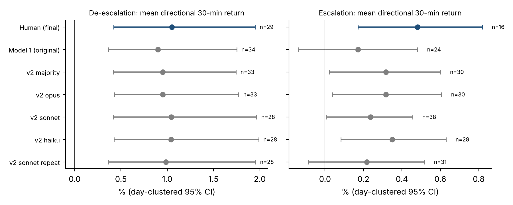
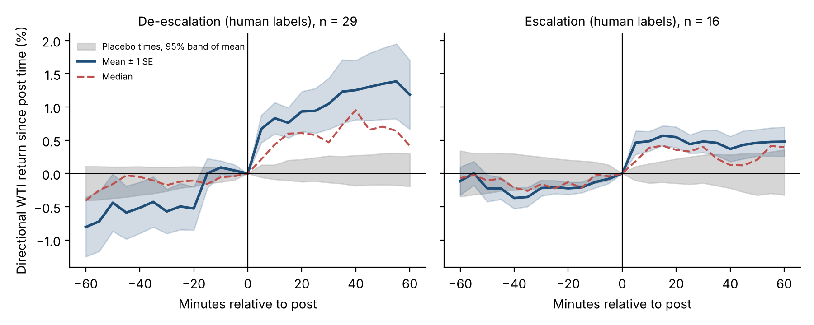

# Do Model Labels Mislead an Event Study? Presidential Posts and Oil Prices in the 2026 Hormuz Closure

[Author names and affiliations are on the separate title page.]

*Analyses carry a status given in Table A1; the plans behind them are files in a project repository, not entries in an independent registry.*

---

## Abstract

Large language models now label social-media posts in event studies, usually with agreement between model runs reported as reliability. Using 191 war-period posts from the U.S. president's platform and tick data on oil during the 2026 Strait of Hormuz closure, we compare model labels with those of human coders. The models agree with the humans at κ = 0.50 and over-label escalation; four further runs under the humans' own codebook do not improve this. On human labels, oil moves in the posts' direction within 30 minutes by +1.05% after de-escalation posts (n = 29), more than at drift-matched placebo times. For escalation posts the estimate is +0.48% (n = 16) when the lead investigator resolved the coders' disagreements; when an independent third coder and the two coders resolve them it is +0.45% (n = 10, p = 0.08) because the escalation class shrinks from 41 to 28 posts. Model-labelled escalation estimates are smaller (0.17% to 0.35%), but their difference from the human estimates is not reliably detectable. The move is preceded by drift and its excess over the preceding 30 minutes is not reliably separable from it. The case shows that agreement with human readers, not between model runs, is the evidence a labelling needs, and that the escalation class is the ambiguous one.

**Keywords:** large language models as annotators, measurement validity, event study, social media, executive communication

---

## 1. Introduction

On the evening of 7 April 2026 a post on the president's platform announced a conditional two-week ceasefire with Iran, contingent on the reopening of the Strait of Hormuz. Oil, which had risen from about $67 to $114.6 per barrel since the first U.S. trading day of the war, fell by 12% within hours. Two weeks earlier, on 23 March, a post announcing a five-day postponement of strikes had been followed by a fall of 9.8%. Between those dates, and many times since, other posts threatened strikes, restated demands, or linked to commentary, and the market often barely moved. Whether and how platform posts relate to prices is an empirical question that depends on which posts are counted as what.

Research on social media and markets has mostly asked whether platform content predicts prices (Bollen et al. 2011; Chen et al. 2014; for the news-media precursor, Tetlock 2007) and, from the firm's side, how dissemination through Twitter affects market liquidity (Blankespoor et al. 2014). The closest work on presidential communication studies tweets and firm values or intraday reactions (Born et al. 2017; Ge et al. 2019). Explanations typically invoke attention (Barber and Odean 2008), rational inattention (Sims 2003), or the distinction between words and actions in central-bank communication (Gürkaynak et al. 2005). Most such studies classify text automatically, and increasingly with large language models, which can match or exceed crowd workers on some annotation tasks (Gilardi et al. 2023; Ziems et al. 2024). The text-as-data literature has long urged that automatic classifications be validated against human readings before they enter downstream inference (Grimmer and Stewart 2013), and recent work shows how imperfect machine labels bias downstream estimates unless they are corrected with a validated subsample (Egami et al. 2023; Angelopoulos et al. 2023). In applied event studies, agreement between two runs of a model is often reported as reliability; that measures consistency, not validity, and agreement with human readers is less often reported next to the market result.

We use the Hormuz closure to study that gap. The setting is favorable because one physical state (strait open or closed) dominated the news for months, because the president posted frequently about it, and because oil was priced continuously. We make two contributions. First, we show how the labelling changes the event-study answer. A model-labelled analysis found a response to de-escalation posts and none to escalation posts. Two human coders labelled all 191 war-period keyword posts; against them the model over-labels escalation, and four further model runs under the clearer codebook the humans used do not close the gap. On human labels de-escalation posts are followed by a directional move in oil, larger than at matched placebo times; escalation posts are followed by a smaller move whose evidence depends on who resolved the coders' disagreements. The escalation response is smaller under every model label set we tried, but its difference from the human estimate is detectable at most for the original labels and not under independent adjudication. The attenuation comes from the events the models add to the escalation class, not from noise shrinking the same effect. Second, we report which part of the human-label market result is robust (the direction of the post-period move) and which is not (its separation from pre-post drift beyond short windows; the escalation result is weaker when disagreements are resolved by an independent third coder). Posting is also overdispersed and follows volatile hours, so posting times are not exogenous, and an information-theoretic account that motivated the study is not supported by its pre-specified tests (Appendices D and F). The paper does not identify a causal effect of posts on prices.

Section 2 gives the scope. Section 3 describes the data and design. Section 4 reports results. Section 5 discusses contributions and limits, and Section 6 concludes. Exploratory, model-labelled and theory-motivated analyses are in the appendices.

## 2. Scope

The paper concerns the measurement of what a head of state's posts are (escalation or de-escalation of a military and supply risk) and how oil prices move around them. We began from an information-theoretic reading in which a post moves prices according to its surprisal, the prior uncertainty about the state it concerns and its redundancy; its pre-specified tests (novelty, prior uncertainty, their interaction, mutual information, timing surprisal) are not supported, use crude proxies, and are reported in Appendix F. They do not bear on the labelling question and no theory is claimed here. The study also does not identify a causal effect of posts on prices.

## 3. Data and Design

### 3.1 Setting and data

The war that began on Saturday 28 February 2026 provides a topic on which the president posted frequently, a physical constraint (the strait was effectively closed from early March), and a commodity market in which the constraint was priced continuously. The first U.S. trading day was 2 March. WTI rose from about $67 to $114.6 by 7 April and was near $96 at the end of the sample.

*Posts.* We use the CNN-maintained archive of the president's posts. Between 1 March and 13 October 2026 there are 4,838 original posts after removing pure re-posts; 373 mention Iran, and 108 mention Iran with a threat term. A keyword-selected set of 191 war-period posts is the frame for classification. *Markets.* Hourly bars for WTI and Brent, E-mini S&P 500 and ten-year Treasury futures, the dollar index, USD/CNH, USD/KRW, gold and several equities cover October 2024 to October 2026. For timing we use tick quotes (mid price and bid–ask spread) for a WTI crude CFD from Dukascopy, 2017–2026 (hourly returns correlate 0.999 with the futures series). A price at time t is the mid of the last tick before t, accepted only if that tick is no more than ten minutes old; all windows used in the tick results have a tick no more than two minutes old.

### 3.2 Classifying posts

*Model labels, first stage.* Each post was classified by two independent runs of a large language model that received only the post text, for direction (escalation, de-escalation, mixed, other). The two runs are copies of one model (Anthropic's Claude Sonnet 5.5, model ID claude-sonnet-5-5, run on 14 October 2026 through agent calls with default sampling settings; temperature was not set by us); their agreement (κ = 0.74 on the human-validation sample, 0.62–0.96 elsewhere) measures consistency. The first-stage analysis (Section 4.2) uses the first run's labels ("model 1"). The model had not been given the codebook the human coders later used (Appendix B).

*Model labels, codebook v2.* After human validation we re-labelled all 191 war-period posts with four blind runs (three model sizes and a repeat of one) that received the human codebook v2 and the post texts as the humans saw them, in a different random order per run, and nothing else (Section 4.4; Appendix B). Their majority label is "v2 majority".

*Human labels.* Two human coders labelled the posts independently from the text alone in three rounds (Section 4.3), and agreement is reported as Cohen's (1960) kappa. Disagreements were first adjudicated from the text by the lead investigator, who knew the research question; 23.6% of all final labels, and 66% of the final escalation labels, are adjudicated (11% of the de-escalation labels). Because that is a researcher's judgement, a third coder who did not know the research question or any market result and had not seen the earlier labels afterwards labelled the 45 items on which the two coders had disagreed, mixed with 15 items on which they had agreed, in random order, text only [describe the third coder]; the plan was written before the sheet was sent (Section 4.5). We report the investigator-adjudicated labels, the labels in which the majority of the two coders and the third coder decides ("v3 final"), the coder-consensus subsample and the adjudicated subsample separately. The two coders were doctoral students in information systems with extensive training in the field, and both belong to the authors' department; neither had seen market data or had a particular interest in oil prices. They did not know the research question; because the war was a widely reported event, they remembered its course, and the labels may reflect that knowledge.

### 3.3 Outcomes

The hourly outcome is the log change from the open of the bar containing the post to the close of the next bar (two hours), signed so that positive values are in the direction the post implies. The tick outcome is the directional log return from the last tick before the post to 5, 15, 30 or 60 minutes after, and the same window before the post for comparison; the 30-minute window is primary. A post is dropped if another of the 191 posts occurred in the previous three hours (cluster filter), or if the market was not open (no tick within ten minutes) at the post time or 30 minutes later.

### 3.4 Other measures

Novelty, prior uncertainty, mutual information and the |z| outcome used for the information-theoretic tests are defined in Appendix F.

### 3.5 Status of analyses

Each analysis had a written plan committed to the repository before estimation, and plans state what had already been seen; we call such results pre-specified and do not call them pre-registered. The repository is not an independent registry, many plans were written after related results were seen, several were amended after a first result, and commit dates cluster on 13–14 October 2026. We follow the argument for pre-registration in observational work with many analytic choices (Nosek et al. 2018), but use the plans as a transparency device and classify every reported result as pre-specified (the plan preceded the relevant outcome and was not amended), amended, exploratory or post hoc (Table A1). Holm's (1979) sequential procedure is applied within families defined in the plans (Appendix A); other p-values are unadjusted and reported as such. The human-label headline was not the original plan: a first pass with keyword classes, and then model labels, proved misleading, and the primary sample was redefined three times (33 model-labelled posts; 25 posts after round 2; 29 and 16 posts after round 3), each time after label quality or outcomes were known. The earlier versions are reported in Section 4 and the model re-labelling of Section 4.4 and the robustness variants of Section 4.5 were planned before they were computed.

## 4. Results

### 4.1 Posting is overdispersed and follows volatile hours

For the 108 posts that mention Iran with a threat term, daily counts have mean 0.48 and variance 0.74; the Pearson dispersion statistic is 350 on 226 degrees of freedom (p < 0.001), and a negative binomial (Cameron and Trivedi 2013) with size 0.79 fits much better than a Poisson (LR p = 3 × 10⁻⁶). Inter-arrival times are bursty (mean 51 hours, median 21, coefficient of variation 1.94; exponential: 1). The overdispersion is not an artifact of the keyword class: among the model-labelled classes of war-period posts (a wider keyword set than the 108 threat-term posts), de-escalation posts (57) have a dispersion statistic of 367 and escalation posts (60) 430 (all p < 10⁻⁸). Posting is also not independent of market conditions. In an hourly logit over 3,605 war-period bars, the absolute prior six-hour oil return predicts a de-escalation post (coefficient 0.115, p = 0.033) and an escalation post (0.144, p = 0.024); the signed prior return does not (p = 0.32 and 0.18). Posts follow volatile hours, so posting times cannot be treated as random for identification (Figure D1 and further arrival analyses are in Appendix D).

### 4.2 First stage: model labels

With the first model run's labels, WTI fell by 1.29% in the two hours after a de-escalation post (n = 33; median 0.31%; 24 of 33 declines; sign test p = 0.007; Wilcoxon p = 0.005; week-block bootstrap 95% CI 0.43 to 2.27, 16 weeks). Two events (23 March, −9.8%; 7 April, −12.0%) account for half of the summed move; without them the mean is 0.67% and the median 0.30%. Brent fell by 1.21% and USD/KRW by 0.14%; after the same posts Treasury futures rose 0.10% (Holm-adjusted p = 0.004), the dollar index fell 0.11% (p = 0.014) and USD/CNH fell 0.04% (p = 0.02). These responses are measured on the same events and share a common oil and geopolitical factor; they are one finding in several assets. Posts labelled escalation by the model (n = 28) showed no response (WTI −0.02%; week-block CI −0.58 to 0.35), and the difference between the two classes was 1.31 points (permutation p = 0.011; rank-based p = 0.051).

At hourly resolution the post cannot be separated from what came before it. The return in the hour before the post bar is already +0.36% in the direction of the post (p = 0.10), and the first full hour after it adds +0.34% (p = 0.18, the revised primary statistic, not supported); the paired difference is −0.02%. Of 20 cases examined against contemporaneous market-wire coverage, all show other reported drivers. We therefore describe the finding as co-movement. Whether the model's asymmetry between classes was real depended on the validity of its labels, which we then tested (Figure E1 in Appendix E shows the model-labelled paths).

### 4.3 Human validation of the labels

In round 1, two human coders labelled 150 posts (67 from the war period, 23 pre-war Iran posts, 60 other oil-related posts). They agree at κ = 0.51; against the 97 posts on which both humans agree, the two model runs reach κ = 0.43 and 0.56 (moderate by our prior criteria), while agreeing with each other at κ = 0.74. The dominant error is a model de-escalation label where humans see an unrelated post (de-escalation precision about 0.52 and 0.54; recall 0.77 and 0.88). In round 2, the coders labelled all 61 war-period signal posts, the posts that the model had flagged and that the first-stage result rests on, with a clarified codebook (demands and ultimatums without an announced pause are escalation; de-escalation requires an announced pause, agreement, progress or reopening): humans agree at κ = 0.69, 13 disagreements were adjudicated, and the first model run agrees with the final labels at κ = 0.29. In round 3, the remaining 130 war-period keyword posts were labelled (humans κ = 0.61 on 129 posts with two labels). Across all 191 posts the final human labels are 79 other, 46 de-escalation, 41 escalation and 25 mixed; of 71 posts that the model called other or mixed, 14 (20%) are escalation or de-escalation for humans, so the model also misses signals.

| Round | Posts | Human–human κ | Model 1 vs humans κ | Model 1 escalation precision | Model 1 de-escalation precision |
|---|---|---|---|---|---|
| 1 | 150 | 0.51 | 0.43 (97 consensus posts) | not computed | 0.52 |
| 2 | 61 | 0.69 | 0.29 | 0.36 (10 of 28) | 0.64 (21 of 33) |
| 3 | 130 | 0.61 | 0.55 | 0.60 (21 of 35) | 0.58 (14 of 24) |
| Rounds 2–3, all war-period posts | 191 | 0.67 | 0.50 | 0.49 (31 of 63) | 0.61 (35 of 57) |

*Table 1. Agreement between human coders and between model 1 and the final human labels. In round 1 the second model run reaches κ = 0.56.*

The 36% escalation precision that drove the first-stage reading is a round-2 figure on posts that the model itself had selected as signals; pooled over all war-period posts it is 49%, so about half of the model's escalation labels are escalation in human judgment, not nearly two thirds wrong. κ is also sensitive to class prevalence (79 of 191 posts are "other"), and we therefore report Gwet's AC1 alongside it in Table 2.

### 4.4 Does a clearer codebook repair the model labels?

The human coders used codebook v2, written after round 1 showed where the model had gone wrong, whereas model 1 never saw it, so the gap could reflect the prompt. We tested this with four blind re-runs under codebook v2 (opus, sonnet, haiku and a repeat of sonnet; plan written before the labels were seen; Section 3.2). The runs agree with each other at κ 0.69 to 0.84, and with the humans at κ = 0.48 to 0.51 over all 191 posts, no better than model 1 (Table 2). The codebook raised agreement in round 2 (κ 0.29 to 0.37–0.45) and not over the full set. The persistent pattern is over-labelling of escalation: the humans call 41 posts escalation, each run calls 73 to 85, with precision 0.45 to 0.48 and recall 0.85 to 0.93. By the rule fixed in advance (a prompt explanation would require κ ≥ 0.60 and escalation precision ≥ 0.70), the first-stage failure is not a prompt problem.

| Labels | κ (95% CI) | AC1 | Escalation predicted | Escalation precision / recall | De-escalation precision / recall |
|---|---|---|---|---|---|
| Model 1 (original) | 0.50 (0.41–0.59) | 0.53 | 63 | 0.49 / 0.76 | 0.61 / 0.76 |
| v2 opus | 0.48 (0.39–0.57) | 0.50 | 78 | 0.45 / 0.85 | 0.68 / 0.78 |
| v2 sonnet | 0.51 (0.43–0.60) | 0.53 | 85 | 0.45 / 0.93 | 0.76 / 0.74 |
| v2 haiku | 0.50 (0.41–0.58) | 0.52 | 76 | 0.46 / 0.85 | 0.77 / 0.74 |
| v2 sonnet repeat | 0.49 (0.41–0.58) | 0.51 | 73 | 0.48 / 0.85 | 0.70 / 0.70 |
| v2 majority | 0.50 (0.41–0.59) | 0.52 | 77 | 0.45 / 0.85 | 0.71 / 0.78 |

*Table 2. Agreement with the final human labels (191 war-period posts; humans label 41 escalation and 46 de-escalation). Model IDs: opus claude-opus-5-5, sonnet claude-sonnet-5-5, haiku claude-haiku-5-5, sonnet repeat claude-sonnet-5-5; all run on 14 October 2026 with default sampling settings.*

We then asked whether the label set matters for the market estimate, on the same 95 events (posts passing the three-hour filter with a valid 30-minute window) so that only the labelling differs (Table 3). The de-escalation response is the same under every label set (0.90 to 1.05%). The escalation response is smaller under every model label set (0.17 to 0.35% against 0.48%) because the model sets add posts that humans do not call escalation. Under the original labels it cannot be distinguished from zero (p = 0.53) and differs from the human estimate (difference +0.31 points, day-clustered 95% CI 0.02 to 0.65, p = 0.04). Under the v2 majority it is +0.32% (p = 0.047) and the difference from the human estimate is +0.16 (CI −0.12 to 0.47, p = 0.27). So the first-stage statement that escalation posts show no response holds for the original labels only; what every label set supports is that the escalation response is smaller and less certain than the de-escalation response (Figure 3). The contrast with the human estimate is one of twelve comparisons without a multiplicity correction, the intervals overlap, and a difference between a significant and a non-significant estimate is not itself a test, so we call the difference suggestive, not established. Against the independent v3 labels the models' escalation precision is lower still (0.35 for model 1, 0.32 for the v2 majority; κ 0.48 and 0.49), and the difference between the v3-final and model-label escalation estimates is +0.28 (day-clustered CI −0.07 to 0.68; p = 0.11) and +0.13 (CI −0.26 to 0.54; p = 0.51): not detectable.

*Why the models' estimate is smaller.* The decomposition in Table 3b shows that the attenuation is event selection. Under the v2 majority, 30 events are labelled escalation: 14 are also escalation for humans (mean directional return +0.53%), 8 are mixed (+0.71%), and 8 are de-escalation or other (−0.84% and −0.30%). The model sets add events that humans do not call escalation, and the ones humans call de-escalation or other have returns of the wrong sign for the escalation class. This is not classical noise shrinking the same effect: misclassified events enter with their own signs.

*Figure 3. Mean directional 30-minute WTI return by class under each label set, with day-clustered 95% confidence intervals, on the same 95 events.*

| Model labels, class | Model-labelled events | Also human class (mean) | Human de-escalation | Human mixed | Human other |
|---|---|---|---|---|---|
| Model 1, escalation | 24 | 10 (+0.45) | 4 (−0.43) | 5 (+0.71) | 5 (−0.44) |
| v2 majority, escalation | 30 | 14 (+0.53) | 2 (−0.84) | 8 (+0.71) | 6 (−0.30) |
| Model 1, de-escalation | 34 | 23 (+1.15) | — | 4 (+0.99) | 6 (+0.23) |
| v2 majority, de-escalation | 33 | 24 (+1.06) | — | 4 (+0.99) | 5 (+0.38) |

*Table 3b. Events labelled by the model, split by the human label; mean directional return (percent) in the direction of the model's class. One model-1 de-escalation event is human escalation (−1.30).*

| Label set | De-escalation: n, mean (median), p | Escalation: n, mean (median), p | Human minus labels, escalation: difference (95% CI), p |
|---|---|---|---|
| Human | 29, 1.05 (0.47), .0003 | 16, 0.48 (0.40), .013 | — |
| Model 1 | 34, 0.90 (0.46), .0008 | 24, 0.17 (0.11), .53 | +0.31 (0.02, 0.65), .038 |
| v2 majority | 33, 0.95 (0.47), .0001 | 30, 0.32 (0.31), .047 | +0.16 (−0.12, 0.47), .27 |
| v2 sonnet | 28, 1.04 (0.46), .0002 | 38, 0.24 (0.25), .072 | +0.25 (0.00, 0.54), .046 |
| v2 haiku | 28, 1.04 (0.54), .0002 | 29, 0.35 (0.35), .019 | +0.13 (−0.14, 0.42), .36 |
| v2 sonnet repeat | 28, 0.99 (0.48), .0002 | 31, 0.22 (0.25), .16 | +0.26 (−0.05, 0.61), .099 |

*Table 3. Directional 30-minute WTI return (percent) by class under each label set, on the same 95 events; two-sided Wilcoxon p; differences by day-clustered bootstrap (4,000 resamples instead of the 10,000 in the plan; two-sided p from the bootstrap distribution, not a null distribution). The v2 opus run gives the same results as the majority for escalation and de-escalation (33 and 30 events).*

### 4.5 Human-labelled posts and tick-level results

We rebuilt the signal set from the human labels over all 191 posts (cluster filter; market open at the post and 30 minutes later). The reconciliation is in Table 4.

| Step | De-escalation | Escalation |
|---|---|---|
| Posts with a human signal label after the three-hour filter (141 of 191 pass) | 37 | 31 |
| With a tick window at the post time and +30 minutes (primary sample) | 29 | 16 |
| Also with a valid −60 minute price (the sample of the pre-post drift analysis) | 26 | 14 |
| Signal posts dropped for no window | 8 | 15 |

*Table 4. Sample reconciliation (human labels). 83% of the 23 signal posts without a window were made on weekends or with the market closed, against 29% of all signal posts; 48% of escalation signal posts are dropped, against 22% of de-escalation posts. The results do not extend to weekend announcements, and the two classes are selected differently.*

For de-escalation posts the directional WTI return is +0.67% at five minutes and +1.05% at 30 minutes (n = 29 posts on 25 days; median 0.47%; two-sided Wilcoxon p = 0.0003; day-clustered bootstrap 95% CI of the mean 0.44 to 1.96 and of the median 0.21 to 1.10). For escalation posts it is +0.48% at 30 minutes (n = 16 on 16 days; median 0.40%; p = 0.013; CIs 0.17 to 0.80 and 0.02 to 1.02), against +0.17% (p = 0.53) when the original model's escalation label is used. The difference between the two directions is not distinguishable from zero (Mann–Whitney p = 0.20, exploratory). Quote quality does not explain the result: the median bid–ask spread is 0.05 on a price near 89.6, and the median absolute 30-minute move (0.46) is about nine spreads.

*Dependence on adjudication and the third coder.* Of the 41 final escalation labels, 27 (66%) were adjudicated by the investigator, against 5 of 46 (11%) for de-escalation (Table 5). On coder-consensus labels only, the escalation response is +0.71% (n = 7; p = 0.016); on the 9 adjudicated escalation events it is +0.30% (day-clustered CI −0.11 to 0.71; p = 0.30). We therefore asked an independent third coder to label the 45 disputed items. The third coder agrees with the investigator's labels on 44% of them (κ = 0.23) and with coder A and coder B at κ = 0.13 and 0.23; on 15 control items on which the coders had agreed the third coder agrees with the consensus at κ = 0.45 (67%), above the floor we set (0.40) but not high. The investigator labelled 27 of the 45 items escalation, the third coder 14 (de-escalation 14, mixed 10, other 7). With the majority of the two coders and the third coder as the final label (v3 final; 11 of the 45 items have three different labels and were set to mixed or other by the rule fixed in advance), 24 final labels change, the escalation class shrinks from 41 to 28 posts, and mixed grows from 25 to 34; no de-escalation label changes. The de-escalation response is unchanged (n = 32 events; mean +0.94%, median 0.46%; day-clustered CI 0.39 to 1.76; p = 0.0003). The escalation response under v3 final is +0.45% on 10 events (median 0.36%; day-clustered CI of the mean 0.03 to 0.89, so it passes the criterion we set, but the median's CI includes zero and the two-sided Wilcoxon p is 0.084). The escalation result is therefore consistent in sign and size across the label sets but its statistical support comes from a few events and from the investigator's labels; against the independent adjudication it is weak.

| Label set | De-escalation | Escalation |
|---|---|---|
| Investigator final | 29; 1.05 (0.44, 1.96); p = .0003 | 16; 0.48 (0.17, 0.80); p = .013 |
| v3 final (third coder in the majority) | 32; 0.94 (0.39, 1.76); p = .0003 | 10; 0.45 (0.03, 0.89); p = .084 |
| Coder consensus only | 28; 1.03 (0.40, 1.93); p = .0006 | 7; 0.71 (0.30, 1.17); p = .016 |
| Adjudicated items only (investigator labels) | 1 | 9; 0.30 (−0.11, 0.71); p = .30 |

*Table 5. Human-label 30-minute directional return by label set: n; mean (day-clustered 95% CI); two-sided Wilcoxon p. The consensus-only row is also the sensitivity in which adjudicated items are set to "other". The third coder's own labels for the 45 items give 10 escalation events with the same estimate (+0.45%, p = .084).*

*Placebo.* To check that the co-movement is not an artefact of the hours in which posts fall, we drew fake post times in the same clock hour on neighbouring days (same weekday status, at least two hours from any labelled post; 10,000 draws) for the same events as the headline. The placebo mean of the 30-minute directional return is +0.04% for de-escalation (95th percentile 0.20, 99th 0.28; observed +1.04%, 28 of 29 events with a placebo pool) and +0.02% for escalation (95th percentile 0.20; observed +0.48%, 16 of 16); none of the 10,000 draws reaches the observed value. A second placebo uses only the 20% of candidate times whose directional return in the preceding 30 minutes is nearest to the event's own (mean +0.57% for de-escalation events, +0.22% for escalation): the placebo means are +0.10% and +0.09% (95th percentiles 0.27 and 0.26) and again no draw reaches the observed value. Neither placebo is matched on news, so they show that the posts' windows differ from comparable hours with comparable preceding drift, not from comparable news hours.

*Figure 2. Directional WTI return relative to the price at the post time, human-labelled posts (de-escalation n = 29, escalation n = 16): mean ± 1 SE, median, and the 95% band of the mean at placebo times.*

*Weekend and closed-market posts.* The 23 signal posts without a window cannot be analysed at 30 minutes. As a descriptive check we computed the directional return from the last tick before the post to the first tick after the market reopened (median gap 49 hours, so it contains all news of the weekend): for the 15 escalation posts the mean is +4.14% (median +3.94%; 14 of 15 positive), for the 8 de-escalation posts −0.10% (median −1.47%; 3 of 8 positive). The escalation gaps are consistent in sign with the weekday result, the de-escalation gaps are not informative, and neither can be attributed to the post.

*Pre-post drift.* On the 26 and 14 events with a −60 minute price, the 30 minutes before the post also exceed the placebo for de-escalation (+0.57%; +0.86% over the preceding hour; both below 0.0001) and, on the 30-minute window only, for escalation (+0.29%, p = 0.016); tick counts in the half hour before a de-escalation post are 28% above comparable hours. The mean path before de-escalation posts rises by about 0.5 points between 20 and 15 minutes before the post (Figure 2); the median does not show the step, so a few events moving together produce it. We describe this as drift larger than in comparable hours whose cause is not identified: the market may be reacting to news that the post then repeats, or the same event may move both. It does not show leakage or any party's conduct. Whether an outside source reported a decision before the post makes no difference to the drift (30 events, p = 0.90; Appendix E).

*Robustness.* Table 6 varies one feature at a time. The post-period move is positive in every variant for both classes, with two-sided p < .05 in all but one (escalation over 60 minutes, p = .065), including when the three events on 23 March and 7 April are dropped (de-escalation mean 0.80%, median 0.48%) and when only posts on which both coders agreed are used. The variants change cluster rule, window or labels of largely the same events and are not independent confirmations. The median is stable at 0.4 to 0.5%; the mean is pulled by a few events (the three largest de-escalation events, 2.7%, 3.3% and 10.5%, make up 54% of the summed move; leave-one-event-out means range from 0.71 to 1.12). The excess of the 30 minutes after a post over the 30 minutes before is not reliable: two-sided p between .049 and .127 across the cluster rules for de-escalation and between .089 and .194 for escalation. It depends on the window. Over 5 and 15 minutes the post move is not preceded by drift for de-escalation posts (pre-window means −0.05% and 0.00%; paired excess +0.72 and +0.76 points, p = .006 and .011), and for escalation it is significant only at 15 minutes (p = .039); over 60 minutes the earlier drift has caught up (paired −0.15, p = .73). The short-window statement is the one we can defend, but the windows to rely on were chosen after seeing Table 6, and the 5-minute pre-window cannot see the drift that occurs 30 to 15 minutes before the post. Post timestamps come from the archive at one-second precision and are matched to a dealer quote feed whose latency we cannot test; a tick stamped in the same second as the post is counted as before it.

| Variant | De-escalation: n, post-30 mean (median), paired post − pre (p) | Escalation: n, post-30 mean (median), paired post − pre (p) |
|---|---|---|
| Baseline (3-hour filter) | 29, 1.05 (0.47), +0.48 (.059) | 16, 0.48 (0.40), +0.26 (.117) |
| No cluster filter | 34, 0.91 (0.46), +0.44 (.053) | 19, 0.46 (0.35), +0.23 (.142) |
| 6-hour filter | 25, 1.08 (0.49), +0.42 (.127) | 14, 0.54 (0.50), +0.27 (.194) |
| Both coders agreed before adjudication | 28, 1.03 (0.47), +0.44 (.090) | 7, 0.71 (0.54), +0.44 (.156) |
| Window 5 minutes | 29, 0.67 (0.21), +0.72 (.006) | 16, 0.46 (0.19), +0.38 (.193) |
| Window 15 minutes | 29, 0.76 (0.60), +0.76 (.011) | 16, 0.57 (0.42), +0.36 (.039) |
| Window 60 minutes | 28, 1.18 (0.42), −0.15 (.731) | 16, 0.48 (0.40), +0.44 (.173) |
| Drop 23 March and 7 April (three events) | 26, 0.80 (0.48), +0.49 (.049) | 16, 0.48 (0.40), +0.26 (.117) |

*Table 6. Robustness of the human-label tick-level result (mean directional returns in percent; two-sided Wilcoxon p for post minus pre; variants are not independent and p-values are unadjusted).*

Other topics. Before the war, de-escalation posts about Iran show the same sign at about a quarter of the size, significant only for posts on which both coders agree (−0.62%, n = 8, p = 0.008); posts about monetary policy and non-tariff China matters show no hourly reaction, though the samples are too small to call this "no response".

### 4.6 Information-theoretic propositions

The pre-specified tests of the information-theoretic propositions (novelty, prior uncertainty, their interaction, mutual information and timing surprisal) are not supported in the 2026 sample, in a 2022–2024 replication or in the two 2017–2021 samples; prior uncertainty is positive in tariff tweets but is the coefficient that volatility persistence predicts without any account of information, and the one marginal mutual-information result (p = 0.041) would be 0.16 under a Holm adjustment over the four tests of its plan. These tests have low power: they could not detect an effect, which is not evidence that none exists. They are reported in full in Appendix F (Table F1).

### 4.7 Analysis status

Table A1 (Appendix A) gives, for each result in the main text, whether it was pre-specified in a repository plan, amended, or exploratory. In brief: the model re-labelling, the label-set comparison, the adjudication split, the matched placebos and the robustness variants were planned before they were computed but after the baseline result was known; the third-coder adjudication was planned before the sheet was sent; the human-label tick result and the post-minus-pre excess are amended results, because the primary sample was redefined after round 2; the information-theoretic tests are pre-specified; and Appendices D to F are exploratory or model-labelled.

## 5. Discussion

### 5.1 What the evidence supports

The evidence supports four statements. First, during the closure, oil moves in the direction of posts that humans label de-escalation (about +1.05% over 30 minutes; median 0.47%) and, at about half the size, of posts that humans label escalation (+0.48%). The direction is robust to the choices we varied and the move exceeds that at matched and drift-matched placebo times. Second, the move cannot be attributed to the post itself beyond short windows: it is preceded by drift, and the excess over the preceding 30 minutes is not reliable at conventional levels. Third, model labels, including four runs under the humans' own codebook, agree with human labels only at κ of about 0.5 and over-label escalation, so the models' escalation class contains events that humans call de-escalation or other. The resulting escalation estimate (0.17% to 0.35%) is smaller than the human one (0.45% to 0.48%); the difference is borderline for the original labels against the investigator's labels (p = 0.038, one of twelve contrasts) and not detectable otherwise, including against the independently adjudicated labels. Fourth, the escalation class is the ambiguous one: two thirds of its labels were resolved by the investigator, an independent third coder agrees with the investigator on 44% of the disputed items, and under independent adjudication the class shrinks from 41 to 28 posts and the estimate rests on 10 events (+0.45%; p = 0.084).

### 5.2 Contributions

The paper's main contribution is a worked example of how the labelling of text changes an event-study estimate. Agreement between model runs was high (κ 0.62 to 0.96; 0.69 to 0.84 among four runs of three model sizes), but agreement with human coders was moderate (0.29 to 0.56 by round; 0.50 overall) and re-running the model with the humans' codebook did not help. The error was in one class, over-labelling escalation, and it changed the estimate by changing which events enter the class. For IS research that uses language models as measurement instruments, which is common in work on platforms and digital traces, the case suggests a short checklist: (i) report validity against human coders by class and with a prevalence-robust measure, not only consistency between model runs; (ii) give the model and the humans the same codebook, and say who wrote it and when; (iii) compare estimates under alternative label sets on the same events with clustered inference, and decompose the difference by the events the label sets disagree on; (iv) report the share of human labels that were adjudicated, by class, and the results with and without them; (v) report which events are lost for lack of an outcome window, by class. Recent methods can correct downstream estimates for imperfect labels using a validated subsample (Egami et al. 2023; Angelopoulos et al. 2023); our human-labelled set is small and was not drawn for that purpose, so we use it descriptively. A second contribution is descriptive: a documented case in which oil moves with posts within minutes without our being able to say that the post is the news.

The paper does not offer a theory of platform-mediated speech. No platform feature varies in our data.

### 5.3 Limitations

The identification is weak. Posts follow volatile hours, all 20 cases examined in market-wire coverage show other drivers, and the pre-post drift is as large as the post move over windows of 30 minutes and longer; the tick analysis separates them only at 5 to 15 minutes, on 29 and 16 events from one conflict, one sender and one asset (a dealer CFD quote feed, not exchange futures, with contract roll and timestamp alignment not tested). The placebos are matched on clock hour, weekday and preceding drift but not on news. Three events supply 54% of the de-escalation mean, 83% of signal posts without a market window were made on weekends or off-hours, and 48% of escalation signal posts are lost for that reason against 22% of de-escalation posts, so the two classes are selected differently. The investigator who first adjudicated the coders' disagreements knew the hypotheses and decided 66% of the escalation labels; an independent third coder, who is a noisy rater (κ = 0.45 on control items), changed 24 final labels and left the escalation estimate on 10 events. The two coders did not know the hypotheses and had no interest in oil prices, but they are from the authors' department and remembered the course of the war. The human coders agree at κ = 0.51 to 0.69, so human labels are a benchmark, not truth. The model comparison uses instances of one vendor's model family under one codebook; the first-stage model is not documented to the level of version and temperature, and no other family, few-shot or reasoning variant was run. The decision rule for a prompt explanation (κ ≥ 0.60 and escalation precision ≥ 0.70) was set by us, and the humans themselves reach 0.61 to 0.69. The label-set contrasts are not corrected for multiplicity. The primary sample was redefined three times after seeing label quality and outcomes, the plans are not an independent registry, and the windows we rely on were chosen after seeing them. The arrival-process, event-explanation and information-theoretic analyses were run after, or are independent of, the labelling question and are exploratory or low-powered (Appendices D to F).

### 5.4 Future research

The most informative next steps are replication on other episodes with human-validated labels and several independent coders who resolve disagreements without knowing the hypotheses; other model families and few-shot or reasoning variants; a latent-class analysis of all raters; exchange-futures data with checked timestamps and next-open returns for weekend posts; and a news-matched placebo.

## 6. Conclusion

In the 2026 Hormuz closure, oil moved with posts that humans labelled de-escalation by more than at comparable hours, and with posts labelled escalation by a smaller amount whose support depends on who resolved the coders' disagreements; the model labels that suggested a one-sided response over-labelled escalation, and a clearer codebook did not repair that. The escalation response is the ambiguous one and is weak under independent adjudication, and the co-movement cannot be separated from earlier drift beyond short windows. We offer the case as an audited example of why agreement with human coders, and not agreement between model runs, is the evidence a labelling needs before it is attached to market outcomes.

---

## Declarations [to be completed]

*Use of generative AI.* Large language models were used as classification instruments in the study and for drafting and analysis support. The journal's disclosure requirements should be checked and the declaration completed accordingly [required].

*Data and code availability.* Code, analysis plans, coder outputs, and results are in an anonymized repository; the post archive and market data come from public sources [add anonymous repository DOI for review].

## References

Angelopoulos, A. N., Bates, S., Fannjiang, C., Jordan, M. I., and Zrnic, T. 2023. "Prediction-Powered Inference," *Science* (382:6671), pp. 669–674, https://doi.org/10.1126/science.adi6000.

Austin, J. L. 1962. *How to Do Things with Words*. Oxford: Clarendon Press.

Barber, B. M., and Odean, T. 2008. "All That Glitters: The Effect of Attention and News on the Buying Behavior of Individual and Institutional Investors," *Review of Financial Studies* (21:2), pp. 785–818.

Blankespoor, E., Miller, G. S., and White, H. D. 2014. "The Role of Dissemination in Market Liquidity: Evidence from Firms' Use of Twitter," *The Accounting Review* (89:1), pp. 79–112, https://doi.org/10.2308/accr-50576.

Bollen, J., Mao, H., and Zeng, X. 2011. "Twitter Mood Predicts the Stock Market," *Journal of Computational Science* (2:1), pp. 1–8.

Born, J. A., Myers, D. H., and Clark, W. J. 2017. "Trump Tweets and the Efficient Market Hypothesis," *Algorithmic Finance* (6:3–4), pp. 103–109, https://doi.org/10.3233/AF-170211.

Cameron, A. C., and Trivedi, P. K. 2013. *Regression Analysis of Count Data* (2nd ed.). Cambridge: Cambridge University Press.

Chen, H., De, P., Hu, Y. J., and Hwang, B.-H. 2014. "Wisdom of Crowds: The Value of Stock Opinions Transmitted Through Social Media," *Review of Financial Studies* (27:5), pp. 1367–1403, https://doi.org/10.1093/rfs/hhu001.

Clauset, A. 2020. "On the Frequency and Severity of Interstate Wars," in *Lewis Fry Richardson: His Intellectual Legacy and Influence in the Social Sciences*, N. P. Gleditsch (ed.), Cham: Springer, pp. 113–127, https://doi.org/10.1007/978-3-030-31589-4_10.

Cohen, J. 1960. "A Coefficient of Agreement for Nominal Scales," *Educational and Psychological Measurement* (20:1), pp. 37–46.

Cover, T. M., and Thomas, J. A. 2006. *Elements of Information Theory* (2nd ed.). Hoboken, NJ: Wiley.

Crawford, V. P., and Sobel, J. 1982. "Strategic Information Transmission," *Econometrica* (50:6), pp. 1431–1451.

Egami, N., Hinck, M., Stewart, B., and Wei, H. 2023. "Using Imperfect Surrogates for Downstream Inference: Design-Based Supervised Learning for Social Science Applications of Large Language Models," in *Advances in Neural Information Processing Systems 36*, pp. 68589–68601.

Ge, Q., Kurov, A., and Wolfe, M. H. 2019. "Do Investors Care About Presidential Company-Specific Tweets?," *Journal of Financial Research* (42:2), pp. 213–242, https://doi.org/10.1111/jfir.12177.

Gilardi, F., Alizadeh, M., and Kubli, M. 2023. "ChatGPT Outperforms Crowd Workers for Text-Annotation Tasks," *Proceedings of the National Academy of Sciences* (120:30), e2305016120, https://doi.org/10.1073/pnas.2305016120.

Grimmer, J., and Stewart, B. M. 2013. "Text as Data: The Promise and Pitfalls of Automatic Content Analysis Methods for Political Texts," *Political Analysis* (21:3), pp. 267–297, https://doi.org/10.1093/pan/mps028.

Gürkaynak, R. S., Sack, B., and Swanson, E. 2005. "Do Actions Speak Louder Than Words? The Response of Asset Prices to Monetary Policy Actions and Statements," *International Journal of Central Banking* (1:1), pp. 55–93.

Holm, S. 1979. "A Simple Sequentially Rejective Multiple Test Procedure," *Scandinavian Journal of Statistics* (6:2), pp. 65–70.

Houweling, H. W., and Kuné, J. B. 1984. "Do Outbreaks of War Follow a Poisson-Process?," *Journal of Conflict Resolution* (28:1), pp. 51–61, https://doi.org/10.1177/0022002784028001003.

Kamenica, E., and Gentzkow, M. 2011. "Bayesian Persuasion," *American Economic Review* (101:6), pp. 2590–2615.

Kullback, S., and Leibler, R. A. 1951. "On Information and Sufficiency," *Annals of Mathematical Statistics* (22:1), pp. 79–86.

Leetaru, K., and Schrodt, P. A. 2013. "GDELT: Global Data on Events, Location and Tone, 1979–2012," paper presented at the International Studies Association Annual Convention, San Francisco, April.

Lewis, E., Mohler, G., Brantingham, P. J., and Bertozzi, A. L. 2012. "Self-Exciting Point Process Models of Civilian Deaths in Iraq," *Security Journal* (25:3), pp. 244–264, https://doi.org/10.1057/sj.2011.21.

Nosek, B. A., Ebersole, C. R., DeHaven, A. C., and Mellor, D. T. 2018. "The Preregistration Revolution," *Proceedings of the National Academy of Sciences* (115:11), pp. 2600–2606.

Richardson, L. F. 1960. *Statistics of Deadly Quarrels*, Q. Wright and C. C. Lienau (eds.), Pittsburgh: Boxwood Press; Chicago: Quadrangle Books.

Searle, J. R. 1969. *Speech Acts: An Essay in the Philosophy of Language*. Cambridge: Cambridge University Press.

Shannon, C. E. 1948. "A Mathematical Theory of Communication," *Bell System Technical Journal* (27:3), pp. 379–423.

Sims, C. A. 2003. "Implications of Rational Inattention," *Journal of Monetary Economics* (50:3), pp. 665–690.

Tetlock, P. C. 2007. "Giving Content to Investor Sentiment: The Role of Media in the Stock Market," *Journal of Finance* (62:3), pp. 1139–1168.

Ziems, C., Held, W., Shaikh, O., Chen, J., Zhang, Z., and Yang, D. 2024. "Can Large Language Models Transform Computational Social Science?," *Computational Linguistics* (50:1), pp. 237–291, https://doi.org/10.1162/coli_a_00502.

## Appendix A. Analysis plans, status and outcomes

Plans are files in a project repository, dated 13–14 October 2026 in the commit history; they are not independently time-stamped. Table A1 gives the status of the results in the main text. The labels H5a, H7b and similar in the ledger below are the hypotheses of the individual plans; P1–P7 are the propositions of Appendix F.

| Result | Status |
|---|---|
| Posting overdispersed; follows volatile hours (4.1) | Pre-specified for dispersion; exploratory for the logit |
| Model-labelled hourly co-movement (4.2) | Amended (headline arose from an amendment); superseded by 4.5 |
| Human validation κ (4.3) | Descriptive; round-2 and round-3 plans written before labels returned |
| Model re-labelling under codebook v2 and label-set comparison (4.4) | Planned before the labels were produced |
| Tick-level human-label direction, 5 and 30 minutes (4.5) | Amended (primary sample redefined after round 2) |
| Post − pre excess at 30 minutes (4.5) | Amended; borderline in robustness |
| Placebo and pre-post drift (4.5) | Planned before placebo data were analysed; applied to human labels after the sample was fixed |
| Adjudication split; two-sided and day-clustered re-statement (4.5) | Planned after the round-3 review, before computation |
| Robustness variants (Table 6) | Planned after the baseline was known; unadjusted |
| P1–P3 (4.6) | Pre-specified; not supported |
| P4 (4.6) | Pre-specified; marginal |
| Cross-asset responses (4.2) | Model-labelled; Holm within assets |
| Appendices D and E | Exploratory or model-labelled |

*Table A1. Status of results in the main text.*

**Ledger of plans.**

| Block | Plan | Outcome |
|---|---|---|
| Arrivals | poisson_posts/ANALYSIS_PLAN.md | Overdispersed; conditionally Poisson |
| Weekly market tests | ANALYSIS_PLAN_MARKETS.md | Null |
| Intraday core | hf/ANALYSIS_PLAN.md (Amendment 1) | De-escalation co-movement; none for escalation (exploratory after amendment) |
| Instrumental variables | ANALYSIS_PLAN_IV.md | Weak first stage (F = 2.8) |
| Extension | ANALYSIS_PLAN_EXT.md | Coder-robust; partial pre-war replication; reversal for other oil posts |
| Binding constraint | THEORY_AND_PAPER_PLAN.md | Partly supported |
| Salience | THEORY_V2_SALIENCE.md | Rejected |
| Habituation | THEORY_V3_HABITUATION.md | Underpowered |
| Content analysis | ANALYSIS_PLAN_QUAL.md (Amendments 1–2) | Five themes; four propositions |
| Held-out tests of propositions | ANALYSIS_PLAN_QUAL_TESTS.md | Not supported |
| Pre-trend control | ANALYSIS_PLAN_PRETREND.md | Estimate unchanged; control uninformative |
| First source | ANALYSIS_PLAN_WIRE.md | Not supported (p = 0.176) |
| Tick-level timing | ANALYSIS_PLAN_5MIN.md | H5a, H5b supported for de-escalation posts |
| Matched-hour placebo (H5c) and anticipatory drift (H8) | ANALYSIS_PLAN_H5C_H8.md | H5c supported on the 26 and 14 events of the drift sample (+0.62 and +0.53 against placebo 95th percentiles 0.22 and 0.26); re-run on the headline 29 and 16 events: +1.04 and +0.48 against 0.20 and 0.20; H8a: pre-post drift also exceeds placebo for de-escalation and partly for escalation; H8c: no difference by first source (p = 0.90); cause not identified |
| Twitter-era oil/Iran sample | twitter/ANALYSIS_PLAN_TWITTER.md (Amendment 1) | HI1–HI3 not supported (Holm p ≥ 0.45); H10 supported for escalation (p = 0.001), not for de-escalation |
| Twitter-era tariff/trade sample | twitter/ANALYSIS_PLAN_TARIFF.md (Amendment 1: P6/H12 state-dependent sign) | HI2 supported (Holm p < 0.001; volatility caveat); HI1, HI3 not supported; H10 supported (small); H12 not supported, opposite sign (β = −0.097) |
| Human validation, H7 (human-labelled sample) | ANALYSIS_PLAN_HUMAN.md (Amendments 1–2) | H7a, H7b for de-escalation (one-sided p = 0.0002 and 0.030; two-sided p = 0.0003 and 0.059); escalation +0.48% (one-sided p = 0.007; two-sided p = 0.013) |
| Human validation (round 2) | ANALYSIS_PLAN_HUMAN.md (Amendment 1) | Round 1 κ 0.43–0.56; round 2 (61 war-period posts, adjudicated) κ 0.29, H6a supported, H6c not supported |
| Revision analyses | ANALYSIS_PLAN_REVISION.md | Revised primary not supported; robust inference supports; posting follows volatility |
| Timing surprisal (P7) | arrivals/ANALYSIS_PLAN_TIMING.md | Not supported (pooled β = +0.04 SD, p = 0.27; n = 685) |
| Arrival models and Musk account | none (descriptive; arrivals/RESULTS_ARRIVALS_MODELS.md) | Poisson rejected; NB ≈ Poisson–lognormal; dynamic NB-INGARCH best in multi-year series |
| Event explanation of dispersion | arrivals/ANALYSIS_PLAN_EVENTS.md (exploratory) | Lagged GDELT conflict events significant in all six pairings but remove 9–25% of NB dispersion (never ≥ 50%); event series not Poisson; Calendar-week effects remove 66% (all Twitter) |
| LLM release arrival | arrivals/ANALYSIS_PLAN_LLM_RELEASES.md (exploratory) | Over-dispersed after trend (LR p = 0.0001); weekend share 4% vs 29% expected; geometric gaps rejected |
| LLM release stock reaction | arrivals/ANALYSIS_PLAN_LLM_STOCK.md (exploratory) | Direction not supported (+0.40 pp, p = 0.55); magnitude larger than random windows (p = 0.008; Holm 0.015); n = 31 |
| Matched-account comparison (HA1–HA2) | arrivals/ANALYSIS_PLAN_ACCOUNTS.md | Registered, not run; data availability not established |
| Information-theoretic hypotheses | ANALYSIS_PLAN_INFO.md | P1–P3 not supported (p = 0.08, 0.07, 0.52); P4 marginal (p = 0.041; Holm over HI1–HI4 would give 0.16) and not counted as support |
| Independent third-coder adjudication | hf/ANALYSIS_PLAN_THIRD_CODER.md | Third coder κ 0.23 with the investigator's labels on 45 disputed items, κ 0.45 on controls; escalation class 41 → 28; escalation estimate +0.45% on 10 events (CI 0.03–0.89; Wilcoxon p = .084); de-escalation unchanged |
| Robustness of the human-label headline | hf/ANALYSIS_PLAN_ROBUST_HEADLINE.md | Direction robust in every variant; post − pre excess borderline and window-dependent (Table 6) |
| Model re-labelling under codebook v2; label-set comparison; adjudication split; same-sample placebo; two-sided and day-clustered re-statement | hf/ANALYSIS_PLAN_V2RELABEL.md | κ 0.48–0.51 under v2 (no improvement); escalation attenuated under all model label sets (human minus original model +0.31, p = 0.038; minus v2 majority +0.16, p = 0.27); 66% of escalation labels adjudicated (Tables 2, 3, 5) |

## Appendix B. Coding protocol

**B.1 Model labelling.** Two independent runs of a large language model each received only the text of a post, with no market data, time stamp or other posts, and returned a direction class (escalation, de-escalation, mixed, other) and a type (action or rhetoric). The runs are copies of the same model. Prompts, outputs and the code that merges them are in an anonymized repository. The first run's labels were adopted as primary in a dated amendment after a first pass with keyword classes proved misleading (the "threat" class contained the principal de-escalation posts).

**B.2 Human coders.** Two coders, doctoral students in information systems, coded independently from a spreadsheet that contained the codebook and, for each item, only the post text. They were told to use only the text shown, not to look anything up or look at prices, not to discuss items with each other, and to code the post's own stance (for a re-post or link, the stance of a quoted headline if clear, otherwise "other"). Items were in a different random order for each coder in round 2. Each item also received a confidence rating (1 = clear, 2 = somewhat unclear). The coders did not know the research question. Disagreements were adjudicated by the lead investigator from the text alone, without market information; a post for which no resolution was reached would have been excluded (sensitivity: treated as mixed).

**B.3 Codebook, round 1 (v1; 150 posts, 2024–2026 posts matching keywords about Iran, oil or oil-producing countries).** Exactly one class per post.
- ESC: the post raises the risk of military conflict or oil-supply disruption; threatens, warns of, announces or celebrates attacks, strikes, blockade or destruction (for example on Iran); ultimatums; new sanctions or secondary tariffs on oil buyers or oil-exporting countries; threats against such countries or their energy infrastructure.
- DEESC: the post lowers that risk; announces or hints at holding off, cancelling or postponing strikes; ceasefire; deal, memorandum or agreement progress; talks; reopening of routes (for example the Strait of Hormuz); peace; sanctions relief; higher oil production or lower oil prices through supply.
- MIXED: clear escalation and clear de-escalation in the same post (for example "deal or we strike").
- OTHER: not about the military or diplomatic course of conflicts involving oil-producing countries or about oil supply; polls, domestic politics, attacks on the media, tariffs on non-oil goods, unrelated mentions; re-posts or links of others' commentary without a clear stance.

**B.4 Codebook, rounds 2 and 3 (v2; 61 and 130 war-period posts).** Written after round 1 showed moderate agreement (κ = 0.51) and a dominant model error (a de-escalation label on unrelated posts). Changes from v1:
- ESC includes demands or conditions addressed to Iran that are backed by pressure ("Iran must …, or …") and criticism that the other side is failing to agree, when no pause, concession or progress is announced; it covers posts that raise or keep up the risk.
- DEESC requires an announced or clearly signalled pause, postponement or cancellation of strikes, ceasefire, agreement or deal, progress in talks, reopening of the Strait or lifting of the blockade, sanctions relief or other relief. A post that only describes terms or demands is not DEESC.
- MIXED requires a clear announcement of de-escalation and a clear threat or escalation in the same post ("we will hold off, but if they do not sign we will strike").
- OTHER: domestic politics, attacks on the media or critics without a stance on the conflict, boasts without a stance on what happens next, polls and unrelated topics; re-posts and bare links with no stated stance in the visible text. If the visible text quotes a headline with a clear stance, the stance of that headline is coded.

Eighteen of the 61 round-2 posts had been coded in round 1 and give a test–retest comparison. Codebook v2 was written after the investigators knew where the model had gone wrong, and it was fixed before the round-2 and round-3 labels returned; this is a researcher degree of freedom that Table 6 partly addresses by repeating the main result on posts where the coders agreed before adjudication.

**B.5 Model re-labelling under codebook v2 (Section 4.4).** Four runs (three model sizes of one vendor's family and a repeat of one) each received the codebook v2 text exactly as the human coders saw it and the 191 post texts as the coders saw them, in a different random order per run, with no ids, times, prices, source labels or earlier labels, and wrote one class and a confidence per item to a file outside the repository; they were instructed not to write keyword rules and not to open any other file. The runs were launched after the plan was committed. The majority of the four runs is the "v2 majority"; ties (15 posts) were resolved by the largest run. The runs used claude-opus-5-5, claude-sonnet-5-5, claude-haiku-5-5 and claude-sonnet-5-5 (repeat) on 14 October 2026 with default sampling settings; the first-stage labels (model 1) were produced by claude-sonnet-5-5 on the same date.

**B.6 Content analysis (hypothesis generation, Appendix E.2).** 136 posts were shuffled, stripped of labels and market data, and coded by two model-instance analysts; codebooks were reconciled and fixed before reactions were attached.

## Appendix C. Human validation

Two human coders coded 150 posts independently from text only (war-period 67, pre-war Iran 23, other oil-geopolitics 60). Four-class kappa: human–human 0.51; model 1–model 2 0.74; human consensus (97 posts) with model 1 0.43 and with model 2 0.56 (three-class 0.48 and 0.59). De-escalation precision against the consensus is 0.52 (model 1) and 0.54 (model 2); recall 0.77 and 0.88. Of the 12 posts in the tick-level de-escalation sample that fall in the round-1 human sample, the human consensus is de-escalation for 3, escalation for 2, other for 1, and absent for 6. In round 2 (all 61 war-period signal posts, codebook v2, κ between humans 0.69, 13 disagreements adjudicated), the final human labels are 25 de-escalation, 11 escalation, 12 mixed, and 13 other; the model agrees at κ = 0.29. On the 25 human-labelled de-escalation posts the 30-minute directional return is +1.03% (p = 0.0015) and its excess over the preceding 30 minutes +0.35% (p = 0.082). The round-3 labels and the model re-labelling are reported in Sections 4.3 and 4.4.

## Appendix D. Exploratory analyses of arrival, events and other self-timed events

*Figure D1. Iran-related posts with threat terms (n = 108). A: observed daily counts versus Poisson and negative binomial fits. B: weekly counts.*

These analyses were run after the main results were seen. Their definitions were fixed in dated plans before the relevant data were downloaded or parsed (Appendix A), but none is confirmatory.

### D.1 Alternative arrival models and a second account

 Poisson is not the only candidate, and the negative binomial (a Poisson–Gamma mixture) is a particular one. Table D1 compares daily-count models by AIC for the Truth Social series, for the 2017–2021 Twitter series (all original tweets and the two topic subsets of Appendices E.4–E.5), and for Elon Musk's account as a second influential poster (a public third-party extract of 3,218 tweets, 2012–2017, whose completeness and time zone we could not verify). A homogeneous Poisson process is rejected everywhere (ΔAIC 150 to 3,700). The negative binomial and a Poisson–lognormal mixture fit equally well (differences within about 13 AIC units), so the data do not support choosing a gamma over a lognormal mixing distribution. In the multi-year Twitter series a dynamic model, a negative-binomial INGARCH(1,1) in which today's rate depends on yesterday's count and rate, is far better than every static mixture (ΔAIC 57 to 626); the 227-day Truth Social series is too short for this and the static negative binomial suffices. Waiting times follow no power law (Pareto is worst in every series); the best form is Weibull for all of Trump's tweets, gamma for the topic subsets, and lognormal for Truth Social and Musk (CV 1.7 to 2.5). Musk's account shows the same qualitative pattern as the president's. We read this as evidence that human posting is bursty and self-exciting, not as evidence that the pattern is specific to people whose words carry weight: we have no comparison with ordinary accounts. A pre-specified comparison with matched ordinary accounts is specified but has not been run, because we have not established that data of sufficient quality exist.

| Series | Days | Static NB (ΔAIC) | Poisson–lognormal (ΔAIC) | NB-INGARCH (ΔAIC) | Best waiting-time model |
|---|---|---|---|---|---|
| Trump, Truth Social 2026 | 227 | 0 | 1 | 0 (collapses to NB) | Lognormal |
| Trump, Twitter, all original | 1,448 | 626 | 639 | 0 | Weibull |
| Trump, Twitter, oil/Iran | 1,448 | 57 | 62 | 0 | Gamma |
| Trump, Twitter, tariff/trade | 1,448 | 137 | 129 | 0 | Gamma |
| Musk, Twitter 2012–17 | 1,779 | 238 | 249 | 0 | Lognormal |
| Musk, Twitter 2016–17 | 638 | 59 | 66 | 0 | Lognormal |

*Table D1. Alternative models for the arrival of posts (ΔAIC relative to the best model in each row; Poisson ΔAIC 150 to 3,700 in all rows; descriptive, not pre-specified; the results file).*

### D.2 Do external events explain the over-dispersion?

 If a head of state mostly reports external events and those events arrive as a Poisson process, posting would be over-dispersed only because each event spawns several posts. Richardson's classic result is that the onsets of separate interstate wars are roughly Poisson at an annual scale (Richardson 1960; Clauset 2020), although it has been questioned (Houweling and Kuné 1984), and within a war, violent events are usually modelled as self-exciting (Lewis et al. 2012); a single war that has already begun supplies no such onsets at the daily scale of our data. We therefore tested the idea directly, in an exploratory analysis whose definitions were fixed before the event counts were downloaded. We counted GDELT conflict events per day (Iran-involved conflict events, world conflict, riots, and US–China conflict events; Leetaru and Schrodt 2013) and added the previous day's count and the average of the previous 2–7 days, together with total event volume, to a negative binomial model of daily posts. The event terms are statistically significant in all six pairings, but they remove only a small part of the dispersion: 9% (Truth Social, all posts), 11% (tariff tweets), 17–20% (all Twitter posts, with riot or world-conflict events) and about 22–25% (oil/Iran tweets; Truth Social Iran posts); in no pairing do they remove half. Calendar-week fixed effects, in contrast, remove 66% of the dispersion of all Twitter posts, so the over-dispersion mostly reflects a slowly moving rate that daily conflict counts do not capture. The event series are themselves far from Poisson (variance-to-mean ratios of about 550 and 900 for Iran-related conflict events, lag-1 autocorrelations of 0.85 and 0.96). The premise that the posts follow Poisson events fails at the daily scale. These counts reflect media coverage, which the posts also influence, so the tests do not identify causal direction, and block-bootstrap intervals rest on only 100 resamples.

### D.3 A probe beyond politics: other actors who time their own events

A head of state who announces a war and a company that releases a model both choose when the event happens. If the account generalizes, the arrival of such events should not be Poisson, and the market should react more strongly on event days. We probed both in an exploratory analysis registered before the data were parsed. The source is Wikipedia's list of large language models (fetched on 14 October 2026; 187 rows with at least a month, 126 with a full date, nearly all from 2025–2026); it is crowd-edited and includes models by notability, so the tests are descriptive.

*Arrival.* Monthly release counts rise steeply over 2018–2026, and with a log-trend they remain over-dispersed (Pearson χ²/df 1.7; negative-binomial α = 0.25; likelihood-ratio p = 0.0001); in the shorter 2024–2026 window the evidence is weaker with a quadratic trend (α = 0.10; one-sided p = 0.028). Of 125 releases with a full date since 2023, 4% fell on a weekend, against 29% expected under a homogeneous process (χ² = 62.1, 6 df; Holm p < 10⁻¹⁰). Gaps between releases (119 gaps since 2024; coefficient of variation 1.55) are fitted best by a negative binomial; the memoryless geometric is worse by 22 AIC units. Individual developers release more regularly than a Poisson process (coefficients of variation 0.67 for Anthropic, 0.81 for OpenAI, 1.12 for Google DeepMind), so the clustering appears only after pooling. Release dates follow the business calendar, a clear departure from a Poisson process.

*Market reaction.* For the 31 releases by listed developers (Alphabet 9, Alibaba 8, Meta 4, Microsoft, Xiaomi and Tencent 3 each, Nvidia 1), the mean abnormal return over the release day and the next trading day, from a market model, is +0.40 percentage points (SE 0.68; Wilcoxon p = 0.76). The standardized absolute abnormal return is larger than in random two-day windows of the same firms (1.11 against 0.75; permutation p = 0.008; Holm p = 0.015). In other words, there is a magnitude effect without a direction. It shrinks by about 40% when three events likely to coincide with other news are removed (Gemini 2.0 on 5 February 2025, Qwen2.5 on 26–27 January 2025 and Llama 4 on 5–7 April 2025; the coincidences are our recollection, not checked here). Release times of day are not in the list, so daily windows were used; unlisted developers, about half of the 2025–2026 rows, are excluded by design; and a few firms contribute only 3–4 events each, with opposite signs across firms.

Taken together with the war-period results, the two settings agree on one point, that timing is chosen by the actor and arrival is not Poisson. They do not agree on the market reaction: with the matched-hour placebo (Section 4.5) the posts show a directional move beyond fake times in comparable hours, whereas releases show larger absolute moves without a direction. Because the two statistics differ, and because we have no comparison group of externally caused events, we do not claim that self-caused events are a common class with a common market signature.

## Appendix E. Supplementary analyses (model-labelled or exploratory)

The analyses in this appendix use model labels that humans accept for only about half of the model-agreed signals (Section 4.3; E.5), or were generated from the cases they describe, or were run after the main results were seen. They are not evidence for the information-theoretic account. In particular, the opposite signs of the oil responses in 2026 and 2017–2021 are an unvalidated observation: the 2017–2021 oil sample has model labels only, and the pre-specified test of the proposition that would have made sense of it (P6) was rejected in the opposite direction (E.5).

*Figure E1. WTI path around war-period posts, model labels (first stage): de-escalation n = 33; escalation n = 27 with complete windows. A: mean ± 1 SE. B: median.*

*Figure E2. Directional WTI return by hour relative to the bar k containing the post, model-labelled de-escalation posts (mean ± 1 SE); the hour before the post bar already carries +0.36%.*

### E.1 Earlier pre-specified mechanisms

Three mechanisms were pre-specified before the information-theoretic account. *Binding constraint:* oil de-escalation posts moved WTI by a directional 1.40% during the war and 0.01% before it (p = 0.014; Holm-adjusted 0.056); the other three primary comparisons did not support the prediction (oil escalation p = 0.86; tariff escalation, opposite sign, p = 0.09; tariff relief, three pre-period posts). *Salience:* in hold-out topics the coefficient of log posts in the previous seven days is +0.045 (p = 0.44), and those topics show no hourly reaction at all. *Habituation:* −0.24 pooled in-sample (p = 0.036, exploratory); −0.09 (SE 0.29) in the pre-specified 2022–2024 test, whose minimum detectable effect (0.82) is more than three times the in-sample estimate, so the test can neither confirm nor refute it. The action-versus-rhetoric difference (a verifiability premium) was +0.56 points for oil (p = 0.12) and not significant pooled (p = 0.20). Under the information-theoretic account, habituation is the redundancy implication and the binding constraint the prior-uncertainty implication, but the evidence for each is no stronger when stated that way.

### E.2 Content analysis (hypothesis generation)

To generate hypotheses about which posts were consequential, 136 posts were shuffled, stripped of labels and market data, and coded by two model-instance analysts; codebooks were reconciled and fixed before reactions were attached; 20 cases (the eight largest reactions, six moves opposite to the post's direction, and six near-zero de-escalation posts) were compared with contemporaneous market-wire coverage collected without access to our reaction values. Because the analysts are model instances and the study involves no human interpreter, we describe this as LLM-assisted content analysis for hypothesis generation, not as interpretive or critical research.

The two analysts' codebooks mapped onto each other on all six themes of one analyst's list (some merged); post-level agreement on shared concepts ranged from kappa 0.37 (claims of agreement) and 0.42 (boasts) to 0.96 (amplification). Five themes were retained: pressure-then-pause cycles; concrete acts versus atmospheric statements; counterparty denial and partial retracement (after the 23 March postponement, the Iranian state denied that talks had occurred and oil rebounded the next session); posts that are themselves the first announcement of a decision (four of the eight largest reactions); and multi-causality (all 20 triangulated cases show other reported drivers; seven were not mentioned in market coverage). Two propositions derived from these themes were tested on held-out data and not supported: that re-posts and links produce no reaction while originals do (difference −0.13 standard deviations, CI −0.57 to +0.31, minimum detectable effect 0.75; in that sample original posts also showed almost no reaction), and that after-hours posts are better measured at the next open (−0.10 points, p = 0.63). The themes of counterparty denial and the carrying of decisions correspond to the channel-reliability and surprisal implications of the account, but they were generated from the same cases they describe and are not independent support.

### E.3 Timing surprisal (P7), first source and redundancy (P5)

*Timing surprisal (P7).* The account's second information channel is the time at which a post arrives. We computed, for each post, the surprisal of its waiting time under a lognormal predictive model fitted to the poster's own gaps in the preceding 60 days, separately by trading-session bucket (the analysis plan, registered before the measure was computed). Pooled over the three tick-level samples, a one-SD increase in timing surprisal is associated with 0.04 SD higher |z| (SE 0.065; one-sided p = 0.27; n = 685), with N_c, U, the preceding 30-minute |z|, the prior-hour post count, session and sample controlled. The estimates are +0.08 in the tariff tweets, −0.02 in the oil tweets and −0.01 in the 2026 posts (Holm p ≥ 0.60); a count-based surprisal, winsorizing, a log outcome, dropping bursts and dropping weekends give the same answer. Timing surprisal is nearly uncorrelated with the volatility preceding the post (Spearman 0.05), so the null is not a control artifact. The confidence interval (about −0.09 to +0.17 SD) excludes a medium effect but not a small one. P7 is not supported.

*First source.* Because the account treats the platform as a possible first source of a decision, we classified all 61 war-period signal posts by whether an outside public source had reported the decision earlier (searchers saw only the post's time and text). Thirty-two were POST_FIRST, 14 OTHER_FIRST, 10 SIMULTANEOUS (six of them 6–9 minutes after the post), and five undeterminable; nine of the 14 OTHER_FIRST posts were links to articles or re-posts. The mean directional reaction was +0.73% for POST_FIRST and +0.04% for OTHER_FIRST (difference 0.70; permutation p = 0.176; not supported). "Post first" means that no earlier report was found by keyword-based search; several outlets could not be opened, and the classification should be read as an upper bound on how often the post was first.

The redundancy proposition (P5) was examined as the correlation between novelty and the number of same-topic posts in the previous 24 hours (−0.10, direction as expected, uninformative) and in the held-out re-post test of E.2. For the 30 events that overlap the first-source classification, the mean directional return in the 30 minutes before the post was +0.28% (POST_FIRST, n = 10), +0.66% (OTHER_FIRST, 9), +1.57% (SIMULTANEOUS, 6) and +0.30% (undeterminable, 5); POST_FIRST versus OTHER_FIRST p = 0.90, so the drift does not differ by who reported first.

### E.4 Twitter-era oil and Iran tweets (model labels)

To test the propositions on data not used to form them, we pre-specified (a plan written before any label, price or return was examined) a confirmatory analysis of the same author's original tweets from 20 January 2017 to 8 January 2021 that mention Iran, oil, OPEC, Saudi Arabia, or related energy terms (341 tweets; exact times from the tweet identifiers). Two independent model instances labelled direction (κ = 0.77). After the three-hour cluster filter, 278 tweets remained, and 191 had a tick window (market open 30 minutes before and after); 87, mostly weekend and overnight tweets, did not. The outcome is the 30-minute absolute return divided by a scale derived from the prior 60 daily volatilities, so the test of the three propositions does not depend on any label.

The propositions are not supported. The coefficient of novelty (conditional compression) on the standardized absolute reaction is −0.27 (SE 0.74; one-sided p = 0.64), that of prior uncertainty +0.18 (SE 0.18; p = 0.15), and that of their interaction −0.37 (SE 1.81; p = 0.58); the Holm-adjusted p-values are 1.00, 0.45, and 1.00. A lexical novelty measure registered as a robustness check is positive (+1.14, SE 0.44; p = 0.005), so the two measures of novelty disagree, and because the plan designated the compression measure as the test we do not read the lexical result as confirmation. The standard error of the novelty coefficient is large, so effects smaller than about 1.5 standardized units cannot be excluded.

The directional response differs from 2026 in sign. Among tweets that both model instances label escalation (n = 32), oil rose by 0.51% in the 30 minutes after the tweet (median +0.09%; one-sided Wilcoxon p = 0.001); the preceding 30 minutes show +0.04%, and the excess is +0.50 points (p = 0.010). Among tweets labelled de-escalation (n = 11) the response is +0.18% in the expected direction and not significant (p = 0.22), too few to conclude. With the strait closed in 2026 the pattern differed: de-escalation moved oil, and escalation did so when humans, not the model, labelled it. An information-theoretic account can accommodate this (a message is informative when it changes beliefs about the state to which the market assigns little probability: relief when closure is the prior, threat when peace is), but we had not pre-specified the sign flip, and we offer it as a post hoc reading. P6 turns it into a prediction that is tested on the tariff and trade tweets of the same period, with a plan registered before their returns were examined (the analysis plan, Amendment 1); human labels for the oil sample were not collected. Finally, the standardized reaction is larger in the 2026 posts (mean 1.39 against 0.84; exploratory permutation p = 0.002); the comparison is confounded with the war and cannot isolate the platform.

### E.5 Tariff and trade tweets (model labels; state-dependent sign)

The state-dependence reading of Appendix E.4 was formed after the oil results, so it could not be tested on them. For the tariff, trade, and China tweets of 2017–2021 (937 original tweets; 632 after the three-hour filter; 410 with a tick window of the S&P 500 index CFD; labels from two model instances, κ = 0.80, human labels for only 150 tweets) we registered the test before any price or return was examined (the analysis plan and its Amendment 1).

*Novelty, uncertainty, and their interaction.* Prior uncertainty is supported: the coefficient of U on the standardized absolute 30-minute reaction is +0.40 (SE 0.10; one-sided p < 0.001; Holm-adjusted 0.0001). Novelty (−0.05, SE 0.68; Holm-adjusted p = 0.74) and the interaction (+0.32, SE 0.97; 0.74) are not. The result for U needs a caveat that restricts its meaning: U is the log ratio of recent to long-run daily volatility and the outcome is scaled by long-run volatility, so the coefficient is what the persistence of volatility predicts without any account of information. It is consistent with our account but does not distinguish it from volatility clustering, and in the oil sample the same coefficient was not significant (p = 0.15).

*Direction.* Among tweets with an agreed label, the S&P 500 rose by 0.085% in the 30 minutes after de-escalation tweets (n = 70; one-sided Wilcoxon p = 0.0007) and fell by 0.046% after escalation tweets (n = 50; p = 0.024); the excess over the preceding 30 minutes is significant for escalation (p = 0.048) and not for de-escalation (p = 0.099). Both responses have the expected sign and are small in index terms.

*Human validation.* Two coders labelled 150 of these tweets (a stratified sample of model-agreed signals, model-disagreed candidates, and model-agreed other tweets; κ between the coders 0.54; 44 disagreements adjudicated from the text). The model labels agree with the final human labels only weakly (κ = 0.39 and 0.34): of the 60 tweets that both models call escalation or de-escalation, humans give the same label to 33 (55%), call 19 other, and reverse the sign of 8; the models almost never miss a signal (1 of 30 model-other tweets is a human signal). On the human labels the directional 30-minute S&P 500 return is −0.10% after de-escalation tweets (n = 20 with a window; one-sided p = 0.49) and +0.058% after escalation tweets (n = 30; p = 0.069; excess over the preceding 30 minutes +0.056, p = 0.026). The response to de-escalation seen with model labels is therefore not reproduced on the human-labelled subset, which is small and not random, and the escalation response is borderline.

*State-dependent sign.* A regime variable R, computed from labels alone as the balance of escalatory and de-escalatory trade tweets in the preceding 30 days, was used to test P6: a message that runs against the regime should move prices more than one that continues it (H12). Among 108 tweets with a defined regime the coefficient is −0.097 (SE 0.032; one-sided p = 0.9987; two-sided p = 0.003). The effect is in the opposite direction: messages that continued the recent regime moved the index more (mean directional returns of +0.119% for aligned and +0.045% for opposed de-escalation; +0.150% and −0.084% for escalation). The test on the human-labelled subset (46 tweets with a window and a regime) gives the same answer (β = −0.041, SE 0.079; one-sided p = 0.70). By the rule we fixed in advance, P6 is not supported and the sign flip in the oil samples remains a post hoc observation that carries no theoretical weight. A reader should therefore not take the opposite signs of the 2026 and 2017–2021 oil responses as evidence for the account. USD/CNH ticks for the China-related subset were not analysed.

## Appendix F. Information-theoretic motivation and tests

These analyses motivated the study and are reported here because they do not bear on the labelling question. They use hourly signal posts selected with model labels, but their outcome is the size of the reaction, which does not depend on the label of direction. The tests have low power; "not supported" means that they could not detect an effect.

### F.1 Motivation and propositions

When the author of a message is also the decision-maker, the message may be the decision's first public form (Austin 1962; Searle 1969). A platform lowers the cost of producing messages and removes intermediaries that would filter or confirm them, so receivers must infer the channel's reliability (Crawford and Sobel 1982; Kamenica and Gentzkow 2011). Information theory offers a vocabulary for this (Shannon 1948; Cover and Thomas 2006). Let S be a state the market cares about (here, whether Hormuz transit is open), with prior π and entropy H(π). A message that changes the belief to π′ conveys KL(π′ ‖ π) (Kullback and Leibler 1951). Three implications follow in expectation. A message that is unlikely under π, and not a repeat of earlier messages, should produce a larger update (surprisal and redundancy). The update should be larger when H(π) is larger (prior uncertainty). And reliability should scale the update. These are statements about the *size* of a reaction, not its sign.

We treat this as a motivation and test four propositions with operationalizations fixed in advance in repository plans:

P1 (surprisal): |reaction| increases in the novelty of the post relative to the poster's recent posts.
P2 (prior uncertainty): |reaction| increases in the market's prior uncertainty.
P3 (interaction): the effect of novelty is larger when prior uncertainty is higher.
P4 (information transfer): the mutual information between post class and the direction of the subsequent price move is positive when prior uncertainty about the relevant state is high and close to zero otherwise.

Three further propositions (P5, redundancy; P6, state-dependent sign; P7, timing surprisal) are examined in Appendix E. The proxies are crude. Prior uncertainty is relative volatility, not the entropy of beliefs about the strait; novelty is a lexical measure computed on the poster's own recent text, not on the market's information set. We therefore treat failures as failures of these tests, not of the vocabulary, and we do not claim that the account organizes the evidence.

### F.2 Measures

*Novelty* N_c is a conditional compression ratio: the compressed length of the post appended to the account's last 30,000 characters of posts from the preceding seven days, minus the compressed length of that context, divided by the compressed length of the post alone. A TF-IDF measure (one minus the maximum cosine similarity to any post in the previous seven days) is a robustness check. *Prior uncertainty* U is the log ratio of the standard deviation of the previous 24 one-bar returns to that of the previous 300 in the post's primary asset. *Mutual information* is estimated between post class (de-escalation, escalation, none) and the sign of the two-hour return over all war-period bars, with a permutation null. U shares the long-run volatility denominator with |z|, so a positive coefficient is also what volatility persistence predicts; we return to this in Appendix F.3.

### F.3 Tests

Table F1 reports the pre-specified tests on 271 hourly signal posts across four topics (oil 112, tariffs 74, Fed 47, China 38), with topic fixed effects and standard errors clustered by day; the outcome is |z|. These tests use model labels only to select posts, so they do not depend on the label of direction.

| Proposition | Estimate | One-sided p | Decision |
|---|---|---|---|
| P1 novelty N_c, 2026 sample | +0.77 (SE 0.56) | 0.084 | Not supported; same sign in all four topics |
| P1, 2022–24 daily (n = 49) | +0.26 (SE 0.37) | 0.24 | Same sign |
| P1, 2017–21 oil/Iran tweets (n = 191) | −0.27 (SE 0.74) | 0.64 | Not supported |
| P1, 2017–21 tariff tweets (n = 410) | −0.05 (SE 0.68) | Holm 0.74 | Not supported |
| P2 prior uncertainty U, 2026 | +0.29 (SE 0.20) | 0.072 | Not supported |
| P2, 2017–21 oil/Iran | +0.18 (SE 0.18) | 0.15 | Not supported |
| P2, 2017–21 tariff | +0.40 (SE 0.10) | < 0.001 | Supported; confounded with volatility clustering |
| P3 N_c × U, 2026 | −0.08 (SE 1.52) | 0.52 | Not supported |
| P3, 2017–21 oil/Iran; tariff | −0.37 (1.81); +0.32 (0.97) | 0.58; Holm 0.74 | Not supported |
| P4 mutual information, war | 0.0014 bits (null 0.0004) | 0.041 | Marginal; Holm over HI1–HI4 would give 0.16 |
| P4 mutual information, pre-war | 0.0003 bits (null 0.0002) | 0.28 | Not different from null |

*Table F1. Pre-specified information-theoretic tests (analysis plans in Appendix A).*

The coefficients of novelty and prior uncertainty have the predicted sign in the 2026 sample and its replication, but none reaches p < 0.05, and the interaction is absent. In the two 2017–2021 samples novelty is negative or zero. With 271 posts the standard error of the novelty coefficient is 0.56 against an estimate of 0.77, so effects below about 1.5 in these units cannot be excluded; "not supported" here means that the tests could not detect an effect, not that none exists. The only coefficient that clears its threshold, prior uncertainty in the tariff tweets, is the one that volatility persistence predicts without any account of information (Appendix F.2), and it did not appear in the oil samples. The mutual-information result, at about one thousandth of a bit per hour-bar, is one of four tests of the information family in the plan (each fixed at α = .05 with no family adjustment); a Holm adjustment over the four would give 0.16, and the plan's test of a larger value in the war than before the war was not a formal contrast. We do not count it as support.
