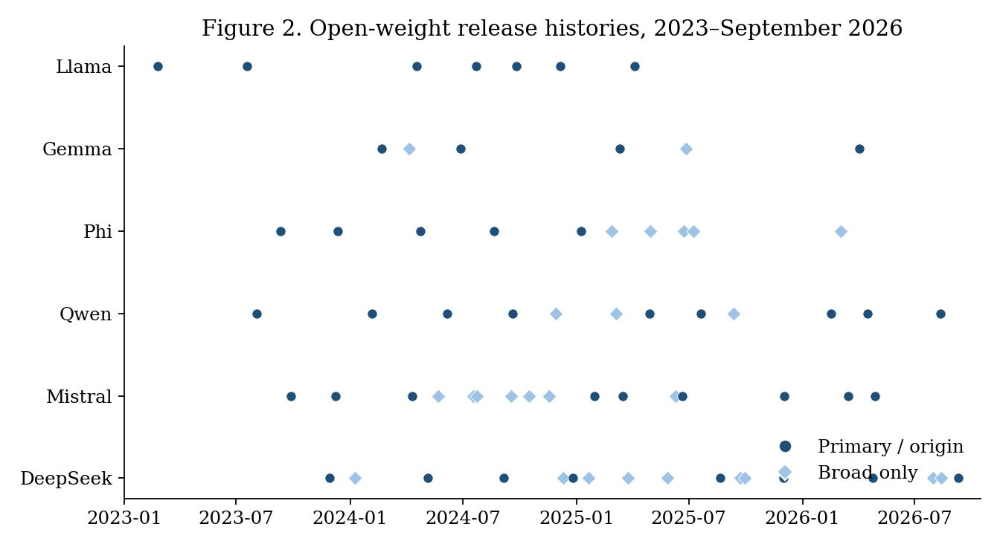
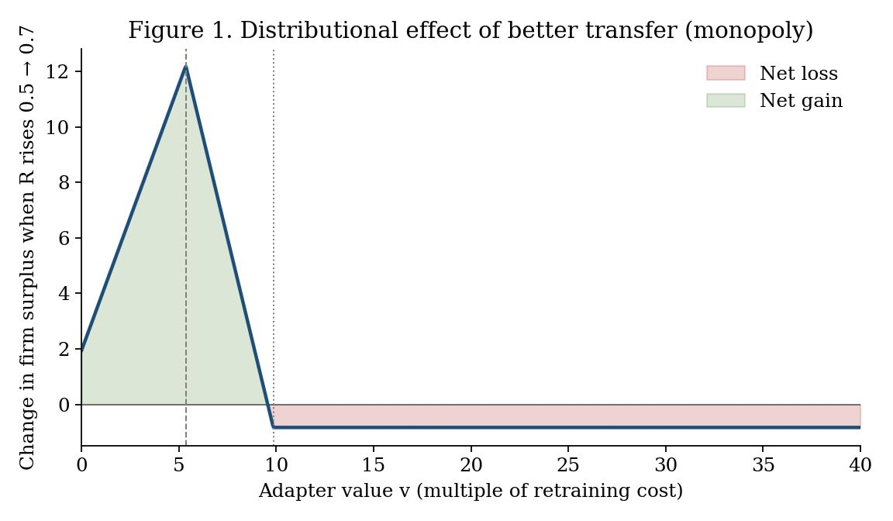
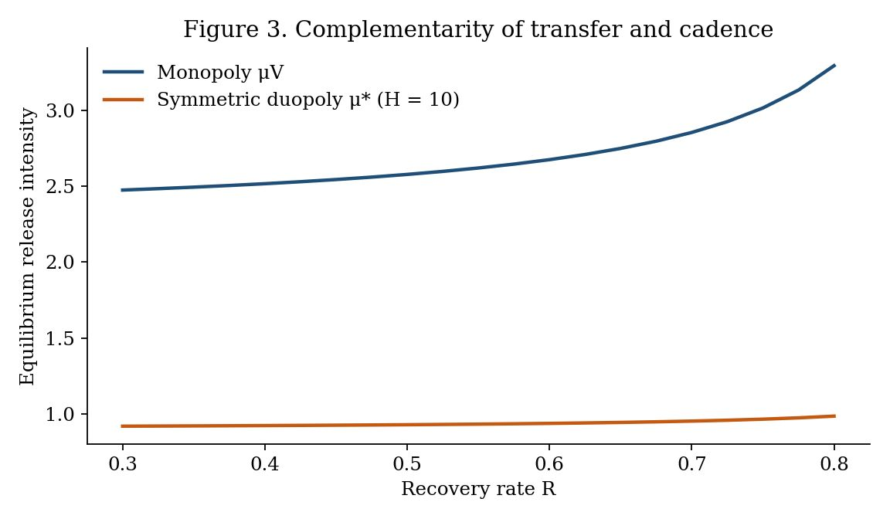
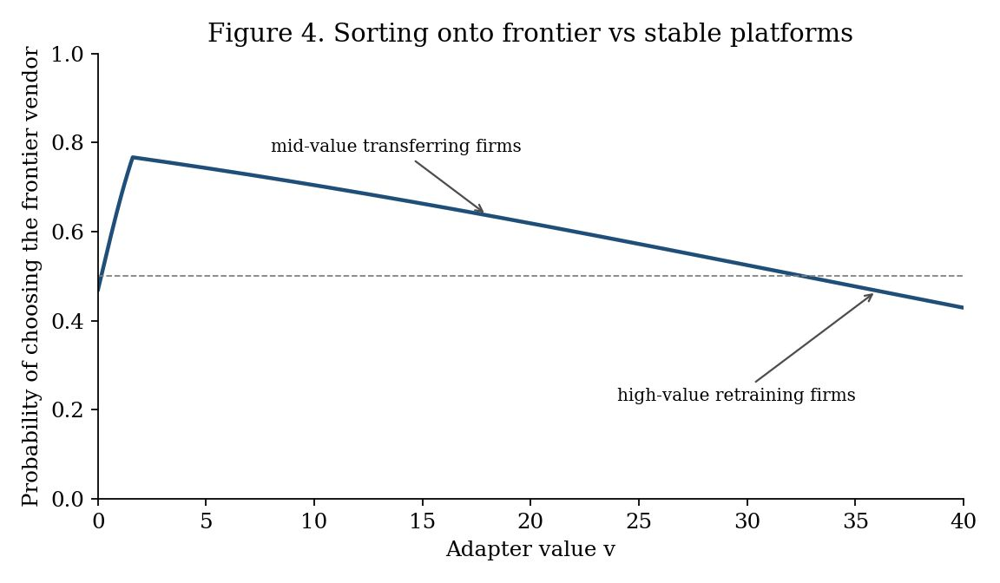

**Target journal:** *Information Systems Research* (anonymized manuscript; no author information)

**Keywords:** platform evolution; post-adoption maintenance; real options; compatibility; foundation models; release cadence; complementary assets; platform competition

## Abstract

Firms increasingly build complementary IT assets, such as fine-tuned adapters, on foundation-model platforms they do not control, and each platform upgrade destroys part or all of those assets. We study this post-adoption maintenance problem as an interaction between an adopter's real-option decision and a platform owner's choice of release cadence and compatibility support. At every upgrade a firm can copy its asset, which is free but imperfect; transfer it with a costly compatibility tool that recovers a share $R$ of its value; or retrain it, an irreversible investment that expires at the next upgrade. The retraining threshold rises with the recovery rate as $1/(1-R)$, with upgrade intensity, and with value volatility. A free copy weakly dominates immediate retraining, and a costly tool is optimal only for assets of intermediate value and only when its cost is below a bound $\Gamma$. We then let the platform owner choose how often to release. An owner that captures part of enterprise surplus over-releases if and only if the average customer is harmed at the margin by a faster clock. Compatibility tools and release speed are strategic complements for any distribution of asset values, so better tools invite faster release and can leave firms that retrain anyway worse off. Under logit duopoly with a release race, each owner internalizes exactly one-third of the marginal change in customer surplus, and, in numerical analysis, an intermediate race separates owners into a fast, compatible frontier platform and a slow, stable one. Release histories of six open-weight model families imply about two main-line versions per year, and recovery measured on five open model pairs falls sharply with upgrade size. The results recast compatibility tooling as a governance variable that the platform owner sets jointly with the pace of change.

## 1. Introduction

Information systems research has long treated platforms as bundles of options for the firms that build on them (Fichman 2004) and has examined how platform owners govern the architecture and the boundary between platform and complements (Tiwana et al. 2010, Ghazawneh and Henfridsson 2013). A less examined question is what happens *after* adoption, when the platform is replaced underneath assets the adopter has already built. Foundation models make this question concrete and urgent. A fine-tuned low-rank adapter is cheap to train on a given base model and worthless, as a weight file, on the next one. Open-weight families release on the order of two main-line versions a year. The standard engineering response, retraining every adapter at every upgrade, treats the platform's clock as a fact of nature and the firm's cost as a sunk operating expense. Both treatments are incomplete, and the incompleteness is an information systems problem: it concerns the maintenance of IT assets that depend on a platform controlled by someone else.

Retraining is an irreversible investment whose payoff is uncertain and whose life ends when the platform owner ships again. That is the textbook setting of real options (McDonald and Siegel 1986, Dixit and Pindyck 1994), and the right to wait has value. Compatibility and transfer tools that move an adapter without its original training data change the option: they buy a recovery rate $R$ at a cost $C$ and shift the exercise threshold. A free, naive copy of the adapter weights is itself a transfer technology with $C=0$.

The more important part is that the clock is chosen. Platform owners release to win benchmarks, developers, and publicity, and much of the cost of each release falls on enterprise customers. Compatibility tools restore part of the destroyed option and, precisely because they do, change the owner's incentive to destroy it. Better compatibility is therefore not an unmixed blessing for the firms that use it. It invites faster release, and firms that would have retrained anyway bear a higher cadence and can be made worse off.

We ask three questions. First, given an exogenous release intensity, when should a firm copy, transfer, or retrain a complementary asset that dies at the next upgrade? Second, when the platform owner chooses intensity and possibly compatibility, does it release too often, and how does transfer technology feed back into that choice? Third, if owners compete for enterprise customers and for a general-market prize tied to release speed, how much of the change in customer surplus do they internalize, and can they differentiate on the speed–compatibility bundle?

**Summary of results.** Table 1 lists the results, the intuition behind each, and what each means for information systems research and practice.

| Result | Intuition | Implication for IS |
|:---|:---|:---|
| The retraining threshold is proportional to $1/(1-R)$ and rises with upgrade intensity and volatility; a free copy weakly dominates immediate retraining (Props. 1–2) | Waiting is valuable when the asset can be partly rescued and may be rescued again | Triage assets by value relative to retraining cost; do not retrain by default |
| A costly tool is optimal only in an intermediate band of values and only if its cost is below $\Gamma$ (Prop. 2b) | Low-value assets are served by copy and high-value assets are retrained anyway | Buy compatibility tools by measured $C<\Gamma$, not by vendor claims |
| A revenue-sharing owner over-releases iff the average customer is harmed at the margin (Prop. 3) | The owner internalizes only share $\theta$ of the burden it imposes | Release cadence is a governance variable with welfare consequences |
| Compatibility and cadence are strategic complements for any distribution of values (Props. 4a, 6) | Easier transfer lowers the marginal burden of a release | Owner-provided migration tools should be read as a signal of faster release |
| Better transfer helps mid-value transferring firms and hurts firms that retrain anyway (Prop. 4b) | The cadence effect dominates for firms that cannot use the tool | Contractual release caps or long-term-support lines can be worth more than a better converter for high-value assets |
| Under logit duopoly each owner internalizes exactly one-third of the marginal change in customer surplus (Prop. 5) | A logit price response splits a quality shock one-third to price and one-third to share | Competition does not remove over-release; it caps internalization |
| A numerical intermediate race yields a fast, compatible frontier owner and a slow, stable one (Numerical Finding 1) | Cadence and compatibility are a bundle along which owners can separate | Segment assets across frontier and stable platforms |

*Table 1. Summary of results.*

Two empirical inputs discipline the model; they are not the contribution. Public release dates for Llama, Gemma, Phi, Qwen, Mistral, and DeepSeek through 28 September 2026 imply a pooled primary-definition intensity of 1.97 main-line versions per year. Recovery rates measured on five small open model pairs show that upgrade size, not the brand of transfer method, is the first-order determinant of $R$: a naive copy recovered about 94 percent of the retraining gain after small continued-training upgrades and about 5 percent after a large one. These facts are used as $(R,C,\mu)$ inputs. A particular converter used only to measure one $(R,C)$ pair is confined to the online appendix and is not a contribution of this paper.

**Contribution.** The paper makes three contributions to information systems research. First, it moves the real-options view of IT platforms (Fichman 2004, Taudes et al. 2000, Benaroch and Kauffman 1999) from the adoption decision to *post-adoption maintenance* of complementary assets, and it characterizes the resulting policy regions without reference to any named algorithm. Second, it treats the platform owner as the agent that sets the rate at which the adopter's options are destroyed, and it identifies a complementarity between compatibility support and release speed with a sharp distributional implication: tools that help some customers hurt others through the cadence they induce. This extends platform-evolution research (Tiwana et al. 2010) with an explicit maintenance channel. Third, it shows how much of the change in customer surplus competing owners internalize and that the speed–compatibility bundle is a dimension along which platforms can separate, which links platform governance to platform competition (Parker and Van Alstyne 2018, Rochet and Tirole 2003). The paper also offers managers a maintenance policy whose qualitative regions do not depend on any named algorithm.

The remainder of the paper is organized as follows. Section 2 positions the paper in the literature. Section 3 sets up the model and presents two stylized facts. Section 4 solves the firm's maintenance option. Sections 5 and 6 study a monopoly owner and competing owners. Section 7 reports robustness and extensions. Section 8 draws implications for research and practice, and Section 9 concludes.

## 2. Related Literature and Positioning

*Real options and IT investment.* McDonald and Siegel (1986) and Dixit and Pindyck (1994) established that the right to delay an irreversible investment has value. Technology investments fit this logic because implementation costs are partly sunk while standards keep moving (Dos Santos 1991, Grenadier and Weiss 1997, Benaroch and Kauffman 1999, Taudes et al. 2000, Benaroch 2001, Fichman 2004, Kauffman and Li 2005, Santiago and Bifano 2005). Closest in structure are models of adoption when a further innovation is anticipated (Rajagopalan 1999) and of modular upgradeability as insurance against technological change (Kamrad et al. 2013). Recent work applies the same lens to enterprise AI adoption (Tewari 2026). We move the lens from whether to adopt to how to *renew* an already deployed complementary asset when the platform underneath it is replaced at a rate the asset owner does not choose, and we make that rate endogenous.

*Platform evolution, compatibility, and planned obsolescence.* Compatibility choices shape adoption and competition (Katz and Shapiro 1985, Farrell and Saloner 1985). Platform owners trade off openness against control over complements (Parker and Van Alstyne 2018), and platform architecture and governance coevolve with the environment (Tiwana et al. 2010, Ghazawneh and Henfridsson 2013, Yoo et al. 2010). Competing platforms can relax price competition through differentiation (Shaked and Sutton 1982) and compete in two-sided markets (Rochet and Tirole 2003, Armstrong 2006). We add a maintenance channel: the platform's release cadence destroys options held by complementors, compatibility tools partly restore them, and the restoration feeds back into the cadence. The resulting speed–compatibility bundle is a dimension along which competing platforms can separate.

*What the paper changes in IS theory.* Three conceptual moves connect the model to established IS constructs. First, digital options (Sambamurthy et al. 2003, Fichman 2004) are usually treated as assets the adopter accumulates; here they are assets the platform owner can extinguish, so the option's life is a choice variable of the owner. Second, compatibility tools such as migration kits, converters, and long-term-support promises are boundary resources in the sense of Ghazawneh and Henfridsson (2013). The literature treats them as instruments for attracting third-party development; we show that they also change the owner's incentive to change the platform, so that resource provision and platform evolution (Tiwana et al. 2010) cannot be analyzed separately. Third, generativity (Yoo et al. 2010) is the capacity of a platform to be changed by many uncoordinated actors; our model shows its cost side, since a platform whose owner changes it often imposes a maintenance burden that falls unevenly on the actors that build on it.

*Maintenance of IT and learning systems.* Maintenance has long been recognized as a central cost of IT assets (Swanson 1976). Work on when to retrain a machine-learning model attributes the need to data drift and considers two actions, retrain or keep (Mahadevan and Mathioudakis 2023, Regol et al. 2025). We attribute the need to platform replacement and add transfer as an intermediate action.

*Adapter transfer.* Methods that move adapters without retraining include distillation, subspace projection, and light remapping (Wang et al. 2024, Farhadzadeh et al. 2025a,b, Li et al. 2025, Xia et al. 2025). Hochlehnert et al. (2026) find that naive copy is a strong baseline between related models. In our model every method is a pair $(R,C)$, which is what allows us to study the economics without taking a stand on the algorithm.

| | Adoption timing | Maintenance after adoption | Platform owner endogenous | Competition between owners |
|:---|:---:|:---:|:---:|:---:|
| Real options in IT (Benaroch and Kauffman 1999, Fichman 2004) | ✓ | | | |
| Anticipated innovation (Rajagopalan 1999, Kamrad et al. 2013) | ✓ | | | |
| Platform evolution and governance (Tiwana et al. 2010, Parker and Van Alstyne 2018) | | | ✓ | partly |
| Model retraining (Mahadevan and Mathioudakis 2023, Regol et al. 2025) | | ✓ | | |
| **This paper** | | ✓ | ✓ | ✓ |

*Table 2. Positioning.*

## 3. Setting and Stylized Facts

### 3.1 Complementary assets on a foundation-model platform

The unit of analysis on the demand side is a firm that operates one task-specific adapter on a named base model. An *epoch* is the interval from one upgrade to the next. At the start of an epoch the firm chooses a transfer method. During the epoch it may retrain. When the next upgrade arrives, the current adapter and any retraining investment lose their value and a new epoch begins.

A transfer method $j$ is summarized by a recovery rate $R_j\in[0,1]$ and a cost $C_j\ge 0$. Naive copy of adapter weights is $(R_C,0)$. Retraining costs $C_N$ and restores $R=1$. The value flow $v$ when the adapter performs at the retrained level follows geometric Brownian motion $dv=g\,v\,dt+\sigma v\,dW$. After transfer the firm receives flow $v(1-R)$ until it retrains or the epoch ends. The discount rate is $\rho$, with $\rho+\mu>g$. Upgrades arrive as a Poisson process of intensity $\mu$ when $\mu$ is taken as given. Section 5 endogenizes $\mu$.

### 3.2 Stylized fact 1: release intensity is about two per year and more regular than Poisson

We recorded the date on which weights of each new main-line version of six open-weight families were first publicly available, from each family's first release through 28 September 2026. The primary definition counts a new version of the family's main general-purpose text model. A broad definition adds refreshed checkpoints and reasoning variants. The replication package lists every date. Selected dates were re-checked against vendor announcements (Llama 3.3 on 6 December 2024; Gemma 4 on 2 April 2026; DeepSeek-V4.1-Flash on 10 September 2026); see Appendix C.

| Family | $n$ | $T$ (years) | $\hat\mu$ | 95% CI | Mean gap (months) | CV of gaps |
|:---|---:|---:|---:|:---:|---:|---:|
| Llama | 6 | 3.59 | 1.67 | [0.61, 3.64] | 7.2 | 0.61 |
| Gemma | 3 | 2.60 | 1.15 | [0.24, 3.37] | 10.4 | 0.50 |
| Phi | 4 | 3.05 | 1.31 | [0.36, 3.36] | 9.1 | 0.18 |
| Qwen | 8 | 3.15 | 2.54 | [1.10, 5.00] | 4.7 | 0.44 |
| Mistral | 8 | 3.00 | 2.66 | [1.15, 5.25] | 4.5 | 0.70 |
| DeepSeek | 7 | 2.83 | 2.47 | [0.99, 5.10] | 4.9 | 0.31 |
| Pooled | 36 | 18.23 | 1.97 | — | 6.1 | 0.46 |

*Table 3. Estimated upgrade intensity, primary definition (window to 28 September 2026).*

The pooled rate is 1.97 per year. A likelihood-ratio test does not reject a common primary rate across families ($\chi^2(5)=3.43$, $p=0.63$). The rate was 2.18 before 2025 and 1.82 after ($p=0.62$). Under the broad definition the pooled rate rises to 3.40 and family rates differ ($p=0.04$). Gaps are more regular than exponential: the mean coefficient of variation is 0.46. Platforms can also stop. Llama has had no subsequent open-weight main-line release for 17.8 months as of the window end.

### 3.3 Stylized fact 2: recovery collapses with upgrade size

On five open model pairs that share a tokenizer, a rank-8 adapter was trained on the source, retrained on the target, copied, and transferred with a calibration method that reduces to copy as its regularization diverges (Online Appendix B). After two small Pythia continued-training upgrades, copy recovered 0.945 and 0.940 of the retraining gain. After a large Pythia upgrade, copy recovered 0.051 and the calibration method 0.500. Base-to-instruct upgrades sat in between. Compute-only cost ratios for the calibration method were 0.33 to 0.61 of retraining and overstate the economic ratio because they omit data acquisition and revalidation. Small upgrades look like high-$R$ free copy; large upgrades open a gap that a costly method can fill if and only if its cost is below $\Gamma$.

## 4. Microfoundation: The Firm's Maintenance Option

Let $k(R)=(1-R)/(\rho+\mu-g)$ be the expected present-value multiplier on lost flow until Poisson expiry. The underlying asset of the retraining option is $k(R)v$, the strike is $C_N$, and expiry is the next upgrade. Let $\beta>1$ be the positive root of $\tfrac12\sigma^2\beta(\beta-1)+g\beta-(\rho+\mu)=0$.

**Proposition 1 (Maintenance option).** (a) For a firm operating at recovery $R<1$, it is optimal to retrain the first time $v$ reaches
$$v^*(R)=\frac{\beta}{\beta-1}\,\frac{C_N}{k(R)}.$$
For $v<v^*$ the option value is $F(v)=(kv^*-C_N)(v/v^*)^{\beta}$. (b) $v^*(R)$ is increasing in $R$, in $\mu$, and in $\sigma$, and strictly exceeds the NPV threshold $C_N/k(R)$.

At $\rho=0.10$, $g=0.20$, $\sigma=0.40$, $\mu=2$ one has $\beta\approx 4.43$ and $\beta/(\beta-1)\approx 1.29$. Write $W_j(v)$ for the expected total cost of transferring with method $j$ and then following the optimal retraining rule. For $v<v_j^*$, $W_j(v)=C_j+k_jv-F_j(v)$; otherwise $W_j(v)=C_j+C_N$.

**Proposition 2 (Copy dominance and the costly-transfer band).** (a) For all $v$, $W_C(v)\le C_N$, with equality only on $v\ge v_C^*$. Immediate retraining is therefore optimal only above the copy threshold. (b) A method $A$ with $R_A>R_C$ has a nonempty set of $v$ at which it is uniquely optimal only if $C_A<\Gamma(R_A,R_C)$, the maximum reduction in expected cost that $A$ can deliver relative to copy and to immediate retraining. That set, when it exists, lies strictly between the copy region and the immediate-retraining region.

| Family | $\hat\mu$ | $v^*$ copy | $v^*$ transfer | Transfer-optimal band | $\Gamma$ |
|:---|---:|---:|---:|:---:|---:|
| Gemma | 1.15 | 3.50 | 6.90 | 0.25 to 5.66 | 0.38 |
| Phi | 1.31 | 3.91 | 7.72 | 0.29 to 6.37 | 0.39 |
| Llama | 1.67 | 4.84 | 9.55 | 0.37 to 7.95 | 0.40 |
| DeepSeek | 2.47 | 6.87 | 13.55 | 0.56 to 11.49 | 0.42 |
| Qwen | 2.54 | 7.05 | 13.90 | 0.57 to 11.77 | 0.42 |
| Mistral | 2.66 | 7.35 | 14.49 | 0.60 to 12.33 | 0.42 |

*Table 4. Firm policy regions at family-specific $\mu$ ($R_{\text{copy}}=0.57$, $R_{\text{transfer}}=0.78$, $C_A=0.05\,C_N$).*

The platform a firm has already chosen is itself an input to the maintenance rule. Feeding the five measured $(R,C)$ pairs into the same formulas produces an actual transfer-optimal region only for the large Pythia upgrade, where $\Gamma=0.39$ exceeds the compute-only cost ratio 0.33.

## 5. A Monopoly Platform Owner Chooses Cadence and Compatibility

To keep the owner's problem tractable we use the static limit $\sigma=g=0$ of Section 4. The retraining threshold collapses to $\hat v=C_N(\rho+\mu)/(1-R)$. Section 7.4 re-optimizes the owner's problem with the dynamic threshold inside the burden function.

A mass $n$ of firms each operate one adapter. Values $v$ are constant and distributed with c.d.f. $F$. Each upgrade permanently raises every firm's flow by $\delta$. Write $b=\delta/\rho^2$ for the present value of a unit intensity of such gains. A firm retrains iff $v\ge\hat v$. The present value of a cost $w$ at every Poisson upgrade is $(\mu/\rho)w$. The maintenance burden $m(\mu,v;R)$ is $\mu C_N/\rho$ for retraining firms and $(1-R)v\mu/[\rho(\rho+\mu)]$ for transferring firms. Net surplus is $s(\mu,v;R)=b\mu-m(\mu,v;R)$.

A transferring firm's burden is concave in $\mu$ and saturates at $(1-R)v/\rho$. A retraining firm's burden is linear and unbounded. A retraining firm is harmed by more frequent releases whenever $b<C_N/\rho$.

The owner earns a direct return $\psi\mu$ from the general market, bears development cost $\tfrac12 c\mu^2$, and captures a share $\theta\in(0,1]$ of expected enterprise surplus. The planner has the same objective with $\theta=1$.

**Proposition 3 (Cadence and over-release).** (a) The owner's intensity $\mu_V$ solves $\psi-c\mu+\theta n\,(b-\partial E[m]/\partial\mu)=0$. Movement of $\hat v$ has no first-order effect on $E[m]$ because the two options have equal burden at $\hat v$. Under $v\sim U[0,\bar v]$ with some retraining and $\kappa(\rho+\mu)\le 1$,
$$E[m]=\frac{\mu C_N}{\rho}\left(1-\frac{\kappa(\rho+\mu)}{2}\right),\qquad \kappa=\frac{C_N}{(1-R)\bar v},$$
and $\mu_V=(\psi+\theta X)/(c-\theta Y)$ with $X=n\left[b-(C_N/\rho)(1-\kappa\rho/2)\right]$ and $Y=nC_N\kappa/\rho$, provided $c>\theta Y$. (b) If the planner's objective is concave, $\mu_V>\mu_P$ if and only if $E[s_\mu(\mu_V,v)]<0$, that is, if and only if the average customer is harmed at the margin. Under the uniform specification this is equivalent to $cX+\psi Y<0$. Because $\kappa$ rises with $R$, better transfer shrinks the region of over-release.

**Proposition 4 (Complementarity and distribution).** Suppose $F$ puts positive mass on both sides of $\hat v$, so that some firms transfer and some retrain. (a) *Strategic complementarity:* $d\mu_V/dR>0$ for any such $F$. If all firms retrain or all transfer, $R$ has no effect on the owner's problem and $d\mu_V/dR=0$. (b) *Distribution:* a small increase in $R$ has a direct effect and a cadence effect. A firm that retrains before and after the change has no direct effect; if $b<C_N/\rho$ it is made strictly worse off. A transferring firm with $v\to 0$ gains from both effects. In the over-release region the cadence effect is negative on average, so mean surplus can fall even as $R$ improves.

Easier transfer lowers the marginal burden of a release. The owner internalizes share $\theta$ of that reduction and therefore releases more often. The firms that cannot use the tool bear the faster clock.

| $R$ | $\mu_V$ | $\mu_P$ | Retrain boundary | Over-release? |
|:---:|---:|---:|---:|:---:|
| 0.3 | 2.48 | 1.84 | 3.68 | Yes |
| 0.5 | 2.58 | 2.02 | 5.36 | Yes |
| 0.7 | 2.86 | 2.61 | 9.85 | Yes |
| 0.8 | 3.30 | 4.08 | 16.98 | No |

*Table 5. Monopoly intensity by recovery rate ($\rho=0.10$, $C_N=1$, $v\sim U[0,40]$, $b=7$, $\psi=6$, $c=2$, $\theta=0.5$).*

## 6. Competing Platform Owners and the One-Third Rule

Owners first choose intensities (and, later, compatibilities) simultaneously, then set enterprise prices, then firms choose an owner and stay with it. A firm of value $v$ obtains $s(\mu_i,v;R_i)-p_i+\eta\varepsilon_i$ from owner $i$, with $\varepsilon_i$ i.i.d. Gumbel. A general-market prize $H$ is split by a Tullock contest (Tullock 1980) in intensities. Let $a\ge 0$ denote the planner's marginal valuation of the general-market benefit of intensity.

**Proposition 5 (One-third rule and efficiency).** Let $R$ be exogenous and common. In a symmetric subgame-perfect equilibrium, (a) prices are $p^*=2\eta$, independent of $\mu$ and $R$; (b) $\mu^*$ satisfies $\dfrac{H}{4\mu^*}+\dfrac{n}{3}E[s_\mu]-c\mu^*=0$; (c) each owner internalizes the marginal change in enterprise surplus with weight exactly one-third, regardless of $\eta$ and of $F$. (d) If the planner's objective is concave, the symmetric equilibrium over-releases if and only if $a+(n/6)E[s_\mu]-H/(4\mu^*)<0$. Over-release has two sources: rent-seeking in the race and under-internalization of enterprise surplus (weight 1/3 against the planner's per-owner weight 1/2).

**Proposition 6 (Complementarity under competition).** Under the condition of Proposition 4, $d\mu^*/dR>0$ in the symmetric equilibrium. If $b<C_N/\rho$, firms that keep retraining lose when $R$ improves. Evaluated at the same $\mu$, the rebound $d\mu^*/dR$ is smaller than the monopoly rebound whenever $\theta\ge 1/3$.

Raising $R$ from 0.5 to 0.7 raises $\mu^*$ only from 0.928 to 0.952, against 2.58 to 2.86 under monopoly.

**Numerical Finding 1 (Differentiation).** When each owner also chooses $R_i$ at cost $Z(R)=zR^2/(1-R)$, the symmetric candidate is an equilibrium at weak race intensity and fails at intermediate race intensity. At the latter, an asymmetric equilibrium appears: a frontier owner that is fast and compatible and a stable owner that is slow and sparse. Mid-value transferring firms sort to the frontier owner; the highest-value retraining firms lean to the stable owner. When the race is very intense both owners become fast and compatible. This is a grid-search finding at one parameterization, not a theorem, and multiple equilibria exist at some $H$.

With $z=0.1$ and $\eta=10$ the asymmetric pair at $H=20$ is approximately $(\mu,R)=(2.50,0.96)$ versus $(1.38,0.08)$. Prices in that illustration are 26.4 and 17.3. Mean customer value is 18.2 on the frontier platform and 22.8 on the stable platform.

## 7. Robustness and Extensions

### 7.1 Regular arrivals

Replace the exponential epoch length by a gamma law matched to each family's mean gap and CV, or by a deterministic gap. The loss multiplier $E\!\left[\int_0^\tau e^{-(\rho-g)t}dt\right]$ is 1 to 4 percent smaller than under Poisson (gamma-to-Poisson ratios 0.96 to 0.99). Average burden barely moves. What regularity changes is timing: with a predictable release the retraining threshold should rise as the date approaches (Rajagopalan 1999). The time-homogeneous $v^*$ should be read as an average over the epoch.

| Family | CV | Gamma / Poisson | Deterministic / Poisson |
|:---|---:|---:|---:|
| Gemma | 0.50 | 0.965 | 0.954 |
| Phi | 0.18 | 0.961 | 0.960 |
| Llama | 0.61 | 0.980 | 0.969 |
| Qwen | 0.44 | 0.984 | 0.980 |
| Mistral | 0.70 | 0.990 | 0.981 |
| DeepSeek | 0.31 | 0.981 | 0.979 |
| Pooled | 0.46 | 0.979 | 0.974 |

*Table 6. Loss-multiplier ratio versus Poisson ($\rho=0.10$, $g=0.20$).*

### 7.2 Threshold loss

If the adapter creates value only above a quality floor $R_{\min}$, effective recovery is 0 when $R<R_{\min}$ and $R$ otherwise. Then $k$ and $v^*$ jump when a method crosses the floor. A large upgrade that drops copy below the floor and leaves a costly method above it widens $\Gamma$. Linear loss understates the value of transfer exactly when the upgrade is large. It does not overturn weak dominance of copy when copy itself stays above the floor.

### 7.3 A two-period switching extension

Section 6 assumes a firm stays with its first owner. Consider a two-period variant. In period 0 owners choose $(\mu_i,R_i)$ and prices. Firms choose an owner. After the first upgrade, a firm may switch at a cost $\omega(R_{\text{from}},R_{\text{to}})$. Interpret $\omega$ as the labor of rebuilding the complementary asset on the rival stack. A transfer technology that is stack-agnostic lowers $\omega$.

Write $V_i(v)$ for the period-1 continuation, including the option to switch. The period-0 choice probability remains logit in $s(\mu_i,v;R_i)-p_i+\mathbb{E}[V_i(v)]$. Two first-order effects follow without solving the full game.

*Portability intensifies price competition.* A lower $\omega$ raises the elasticity of period-0 demand to period-1 quality and price, because the period-1 outside option is closer. In logit, that is a fall in the effective $\eta$ on the continuation component. Symmetric prices fall below $2\eta$ once continuation is included. Customers capture more of any quality gain.

*Portability reduces the return to compatibility investment.* The demand derivative $\partial D_i/\partial R_i$ splits into an own-customer maintenance effect (the Section 5 channel) and a switching-in effect. The second effect is business-stealing. In a symmetric equilibrium business-stealing is a transfer and does not enter welfare, but it does enter the owner's private return to $R$. As $\omega\to 0$, differentiation in $R$ cannot support a price gap, so $Z'(R)$ is harder to recoup. Compatibility investment therefore falls even as the social return to $R$, a lower maintenance burden, remains.

The one-third weight is consequently an upper bound on under-internalization only inside the no-switching game. Treating transfer purely as a maintenance tool and ignoring portability will overstate the case for owner-provided compatibility as a customer-friendly investment. We do not claim a closed-form analogue of Proposition 5 under switching.

### 7.4 Owner's first-order condition with the dynamic threshold

Replace $\hat v$ by $v^*(R;\mu)$ inside the static present-value arithmetic and re-optimize $\psi\mu-\tfrac12 c\mu^2+\theta n\left(b\mu-E[m]\right)$. This is still a proxy, because the firm's option value is not the full infinite-horizon object, but it lets the owner respond to a $\mu$-dependent threshold.

| $R$ | $\mu_V$ static | $\mu_V$ dynamic proxy | $\mu_P$ static | $\mu_P$ dynamic proxy |
|:---:|---:|---:|---:|---:|
| 0.3 | 2.475 | 2.472 | 1.837 | 1.830 |
| 0.5 | 2.579 | 2.574 | 2.017 | 2.005 |
| 0.7 | 2.855 | 2.846 | 2.607 | 2.582 |
| 0.8 | 3.295 | 3.279 | 4.083 | 4.024 |

*Table 7. Owner intensity: static cutoff versus dynamic-threshold proxy.*

Intensities move by less than one percent. The slope $d\mu_V/dR$ from $R=0.3$ to $0.7$ is 0.95 under the static cutoff and 0.93 under the proxy. Complementarity is not an artifact of dropping volatility. Finite-difference estimates of $\partial^2 E[m]/\partial\mu\,\partial R$ at $(R,\mu)=(0.5,2)$ equal $-2.05$ (static) and $-2.02$ (proxy).

### 7.5 Logit specificity of one-third

The one-third weight uses two logit facts: the own-price markup $p=2\eta$ at symmetry, and a quality shock that splits one-third into price and one-third into share. Under Hotelling the analogous weight differs. Pure-strategy price equilibria fail when $\eta$ is small relative to value heterogeneity. The one-third rule should be read as: competing owners internalize a constant that is strictly less than one-half, and in the standard discrete-choice workhorse that constant is one-third.

### 7.6 Parameter grid and alternative value distributions

The numerical illustrations use one parameter vector and uniform values. To check that Propositions 3 to 4 do not depend on them, we solved the monopoly problem on a grid of $\rho\in\{0.05,0.10,0.20\}$, $b\in\{2,4,7,10,14\}$, $\psi\in\{0,3,6,9\}$, $c\in\{1,2,4\}$, $\theta\in\{0.25,0.5,0.75\}$ and $R\in\{0.1,0.3,0.5,0.7,0.8\}$, under six value distributions with the same mean as $U[0,40]$ (uniform, exponential, gamma with shape 3, lognormal with $s=0.5$ and $s=1$, and Pareto with tail index 2.5). The code reproduces Tables 5 and 7 (static columns) exactly. Of the 16,200 cells, 6,505 satisfy the hypotheses of the propositions: the owner's and the planner's objectives are globally concave on the grid and both have interior maximizers (Appendix F reports the breakdown). Three results follow. First, strategic complementarity (Proposition 4a) holds in every one of them: $d\mu_V/dR>0$ in 5,212 cells, equals zero in 392 cells, and is negative in none. In every zero cell essentially no firm transfers (the threshold $\hat v$ lies below the support of $F$, or the mass below it is at most $4\times 10^{-8}$), which is the degenerate case excluded in the statement of Proposition 4. Second, the over-release criterion of Proposition 3(b), $E[s_\mu(\mu_V)]<0$, agrees with the direct comparison of $\mu_V$ and $\mu_P$ in all 6,505 cells, with 31 exact ties at $\mu_V=\mu_P$. Third, over-release is not an artifact of one parameter vector: it occurs in 23 to 34 percent of valid cells depending on the distribution, and in the uniform case it arises when $b$ is below roughly $C_N/\rho$ (Figure 5b), the region in which firms that retrain are harmed at the margin.

## 8. Implications for Research and Practice

### 8.1 Implications for research

*Post-adoption IS value.* The real-options view of IT platforms has concentrated on when to adopt. Our results show that the maintenance decision has its own option structure, with a free partial transfer (copy) knocking out blanket retraining and a costly tool surviving only in a bounded intermediate band. Empirical work on IT asset value should therefore measure recovery under upgrades, not only adoption timing.

*Platform governance.* Release cadence and compatibility support are governance instruments that the platform owner sets jointly, and boundary-resource provision (Ghazawneh and Henfridsson 2013) should be modeled as endogenous to platform evolution rather than as a fixed offer. Treating them separately misses their complementarity and the distributional consequence that follows. A testable implication is that, across platforms, announcements of migration or compatibility tooling should be followed by higher release frequency, and that the customers with the highest-value retrained assets should be the most likely to object.

*Platform competition.* Platforms can separate on the speed–compatibility bundle, and customers sort across them by asset value. This suggests studying asset-level heterogeneity, not only customer-level heterogeneity, in platform choice.

### 8.2 Implications for practice

Five implications do not depend on a named transfer algorithm.

1. **Triage by value.** Triage complementary assets by value relative to retraining cost, and let the platform's estimated $\mu$ set the boundaries. Copy below a low cutoff, consider a costly transfer tool in the middle, retrain only above a high cutoff.
2. **Buy tools against $\Gamma$.** Buy transfer tools when measured $C_A<\Gamma(R_A,R_C)$. After small upgrades that inequality typically fails because free copy is already close to retraining.
3. **Treat cadence as part of procurement.** Owner-provided migration tools should be expected to arrive with faster releases. Owners of the highest-value assets, who retrain anyway, can be made worse off by those tools. For those assets, a contractual cap on release frequency or a long-term-support line can be worth more than a better converter.
4. **Segment across platforms.** If owners separate into frontier and stable platforms, park high-value and regulated adapters on the stable line and mid-value adapters on the frontier line.
5. **Time retraining.** When the next dated release is near, defer retraining of adapters that sit close to $v^*$.

### 8.3 Limitations and future research

Value is taken as linear in $R$; the owner's problem is solved in the static limit, with a dynamic-threshold proxy in Section 7.4; the asymmetric compatibility equilibrium is numerical; the switching game is characterized only to first order; the recovery measurements are small-scale (160M to 0.5B parameters, one task, one seed); and open lines can be discontinued. The first empirical priority is $(g,\sigma)$ from service logs and a historical cost accounting of copy versus retrain-every-time on a real adapter portfolio. A natural field-data test of Proposition 4(a) is whether the introduction of owner-provided migration tooling predicts a subsequent change in release frequency.

## 9. Conclusion

The paper's theoretical claim is not that any particular converter is optimal. It is that complementary assets on an evolving platform create a maintenance option; that a free partial transfer already knocks out blanket retraining; that a costly converter has a market only in a bounded intermediate band; and that the platform owner, facing that band, will use improvements in the converter to go faster. Competing owners internalize a fixed fraction of the resulting change in customer surplus; in the logit workhorse the fraction is one-third. Platforms are not only bundles of options for adopters (Fichman 2004). They are also the agents that choose how fast those options expire.

## References

Armstrong M (2006) Competition in two-sided markets. *RAND J. Econom.* 37(3):668–691.

Benaroch M (2001) Option-based management of technology investment risk. *IEEE Trans. Engrg. Management* 48(4):428–444.

Benaroch M, Kauffman RJ (1999) A case for using real options pricing analysis to evaluate information technology project investments. *Inform. Systems Res.* 10(1):70–86.

Dixit AK, Pindyck RS (1994) *Investment Under Uncertainty* (Princeton University Press, Princeton, NJ).

Dos Santos BL (1991) Justifying investments in new information technologies. *J. Management Inform. Systems* 7(4):71–89.

Farhadzadeh F, Das D, Borse S, Porikli F (2025a) LoRA-X: Bridging foundation models with training-free cross-model adaptation. *Proc. 13th Internat. Conf. Learn. Representations.*

Farhadzadeh F, Das D, Borse S, Porikli F (2025b) Zero-shot adaptation of parameter-efficient fine-tuning in diffusion models. *Proc. 42nd Internat. Conf. Machine Learn.*, PMLR 267:16144–16160.

Farrell J, Saloner G (1985) Standardization, compatibility, and innovation. *RAND J. Econom.* 16(1):70–83.

Fichman RG (2004) Real options and IT platform adoption: Implications for theory and practice. *Inform. Systems Res.* 15(2):132–154.

Ghazawneh A, Henfridsson O (2013) Balancing platform control and external contribution in third-party development: The boundary resources model. *Inform. Systems J.* 23(2):173–192.

Grenadier SR, Weiss AM (1997) Investment in technological innovations: An option pricing approach. *J. Financial Econom.* 44(3):397–416.

Hochlehnert A, Liu D, Niehues J, Kumar S, Stahlberg F (2026) On the importance of trivial baselines: Re-evaluating LoRA adapter transfer for generative tasks. *Proc. 43rd Internat. Conf. Machine Learn.*

Kamrad B, Schmidt GM, Ulku S (2013) Analyzing product architecture under technological change: Modular upgradeability tradeoffs. *IEEE Trans. Engrg. Management* 60(2):289–300.

Katz ML, Shapiro C (1985) Network externalities, competition, and compatibility. *Amer. Econom. Rev.* 75(3):424–440.

Kauffman RJ, Li X (2005) Technology competition and optimal investment timing: A real options perspective. *IEEE Trans. Engrg. Management* 52(1):15–29.

Li Y, Meng F, Zhang M, Zhu S, Wang S, Xu M (2025) LoRASuite: Efficient LoRA adaptation across large language model upgrades. *Adv. Neural Inform. Processing Systems* 38.

Mahadevan A, Mathioudakis M (2023) Cost-effective retraining of machine learning models. Working paper, arXiv:2310.04216.

McDonald R, Siegel D (1986) The value of waiting to invest. *Quart. J. Econom.* 101(4):707–727.

Milgrom P, Shannon C (1994) Monotone comparative statics. *Econometrica* 62(1):157–180.

Parker G, Van Alstyne M (2018) Innovation, openness, and platform control. *Management Sci.* 64(7):3015–3032.

Rajagopalan S (1999) Adoption timing of new equipment with another innovation anticipated. *IEEE Trans. Engrg. Management* 46(1):14–25.

Regol F, Schwinn L, Sprague K, Coates M, Markovich T (2025) When to retrain a machine learning model. *Proc. 42nd Internat. Conf. Machine Learn.*, PMLR 267.

Rochet J-C, Tirole J (2003) Platform competition in two-sided markets. *J. Eur. Econom. Assoc.* 1(4):990–1029.

Santiago LP, Bifano TG (2005) Management of R&D projects under uncertainty. *IEEE Trans. Engrg. Management* 52(2):269–280.

Shaked A, Sutton J (1982) Relaxing price competition through product differentiation. *Rev. Econom. Stud.* 49(1):3–13.

Swanson EB (1976) The dimensions of maintenance. *Proc. 2nd Internat. Conf. Software Engrg.* (IEEE Computer Society Press, Los Alamitos, CA), 492–497.

Taudes A, Feurstein M, Mild A (2000) Options analysis of software platform decisions: A case study. *MIS Quart.* 24(2):227–243.

Tewari G (2026) Pilot early, commit late: A real-options model of enterprise AI adoption under rapid technological progress. Working paper, arXiv:2609.15919.

Tiwana A, Konsynski B, Bush AA (2010) Platform evolution: Coevolution of platform architecture, governance, and environmental dynamics. *Inform. Systems Res.* 21(4):675–687.

Tullock G (1980) Efficient rent seeking. Buchanan JM, Tollison RD, Tullock G, eds. *Toward a Theory of the Rent-Seeking Society* (Texas A&M University Press, College Station), 97–112.

Wang R, Ghosh S, Cox D, Antognini D, Oliva A, Feris R, Karlinsky L (2024) Trans-LoRA: Towards data-free transferable parameter efficient finetuning. *Adv. Neural Inform. Processing Systems* 37.

Xia F, Liao M, Fang Y, Li D, Xie Y, Li W, Li Y, Xia D, Huang J (2025) Cross-LoRA: A data-free LoRA transfer framework across heterogeneous LLMs. Working paper, arXiv:2508.05232.

Yoo Y, Henfridsson O, Lyytinen K (2010) The new organizing logic of digital innovation: An agenda for information systems research. *Inform. Systems Res.* 21(4):724–735.

## Appendix A. Proofs of Propositions 1 to 6

**Proof of Proposition 1.** (a) In the continuation region the option satisfies the Bellman equation $\rho F=gvF'+\tfrac12\sigma^2v^2F''+\mu(0-F)$. The Euler equation is $\tfrac12\sigma^2\beta(\beta-1)+g\beta-(\rho+\mu)=0$. Of the two roots, the negative root is discarded by $F(0)=0$. Value matching $F(v^*)=kv^*-C_N$ and smooth pasting $F'(v^*)=k$ with $F=Av^\beta$ yield
$$A(v^*)^\beta=kv^*-C_N,\qquad A\beta(v^*)^{\beta-1}=k,$$
hence $v^*=[\beta/(\beta-1)]\,C_N/k$. The quadratic identity $\rho+\mu-g=(\beta-1)(g+\tfrac12\sigma^2\beta)$ gives the equivalent writing in terms of $\rho+\mu-g$.

(b) Since $v^*=h(K)\,C_N/(1-R)$ with $K=\rho+\mu$ and $h(K)=(K-g)\beta/(\beta-1)$: (i) $v^*$ is proportional to $1/(1-R)$, hence increasing in $R$. (ii) By the implicit function theorem $\beta'(K)=1/Q'(\beta)$ with $Q'(\beta)=(g+\tfrac12\sigma^2\beta)+\tfrac12\sigma^2(\beta-1)>0$. Substituting $K-g=(\beta-1)(g+\tfrac12\sigma^2\beta)$ shows $h'(K)>0$, so $v^*$ is increasing in $\mu$. (iii) At any fixed $\beta>1$, $Q$ is increasing in $\sigma$ and $Q'>0$ at the root, so $\beta$ is decreasing in $\sigma$. Since $\beta/(\beta-1)$ is decreasing in $\beta$, the threshold increases in $\sigma$. (iv) $\beta/(\beta-1)>1$ gives the strict excess over the NPV threshold. $\square$

**Proof of Proposition 2.** (a) An option is worth at least its immediate exercise value, so $F_C(v)\ge k_Cv-C_N$, that is $W_C(v)\le C_N$. Equality holds only on $v\ge v_C^*$. (b) Any $v$ at which $A$ is uniquely optimal must satisfy $W_A(v)<\min\{W_C(v),C_N\}$. Because $W_A(v)=C_A+\left(k_Av-F_A(v)\right)$, the highest $C_A$ that can satisfy the inequality for some $v$ is
$$\Gamma=\sup_v\left(\min\{W_C(v),C_N\}-\left(k_Av-F_A(v)\right)\right).$$
The optimizer cannot lie in $v\ge v_C^*$, where both copy and immediate retraining cost $C_N$ and $W_A\ge C_A$, nor at $v=0$, where $W_A=C_A>W_C=0$ whenever $C_A>0$. Hence the $A$-region, when nonempty, is intermediate. $\square$

**Proof of Proposition 3.** (a) The owner's first-order condition is $\psi-c\mu+\theta n\left(b-\partial E[m]/\partial\mu\right)=0$. At $\hat v$ the two instruments have equal burden, so the Leibniz term from moving $\hat v$ vanishes. Under the uniform law with $\kappa(\rho+\mu)\le 1$,
$$E[m]=\int_0^{\hat v}\frac{(1-R)v\mu}{\rho(\rho+\mu)}\frac{dv}{\bar v}+\int_{\hat v}^{\bar v}\frac{\mu C_N}{\rho}\frac{dv}{\bar v}=\frac{\mu C_N}{\rho}\left(1-\frac{\kappa(\rho+\mu)}{2}\right).$$
Then $\partial E[m]/\partial\mu=(C_N/\rho)(1-\kappa\rho/2)-\mu C_N\kappa/\rho$, which produces $X$ and $Y$ and the closed form. Concavity requires $c>\theta Y$.

(b) Substituting the owner's first-order condition into the planner's derivative gives $\mathcal W'(\mu_V)=(1-\theta)\,n\,E[s_\mu(\mu_V)]$, which is negative if and only if $\mu_P<\mu_V$ when $\mathcal W$ is concave. For the uniform case write $\mu(\theta)=(\psi+\theta X)/(c-\theta Y)$. Then $d\mu/d\theta$ has the sign of $cX+\psi Y$, which does not depend on $\theta$. Thus $\mu(\theta)>\mu(1)$ for $\theta<1$ if and only if $cX+\psi Y<0$. $\square$

**Proof of Proposition 4.** (a) $d\mu_V/dR=-\Pi_{\mu R}/\Pi_{\mu\mu}$ with $\Pi_{\mu\mu}<0$. Differentiating the first-order condition with respect to $R$,
$$\Pi_{\mu R}=-\theta n\cdot\frac{\partial^2E[m]}{\partial\mu\,\partial R}.$$
The first term in that cross-partial, holding $\hat v$ fixed, is negative because a higher $R$ lowers the marginal burden of transferring firms. The second term comes from $\partial\hat v/\partial R=C_N(\rho+\mu)/(1-R)^2>0$. At $\hat v$ a transferring firm's marginal burden $C_N/(\rho+\mu)$ lies below a retraining firm's $C_N/\rho$. Raising $\hat v$ therefore replaces a high marginal burden with a lower one, which again lowers $\partial E[m]/\partial\mu$. Both terms vanish if no firm transfers or no firm retrains. Hence $\Pi_{\mu R}>0$ and $d\mu_V/dR>0$ when $F$ puts mass on both sides of $\hat v$.

(b) Differentiate $s(\mu_V(R),v;R)$ and use part (a). A retraining firm has $\partial s/\partial R|_\mu=0$ and $s_\mu=b-C_N/\rho$, which is negative under the maintained condition. A transferring firm with $v\to 0$ has $s_\mu\to b>0$ and a strictly positive direct effect. Average surplus moves with $E[s_\mu]\,d\mu_V/dR$ plus the average direct effect; the first term is negative in the over-release region. $\square$

**Proof of Proposition 5.** (a), (b), (c) At the symmetric point every type chooses each owner with probability $\varphi(v)=1/2$, so the price first-order condition $p=\eta E[\varphi]/E[\varphi(1-\varphi)]$ gives $p=2\eta$. Raising $\mu_1$ slightly gives
$$\frac{\partial E[\varphi]}{\partial\mu_1}=\frac{E[s_\mu]}{4\eta},\qquad\frac{\partial E[\varphi(1-\varphi)]}{\partial\mu_1}=0.$$
To first order the price subgame responds as if every firm received the same quality advantage $d\delta=E[s_\mu]\,d\mu_1$. In a logit duopoly a quality advantage $d\delta$ yields $d(p_1-p_2)=(2/3)d\delta$, $dp_1=d\delta/3$ and $d\varphi_1=d\delta/(12\eta)$. Enterprise profit therefore changes by $\varphi\,dp_1+p_1\,d\varphi_1=d\delta/3$. The race term contributes $H/(4\mu)$ at the symmetric point.

(d) At the symmetric point the planner's marginal welfare per owner is $a+(n/2)E[s_\mu]-c\mu$. Substituting $c\mu^*$ from part (b) gives $a+(n/6)E[s_\mu]-H/(4\mu^*)$, which is negative if and only if $\mu^*>\mu_P$ when the planner's objective is concave. $\square$

**Proof of Proposition 6.** Let $\Phi(\mu,R)$ be the left-hand side of the duopoly first-order condition. $\Phi_R=-(n/3)\,\partial^2E[m]/\partial\mu\,\partial R>0$ by the proof of Proposition 4. Apply the implicit function theorem with $\Phi_\mu<0$. The comparison of slopes follows from $E[s_{\mu\mu}]>0$ (convexity of $s$ in $\mu$ for retraining firms, and the race term). $\square$

Numerical Finding 1 is a grid search, not a proof. The two-period switching extension in Section 7.3 is a first-order characterization, not an equilibrium existence theorem.

## Appendix B. Additional Results

**Proposition B1 (Endogenous compatibility).** If the owner also chooses $R$ at an increasing convex cost $Z(R)$, the objective is supermodular in $(\mu,R)$ and has increasing differences in $(\mu,\psi)$. The largest and smallest optimizers $(\mu^*,R^*)$ are therefore nondecreasing in $\psi$.

*Proof.* $\Pi(\mu,R;\psi)=\psi\mu-\tfrac12c\mu^2-Z(R)+\theta nE[s(\mu,v;R)]$ is supermodular in $(\mu,R)$ by Proposition 4(a), has increasing differences in $(\mu,\psi)$, and has zero cross-partial in $(R,\psi)$. Topkis's theorem (Milgrom and Shannon 1994) yields monotonicity of the extremal optimizers in $\psi$. Holding $\mu$ fixed, $\Pi_{R\theta}=-n\,\partial E[m]/\partial R>0$. $\square$

## Appendix C. Online Appendix: Calibration Pairs

The following table is the measurement used to pin $(R,C)$ in Section 3.3. Models have 160M to 0.5B parameters, one task (GSM8K), one seed, and a short CPU training budget. Recovery is $R=(L_0-L_m)/(L_0-L_{\text{retrain}})$ on held-out negative log-likelihood. These are calibration inputs, not production estimates.

| Pair | $R_C$ | $R_A$ | $C_A/C_N$ |
|:---|---:|---:|---:|
| Pythia-160M, +10k steps | 0.945 | 0.941 | 0.358 |
| Pythia-160M, +30k steps | 0.940 | 0.952 | 0.348 |
| Pythia-160M, +70k steps | 0.051 | 0.500 | 0.334 |
| SmolLM2-360M, Base → Instruct | 0.703 | 0.698 | 0.612 |
| Qwen2.5-0.5B, Base → Instruct | 0.630 | 0.658 | 0.433 |

*Table B.1. Recovery rates and compute-only cost ratios on five open model pairs.*

The calibration method matches, at each layer, the change in hidden activations that the source adapter produces on unlabeled inputs, with a ridge term that anchors the solution to naive copy. As the ridge diverges the method equals copy. Cost is forward passes plus per-layer linear algebra. Full protocol: public checkpoints from EleutherAI/pythia-160m (steps 73000, 113000, 133000 → 143000), HuggingFaceTB/SmolLM2-360M, and Qwen/Qwen2.5-0.5B; rank-8 LoRA on every linear layer in the decoder; 500 GSM8K training problems; 300 AdamW steps; 128 unlabeled calibration prompts.

## Appendix D. Date Verification

Window end: 28 September 2026. Primary definition: new version of the family's main general-purpose text model.

| Family | Version | Date | Check |
|:---|:---|:---|:---|
| Llama | Llama 3.3 | 2024-12-06 | Confirmed (Meta AI, 6 Dec 2024) |
| Gemma | Gemma 4 | 2026-04-02 | Confirmed (Google AI / press, 2 Apr 2026) |
| DeepSeek | V4.1-Flash | 2026-09-10 | Confirmed (DeepSeek API changelog) |
| Other rows | — | source list | Dates as listed in the replication package |

Classification retained: LLaMA 1 research-license weights counted as origin; instruct-only twins and extra sizes excluded from primary; QwQ, DeepSeek-R1, and refreshed checkpoints counted only under the broad definition.

## Appendix E. Replication Materials

The replication package contains the release-history file, the intensity-estimation script, the robustness script, the owner-model and dynamic-threshold scripts, the figure script, and saved numerical output. It does not contain weights or training logs from the five small-model pairs; those are calibration inputs described in Appendix B. No proprietary or subscription data are used. An anonymized copy of the package will be provided to reviewers on request.

## Appendix F. Parameter Grid and Alternative Distributions

Grid: $\rho\in\{0.05,0.10,0.20\}$, $b\in\{2,4,7,10,14\}$, $\psi\in\{0,3,6,9\}$, $c\in\{1,2,4\}$, $\theta\in\{0.25,0.5,0.75\}$, $R\in\{0.1,0.3,0.5,0.7,0.8\}$, $C_N=1$, $n=1$; all value distributions have mean 20. A cell is valid if the owner's and the planner's objectives are concave on the whole intensity grid and both maximizers are interior. Cells that fail concavity violate the hypothesis of Propositions 3(b) and 5(d); cells with a corner solution are those in which the owner prefers no release at all or the maximizer lies at the upper end of the grid. Slopes are computed between adjacent $R$ values; "Zero" means an absolute slope below $10^{-6}$.

| Distribution | Valid cells | $d\mu_V/dR>0$ | Zero | Negative | Over-release share | Criterion agrees |
|:---|---:|---:|---:|---:|---:|---:|
| Uniform [0,40] | 1455 of 2700 | 1203 | 0 | 0 | 0.34 | 1455 of 1455 |
| Exponential | 1300 of 2700 | 1134 | 0 | 0 | 0.30 | 1300 of 1300 |
| Gamma, shape 3 | 1185 of 2700 | 987 | 0 | 0 | 0.28 | 1185 of 1185 |
| Lognormal, $s=0.5$ | 1095 of 2700 | 922 | 38 | 0 | 0.29 | 1095 of 1095 |
| Lognormal, $s=1.0$ | 1098 of 2700 | 948 | 0 | 0 | 0.23 | 1098 of 1098 |
| Pareto, tail index 2.5 | 372 of 2700 | 18 | 354 | 0 | 0.31 | 372 of 372 |

*Table F.1. Monopoly results on the parameter grid.* The Pareto row has few valid cells because its heavy tail makes the planner's objective nonconcave in most of the grid; its zero cells are those in which $\hat v$ lies below the Pareto lower bound, so that every firm retrains.
