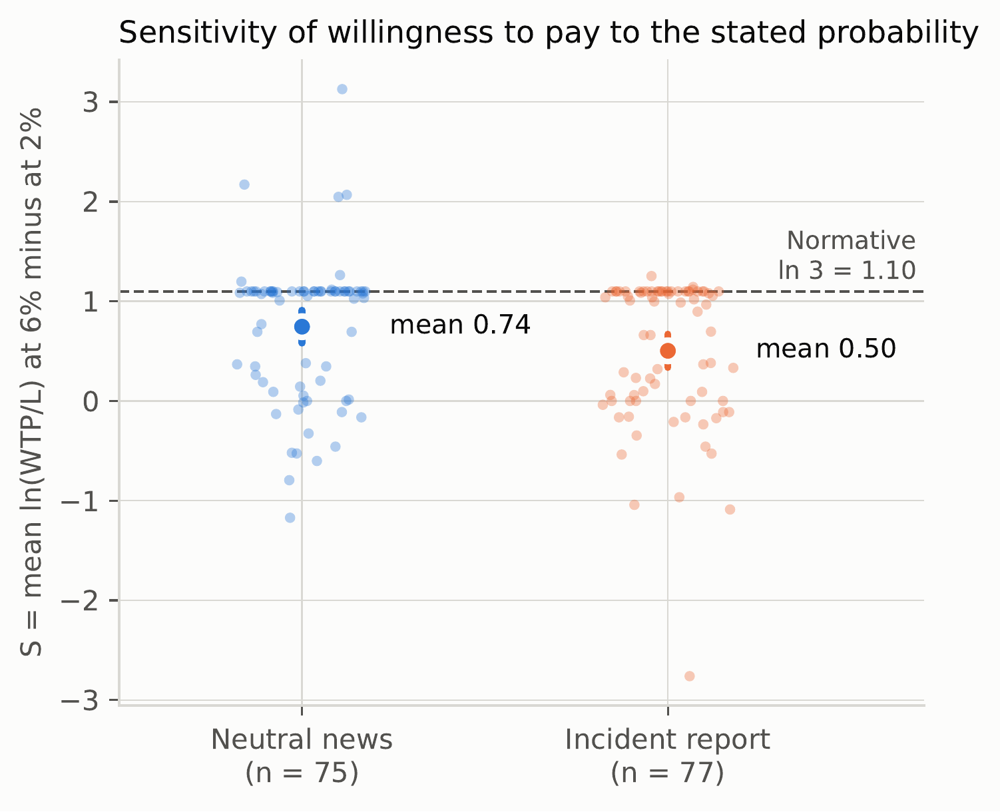
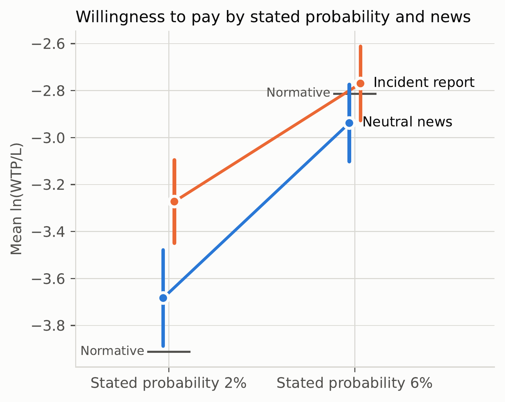
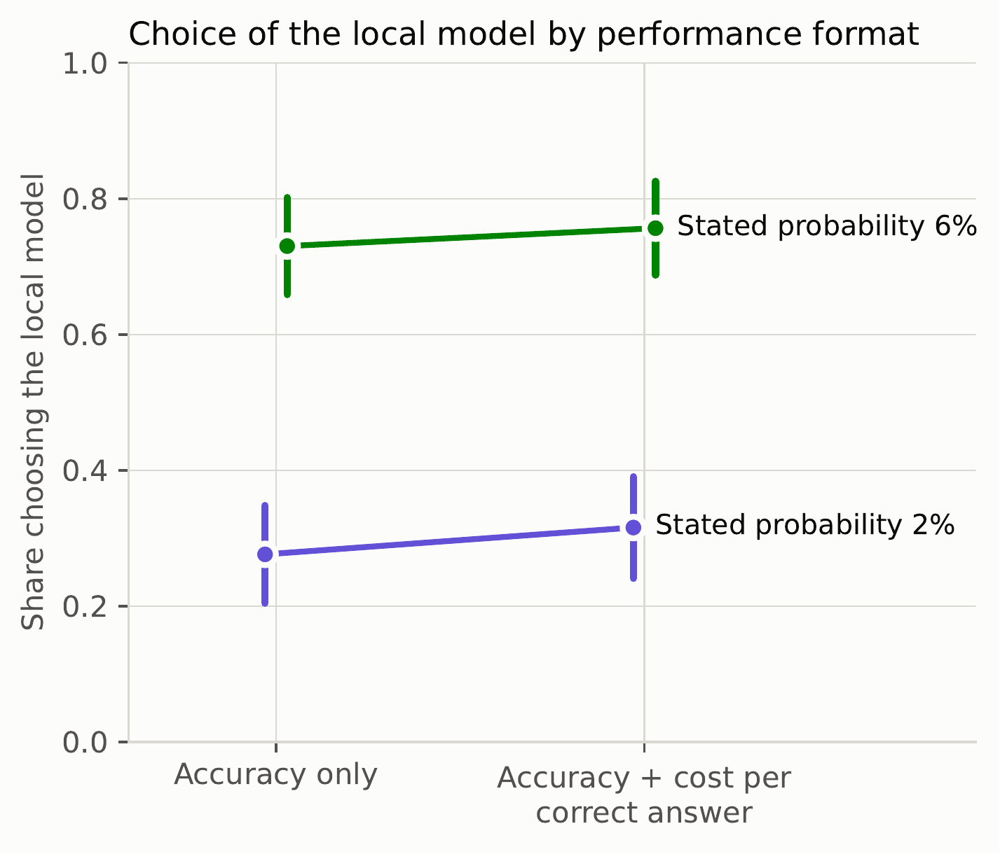

# Vivid Incidents and Flat Probability Responses: How Managers Weigh Privacy Risk When Choosing Between Cloud AI Services and Local Language Models

> Draft manuscript, anonymized for double-anonymous review. For the final version, restore the institution and IRB approval number (Section 3.4), the repository link (Section 3.5) and the preregistration link. Submission requirements for the target journal (length, abstract limit, formatting) have not been verified against its current instructions. Not yet proofread by a native speaker. Items in [square brackets] need the authors' input or a check against the source. All references were written from memory and must be verified against the originals before submission. All statistical values come from the single preregistered analysis run (analysis code commit 3f9c6c0); verify them against `analysis_report.txt`.

## Abstract

Organizations adopting generative AI must decide whether to send sensitive data to a cloud provider or to run a smaller model on their own hardware. A risk-neutral manager would weigh the local model's net operating disadvantage against the expected loss from a data exposure. In a preregistered experiment, 152 professionals involved in technology purchasing chose between the two options in four scenarios calibrated on our own measurements and stated what they would pay each year to remove the provider's exposure risk. After reading a vivid report of an exposure at another firm, participants were willing to pay about 34% more (d = 0.42) and responded less to the stated probability, although the latter result is borderline (d = −0.33, 95% CI [−0.65, −0.01]). The report did not raise general probability estimates, and reporting cost per correct answer did not detectably change choices. A stylized model suggests that a flat response to probability weakens vendors' reward for reducing real risk. How a privacy risk is conveyed can matter alongside its size.

**Keywords:** generative AI sourcing; data privacy; salience; probability insensitivity; behavioral information systems; preregistered experiment

## 1. Introduction

When a company decides how to run a generative AI service, two questions arrive together. The first is economic. A cloud model is usually more accurate, but every request sends text to an outside party, and for some uses that text contains customers' or employees' personal data. A smaller model run on the company's own computers keeps the data in house, but it is less accurate and needs hardware and people to operate it. The second question is about risk. Data exposure is rare in any single year, but it is expensive when it happens, and managers must decide how much that possibility should count.

Normative models of this choice are easy to write down. If the local model costs E more per year in errors and saves B in running costs, and the cloud provider exposes data with annual probability λ at a loss of L, the local model has the higher expected value when (B − E) + λL is positive. In this model, only these four numbers matter. Which incident happened to make the news last month, and whether performance was reported as accuracy or as a cost per correct answer, should not matter, provided the numbers are the same.

There are good reasons to doubt that managers decide this way. Research on judgment under uncertainty has long shown that people respond to how easily an event comes to mind (Tversky and Kahneman 1973), and that they respond to the emotional content of an outcome more than to its probability when the outcome is vivid (Rottenstreich and Hsee 2001, Loewenstein et al. 2001, Sunstein 2003). AI sourcing decisions are a natural setting for such effects. Privacy incidents are widely reported, they are easy to picture, and the probabilities attached to them are small and hard to judge. At the same time, vendors and internal evaluators report the performance of language models in many formats, and research on evaluability suggests that people weigh attributes more heavily when they are easy to compare (Hsee 1996).

Work in information systems has approached pieces of this problem from several directions. Research on IT outsourcing treats sourcing as an organizational decision process (Dibbern et al. 2004), and surveys of IT executives find that security threats dominate their perception of the risk of cloud services while cost advantages drive the opportunities they see (Benlian and Hess 2011). On the economic side, break-even analyses compare the total cost of running a language model on premises with the price of commercial services and find that on-premises deployment pays off mainly for high-volume users or for organizations with strict data-residency requirements (Pan et al. 2025). Real-options models treat AI adoption as a timing problem under technological progress, with a choice among deploying now, piloting and waiting (Tewari 2026), and experiments in the prospect-theory tradition show that managers' exercise of IT options departs from the normative rule in ways that depend on project size and option type (Khan et al. 2017).

Models of security spending give a benchmark for how much to protect a given set of information, in which the optimal outlay is bounded by a fraction of the expected loss (Gordon and Loeb 2002). Behavioral work on that spending finds that decision makers favor prevention over detection and respond to threats too small to justify any investment (Safi et al. 2021), and that non-linear probability weighting is associated with suboptimal allocation of defenses (Woods et al. 2021). A separate stream studies individuals' privacy decisions as a calculus of risk against trust and benefit (Culnan and Armstrong 1999, Dinev and Hart 2006), and shows that fear appeals change intentions to comply with security recommendations, though not uniformly across users (Johnston and Warkentin 2010). Finally, event studies show that announcements of data breaches lower the market value of the affected firm, with effects that fade quickly or depend on competing news (Acquisti et al. 2006, Foerderer and Schuetz 2022).

What these streams leave open is how a manager's choice between outside and in-house sourcing for AI responds to the way a privacy risk is presented, as opposed to its size. In the searches we ran we did not find an experiment that tests this for AI sourcing, or one that manipulates the stated probability of exposure to separate a shift in subjective probability from a flatter response to probability. This is a statement about our searches, not a systematic review.

This paper reports a preregistered experiment that tests whether two such features change managers' choices between a cloud AI service and a local language model, while holding the normatively relevant numbers constant. The first is a vivid account of a data exposure at another firm. The second is whether performance is reported as accuracy alone or together with the cost per correct answer. We measure two outcomes in each of four scenarios: the choice itself, and the amount the participant would pay each year to eliminate the cloud provider's exposure risk. The second outcome has a clean normative value (λL), which lets us ask not only whether the incident report shifts willingness to pay but also whether it changes how willingness to pay responds to the stated probability.

The study makes four contributions. First, it brings a behavioral test to a question that the information systems literature has so far treated mainly in economic or technical terms: how organizations choose between outside and in-house sourcing for AI. Second, by manipulating the stated probability within participants, it separates two accounts of how a vivid incident might work. If the incident makes exposure easier to imagine, participants' subjective probability should rise. If the incident instead makes the outcome emotionally heavier, participants should respond less to the probability they are given. Third, the scenario numbers are not invented; they are calibrated on our own measurements of a quantized open model and a cloud API, and we release the code that computes the normative benchmark. Fourth, we use a stylized model to show what a flat response to probability would imply for the buyer's break-even and for vendors' incentive to reduce real risk, which links the behavioral result to the market for AI services.

In brief, participants who read the incident report were willing to pay about a third more to remove the provider's exposure risk and responded less to the stated probability, although the second result is borderline and weakens when respondents bound by prohibiting policies are excluded. In both conditions, many participants computed the normative willingness to pay exactly, a feature of the data that shapes how the averages should be read. We found no effect of the performance format that we could distinguish from zero. The paper proceeds as follows. Section 2 develops the normative benchmark and the hypotheses, Section 3 describes the experiment, Section 4 reports the results, and Section 5 discusses their implications and limits.

## 2. Theory and Hypotheses

### 2.1 AI sourcing as a sourcing and risk decision

Information systems research has long treated sourcing as an organizational decision process: why to source externally, what to source, how to decide, and with what outcomes (Dibbern et al. 2004). Studies of cloud services show how that decision is experienced by managers. In a survey of IT executives, security threats dominated the overall perception of risk for adopters and non-adopters alike, while cost advantages were the strongest perceived opportunity (Benlian and Hess 2011). Generative AI brings the same decision back in a new form. A firm can send text, often containing personal data, to a model run by an outside provider, or it can keep the text in house and run a smaller model on its own hardware. Two features make this choice different from earlier sourcing decisions and suitable for a test of how risk is perceived. First, the in-house option carries an accuracy penalty, so the manager trades cost, quality and privacy at once. Second, the privacy risk is a rare and severe event: its yearly probability is small and hard to judge, and incidents at other firms are widely reported. Under these conditions, the way a risk is presented may carry more weight than its size.

### 2.2 A normative benchmark

We consider a one-year decision. Choosing the local model saves running costs of B relative to the cloud API but adds error costs of E, so its net operating advantage is B − E, which is negative in our scenarios. Choosing the API exposes personal data with probability λ in the year, and an exposure costs L. The expected privacy loss from the API is therefore λL, and the local model's total advantage is (B − E) + λL. The local model is optimal when this is positive, which happens when λ exceeds the break-even probability λ* = (E − B)/L. This follows the logic of economic models of security investment, in which protection is compared with the expected loss it averts (Gordon and Loeb 2002), and of break-even analyses of on-premises language models, which compare fixed and running costs with service prices (Pan et al. 2025). The amount a risk-neutral manager should be willing to pay to remove the exposure risk entirely is λL.

We set B = 100m, E = 180m and L = 2,000m (in thousands of dollars per year), with a scenario scale m between 0.6 and 1.2. At λ = 2% the API is optimal and the normative willingness to pay is 40m; at λ = 6% the local model is optimal and the normative willingness to pay is 120m; the break-even is 4%. Dividing willingness to pay by L removes the scale, and the normative log difference between the two probabilities is ln 3 = 1.10. This matters for the design because the normatively correct choice reverses between the two probability levels, so sensitivity to probability has a clear meaning.

### 2.3 Salience, decision weights and two accounts of a vivid incident

A report of an exposure at another firm leaves λ and L unchanged, so a risk-neutral manager would ignore it. Behavioral research suggests two ways in which it could nonetheless matter. To compare them, we describe a manager's stated willingness to pay as the perceived expected loss w(λ)L, where w(λ) is the decision weight given to the stated probability and w(λ) = λ in the benchmark. As a stylized description, which is our own simplification and not a model estimated in the literature, we write the weight as a power function around the benchmark break-even probability λ₀ = D/L, where D = E − B is the local model's net cost disadvantage (λ₀ = 4% in our scenarios):

w(λ) = λ₀ m (λ/λ₀)^γ, so that ln(WTP/L) = ln(λ₀m) + γ ln(λ/λ₀).

The parameter m is a level: it is the weight at the break-even probability relative to the benchmark, and it moves willingness to pay by the same proportion at every probability. The parameter γ is sensitivity to the stated probability: it governs how much willingness to pay rises when the probability rises. The benchmark is m = 1 and γ = 1. With probabilities of 2% and 6%, the within-person difference S between the mean of ln(WTP/L) at 6% and at 2% equals γ ln 3, which is 1.10 in the benchmark and falls as γ falls.

*Availability.* A concrete incident is easy to recall and picture, which raises the subjective probability that a similar event will happen (Tversky and Kahneman 1973). If subjective probability is the stated probability scaled up by a constant factor, the incident raises m and leaves γ unchanged. It raises willingness to pay by the same proportion at 2% and at 6%, leaves S unchanged, and works through the participant's own probability estimate.

*Affect and probability insensitivity.* Outcomes that are emotionally rich tend to be weighed with less regard to their probability. People respond to the presence of a frightening outcome more than to its likelihood (Rottenstreich and Hsee 2001; Sunstein 2003), feelings about a risk can drive behavior independently of cognitive assessments of it (Loewenstein et al. 2001; Slovic et al. 2007), and salience theory formalizes a related idea in which payoffs that stand out receive extra decision weight (Bordalo et al. 2012). Related work in security finds that experimental participants spend on defenses against threats too small to justify spending (Safi et al. 2021) and that non-linear probability weighting is associated with how defenses are allocated (Woods et al. 2021); neither study manipulates the vividness of a prior incident or measures how willingness to pay responds to a stated probability. In the stylized description, an incident that makes the outcome affect-rich lowers γ, and S falls with it. Because S is the difference between the two probability levels, the incident effect on ln(WTP/L) is then larger at 2% than at 6% by exactly the fall in S. This account does not require the participant's own probability estimate to change.

The two accounts agree that the incident raises willingness to pay, and they differ in what else they predict (Table 1). Our primary hypothesis concerns the slope, because it is where they differ most clearly.

*Table 1. Predictions of the two accounts of a vivid incident.*

| Observable | Availability | Affect-based insensitivity |
| --- | --- | --- |
| Level of willingness to pay (H2) | Higher | Higher |
| Sensitivity S to the stated probability (H1) | Unchanged | Lower |
| Incident effect at 2% relative to 6% | Equal | Larger at 2% |
| Participant's own probability estimate | Higher | Not necessarily changed |
| Mediation through excess probability estimate (H4) | Yes | No |

**H1 (primary).** Participants who read a (fictional) data-exposure incident report are less sensitive to the stated exposure probability than participants who read a neutral news item. Formally, S, the mean of ln(WTP/L) at λ = 6% minus the mean at λ = 2%, is smaller in the incident group.

**H2.** Participants in the incident group have a higher mean ln(WTP/L).

We also planned a mediation analysis (H4) in which the incident's effect operates through the excess of the participant's own probability estimate over the stated probability.

### 2.4 Performance format

Showing accuracy alone invites a comparison on the attribute that is easiest to evaluate. For a manager whose reference point is the cloud API, the local model's lower accuracy looks like a loss, and its cost advantage, which lives in different units, is harder to weigh (Kahneman and Tversky 1979; Hsee 1996). Reporting cost per correct answer combines the two attributes into one number and should make the trade-off easier to see. Vendors and internal evaluators report model performance in many formats, so the question is practical as well as theoretical. In our scenarios the savings figure already includes the effect of accuracy, so the two formats carry the same information.

**H3.** Presenting accuracy alone, rather than accuracy plus cost per correct answer, lowers the probability of choosing the local model.

We planned a second mediation (H5) through perceived quality disadvantage, and exploratory moderation by numeracy, AI experience and decision authority.

### 2.5 Scope: where rules decide

Some organizations do not choose at all. A security policy may forbid sending data outside the firm, and in that case the decision is governed by a rule, not by a weighing of costs and risks. We therefore asked about organizational policy before randomization, kept respondents whose organizations prohibit external AI services in all analyses, and treated policy strictness and personal discretion as exploratory moderators (H6): we expected the effects of the incident report to be weaker where policy is strict and discretion is low.

### 2.6 Implications for the sourcing market: a stylized analysis

The stylized description has implications beyond the buyer. A buyer chooses the local model if and only if w(λ)L > D.

**Proposition 1 (the buyer's break-even).** The buyer's break-even probability is λ̃ = λ₀ m^(−1/γ). It lies below the benchmark λ₀ if and only if m > 1, and when m > 1 the gap satisfies ln(λ₀/λ̃) = (ln m)/γ, so a lower γ widens it.

A buyer who overweights the risk at the break-even probability therefore switches to the local model at a lower probability, and a flatter response to probability amplifies this. Both channels of a vivid incident, a higher m and a lower γ, move the break-even in the same direction.

Now consider a cloud vendor that makes a take-it-or-leave-it offer at the highest price the buyer will accept. That price equals the buyer's cost of the local option minus the perceived expected loss w(λ)L. The vendor chooses an effort s that lowers the true probability, λ(s) = λ_b e^(−θs), at cost C(s) = ks²/2, and maximizes price minus cost. This is the same as minimizing w(λ(s))L + C(s). A rational buyer (m = γ = 1) makes the vendor bear the true expected loss, so the vendor chooses the efficient effort s_e. A behavioral buyer scales the vendor's marginal reward for reducing risk by w′(λ) = γm(λ/λ₀)^(γ−1).

**Proposition 2 (the vendor's incentive).** Let s_b be the vendor's effort facing a behavioral buyer and λ_e = λ(s_e) the residual probability at the efficient effort. Define λ̄ = λ₀(γm)^(1/(1−γ)) for γ < 1. Then s_b < s_e if and only if λ_e > λ̄, and s_b > s_e if and only if λ_e < λ̄. Moreover, for given λ, a decrease in γ lowers the marginal incentive w′(λ) whenever λ ≥ λ₀e^(−1/γ), with γ the larger of the two values, while a higher m raises it.

When m is close to 1, the threshold λ̄ lies below λ₀/e, which is about 1.5% in our scenarios. A vendor facing a buyer with a flat response to probability then invests too little in reducing risk whenever the remaining risk is above that low level. The buyer pays little more when the true risk is high, so the market pays little for reducing it. A vivid incident has opposing effects on this incentive: a higher m raises it and a lower γ reduces it, so its net effect depends on their sizes. If the buyer is shown the expected loss λL directly, so that m = γ = 1, the vendor chooses s_e.

Two extensions test how much this result depends on its assumptions. The first replaces the single vendor with competing vendors.

**Proposition 3 (competition).** Suppose several vendors choose their effort, which buyers can observe, and then compete in price for a buyer who chooses the offer with the lowest perceived total cost. Suppose also that entry drives profit to zero, so that price equals marginal cost plus effort cost. Then the symmetric equilibrium effort is s_b, the same as with a take-it-or-leave-it offer.

Proposition 2 therefore does not depend on market power. It does depend on two conditions. Buyers must be able to observe the vendor's effort, for example through certification or disclosure, and price must respond to the loss that buyers perceive. If effort cannot be observed, the price carries no reward for it and the argument fails.

The second extension lets buyers differ in how they weigh risk. A share π of buyers are calculators, who weigh the stated probability exactly (w(λ) = λ). The other buyers weigh it with w_b(λ), whose sensitivity is γ_b. Buyers differ in the cost of their local option, which is uniformly distributed on [0, D̄], and the vendor posts one price.

**Proposition 4 (mixed buyers).** The vendor's marginal reward for reducing the true probability is proportional to Q* L ŵ′(λ) |λ′(s)|, where Q* is the demand it serves and ŵ′(λ) = π + (1 − π) w_b′(λ). Holding Q* fixed, this reward rises with the share of calculators π whenever w_b′(λ) < 1. In the population, the mean of S is π ln 3 + (1 − π) S̄_nc, where S̄_nc is the mean of S among the other buyers.

The vendor's under-investment is thus diluted in proportion to the share of calculators, and it disappears if everyone calculates. The statement about the mean of S is an accounting identity, which we use in Section 4.5: a lower mean S can come from fewer calculators, from a flatter response among the others, or from both. Proofs are in Online Appendix H. These results follow from the assumptions of the stylized description and the vendor model and are not tested here.

## 3. Method

### 3.1 Design

The experiment used a mixed design. Participants were randomly assigned to read, before the scenarios, either a short fictional report of a data exposure or a neutral news item of equal length (between subjects). Every participant then saw four scenarios, formed by crossing the stated annual exposure probability (2% or 6%) with the performance format (accuracy only, or accuracy plus cost per correct answer). Four business cases (sorting customer inquiries, extracting fields from HR records, extracting key terms from contracts, and triaging insurance claims) were assigned to the four cells according to a Latin square, so that each case appeared in each cell equally often, and the order of the scenarios was randomized. A server assigned participants to the eight combinations of news condition and Latin-square version in a balanced way.

The incident report described a mid-sized insurer whose customers' names, phone numbers and claim details were exposed after a failure at its external AI vendor, which led to customer notifications, an official investigation and months of elevated call volumes. The neutral item described mid-sized companies weighing cloud against on-premises AI. Both were labelled as fictional.

### 3.2 Materials and calibration

Each scenario described a company deciding how to handle one task for a year. Participants saw the running-cost saving B, the extra error cost E from the local model, and the loss L from an exposure, all in thousands of dollars per year, together with the stated exposure probability and a table of performance figures. The scenario text said that the probability was a risk-team estimate based on all reported incidents in the industry, and that the error cost already included the performance difference. Participants were asked to decide as a risk-neutral manager who cares only about expected total cost over the coming year. The product λL was never shown. The same B, E and L, scaled by the case (0.8, 0.6, 1.0, 1.2), were used in all conditions.

The performance figures were calibrated on our own measurements. We ran Qwen2.5-3B-Instruct, quantized to 4 bits (NF4), on a laptop GPU with 8 GB of memory and compared it with the hosted Qwen2.5-72B-Instruct on synthetic tasks of 500 items each that served as proxies for the business cases: topic classification for the inquiry and insurance cases, and information extraction for the HR and contract cases. For each task we recorded accuracy, latency, and energy use measured with the GPU's power interface. The local cost per correct answer combined measured electricity use at $0.12 per kWh with hardware amortization ($1,500 over three years at 50% utilization); the cloud cost was computed from token counts and the provider's price. In the scenarios, the local model reached 94% accuracy on the classification cases and 99% on the extraction cases, against 99% and 100% for the cloud model; the cost per million correct answers was $2.39 versus $29.52 for classification and $33.27 versus $73.09 for extraction. These costs deliberately count only electricity and hardware time. They exclude setup labor, maintenance, and staff, which would raise the local cost, and the amounts B, E and L were fixed by design and not derived from the measurements. Sensitivity to the utilization assumption, marginal costs and a fixed-versus-variable break-even analysis are reported in Online Appendices C and D.

### 3.3 Measures

*Outcomes.* After each scenario participants chose between the local model and the cloud API (binary). They then stated the amount they would pay per year to eliminate the API's exposure risk altogether, entered as a number in thousands of dollars between zero and L/4. Entries above L/4 were set to L/4 (35 of 748 entries, 4.7% [this count is from all completers; recompute for the analysable sample]), and zero was replaced by 0.001 L before taking logarithms. The primary outcome was S, computed per participant.

*Mediators and checks.* On a following screen, and therefore after the choice and willingness to pay, participants gave their own estimate of the annual exposure probability in that scenario, and rated the local model's quality disadvantage on a seven-point scale. A comprehension check after each scenario asked for the stated exposure probability. Before the scenarios, and after the news item, participants estimated the general 12-month probability that a mid-sized company's personal data would be exposed through an external AI vendor.

*Covariates.* Job function, seniority, decision and budget authority, AI experience, numeracy (three items), privacy concern, risk attitude, industry, the perceived value of trade secrets, whether the organization handles classified or export-controlled information, personal discretion in sourcing, and a ranking of the three most important sourcing factors. Organizational policy on sending sensitive data to external AI services (prohibited, approval required, allowed under guidelines, no formal policy, unsure) was asked before randomization.

### 3.4 Participants and procedure

We recruited professionals through Prolific, using employment and job-role filters where available and no country restriction. A screening block, applied to everyone, required that the participant work in IT, data, security, procurement, finance or general management; play a final, deciding, or recommending role in technology decisions; be a manager or above, or approve at least $10,000 of technology budget alone, or hold a final role; have taken part in a discussion about adopting an AI service in the past two years; and work for an organization with at least ten employees. The procedure was: consent, screening, assignment, news item, general probability estimate, four scenarios with two attention checks in the survey, covariates, a consistency check of job function and level, demographics, and a debriefing that disclosed that the news item was fictional. Median completion time was about 21 minutes, and participants received GBP 19.70 per hour (about GBP 7.2). The study was approved by the institutional review board of the authors' university [name and approval number withheld for review].

Prolific's demographic data for the 152 analysable participants show a sample with a wide geographic spread. The mean age was 32.9 years (SD = 9.0, range 19 to 67), and 55% were men. The most common countries of residence were South Africa (41%), the United Kingdom (20%) and India (11%), with Poland, Kenya and Canada at 3% each and other countries making up the remaining 20%. By Prolific's categories, 56% were Black, 21% White and 18% Asian. All were in full-time employment; 27% reported being students as well (data available for 142 participants). All used AI at work at least once a week, and 75% did so every day or more often.

A pilot with ten participants from the same panel tested the survey. Pilot responses were not used in any test. After the pilot we relaxed one exclusion rule and changed the stated duration (Section 3.6).

### 3.5 Preregistration and analysis

The hypotheses, measures, exclusion rules, sample size and analyses were preregistered on AsPredicted on 20 November 2026, before main data collection began on 21 November 2026 (registration details are given in the cover letter). The primary test (H1) was a Welch two-sample t-test of S between groups at α = .05. H2 and H3 formed a Holm-corrected family. H2 was tested with a Welch test of each participant's mean ln(WTP/L). H3 was tested with a mixed-effects logistic regression of the choice of the local model on format, probability level, incident condition, scenario position and business case, with a random intercept for participants. Mediation (H4, H5) used participant-level percentile bootstrap with 5,000 resamples. All other analyses are labelled exploratory. The stylized description of Section 2.3 and the analysis of Section 2.6 were formalized after the data had been collected, and the illustration in Section 4.5 is not preregistered. For readability, the hypotheses are numbered here in the order of the paper, and the preregistration uses different labels: H1 is H2c in the preregistration, H2 is H2a, H3 is H3a, H4 is H2b, H5 is H3b, H6 is H5 and H7 is H2d. We excluded participants who failed either attention check, answered at least two of the four comprehension checks incorrectly, ended with a job function in a different group from screening (IT, data and security counted as one group) or a different level, finished in under one third of the median time, or gave identical willingness to pay and identical choices in all four scenarios. The analysis was run once, on the final data, with code frozen beforehand and tested on simulated data. The analysis code, the simulation, and the materials are available at [repository].

### 3.6 Deviations from the preregistration

Five departures should be noted. First, the sample was smaller than planned: 152 analysable participants instead of 200 (see Section 4.1). Second, after the pilot, we treated the three technical functions (IT, data, security) as one group in the consistency exclusion, because two pilot participants moved between adjacent technical functions between screening and the end, and we changed the stated duration from 19 to 22 minutes; no scenario, number or measure was changed. Third, a configuration error gave early participants a wrong completion code on Prolific; their submissions were approved manually and their responses were unaffected. Fourth, two participants submitted a completion code on Prolific although their saved responses stop before the end of the survey (probably because the final saves did not reach the server); both are counted as incomplete and are not in the analysis sample. Fifth, some implementation choices were not fixed in the preregistration and were set before analysis: the mixed logistic model was fitted by maximum likelihood with Gauss–Hermite quadrature, the covariate set for adjusted models was numeracy, privacy concern, risk attitude and discretion, and the format mediation (H5) was estimated as a within-person mediation on difference scores.

## 4. Results

### 4.1 Sample

The survey was opened by 279 participants, all of whom consented. Of these, 193 (69%) met the eligibility criteria and 86 were screened out. In total, 188 eligible participants completed the survey. The exclusion rules removed 36 completers: 10 failed an attention check, 11 answered at least two comprehension checks incorrectly, 17 gave a different job-function group or level at the end, 3 finished in under one third of the median time, and 1 gave identical answers in all scenarios (some participants met more than one rule). The analysis sample comprised 152 participants, 77 in the incident condition and 75 in the neutral condition. This is 48 short of the planned 200. The study was powered at about .80 for d = 0.40 with 200 participants; at 152 the power for d = 0.40 is about .69 and for d = 0.35 about .57. Twenty-four analysable participants reported that their organizations prohibit sending such data to external AI services entirely, and they were retained.

*Table 2. Descriptive statistics by condition (mean, SD, 95% CI).*

| Measure | Neutral news (n = 75) | Incident report (n = 77) |
| --- | --- | --- |
| S (ln(WTP/L) at 6% minus at 2%) | 0.74 (0.72) [0.58, 0.91] | 0.50 (0.74) [0.34, 0.67] |
| Mean ln(WTP/L), all four scenarios | −3.31 (0.72) [−3.48, −3.14] | −3.02 (0.64) [−3.17, −2.88] |
| Mean ln(WTP/L), stated probability 2% | −3.68 (0.89) [−3.89, −3.48] | −3.27 (0.78) [−3.45, −3.10] |
| Mean ln(WTP/L), stated probability 6% | −2.94 (0.71) [−3.10, −2.77] | −2.77 (0.70) [−2.93, −2.61] |
| Share choosing the local model | 0.53 (0.27) [0.47, 0.59] | 0.51 (0.27) [0.45, 0.57] |
| General 12-month exposure estimate (%) | 36.6 (22.0) [31.5, 41.7] | 30.4 (21.4) [25.6, 35.3] |
| Share of participants with S within 0.02 of ln 3 | 0.45 [0.34, 0.57] | 0.35 [0.24, 0.46] |
| Share of own scenarios answered exactly at λ × L | 0.52 [0.42, 0.63] | 0.40 [0.29, 0.50] |

The normative values of ln(WTP/L) are −3.91 at 2% and −2.81 at 6%.

### 4.2 Confirmatory tests

*Table 3. Preregistered tests.*

| Hypothesis | Test | Result |
| --- | --- | --- |
| H1 (primary) | S, incident vs. neutral | 0.50 vs. 0.75; t = −2.05, p = .042; d = −0.33, 95% CI [−0.65, −0.01] |
| H1, mixed model | incident × probability interaction | −0.24 (SE 0.10), p = .014 |
| H2 | mean ln(WTP/L) | −3.02 vs. −3.31; t = 2.61, p = .010; d = 0.42, 95% CI [0.10, 0.75]; Holm-adjusted p = .020 |
| H3 | local choice, format effect | OR = 1.21, 95% CI [0.81, 1.78], p = .348; Holm-adjusted p = .348 |

**H1.** Participants who had read the incident report were less sensitive to the stated probability than those who read the neutral item: S was 0.50 in the incident condition and 0.75 in the neutral condition, against a normative value of 1.10. The mixed model that uses all scenarios and adjusts for position, format and business case gave the same direction, and so did the model with covariates (−0.26, SE 0.11, p = .022). Two points limit how much weight the result can bear. The confidence interval for d comes within 0.01 of zero, and when the 24 respondents whose organizations prohibit external AI services are excluded, the estimate is similar but less precise and the Welch test is no longer significant (d = −0.31, 95% CI [−0.66, 0.04], p = .080; mixed model p = .031).

{width=5.2in}

**H2.** The incident report raised willingness to pay. The geometric-mean amount was about 34% higher in the incident condition. The result survives the Holm correction, the covariate-adjusted model (0.32, SE 0.11, p = .005), and the exclusion of respondents with prohibiting policies (d = 0.44, Holm-adjusted p = .031). The neutral group's overall level (−3.31) was close to the normative level (−3.36), so the incident effect is an upward shift from a roughly calibrated level rather than a correction of an earlier bias. The difference between conditions was concentrated at the low stated probability (−3.27 vs. −3.68 at 2%, a difference of 0.41; −2.77 vs. −2.94 at 6%, a difference of 0.17). Relative to the normative values, the neutral group paid more than the benchmark at 2% (−3.68 vs. −3.91) and less at 6% (−2.94 vs. −2.81), while the incident group paid well above the benchmark at 2% (−3.27) and about the benchmark at 6% (−2.77). These comparisons are descriptive. Figure 1 also shows that many participants in both conditions answered exactly at the normative ratio: their willingness to pay at 6% was three times their willingness to pay at 2%, so S equals ln 3. Table 2 gives the numbers. In the neutral condition 45% of participants had an S within 0.02 of ln 3, and in the incident condition 35% did; at the level of single scenarios, participants answered exactly at λ × L in 52% and 40% of their scenarios, respectively. The distribution of S is therefore not a single cloud around the mean but a mixture of participants who computed the product of probability and loss and participants who did not, and the mean difference in S may partly reflect a different share of participants who computed it. This is a descriptive observation made after seeing the figure, not a preregistered analysis, and the confidence intervals of the two proportions overlap; any test of it would be exploratory. Figure 2 shows willingness to pay by probability level and condition, with the normative values marked.

{width=5.2in}

**H3.** Reporting accuracy together with cost per correct answer did not detectably change the choice of the local model. The confidence interval for the odds ratio is wide, and the result should be read as inconclusive rather than as evidence of no effect.

{width=5.2in}

### 4.3 Manipulation checks and mechanisms

Participants chose the local model far more often when the stated probability was 6% than when it was 2% (odds ratio 10.8, p < .001), as the normative benchmark implies. The incident report did not raise the general probability estimate: it was 30.4% in the incident group and 36.6% in the neutral group (t = −1.75, p = .082, d = −0.28), the opposite direction from the availability account. Both averages are far above the stated scenario probabilities of 2% and 6%. In the planned mediation analyses, the indirect effect of the incident on willingness to pay through the excess of participants' own probability estimates over the stated probability was −0.005 (95% CI [−0.070, 0.012]), and the within-person indirect effect of format on choice through perceived quality disadvantage was −0.005 (95% CI [−0.018, 0.004]). Neither interval excludes zero.

### 4.4 Exploratory analyses

The effects of the incident report on S and on willingness to pay did not vary detectably with policy strictness (interaction on S −0.10, SE 0.20, p = .631; on mean ln(WTP/L) −0.19, SE 0.18, p = .317) or with personal discretion (S: 0.08, SE 0.12, p = .525; mean ln(WTP/L): −0.06, SE 0.11, p = .580). Participants in the incident condition were not detectably more likely to rank security and privacy policy among their three most important sourcing factors (91% vs. 85%, p = .292). The incident × format interaction (p = .948) and the format × numeracy interaction (p = .692) were not detectable. Respondents whose organizations prohibit external AI services entirely (n = 24) chose the local model in 47% of the scenarios, with S = 0.67. None of these analyses was corrected for multiple testing.

### 4.5 An illustration of the stylized model

To see how large the implications of Section 2.6 could be, we plug the group means of Table 2 into the stylized description. This is an illustration, not an estimate: it uses means only, ignores heterogeneity between participants who computed the normative value and those who did not, ignores the response cap, and rests on one value of the loss. Fitting a line to the two means of ln(WTP/L) in each condition gives γ = 0.67 in the neutral condition and γ = 0.46 in the incident condition, and values of m of 1.01 and 1.30 at the break-even probability of 4%. Table 4 shows what these values imply.

*Table 4. Illustrative implications of the stylized model, using the group means of Table 2.*

| Quantity | Neutral news | Incident report |
| --- | --- | --- |
| Sensitivity γ | 0.67 | 0.46 |
| Weight at the break-even probability, m | 1.01 | 1.30 |
| Buyer's break-even probability (benchmark 4.00%) | 3.97% | 2.24% |
| Threshold λ̄ for under-investment by the vendor | 1.21% | 1.53% |
| Marginal incentive w′ at a true risk of 2% | 0.85 | 0.86 |
| Marginal incentive w′ at a true risk of 6% | 0.59 | 0.48 |
| Vendor's effort relative to the efficient effort, base risk 2% | 0.88 | 0.91 |
| Vendor's effort relative to the efficient effort, base risk 6% | 0.68 | 0.57 |

The last two rows use arbitrary values for the loss (L = 2,000), the effectiveness of effort (θ = 1) and its cost (k = 400). In this illustration, the break-even probability for the incident condition falls to about 2.2% from the benchmark of 4.0%, while the neutral condition is close to the benchmark. A vendor facing either kind of buyer invests less than the efficient amount when the base risk is 6%, and the shortfall is larger for the incident condition. The numerical checks of the propositions and the calculation of Table 4 are in the project's `model_check.py`.

Table 2 also allows an accounting decomposition of the difference in mean S between the conditions, in the spirit of Proposition 4. Among participants whose S was not within 0.02 of ln 3, the mean S was about 0.45 in the neutral condition and 0.18 in the incident condition. The difference in mean S of −0.24 then splits into about −0.07 that comes from the smaller share of participants at ln 3 (a composition effect, about 27% of the difference) and about −0.17 that comes from the lower S among the other participants (about 73%). This is arithmetic on the descriptive values, not a test: it does not identify why the shares or the means differ, and the 0.02 tolerance used to define the share is arbitrary.

## 5. Discussion

### 5.1 Summary and interpretation

The experiment asked whether features that do not change the economics of the choice change what managers are willing to pay to avoid privacy risk. For a vivid incident report, the answer is yes for the level of willingness to pay and, more tentatively, for its slope. After reading about an exposure at another firm, participants were willing to pay about a third more to eliminate the provider's exposure risk, and their willingness to pay moved less when the stated probability moved from 2% to 6%. Both groups responded to the probability less than a risk-neutral benchmark requires, but the incident group responded the least.

One feature of the data qualifies how these results should be read. A large share of participants, 45% in the neutral condition and 35% in the incident condition, answered exactly at the normative ratio, which means that they computed λ × L from the numbers shown. The averages we report therefore combine people who followed the benchmark closely with people who did not, and the lower mean S in the incident condition may arise because fewer participants in that condition performed the calculation, not because every participant became less sensitive to probability. The data cannot tell these accounts apart, and we did not preregister a test of the difference in shares. The pattern that links these findings is informative, although it cannot settle the mechanism. The incident report lifted willingness to pay without lifting the general estimate of how likely exposure is, and participants' scenario-specific probability estimates did not mediate its effect. A simple availability account would have predicted that the report raises subjective probability and that this change carries the effect. What we observe fits better with an account in which the report makes the outcome heavier, so that participants pay more and attend less to how likely it is. Two caveats apply. We measured the probability estimates with single items, and the general estimate was high in both groups, which leaves little room for an upward shift. The test of the mechanism was also underpowered. We read the pattern as a reason to prefer the affect-based account as a working hypothesis, not as evidence against availability.

### 5.2 Contributions to theory

The result complements what is known from outside the firm. Event studies find that breach announcements lower market value but that the effect can fade quickly or depend on competing news (Acquisti et al. 2006, Foerderer and Schuetz 2022); our experiment looks at the decision maker inside another firm who reads about the incident. It is also consistent with the finding that fear-based messages change security intentions unevenly across people (Johnston and Warkentin 2010), since the incident effect we find is moderate and imprecise. Salience-based accounts lead one to expect payoffs that stand out to receive extra weight (Bordalo et al. 2012), and the incident effect was larger at the low stated probability (Table 2). Our design cannot separate such an account from others, so we treat the pattern as consistent with it, not as evidence for it.

The stylized analysis adds a market implication. If buyers respond to probability with a sensitivity below one, the reward vendors receive for reducing real risk is scaled down, and vendors facing such buyers invest too little in security wherever the remaining risk is above a low threshold (Proposition 2). A vivid incident has two opposing effects here, a higher weight on the risk at the break-even probability and a flatter response to probability, and the illustration in Table 4 suggests that the second can dominate at higher risk levels. The vendor result does not rest on monopoly pricing, because competition among vendors gives the same effort when buyers can observe it (Proposition 3), and it is diluted in proportion to the share of buyers who calculate (Proposition 4). The accounting decomposition in Section 4.5 suggests that about three quarters of the lower mean S in the incident condition came from the participants who did not calculate exactly, not from a smaller share of calculators. This is an implication of assumptions and an illustration with arbitrary vendor parameters, not an empirical finding.

The null result for performance format deserves a brief comment. We expected that reporting cost per correct answer would make the local model's economics easier to see and raise its choice. The data neither confirm nor rule out a moderate effect. A possible reason is that our scenarios already stated the net cost advantage and the error costs in dollars, which may have made the extra metric redundant. Another is that the study did not have the power to detect an effect of the size we assumed.

### 5.3 Implications for practice

The finding suggests that the way an organization communicates an incident can shift its sourcing decisions independently of the underlying risk. An internal write-up that dwells on the vivid consequences of one exposure may push managers toward paying more for protection and away from comparing probabilities and costs. This need not be a bad thing. A manager's weight on rare, severe outcomes may reflect considerations beyond expected cost, and our participants were asked to decide as risk-neutral managers, which makes any extra weight a departure from the instructions. It does imply that governance processes that rely on a numerical comparison should present the probabilities and the losses next to the narrative, not in place of it.

### 5.4 Limitations and future research

Several limitations should be kept in mind. The stakes were hypothetical, and job roles were self-reported, although the screening items and the consistency check were designed to reduce misreporting. No country restriction was applied, and the sample came mostly from a few countries (South Africa, the United Kingdom, India), so the results may not generalize to managers in other markets, and the dollar amounts in the scenarios may have been interpreted differently across countries. The sample was smaller than planned, which limits power for effects of moderate size and for the Holm family as a whole, and the primary result crosses the .05 threshold only narrowly and depends on retaining respondents bound by prohibiting policies. The numbers in the scenarios allowed participants to compute the normative willingness to pay, and many did, which makes a mean-based test of sensitivity a blunt summary of a bimodal distribution. The experiment varied one loss amount and two probabilities, so it cannot say how the effects depend on the size of the loss; organizations whose trade secrets are very valuable may be governed by rules rather than by the weighing we study. Our local model was a small quantized model run on one laptop GPU, and the cost figures exclude labor and maintenance, so they say little about server-grade deployments. Finally, because we manipulated a fictional incident, we cannot tell whether real incidents close to the participant's industry would have stronger effects.

Future work should vary the size of the loss together with the incident, which would test whether the flatter probability response grows with the severity of the outcome, and should use real incidents and real sourcing decisions, for example through field data or interviews. A follow-up should preregister the share of participants who compute the normative willingness to pay as an outcome in its own right, since this study can report that share only descriptively. A larger sample with a design that can separate the availability and affect accounts directly, for example by manipulating the vividness of the report while holding its informational content fixed, would address the mechanism that this study could not resolve.

## 6. Conclusion

When we hold the economics of a sourcing choice fixed, a vivid incident report still moves what managers are willing to pay to avoid privacy risk, and it appears to make their willingness to pay less responsive to the stated probability of exposure. Reporting performance as cost per correct answer did not change choices in our data. These results suggest that organizations should look not only at how large their privacy risk is but also at how it is told.

## References

Reference style follows the INFORMS examples (author initials, year, abbreviated journal name in italics). Journal abbreviations other than those shown in the INFORMS examples (*Oper. Res.*, *Inform. Systems Res.*, *Management Sci.*) are by analogy and should be checked against the INFORMS list. References were checked against search results (indexing sites, publisher and repository pages), not against the printed articles. Entries still marked in brackets have one detail that could not be confirmed. Check volume, pages and author lists against the published versions before submission.

Acquisti A, Friedman A, Telang R (2006) Is there a cost to privacy breaches? An event study. *Proc. Internat. Conf. Inform. Systems (ICIS 2006)*, paper 94 (Association for Information Systems, Milwaukee, WI).

Benlian A, Hess T (2011) Opportunities and risks of software-as-a-service: Findings from a survey of IT executives. *Decision Support Syst.* 52(1):232–246.

Bordalo P, Gennaioli N, Shleifer A (2012) Salience theory of choice under risk. *Quart. J. Econom.* 127(3):1243–1285.

Culnan MJ, Armstrong PK (1999) Information privacy concerns, procedural fairness, and impersonal trust: An empirical investigation. *Organ. Sci.* 10(1):104–115.

Dibbern J, Goles T, Hirschheim R, Jayatilaka B (2004) Information systems outsourcing: A survey and analysis of the literature. *Data Base Adv. Inform. Systems* 35(4):6–102.

Dinev T, Hart P (2006) An extended privacy calculus model for e-commerce transactions. *Inform. Systems Res.* 17(1):61–80.

Foerderer J, Schuetz SW (2022) Data breach announcements and stock market reactions: A matter of timing? *Management Sci.* 68(10):7298–7322.

Gordon LA, Loeb MP (2002) The economics of information security investment. *ACM Trans. Inform. System Security* 5(4):438–457.

Hsee CK (1996) The evaluability hypothesis: An explanation for preference reversals between joint and separate evaluations of alternatives. *Organ. Behav. Human Decision Processes* 67(3):247–257.

Johnston AC, Warkentin M (2010) Fear appeals and information security behaviors: An empirical study. *MIS Quart.* 34(3):549–566.

Kahneman D, Tversky A (1979) Prospect theory: An analysis of decision under risk. *Econometrica* 47(2):263–291. [sources differ on the last page, 291 or 292; check the journal's own page]

Khan SS, Zhao K, Kumar RL, Stylianou A (2017) Examining real options exercise decisions in information technology investments. *J. Assoc. Inform. Systems* 18(5):372–402.

Loewenstein GF, Weber EU, Hsee CK, Welch N (2001) Risk as feelings. *Psych. Bull.* 127(2):267–286.

Pan G, Chodnekar V, Roy A, Wang H (2025) A cost-benefit analysis of on-premise large language model deployment: Breaking even with commercial LLM services. Working paper, arXiv:2509.18101 (v3). [author list taken from version 2; check that version 3 has the same authors and whether a peer-reviewed version exists]

Rottenstreich Y, Hsee CK (2001) Money, kisses, and electric shocks: On the affective psychology of risk. *Psych. Sci.* 12(3):185–190.

Safi R, Browne GJ, Naini AJ (2021) Mis-spending on information security measures: Theory and experimental evidence. *Internat. J. Inform. Management* 57.

Slovic P, Finucane ML, Peters E, MacGregor DG (2007) The affect heuristic. *Eur. J. Oper. Res.* 177(3):1333–1352.

Sunstein CR (2003) Terrorism and probability neglect. *J. Risk Uncertainty* 26(2–3):121–136.

Tewari G (2026) Pilot early, commit late: A real-options model of enterprise AI adoption under rapid technological progress. Working paper, arXiv:2609.15919.

Tversky A, Kahneman D (1973) Availability: A heuristic for judging frequency and probability. *Cognitive Psych.* 5(2):207–232.

Woods D, Abdallah M, Bagchi S, Sundaram S, Cason T (2021) Network defense and behavioral biases: An experimental study. *Experiment. Econom.*, ePub ahead of print, https://doi.org/10.1007/s10683-021-09714-x.
