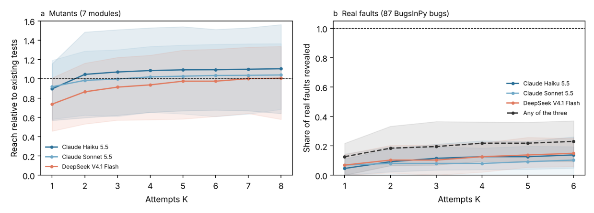

Department of Information Systems, Hanyang University, Seoul, Republic of Korea

**Correspondence:** Ook Lee, Department of Information Systems, Hanyang University, Seoul, Republic of Korea. Email: ooklee@hanyang.ac.kr

# Abstract

Unit tests written by large language models (LLMs) are judged mostly by coverage and mutation scores, whereas teams that consider relying on them need to know which faults the tests can find. We measure the *reach* of LLM-written tests, the share of faults they reveal relative to developer tests, and ask whether mutation scores predict reach on real faults. Three models (Claude Haiku 5.5, Claude Sonnet 5.5 and DeepSeek V4.1 Flash) wrote pytest suites from source code alone, with up to eight independent attempts per target. We measured reach on 947 AST mutants of seven modules from four Python libraries and on 87 real faults from seven BugsInPy projects, with bootstrap intervals that resample modules or projects. On mutants, a single attempt reaches 0.84 to 1.05 of what the existing tests kill, and eight attempts exceed parity (1.15 to 1.20). On real faults, six attempts reveal only 0.10 to 0.15 of the faults, and all three models together 0.23. Most failing tests are wrong rather than revealing: 54% to 66% of attempts contain a test that fails on the faulty version, but only 4% to 5% reveal the fault. Mutation analysis rewards tests that pin down current behaviour, which a real fault is already part of. By the mutation measure, LLM-written tests look like substitutes for developer tests; on real faults they are not. Evaluations of generated tests should include real faults and should separate revealing tests from failing tests.

**Keywords:** test generation; large language models; mutation testing; real faults; test oracle; BugsInPy

# 1 Introduction

Large language models now write unit tests in research tools and in industry [1, 2, 3]. Evaluations of such tests usually report coverage and mutation scores, and sometimes the share of bug reports from which a failure-reproducing test can be generated [4, 5]. A team that considers relying on generated tests needs a different quantity: of the faults its code contains, what share will the generated tests reveal, and how does that share compare with its own tests? We call this share the tool's *reach*. Reach differs from speed. A tool that writes many tests quickly but cannot express the right expectations reveals few faults however many tests it writes.

Mutation scores are a natural proxy for reach, and mutant detection correlates with real-fault detection for developer-written and tool-generated Java suites [6]. It is not known whether the proxy holds for LLM-written tests, whose main weakness is the oracle: deciding what the correct output is [7]. An LLM that reads the code may encode the code's current behaviour as the expectation. Such a test kills mutants that change that behaviour but cannot reveal a fault already present in the code.

We ask three research questions:

- **RQ1** How much of the mutant space that developer tests cover do LLM-written tests reach, and how does reach grow with the number of attempts?
- **RQ2** What share of real faults do LLM-written tests reveal, from source code alone?
- **RQ3** Why do the two measures differ? In particular, how often do LLM-written tests fail on faulty code without revealing the fault?

Our contributions are (i) a measurement of reach on both mutants and real faults with the same models and prompts, (ii) evidence that the two measures lead to opposite conclusions about substituting generated tests for developer tests, and (iii) an account of the disagreement in terms of oracle errors. All code, prompts and results are available from the author on request.

# 2 Background and Related Work

*LLM-based test generation.* TestPilot generated JavaScript unit tests with an LLM and reported statement coverage of 70.2% on 25 npm packages [1]. CodaMosa uses an LLM to escape coverage plateaus in search-based testing [2], and TestGen-LLM improves existing human-written tests at Meta under filters that require a measurable gain [3]. These works evaluate coverage, build and pass rates or acceptance by engineers, not the share of real faults revealed.

*Reproducing reported bugs.* LIBRO generates failure-reproducing tests from bug reports and reproduced 33% of 750 Defects4J cases [4]; SWT-Bench asks code agents to turn GitHub issues into tests that fail before and pass after the fix [5]. Both give the model a description of the fault. We give only the code, which is the situation of a team that wants tests to find faults it does not yet know about.

*Mutants and real faults.* Just et al. found that mutant detection correlates with real-fault detection, independently of coverage [6]. Our results suggest that for LLM-written tests the *level* differs greatly, even if a correlation exists.

# 3 Study Design

## 3.1 Models and prompts

We used Claude Haiku 5.5, Claude Sonnet 5.5 and DeepSeek V4.1 Flash through a commercial API gateway. For each target the model received only source code and was asked to write a thorough pytest file testing the public functions, including edge cases, with absolute imports and under 250 lines (full prompts are in the replication package). Each attempt is an independent call. Reach after *K* attempts counts a mutant or fault as found if any of the first *K* attempts finds it.

## 3.2 Mutants (RQ1)

We generated AST mutants (arithmetic, comparison and Boolean operator replacement, constant replacement and negation removal) for eleven modules of five libraries (toolz, boltons, humanize, cachetools and more-itertools), capped at 150 per module. A mutant is killed by a suite if a test that passes on the original code fails on the mutant. The human baseline is the project's existing test file for the module. Reach is the module-level ratio of mutants killed by the LLM tests to mutants killed by the existing tests, among mutants killed by either, averaged over the seven modules with at least 30 mutants (947 mutants in boltons, humanize, more-itertools and toolz). Intervals resample modules (1,500 resamples).

LLM tests that failed on the original code were discarded before mutation analysis. Passing tests were identified from JUnit XML reports. An earlier version of the harness read test names from console output, which truncated names containing spaces and missed coloured output; the affected kill vectors (humanize, and 5 of 24 attempts on boltons/strutils) were recomputed from the stored generated tests without new model calls.

## 3.3 Real faults (RQ2, RQ3)

We used BugsInPy [8]. For each bug we checked out the faulty and fixed commits, installed the project in its own environment, and confirmed that the developer's fault-revealing test fails on the faulty version and passes on the fixed version. Of 229 bugs in twelve projects that we tried, 87 bugs in seven projects passed this check: youtube-dl (38), thefuck (32), tqdm (7), httpie (5), fastapi (3), tornado (1) and cookiecutter (1). No bug in luigi, black, scrapy, sanic or PySnooper passed, mostly because the developer's test could not run under the project's pinned dependencies.

The model received the non-test source files changed by the fix (up to 40,000 characters each) in their faulty state, without the bug report or the fix. A fault is *revealed* if at least one generated test fails on the faulty version and passes on the fixed version. The human baseline is the developer's fault-revealing test, so human reach is 1 by construction. Intervals resample projects and then bugs within projects (3,000 resamples).

## 3.4 Comparing the two measures

Both measures are relative to a human baseline, but the baselines differ. On mutants the baseline is the existing test file, written without knowledge of the mutants. On real faults it is a test written or kept by the developer once the fault was known, which favours the human side. We therefore do not read the ratio of the two reach values as a precise effect size. The comparison we draw is qualitative and concerns the decision a team would make: whether each measure says that generated tests can substitute for developer tests.

# 4 Results

## 4.1 RQ1: Reach on mutants

**Table 1. RQ1: reach on mutants relative to existing tests (7 modules; 95% intervals over modules). Values above 1 mean the LLM tests kill more mutants than the existing tests.**

| Model | K = 1 | K = 2 | K = 4 | K = 8 |
|---|---|---|---|---|
| Claude Haiku 5.5 | 1.02 (0.89–1.18) | 1.10 (0.94–1.28) | 1.17 (0.96–1.39) | 1.19 (0.99–1.40) |
| Claude Sonnet 5.5 | 1.05 (0.92–1.20) | 1.13 (0.98–1.31) | 1.17 (1.00–1.36) | 1.20 (1.00–1.41) |
| DeepSeek V4.1 Flash | 0.84 (0.69–1.04) | 1.00 (0.83–1.19) | 1.08 (0.91–1.28) | 1.15 (0.96–1.37) |

A single attempt reaches 0.84 to 1.05 of what the existing tests kill (Table 1, Figure 1a). Reach rises with attempts: the Claude models are at parity after one attempt and DeepSeek after two, and all three exceed it at *K* = 8 (1.15 to 1.20). The intervals are wide because the seven modules differ greatly: the existing tests kill from 0.47 to 0.93 of the mutants. The LLM tests are partly complementary to the existing tests: among mutants killed by either side, 17% to 18% are killed only by the LLM tests (*K* = 8). By the mutation measure, LLM-written tests are a substitute for the existing tests after one or two attempts.

## 4.2 RQ2: Reach on real faults

**Table 2. RQ2: share of 87 real faults revealed (95% intervals resampling projects, then bugs). The developer's fault-revealing test reveals every fault by construction.**

| Model | K = 1 | K = 3 | K = 6 |
|---|---|---|---|
| Claude Haiku 5.5 | 0.05 (0.00–0.11) | 0.12 (0.04–0.21) | 0.14 (0.05–0.26) |
| Claude Sonnet 5.5 | 0.07 (0.00–0.14) | 0.08 (0.00–0.19) | 0.10 (0.00–0.19) |
| DeepSeek V4.1 Flash | 0.07 (0.00–0.14) | 0.10 (0.00–0.21) | 0.15 (0.06–0.25) |
| Any of the three | 0.13 (0.00–0.22) | 0.20 (0.07–0.36) | 0.23 (0.09–0.37) |

On real faults the picture reverses. A single attempt reveals 0.05 to 0.07 of the faults, six attempts 0.10 to 0.15, and the union of all three models' 18 attempts 0.23 (Table 2, Figure 1b). Reach differs by project: with the three models together it is 0.43 on tqdm (7 faults), 0.31 on thefuck (32), 0.20 on httpie (5) and 0.16 on youtube-dl (38), and zero on the five faults of fastapi, tornado and cookiecutter. The ordering of models also changes: Claude Sonnet 5.5, the strongest on mutants at one attempt, is the weakest on real faults at six.

## 4.3 RQ3: Failing tests are mostly wrong tests

**Table 3. RQ3: outcomes of single attempts on real faults (87 faults × 6 attempts per model).**

| Model | Attempts | No runnable test | Some test fails on faulty version | Reveals the fault |
|---|---|---|---|---|
| Claude Haiku 5.5 | 522 | 1.0% | 54.2% | 4.4% |
| Claude Sonnet 5.5 | 522 | 0.0% | 61.3% | 5.2% |
| DeepSeek V4.1 Flash | 522 | 1.1% | 65.5% | 5.0% |

Almost every attempt produced runnable tests, and in 54% to 66% of attempts at least one test failed on the faulty version (Table 3). Only 4.4% to 5.2% of attempts revealed the fault, that is, contained a test that also passed after the fix. The rest failed for other reasons: expectations that do not match the intended behaviour, environment assumptions or wrong use of the API.

This explains the gap with RQ1. Mutation analysis discards tests that fail on the original code and counts a kill whenever a passing test fails on a mutant, so it rewards tests that pin down current behaviour. A real fault is already part of the current behaviour, and a test that pins it down passes on the faulty version. To reveal the fault, a test must encode the *intended* behaviour, which the code alone does not show. This is the oracle problem [7] in its plainest form. A developer who receives a failing generated test therefore cannot treat the failure as evidence of a fault without checking the test.

# 5 Discussion

*For practitioners.* Generated tests that pass on the current code document its behaviour. They protect against regressions, which is what mutation scores measure, and they kill mutants that the existing tests miss (RQ1). They are much weaker at finding faults that are already present. A failing generated test is more than ten times as likely to be wrong as to reveal a fault (Table 3), so a review step is needed before acting on it. Used as a complement to developer tests for regression protection, generated tests add value; used as a substitute for fault-revealing tests, they do not, at least in our setting.

*For researchers.* Mutation scores and coverage can make LLM-written tests look like substitutes for developer tests when, on real faults, they are not. Evaluations should report reach on real faults, separate revealing from failing tests, and report how reach grows with attempts. Benchmarks that give the model the bug report [4, 5] measure reproduction, a different task.

*What the gap means for a substitution decision.* Software reliability growth models distinguish the eventual number of detectable faults from the rate at which they are found [9]. Reach corresponds to the first quantity, and attempts play the role of testing time. Under a Goel–Okumoto model, a tool whose reach is a share *A* of the human fault pool can save at most a fraction *A* of the cost of escaped faults, whatever its price and speed. At the measured real-fault reach (0.10 to 0.15 with six attempts), this caps the benefit of substitution well below what mutation reach near 1 would suggest; the bound disappears under the mutation measure. The bound assumes that developer tests reveal all faults, which overstates the human side, and that generated tests replace rather than complement them.

# 6 Threats to Validity

*Construct validity.* Mutation reach is relative to the existing tests and real-fault reach is relative to the developer's fault-revealing test (Section 3.4). The two are not on the same scale, and the human baseline for real faults is 1 by construction, which favours the human side.

*Internal validity.* We gave the model the files changed by the fix, which tells it where the fault is; reach without this hint would likely be lower. Models may have seen the projects, their tests or their fixes during training, which would raise reach. Our values are therefore likely upper bounds.

*External validity.* The real faults come from seven Python projects, 38 from youtube-dl and 32 from thefuck, so project-cluster intervals are wide. Three projects failed to build, and we did not test Java (Defects4J) or other languages. The mutants come from seven modules of utility libraries, and the real faults from application projects; part of the gap may reflect this difference in code type.

*Conclusion validity.* With 87 faults, differences between models are within the intervals. Our conclusions concern the gap between the two measures, which is large relative to these intervals.

# 7 Conclusion

LLM-written unit tests reach or exceed parity with existing tests on mutants within one or two attempts, but reveal only 10% to 15% of real faults after six attempts, because most of their failures come from wrong expectations. Mutation scores overstate their fault-finding reach, and evaluations of generated tests should measure reach on real faults.

# Data Availability Statement

Code, prompts, per-bug and per-module results and analysis scripts are available from the corresponding author on request. BugsInPy and the studied libraries are public.

# Conflict of Interest Statement

The author declares no conflict of interest.

# Funding Statement

This research received no specific funding.

# Author Contributions

O.L. conceived the study, built the pipeline, ran the analyses and wrote the manuscript.

# Use of Generative AI

The studied tests were written by Claude Haiku 5.5, Claude Sonnet 5.5 and DeepSeek V4.1 Flash, which are the objects of study. An AI coding assistant (Claude Code) was used to write and run the analysis code and to draft and edit the manuscript text. The author reviewed the code, the results and the text, and takes full responsibility for the content.

# References

1. Schäfer M, Nadi S, Eghbali A, Tip F. An empirical evaluation of using large language models for automated unit test generation. *IEEE Trans Softw Eng.* 2024;50(1):85–105.
2. Lemieux C, Inala JP, Lahiri SK, Sen S. CodaMosa: escaping coverage plateaus in test generation with pre-trained large language models. In: *Proc 45th Int Conf Softw Eng (ICSE)*; 2023:919–931. doi:10.1109/ICSE48619.2023.00085
3. Alshahwan N, Chheda J, Finogenova A, et al. Automated unit test improvement using large language models at Meta. In: *Companion Proc 32nd ACM Int Conf Found Softw Eng (FSE '24)*; 2024.
4. Kang S, Yoon J, Yoo S. Large language models are few-shot testers: exploring LLM-based general bug reproduction. In: *Proc 45th Int Conf Softw Eng (ICSE)*; 2023:2312–2323.
5. Mündler N, Müller MN, He J, Vechev M. SWT-Bench: testing and validating real-world bug-fixes with code agents. In: *Advances in Neural Information Processing Systems 37*; 2024. doi:10.52202/079017-2601
6. Just R, Jalali D, Inozemtseva L, Ernst MD, Holmes R, Fraser G. Are mutants a valid substitute for real faults in software testing? In: *Proc 22nd ACM SIGSOFT Int Symp Found Softw Eng (FSE)*; 2014:654–665.
7. Barr ET, Harman M, McMinn P, Shahbaz M, Yoo S. The oracle problem in software testing: a survey. *IEEE Trans Softw Eng.* 2015;41(5):507–525. doi:10.1109/TSE.2014.2372785
8. Widyasari R, Sim SQ, Lok C, et al. BugsInPy: a database of existing bugs in Python programs to enable controlled testing and debugging studies. In: *Proc 28th ACM Joint Eur Softw Eng Conf Symp Found Softw Eng (ESEC/FSE)*; 2020:1556–1560. doi:10.1145/3368089.3417943
9. Goel AL, Okumoto K. Time-dependent error-detection rate model for software reliability and other performance measures. *IEEE Trans Reliab.* 1979;28(3):206–211.
